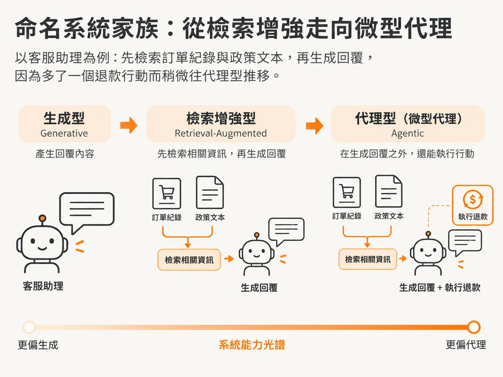
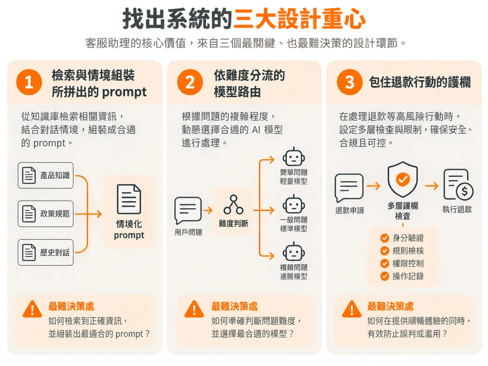

# 定義 AI 系統家族與三大設計重心

在選定客服助理方向後，接著要為它建立明確的技術架構骨架。清楚界定系統所屬的「家族」（family）並指出架構的「設計重心」（design centers），能讓整個技術方案有穩固的支撐。

## 命名系統家族：從檢索增強走向微型代理

以常見的客服助理為例，這類系統主要的工作是產生回覆內容，本質上屬於生成型（generative）系統。

但單靠模型本身的權重，它既不可能知道特定顧客的訂單細節，也無法掌握公司最新的退款規定。因此，系統必須先從資料庫或知識庫找出顧客的訂單紀錄與退款政策文本，再根據這些資料撰寫回覆。這種「先檢索、再生成」的架構，就是檢索增強生成（RAG, Retrieval Augmented Generation）。

如果系統的第一個版本還被賦予了發放小額退款的功能，情況就會更進一步。退款是一項實際的「行動」（action），而不單純只是輸出文字。因此，這套客服助理完整的家族歸屬是：**具備檢索能力的生成型系統，並因為具備一項操作能力而稍微偏向代理型架構（agentic）**。

## 找出系統的三大設計重心

所謂的設計重心，指的是整套系統架構中少數幾個最關鍵、決策最困難的核心環節。這套客服助理有三個核心重心：

### 1. 檢索與情境組裝（Prompt 建構）

情境組裝（context assembly）的任務是拼裝出送給模型的提示詞（prompt）。提示詞代表在單次 API 呼叫中傳送給模型的全部文字內容，它是系統決策的核心交會點。

一個完整的 prompt 必須同時納入三種資訊：
- 給模型的角色與行為指令
- 系統檢索出來的事實（如訂單狀態、退款條款）
- 到目前為止的使用者對話紀錄

如何精準檢索這些事實，並在長度限制內整合成結構清晰的 prompt，直接決定了模型回答的正確性。

### 2. 透過模型路由進行成本控制

客服系統的使用量通常非常大，每一輪對話都使用最強大、最昂貴的模型會迅速吃光預算。設計模型路由（model routing）機制，能將簡單常見的問題分流給體積小、費用低廉的輕量模型，只有在遇到複雜或多步驟的疑難雜症時，才將請求轉交給大型模型處理，以此在品質與營運成本之間取得平衡。

### 3. 退款行動的護欄機制

讓模型執行退款與單純聊天完全不同，退款涉及金錢流動，風險極高。因此，圍繞退款動作所建立的「護欄」（guardrails）是不可妥協的決策點。

退款的額度上限、觸發條件與權限規則，必須寫死在底層的程式碼邏輯中，絕不能單靠模型給予的文字指示來規範。只有將限制留在模型無法自行竄改的程式碼層級，才能確保系統不會因幻覺或惡意引導而誤發退款。

把家族與設計重心定義清楚後，接下來就要進入範圍收斂的最後關鍵：大聲說明這一版不做什麼，再用具體數字把整個系統的規格釘死。
