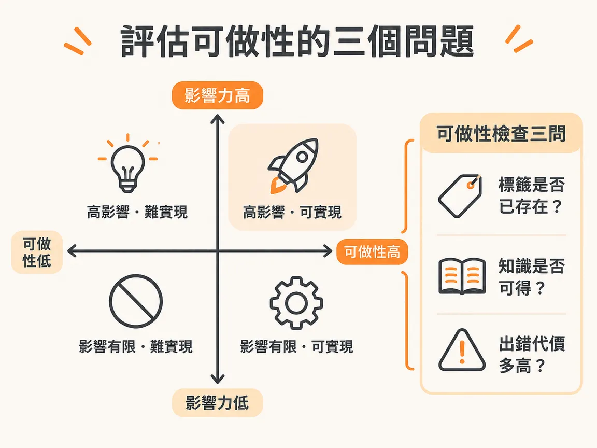
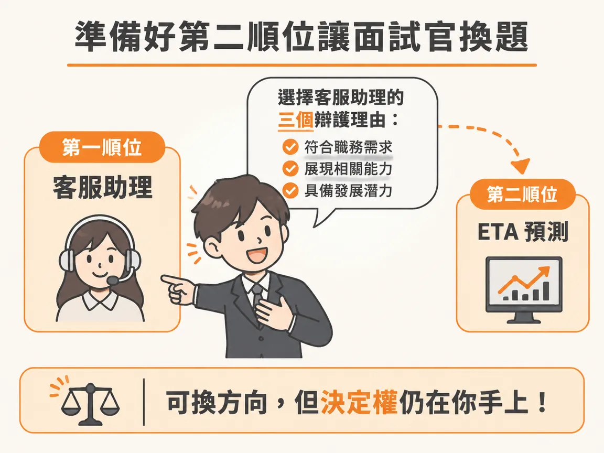

# 評估影響力與可做性：在 AI 設計面試中果斷選題

把菜單攤開之後，盯著選項看上五分鐘會顯得優柔寡斷。這時應該迅速進入展現決策力的動作：選出一個兼具「影響力」與「可做性」的最佳選項。

影響力指的是這個系統對業務或使用者究竟有多重要；可做性則是考量現有資料與時間，把它做好的現實可行度。

## 評估可做性的三個問題

要判斷一個題目是否具備足夠的可做性，可以用三個問題檢驗：

1. **標籤是否已經存在？** 標籤是帶有正確答案的歷史範例，模型需要從這些資料學習，並用來測試效果。
2. **所需的知識是否隨手可得？** 系統運作需要的背景資訊與規則，公司內部是否已經掌握。
3. **出錯的代價有多高？** 當出錯的代價很低時，推出第一版系統的風險就小得多。

## 套用三問評估題目選單

在外送平台的場景下，用這三個問題檢驗選單上的不同方向：

* **預估送達時間（ETA 預測）：最強的預測型選項。** 它關係到每一筆訂單，而且每完成一次外送，系統就會記錄實際花費的時間。一天若有 50 萬筆訂單，每天就能自然累積 50 萬筆新標籤。
* **客服助理：最強的生成型選項。** 每一張客服工單都有明確的處理成本，其依賴的知識全都在公司內部，例如訂單系統與公司自行制定的政策文件。
* **點餐代理人：最弱的起手選項。** 這種系統運作在自主迴圈中，模型自己做決定並執行動作，中間沒有人類逐一步驟把關。一旦點錯餐點或重複下單，損失該由誰承擔？這類信任問題目前還沒有成熟的解法。

## 做出選擇並替它辯護

綜合上述考量，最推薦的選擇是客服助理，理由有三點：

第一，它的商業影響力很容易直接折算成具體金額。  
第二，第一版的範疇可以縮得很小，例如初期只負責回答問題，暫時不替使用者執行操作。  
第三，它涵蓋了許多核心技術組件，像是先找出正確事實的「檢索」（retrieval），以及設定系統嚴格邊界的「護欄」（guardrails）。

## 準備好第二順位讓面試官換題

選定客服助理後，同時要把表現也很優秀的 ETA 預測當作第二順位。這時可以主動說明：

「如果您比較想探討 ETA 模型，我也很樂意切換過去。」

這樣做把最終轉向的決定權留給對方，但同時清楚展現了主導決策、深思熟慮的能力。確定好方向後，下一步就能正式為選定的系統命名家族與三個設計重心。
