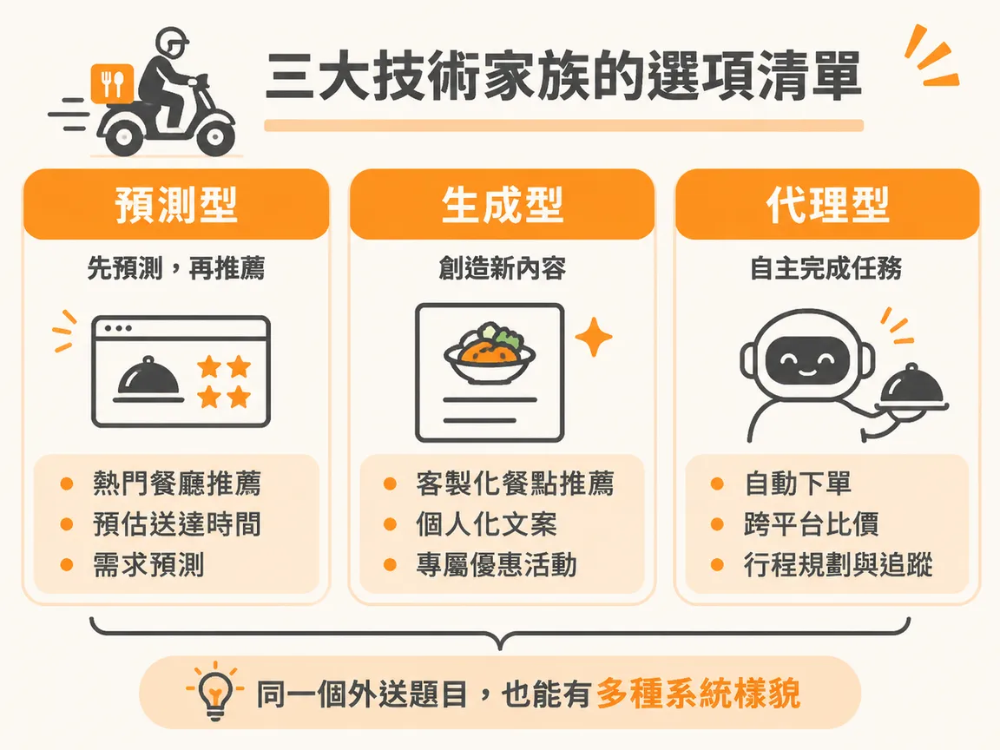

# 先端出選項菜單：AI 系統設計的第一步

在面對外送平台「導入 AI」這類模糊題目時，許多人常犯的毛病是立刻一頭栽進某個特定模型。在下決定之前，更好的做法是先「遞出菜單」（show the menu before you order）。

這份菜單是一份依技術家族分類的精簡候選清單，要在 30 秒內快速講完。

## 三大技術家族的選項清單

以常見的外送場景為例，把候選題目按技術家族分成三大類：

1. **預測型（Predictive）**
   - **外送時間預測**：也就是預估送達時間（ETA，estimated time of arrival）。
   - **餐廳推薦**：依用戶偏好排序並推薦合適的餐廳。
   - **促銷濫用偵測**：針對每個帳號計算濫用優惠券的風險分數。

2. **生成型（Generative）**
   - **客服助理**：協助處理常見的顧客諮詢與客訴。
   - **評論摘要**：自動整理餐廳或餐點的大量顧客評價。
   - **餐點描述生成**：替店家自動生成吸引人的餐點文案。

3. **代理型（Agentic）**
   - **點餐助理**：能主動幫顧客將餐點加入購物車並完成結帳流程。

## 拿捏時間：太窄與太拖的扣分點

列出這份菜單的節奏非常關鍵：

- **跳過菜單直接講答案**：會顯得思考格局太窄（narrow），好像腦中只有一把槌子，看到什麼都當成釘子。
- **對著菜單念了整整 5 分鐘**：則會顯得猶豫不決、缺乏決斷力（unable to decide）。

正確的節奏是用大約 30 秒攤開整張地圖，接著迅速進入下一個動作：從中挑出一個影響力（impact）與可做性（tractability）平衡得最好的一項，並替這個選擇辯護。
