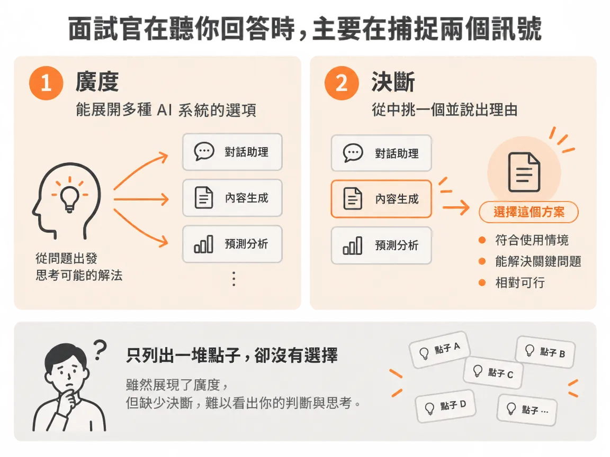

# 面對模糊的 AI 設計題：如何做好前 8 分鐘的 Scoping

你在一家美食外送平台工作，App 每月大約有 2,500 萬名活躍用戶，每天要處理約 50 萬筆訂單。這時管理層提出一個需求：「我們想導入 AI，你會做什麼？」

這是一道真實的面試題目，而且它故意出得非常模糊。在動手畫任何系統架構圖之前，你必須先將這句模糊的話收斂成一個具體的系統。這個系統需要有清晰的目標、具體的數字以及明確的邊界。這項將模糊問題聚焦的能力，就稱為定義範圍（scoping）。

在一般 45 分鐘的系統設計面試中，定義範圍大約佔前 8 分鐘。到了第 8 分鐘，你就應該確定要做的單一系統，並釐清它的限制與關鍵數據。

這道考題雖然給了公司背景、產業別與用戶規模，卻刻意抽掉了所有系統設計都不可或缺的三件事：

1. **沒有指明具體功能（Feature）**：「使用 AI」可以代表上百種完全不同的系統。
2. **沒有提供衡量指標（Metric）**：沒有說明怎樣才算「表現更好」，缺乏成功的評判標準。
3. **沒有界定模型家族（Family）**：這裡的模型家族是指模型產出的主要型態。預測型模型（predictive model）輸出的是數字或分類標籤；生成型模型（generative model）輸出的是文字或圖像內容；代理型系統（agentic system）則是能主動採取行動。

題目之所以刻意留白，是因為補齊這些資訊正是評分的第一道關卡。

在聽你回答時，面試官主要在捕捉兩個訊號：

* **廣度（Range）**：你能否跳脫單一思維，看出可以應用不只一種 AI 系統？
* **決斷（Decision）**：你能否從多個選項中挑出一個，並清楚說明選擇它的理由？如果候選人列出 10 個點子卻遲遲不作抉擇，在面試官眼裡，這場設計根本還沒正式開始。

一個優秀的回答，會透過 5 個動作展現這兩個訊號：前 4 個動作框定問題，第 5 個動作則用具體數字來定義成功。第一步，就是先攤開所有可能的技術家族選項。
