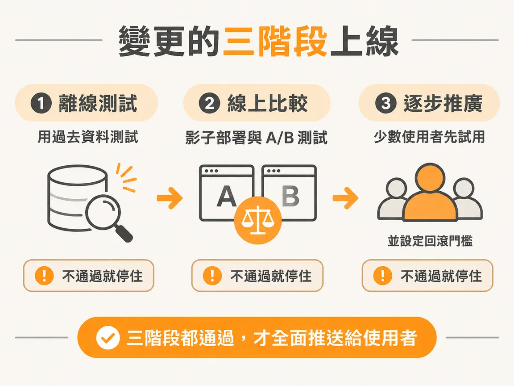
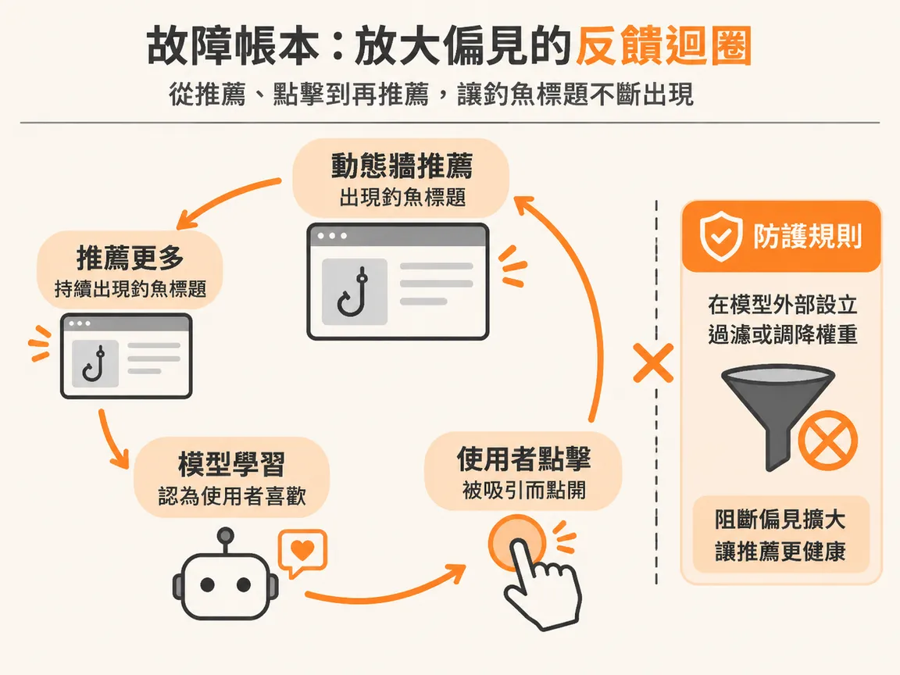
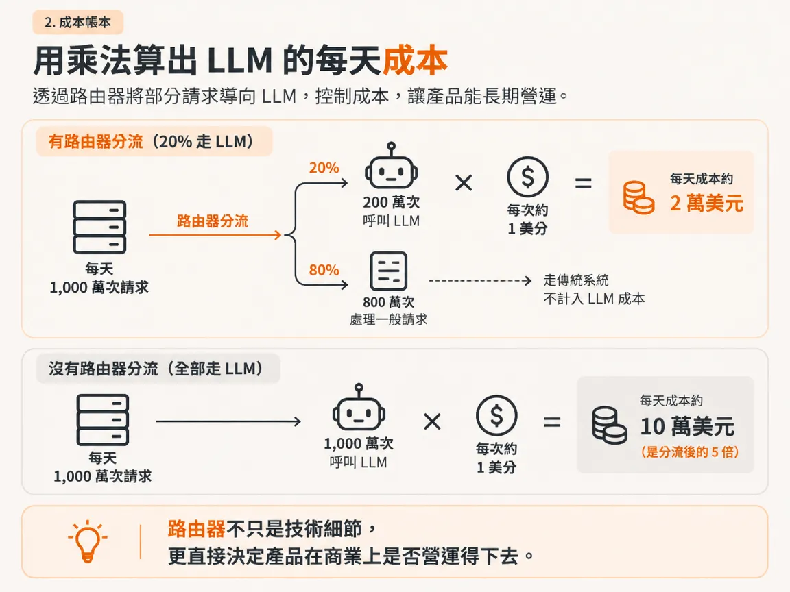
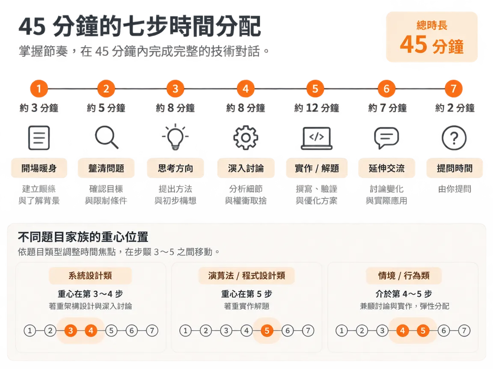

# AI 系統設計的面試節奏：三階段上線、兩本帳與 45 分鐘配比

畫完推論流程後，回答還不能停在這裡。系統如何持續維運、上線時如何避免災難，以及整套架構到底要花多少錢，需要最後兩步來補齊。

如果是代理型（agentic）架構，設計時還要進一步說明各個工具具備哪些權限與功能。第六步的核心就是「維持系統運作，形成閉環」（close the loop）：記錄每一次請求的輸入與輸出、捕捉實際的交付時間、計算平均誤差，並將這些實際運作的結果回饋到再訓練流程中。

## 變更的三階段上線

在第六步中，任何模型變更都必須遵循三階段上線策略任何模型的改動與更新，都必須經過三個階段才能全面推送給使用者：

1. **第一階段：離線測試**  
   使用過去的歷史資料驗證新模型。如果新版本沒有勝過目前的線上版本，流程就在這裡終止，完全不上線。
2. **第二階段：即時流量測試**  
   進入線上環境後，先採用「影子部署」（shadow deployment），讓新模型在背景接收真實流量並運算，但系統依然只回傳舊版本的結果給使用者。這一步用來抓出程式崩潰與回應延遲的問題。確認穩定後，再透過 A/B 測試將不同版本分配給不同使用者，客觀比較兩者的成效差異。
3. **第三階段：漸進式發布**  
   先對少數使用者推出新版本，觀察穩定後再逐步擴大比例。設定好觸發自動回滾（rollback）的具體數值指標，一旦異常就立即退回舊版。同時，監控系統必須持續追蹤「資料漂移」（drift），也就是現實世界變化導致模型準確度下滑的現象。

## 第七步的兩本帳

回答的最後一步是計算成本並列出風險，具體做法是口述兩份清單，稱為「兩本帳」：

### 1. 故障帳本（Failure Ledger）
挑出系統最容易壞掉的三種主要情境，並為每一種情境給出具體因應手段。

其中一個常見故障是路徑服務（route service）斷線停擺。另一個隱蔽的故障是反饋迴圈（feedback loop）另一個常出現在故障帳本中的問題，是「放大偏見的反饋迴圈」：例如推薦動態展示了釣魚標題（clickbait），使用者忍不住點擊，模型便學到使用者喜歡這種內容，進而推薦更多釣魚標題。面對這種反饋迴圈，解決方式是在模型外部設立獨立的防護規則（guard），強制過濾或調降權重。

### 2. 成本帳本（Cost Ledger）
將單次呼叫的單位成本乘以預估的使用總量。

假設系統每天有 1,000 萬次請求假設系統每天面對 1,000 萬次請求，透過路由器將其中 20% 分流給大型語言模型（LLM），每次呼叫成本約為 1 美分。這相當於每天 200 萬次 LLM 呼叫，每天成本約 20,000 美元。如果沒有路由器進行分流、讓所有請求都打向 LLM，帳單費用會暴增五倍。第五步設計的路由器，直接決定了這項產品在商業上是否營運得下去。

## 45 分鐘的七步時間分配

在 45 分鐘的技術對話中要在一場 45 分鐘的面試中完整走完七個步驟，必須嚴格控制每個環節的時間：

- **最後 2 分鐘**：保留給提問與討論。
- **第五步（推論服務）**：分配最多的時間，大約 12 分鐘，因為大部分的核心系統架構都在這裡。
- **第一步（問題範疇）**：必須在第 3 分鐘左右結束。如果第一步拖到 20 分鐘，第五步的 12 分鐘就會被徹底壓縮。

時間比重應根據題目的體系靈活調整：
- **預測型題目**：重心放在第三步與第四步，因為資料標籤決定了整個架構設計。
- **生成型與代理型題目**：重心則偏向第五步的服務設計。
- **沒有任何一步可以被跳過縮減為零分鐘**。如果面試時間被壓縮到只剩 10 分鐘，整體結構要圍繞第一步、第五步與第七步來展開。

如果被要求直接跳到架構細節，至少要在開頭保留一句話交代目標指標，例如：「平均誤差小於五分鐘，延遲維持在 100 毫秒內。」

## 面試應對的三個核心要點

面對 AI 系統設計題，有三件事必須牢記：

1. **傳統架構骨架最容易在兩處破裂**：品質標準必須在開頭就達成數字共識，且整體回答結尾必須包含將實際成果送回系統的閉環機制。
2. **七步驟架構正是為了解決這兩處破裂**：第二步為成功定義明確數字指標；第六步建立閉環；第七步則透過故障帳本與成本帳本，說清楚系統哪裡會壞、要花多少錢。
3. **每次升級都要有明確的前提條件**：從基準線（baseline）出發，也就是先給出能運作的最簡單做法，隨後提出的任何複雜模型都必須拿出勝過基準線的理由。

在動手界定範疇之前，務必先指明題目所屬的系統體系與已知的類似產品。如果一開始就急著界定範圍，後續的設計就會變成憑空捏造。
