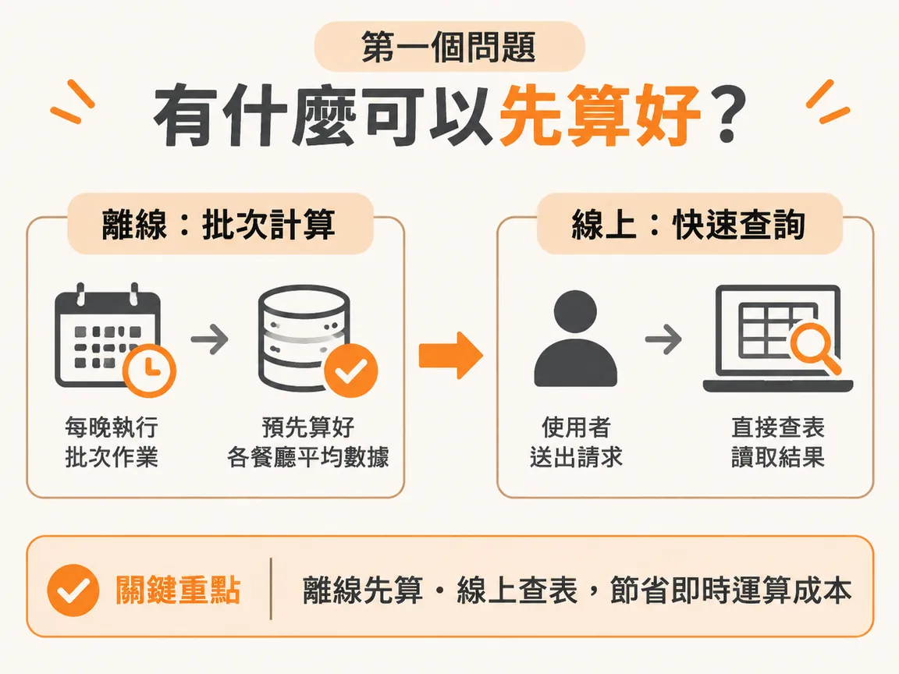
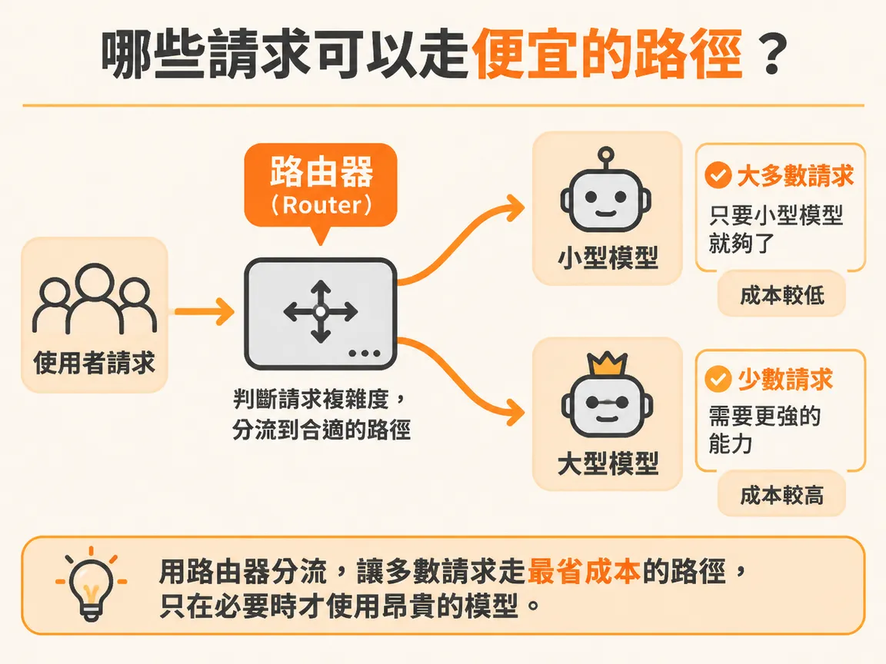
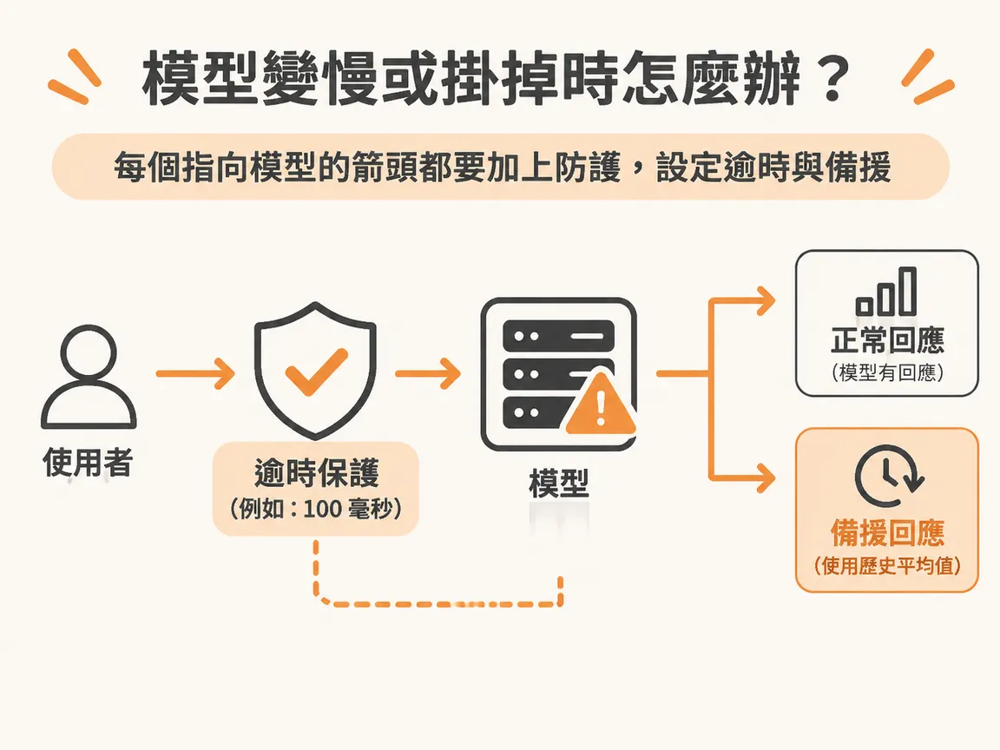

# 用三個問題規劃 AI 系統的服務路徑

在選定模型與基準線後，第五步要進入即時推論流程。服務路徑（serving path）是使用者請求進來時最容易因為延遲過高或系統當機而引發災難的地方。要畫出一條穩健的服務路徑，可以用三個關鍵問題來梳理：

### 第一個問題：有什麼可以先算好？

不是所有資料都需要在使用者發出請求的當下才即時運算。

舉例來說，系統可以透過每晚執行的批次排程作業（nightly job）可以拆成離線與線上兩段，例如透過每晚的批次作業，預先算好每家餐廳的平均數據。當使用者送出即時請求時，服務路徑只需要直接查表讀取這些預算好的數值，省下昂貴的即時運算時間。

### 第二個問題：哪些請求可以走便宜的路徑？

面對大量請求，如果每一次都呼叫最龐大、最貴的模型，成本與延遲很快就會失控。

事實上，對許多請求來說，小型模型就已經足夠好。系統可以加入一個路由器（router）可以在前端加入一個路由器（router），由它判斷每個請求的複雜度，並將請求分流到「表現夠好且成本最低」的路徑上。

### 第三個問題：模型變慢或掛掉時怎麼辦？

線上服務不能假設模型永遠正常運作。在架構圖上，每一條連向模型的箭頭都伴隨潛在的失敗風險每個指向模型的箭頭都必須掛上防護，同時設定逾時限制（timeout）與降級備援方案（fallback）。

以延遲要求嚴格的場景為例，逾時時間通常要壓在 100 毫秒（milliseconds）以內。一旦模型逾時未回應或服務中斷，系統就會立即啟動備用答案——例如直接回傳歷史平均值。這樣一來，即使模型短暫失效，顧客畫面上依然能及時看到數字，不至於整面卡住或跳出錯誤。
