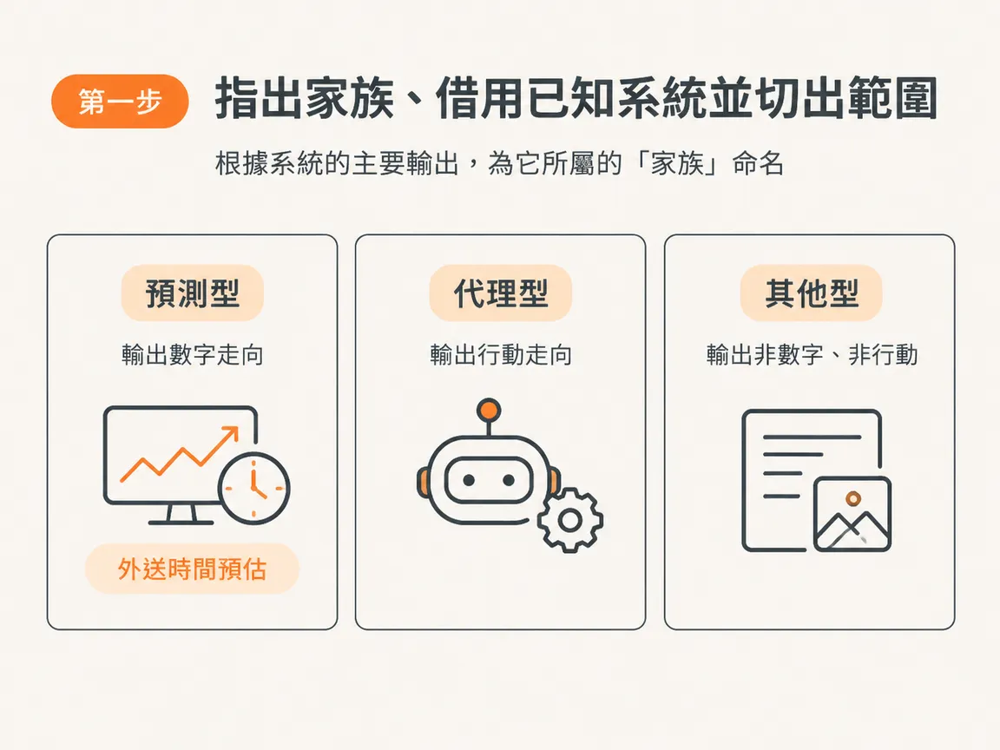
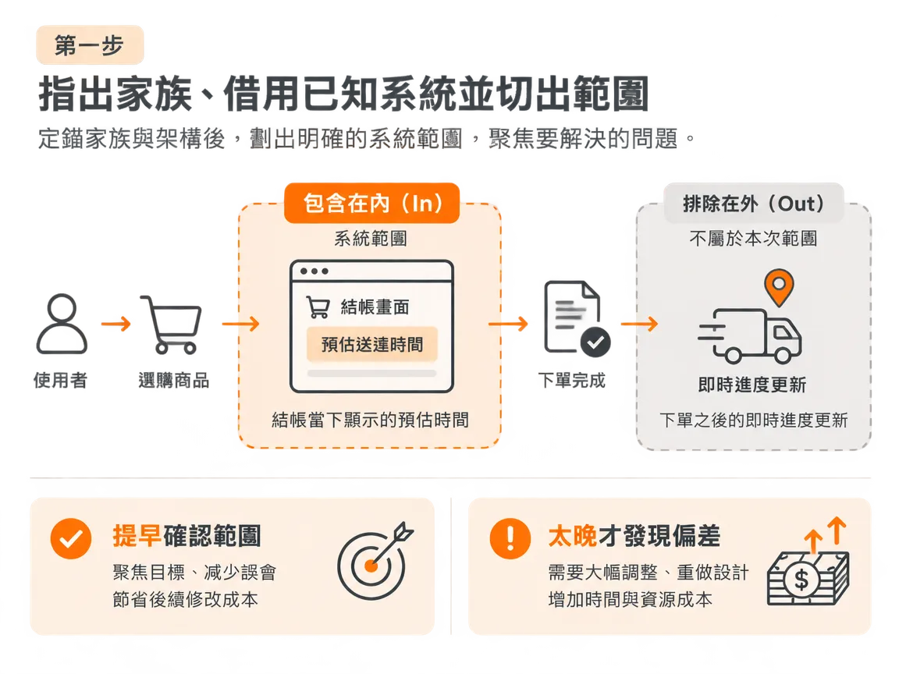
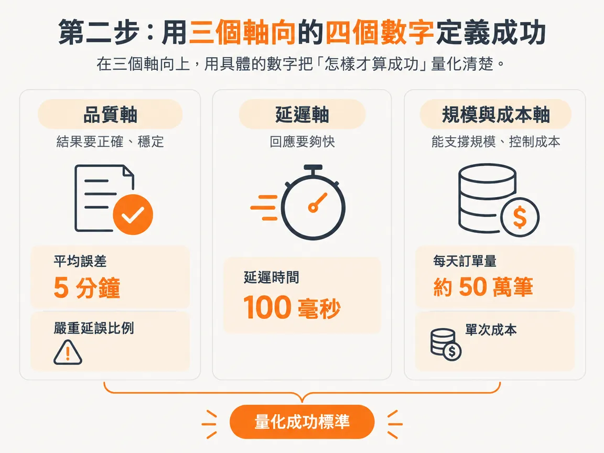

# 做好 AI 系統設計的開場：從系統家族、界定範圍到四個成功數字

七步框架的前兩步，決定了整場系統設計的走向。如果一開始沒有對齊共識，越往後推導，修正的代價就越高。要建立穩固的開場，依序做好兩個步驟：先定錨系統家族與範圍，再用具體數字量化目標。

## 第一步：指出家族、借用已知系統並切出範圍

第一步包含兩個動作。第一個動作是根據系統的主要輸出，直接為它所屬的「家族」命名依據輸出型態，系統大致可分為三個家族：

- 如果輸出是數字，屬於預測型（predictive）。
- 如果輸出是文字或影音內容，屬於生成型（generative）。
- 如果輸出是行動或決策，屬於代理型（agentic）。

以外送送達時間預估為例，系統產出的是預估時間數字，屬於預測型家族。

第二個動作是找出一個已經深入研究過的「已知系統」。例如：「這就像叫車軟體的車輛抵達時間預估，差別在於廚房的備餐時間每分鐘都在變動。」這樣一來，就能立刻借用一套經過驗證的成熟架構來做調整，不必從零摸索。

接著切出明確的系統邊界定錨家族與架構後，請立刻清楚劃出系統範圍（scope）：
- **包含在內（in）**：結帳畫面當下顯示的預估時間。
- **排除在外（out）**：下單之後的即時進度更新。

切好範圍後，主動確認：「我可以按照這個範圍繼續往下展開嗎？」在開場第 3 分鐘確認範圍，代價極小；但如果各自理解不同，一路講到第 25 分鐘才發現方向偏了，往往會直接推翻前面的討論。

## 第二步：用三個軸向的四個數字定義成功

有了範圍後，接著用三個軸向的四個數字把成功標準量化第二步是在三個軸向上，用具體的數字把「怎樣才算成功」量化清楚：

1. **品質門檻（Quality bar）**：模型必須達到什麼水準才算合格。在外送時間預估的例子中，就是平均誤差要壓在 5 分鐘以內。
2. **防護指標（Guardrail metric）**：品質軸上的第二個數字，用來確認特定邊界條件沒有惡化。例如「嚴重延誤的訂單比例」絕不能上升。
3. **延遲（Latency）**：單次請求的時間預算。因為顧客正在結帳畫面等待，送達時間預估必須在約 100 毫秒內算好並呈現。
4. **規模與成本（Scale and cost）**：系統需要支撐的請求總量與單次成本。以這套系統來說，每天大約要處理 500,000 筆訂單。

開場時只要把所屬家族、借鑑架構、系統邊界與這四個關鍵數字講清楚，後續的模型選擇與架構推導就能緊扣目標，不再發散。
