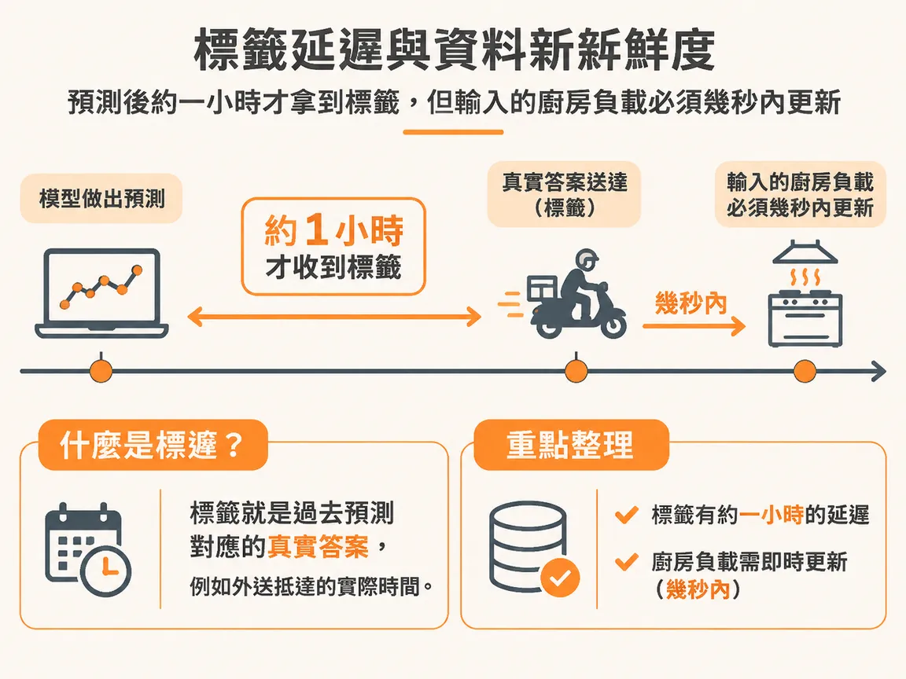
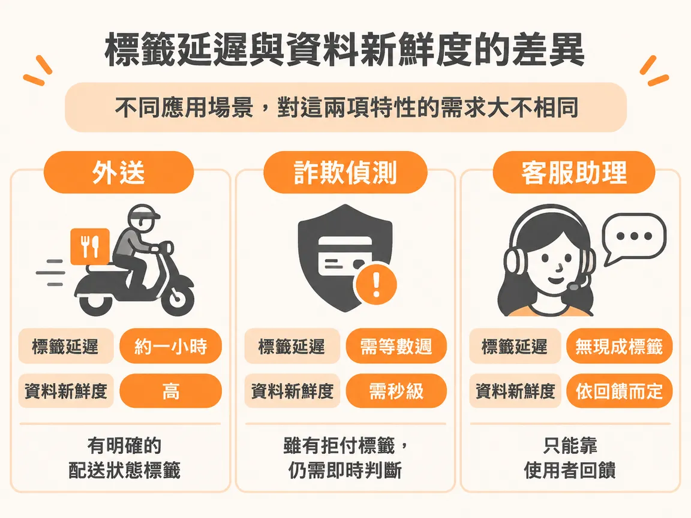
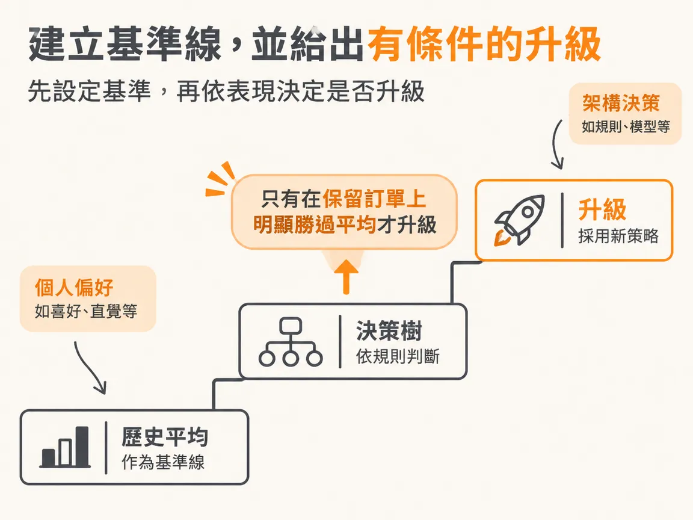

# 從資料特性到模型升級：AI 系統設計的關鍵步驟

在前面定義好成功指標的四個數字後，第三步與第四步要進入資料盤點與模型選擇。評估 AI 系統時，必須先掌握資料的標籤與時效特性，接著從最簡單的基準線（baseline）出發，為每一次模型升級設定明確的觸發條件。

## 用標籤延遲與資料新鮮度定義問題

第三步要先盤點資料。評估資料要先從標籤（label）開始。標籤就是過去預測對應的真實答案，例如外送抵達的實際時間。

在分析資料時，有兩個關鍵時間指標：

- **標籤延遲（Label delay）**：從模型做出預測，到系統拿到真實答案之間的時間差。在外送預估的例子中，大約需要一小時。
- **新鮮度（Freshness）**：模型在進行推論時，輸入特徵必須有多即時。例如餐廳的廚房負載，必須在幾秒鐘內即時更新。

不同家族與業務情境的資料特性截然不同不同的應用場景，這兩項特性的組合落差很大：：

- **信用卡詐欺偵測**：標籤通常是拒付爭議（chargeback），也就是持卡人銀行撤銷付款的紀錄，這往往要等上好幾週才會確定。然而，竊賊可能在一分鐘內盜刷好幾次，因此模型讀取的輸入特徵必須包含過去幾秒內的行為。
- **企業客服助理**：這種情境通常根本沒有現成的標籤。系統設計時必須主動收集信號，例如使用者的後續回饋與滿意度評分。

## 建立基準線，並給出有條件的升級

釐清資料特性後，第四步是挑選模型。基準線是能解決問題的最簡單方法，後續任何更複雜的模型都必須能擊敗它，才有採用的價值。

在不同類型的 AI 模型家族中，基準線與升級策略各不相同：

### 1. 預估型系統：從統計平均到決策樹

在外送時間預估上，基準線就是該餐廳在該時段的歷史平均值。

更進階的升級方案是採用決策樹模型（tree model）。決策樹透過一系列簡單的「是非題」來做預測，例如廚房目前是否繁忙，並且能納入更多輸入特徵（如外送路線）。

提出升級時，要區分「個人偏好」與「架構決策」的差別：

- 說「我會用決策樹模型」，這只是一種個人偏好。
- 說「如果決策樹在保留訂單（held-out orders，即未參與訓練的過去訂單）上的表現明顯勝過歷史平均，我才會採用它」，這才是一個合格的架構決策。

每一次提出升級，都必須同時講清楚觸發條件。

### 2. 生成式系統：從託管模型到微調與檢索

客服助理屬於生成式（generative）任務。它的基準線是使用託管大型語言模型（hosted LLM），也就是由第三方廠商以雲端服務運行的 LLM，並搭配寫得清楚的提示詞（prompting）。

撰寫好的提示詞永遠是第一步。如果想要進一步做微調（fine-tuning），必須有明確的觸發條件，例如模型在語氣或輸出格式上未達品質標準。

如果問題出在回答缺乏事實，微調並不是正確的解法；此時應該採用檢索（retrieval）技術，從公司的內部文件中找出相關段落餵給模型，這樣補充事實的效果會更好。

### 3. 代理型系統：具備工具與限制的退款 Agent

負責處理小額退款的退款代理（refund agent）屬於代理型（agentic）架構。它的基準線是使用單一模型，並掛載兩到三個工具（tool）。

這裡的工具指的是模型可以呼叫的具體函式，例如執行退款動作。為了確保系統安全與穩定，代理人架構必須設定嚴格的邊界，包含限制執行步數、運行時間上限以及成本花費。
