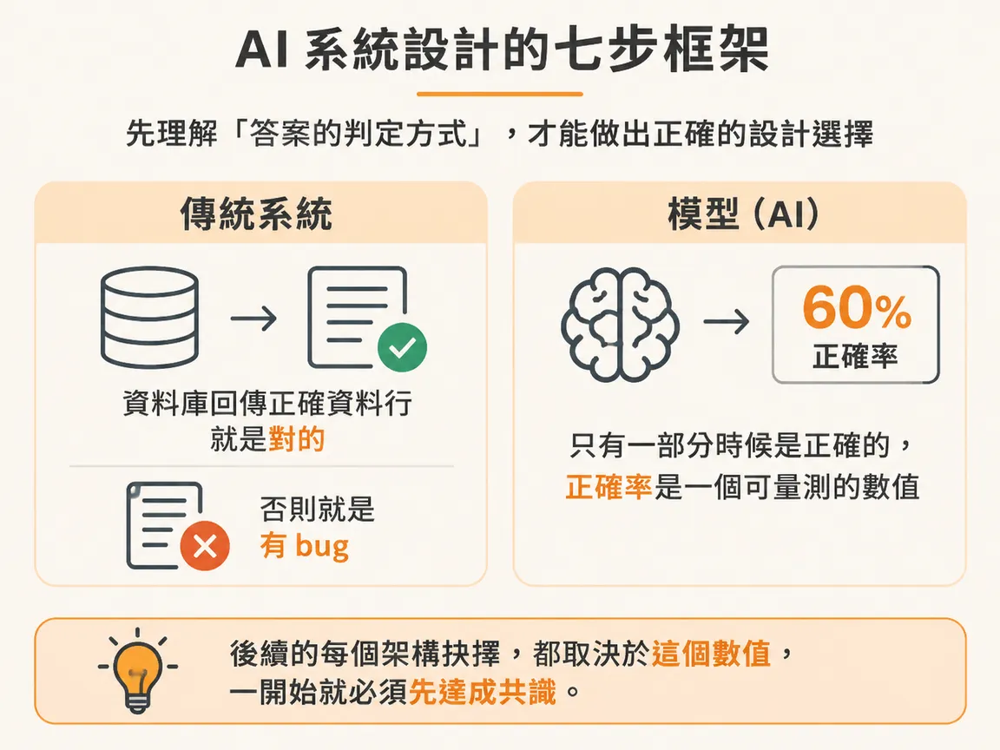
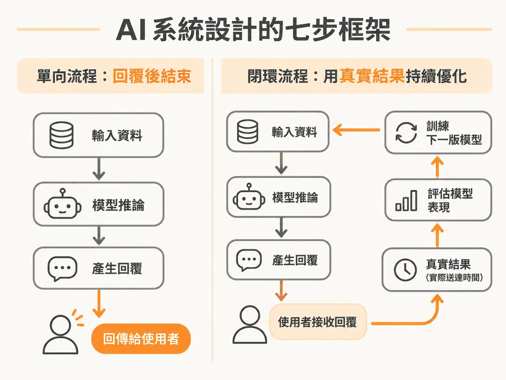
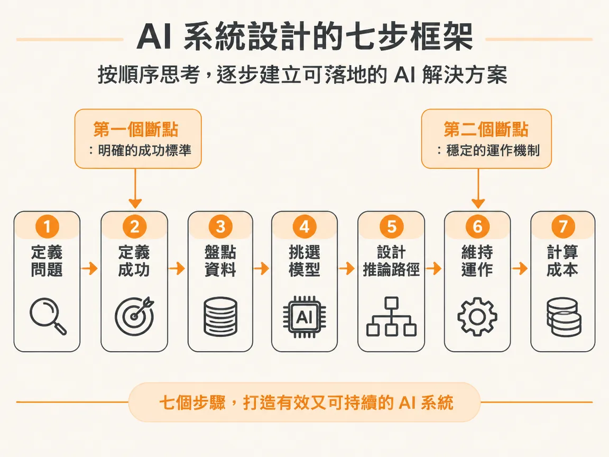

# AI 系統設計的七步框架

面對「設計外送時間估算」這類題目時，經典系統設計面試通常有一套熟悉的套路。

外送平台會在結帳頁面顯示預估送達時間。照著傳統流程，通常會先釐清需求、定義 API，接著畫出後端服務與資料庫架構，花上大半時間討論系統的擴展性。最後，整套回答在系統把結果推送到顧客螢幕時就結束了。

這套回答順序就是傳統的經典骨架。但這時往往會面臨兩個追問：

「你怎麼知道估算出來的時間夠準？」
「下個月交通型態改變時，系統會發生什麼事？」

面對 AI 題目，經典骨架是不完整的。

經典骨架主要斷在兩個地方：

第一個斷點：在傳統系統中，答案正不正確是客觀事實。傳統系統裡，資料庫回傳了正確的資料行就是對的，否則就是有 bug。但模型——也就是從過往資料範例學習的程式——只有一部分時候是正確的。因此模型的品質是一個數值。後續的每一個架構抉擇都取決於這個數值，一開始就必須先達成共識。

第二個斷點：真實的結果發生在系統回覆之後。以外送時間估算來說，真實結果就是餐點實際送達的時間。這個結果要用來衡量模型的好壞，並用來訓練下一個版本的模型。因此，AI 題目的架構圖終點不能只是一條指向使用者的回傳箭頭，而必須形成一個迴圈。要是沒有這個迴圈，隨著外在世界改變，模型的表現就會悄悄退化，而且沒有人會發現。

要補上這兩個斷點，完整的思考流程由七個步驟組成：

為了解決這兩個斷點，AI 設計需要一套固定的思考步驟：

第一步：定義問題（Frame the problem）。
第二步：定義成功（Define success）。
第三步：盤點資料（Map the data）。
第四步：挑選模型（Pick the model）。
第五步：設計推論路徑（Design the serving path），也就是線上即時請求從使用者出發、取得預測答案再返回使用者的完整路線。
第六步：維持系統運作（Keep it working）。
第七步：計算成本（Count the costs）。

第二步及早為品質訂出具體數值，補上了第一個斷點；第六步建立閉環機制，補上了第二個斷點。

這套框架是用來梳理思考順序，而不是死記硬背的腳本。如果討論轉向其他細節，就順著脈絡展開；當面對一套既有的系統架構時，這七個步驟也可以立刻當成抓出盲點的檢查清單。
