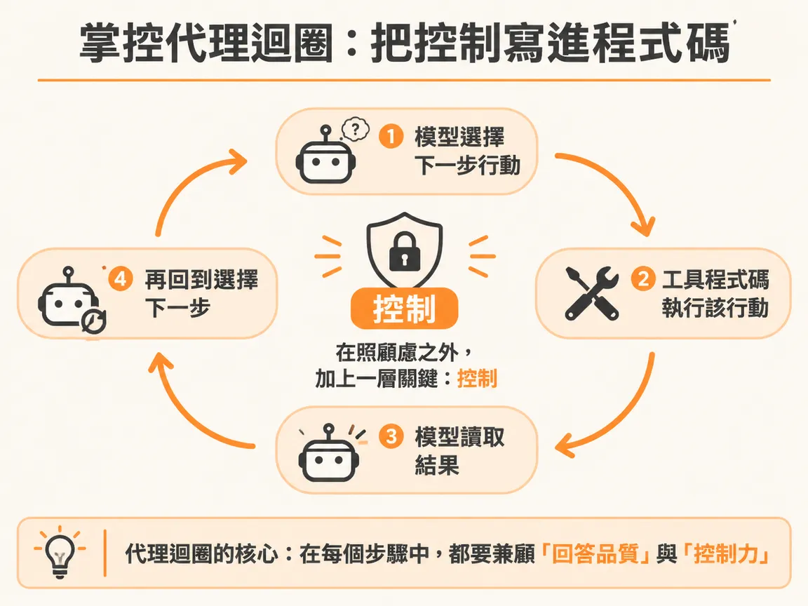
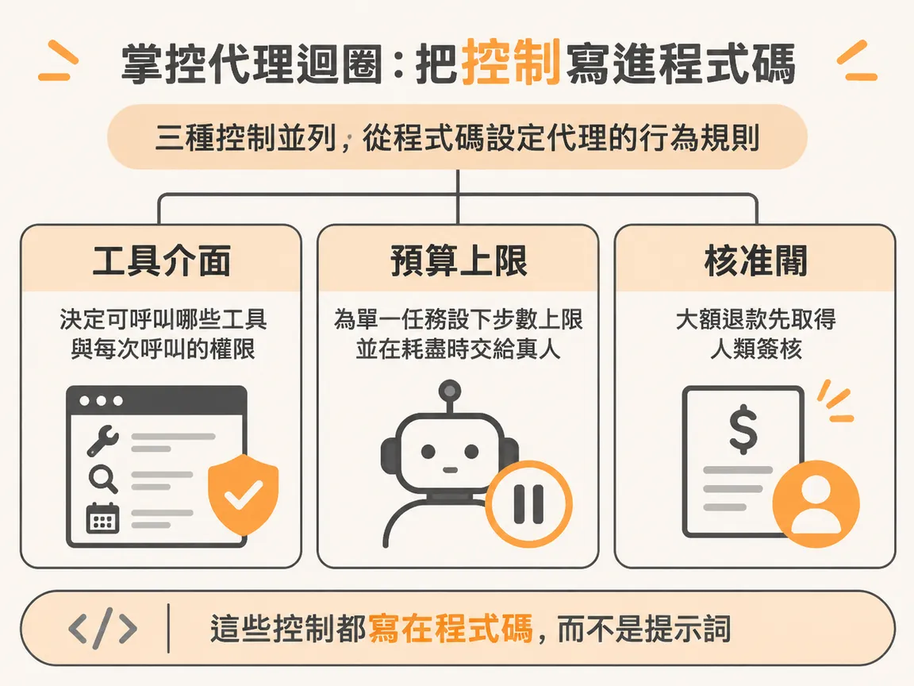
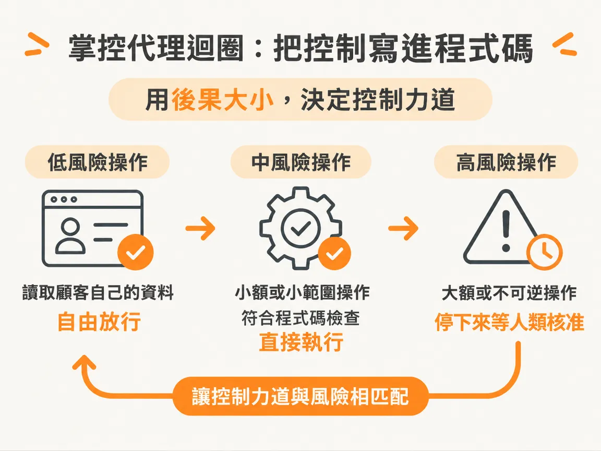

# 掌控代理迴圈：把控制寫進程式碼

使用自有的範例為模型進行微調（fine-tuning），需要有衡量過的充分理由。當客服助理進一步具備採取行動的能力，成為代理系統或代理人（agent）時，運作模式就會變成一個迴圈。

在代理迴圈中，模型會先決定下一步要採取什麼行動，例如查詢一筆訂單。接著，由負責執行工作的程式碼——也就是「工具」（tool）——來執行這個步驟。隨後模型讀取工具回傳的結果，再決定下一個動作。這時，所有針對回答內容的顧慮依然存在，而系統又在此之上多加了一層關鍵課題：控制（control）。

給出錯誤的回答，頂多只是一段文字；但做出一筆錯誤的退款，卻是公司的資金實質流出。可以把代理人想像成一位能力很強的新實習生，而且手上還拿著各種系統密碼。

在這個比喻中，實習生就是模型本身，密碼則是它的工具權限。身為主事者，必須決定這位實習生可以接觸哪些系統、一項任務最多可以執行多久，以及有哪些事情必須先經過人類簽名同意。每一個決定，都會落實為一項具體的控制機制。

具體的控制主要落在三個方向：

第一個是工具介面（tool interface）。這是代理人獲准呼叫的所有工具集合，以及每次呼叫時所具備的執行權限。針對特定任務打造的工具（例如僅能對單筆訂單套用折抵金額），遠比給予通用的資料庫存取工具來得安全。

第二個是預算（budget）。預算是為單一任務設定的硬性上限，例如限制模型最多只能執行幾個步驟。模型本身並不能保證迴圈一定會自行終止。當設定的預算耗盡時，驅動代理迴圈的外部程式碼就會強制停止它，並把這項任務轉交給真人接手。

第三個是核准閘（approval gate）。核准閘會強制要求必須先取得人類簽署同意。例如涉及大筆金額的退款，就必須停下來等待審批。

這些控制機制必須寫在程式碼中，而不是寫進傳送給模型的提示詞（prompt）裡。受到惡意誘導或被騙的模型，可能會完全忽略提示詞裡的指示，但它絕對無法跨越程式碼所設下的限制。

落實這類控制時，通常會面臨兩種相反的失敗極端：

一種是給予過多的自由。代理人擁有毫無限制的存取權限，同時缺乏停止迴圈的規則。只要模型犯下一次錯誤或遭到誘騙，影響範圍就能延伸到每一個已串接的系統。

另一種則是給予太少的自由。就連讀取訂單這類低風險的步驟，都必須經過人類核准。這會讓代理人的運作變得極度緩慢，久而久之，疲於奔命的審核人員甚至會在沒有看清楚的情況下，直接盲目按下核准。

要避開這兩種極端，關鍵在於讓控制力道與操作可能帶來的後果相匹配。讀取顧客自己的資料屬於低風險操作，可以自由放行；小額或小範圍的操作，只要符合程式碼檢查的邊界條件就直接執行；唯有真正高風險的操作，才需要停下來等待人類確認。

