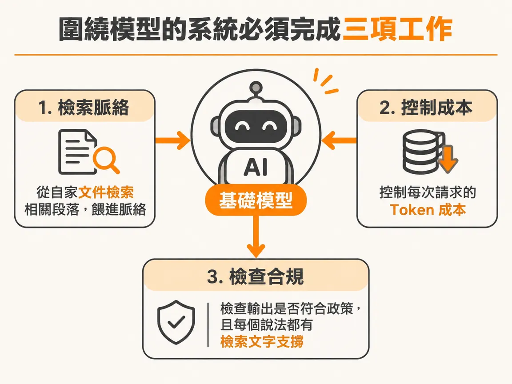
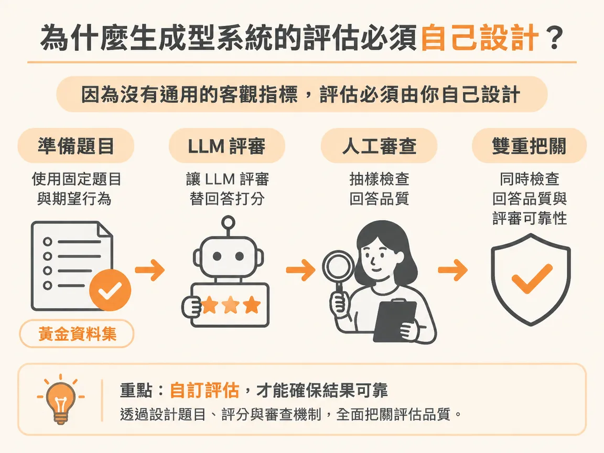

# 圍繞基礎模型打造生成型系統：三項核心工作與自訂評估機制

要打造一個能直接回答問題的客服助理，架構通常會從基礎模型（foundation model）出發。基礎模型是經過大量預訓練的大型模型，也是許多現代 AI 產品的共同底層。

基礎模型本身並不知道今天剛成立的訂單細節。因此，圍繞在模型外圍的軟體系統，必須負責做好三件事。

## 圍繞模型的系統必須完成的三項工作

第一項工作是**餵入脈絡**。透過檢索增強生成（Retrieval Augmented Generation，簡稱 RAG），系統會先從內部文件中檢索出相關段落，再交由模型根據這些內容生成答案。

第二項工作是**控制成本**。模型服務供應商通常是按照 token 計費，一個 token 大約等於四分之三個英文字詞。每次發送請求時，帶入的脈絡越長、模型輸出的回覆越長，成本就會跟著水漲船高。串流（streaming）技術能讓答案逐字浮現，提升使用者體驗，但串流並不能降低 token 的費用。

第三項工作是**抓出錯誤**。模型有時會給出聽起來自信滿滿、事實上卻完全錯誤的答案，這就是所謂的「幻覺」（hallucination）。系統必須負責把關，檢查產出的內容是否符合公司政策，並確認檢索到的參考文字是否真的能支持回答裡的每一項說法。

## 為什麼生成型系統的評估必須自己設計？

在其他類型的任務中，往往可以很輕鬆地獲得品質指標，但生成型系統不同。對於同一個問題，兩個品質都很好的回答，使用的字詞可能幾乎完全沒有交集；相反地，一個語氣親切友善的回覆，背後卻可能答應了公司政策根本不允許的退款。

因為沒有通用的客觀指標可以直接套用，評估機制必須由你自己設計：

- **黃金資料集（Golden Set）**：準備一份固定的測試問題清單，並在每道題目旁明確列出好答案必須具備的行為特徵。
- **LLM 評審（LLM Judge）**：指派另一個模型來評估並替回答打分數。接著由人工抽樣審查這些結果，這項審查不僅能檢驗回答品質，同時也是在確認 LLM 評審打分是否可靠。

在開發這類系統時，最經典的失敗案例就是試圖從頭訓練一個全新的基礎模型。從零開始訓練需要極龐大的資料量以及專用晶片，往往要耗費好幾個月。

想打造一個表現穩健的回答系統，正確的做法是先挑選既有的基礎模型，搭配清楚明確的指令，再逐步加入檢索機制。
