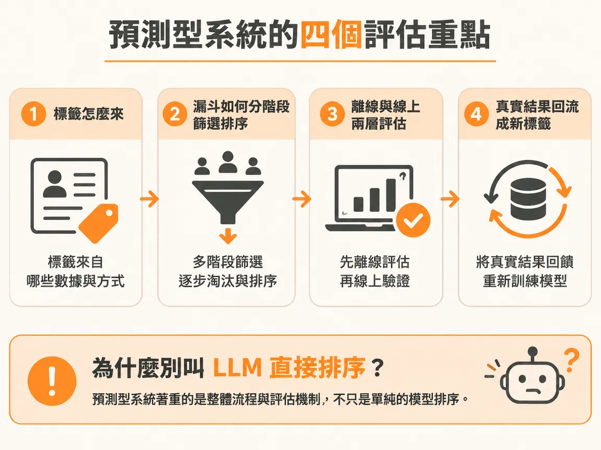
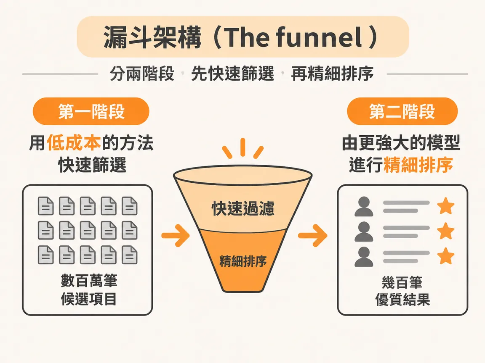
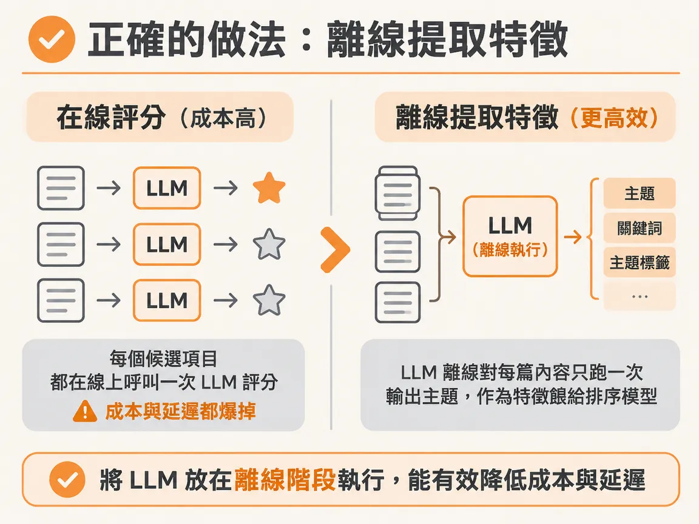

# 預測型系統的四個評估重點，以及為何別叫 LLM 直接排序

在設計機器學習系統或系統設計面試時，預測型模型（Predictive model）是極為常見的考題。這類模型的核心邏輯是從過去的紀錄（例如歷史訂單）中學習，每一筆紀錄都會配上一個標籤（label），也就是真實世界中實際發生的「正確答案」。

面試官在審視預測型系統時，通常會針對四個關鍵細節進行評分：

### 1. 標籤（Labels）
標籤產生的時間點差異極大，系統必須處理這種延遲。外送抵達時間的標籤可能在一小時內就能取得；但詐欺交易的標籤往往要等上數週，直到銀行發動拒付（chargeback，即銀行撤回款項）時才會確定。

### 2. 漏斗架構（The funnel）
處理海量資料時，系統通常會切分成多個階段構成的漏斗。第一階段使用成本極低的方式，將數百萬筆候選項目快速篩選至幾百筆；接著再由功能更強大、特徵更豐富的模型對這幾百筆項目進行精細排序。

### 3. 評估指標（Evaluation）
評估通常分為離線歷史資料與線上真實用戶兩個層面：
- **歷史資料評估**：常用的指標是 AUC（Area Under Curve）。AUC 代表模型將隨機挑選的正樣本（例如被點擊的項目）評分高於隨機挑選的負樣本的機率。AUC 為 0.5 代表純粹猜測，1.0 則是完美的排序結果。
- **線上用戶評估**：常用的指標是點閱率（CTR，Click-Through Rate），也就是展示給用戶的項目中獲得點擊的比例。
離線測試中表現更好的 AUC，才能換取上線進行 A/B 測試（比較新舊兩個版本）的機會，並由 A/B 測試的結果最終決定是否正式發布。

### 4. 回饋迴路（Feedback loop）
系統上線後，用戶產生的真實行為與結果會回流成為新的訓練標籤，團隊再以此重新訓練模型。主動說出這個回饋迴路，是非常關鍵的評分點。

---

## 為什麼直接用 LLM 排序是經典錯誤？

在要求設計動態牆排序（ranked feed）時，最經典的失敗回答就是：「直接用 LLM 來做排序。」

這種做法踩了兩個嚴重的盲點：

1. **忽視了私有數據的價值**：排序品質取決於每個具體用戶過去點擊了什麼、跳過了什麼。這些行為數據是公司獨有的資產（proprietary data）。預先訓練好的 LLM 在使用前就已經訓練完成，根本從未見過這些內部數據。
2. **忽視了運算成本與延遲**：每次動態牆請求通常需要對大約 500 個候選項目進行評分。如果每評分一個項目就呼叫一次 LLM，系統反應會極度緩慢，呼叫成本也高到無法承受。

### 正確的做法：離線提取特徵

一個成熟的架構設計是將 LLM 放在**離線階段**執行。

讓 LLM 閱讀每篇新發布的文章一次，並產出該文章的主題標籤。這個主題標籤隨後會作為一項「特徵」（feature），輸入給下游的專門排序模型使用。這樣一來，LLM 針對每個項目只需要執行一次，運算成本就能壓得非常低。
