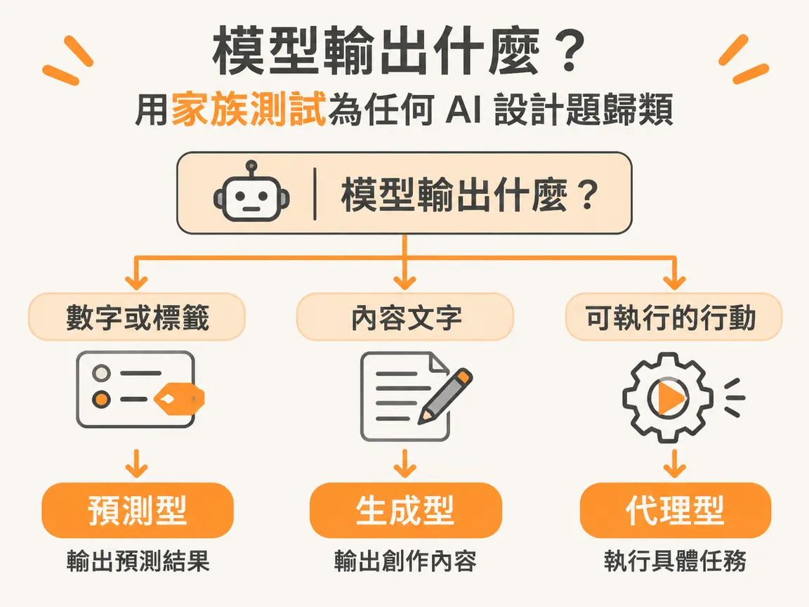
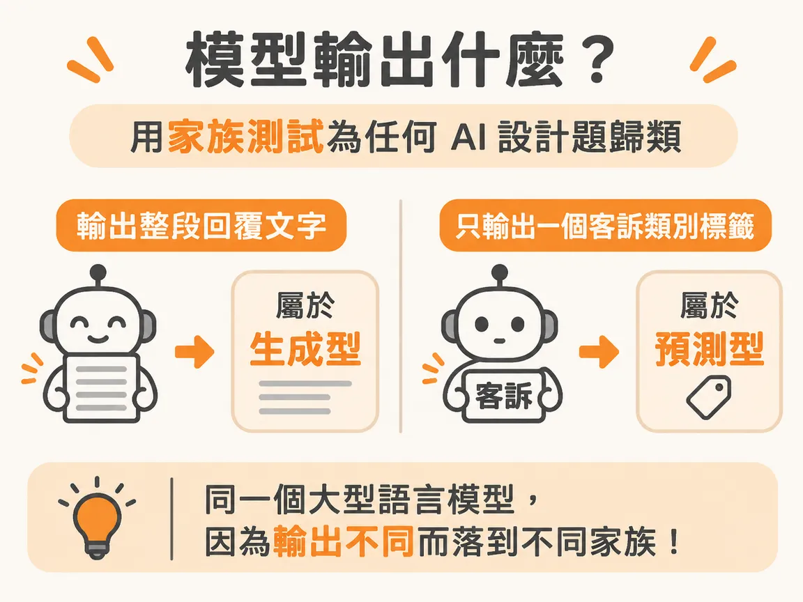

# 模型輸出什麼？用家族測試為任何 AI 設計題歸類

在一家外送平台的面試中，面試官可能會提出三種截然不同的 AI 功能需求：

第一種是預估外送時間。App 需要顯示這筆訂單還要多久才會送達，例如「32 分鐘」。

第二種是回答顧客問題的客服助理。當顧客詢問訂單為什麼遲到時，助理負責撰寫一段文字回覆。

第三種是能夠採取行動的客服助理。它不只回話，還會主動查閱退款政策，並自行替顧客發放一筆小額退款金。

這三種需求背後需要完全不同的架構設計。一旦誤判題目的本質，很容易在系統明明需要排序模組（ranking system）時，卻一路畫成聊天機器人（chatbot）。

要避免這種失誤，只要問自己一個關鍵問題。這項檢驗稱為「家族測試」（family test），它只關注一件事：**模型究竟輸出什麼？**

這個問題的答案，能把任何 AI 系統設計題歸入三大家族之一，同時也能立刻指明整個系統中最棘手的環節在哪裡：

* **家族一：預測型系統（Predictive systems）**。輸出的是數字或標籤。預估 32 分鐘的外送時間，就是典型的預測型任務。
* **家族二：生成型系統（Generative systems）**。輸出的是內容，例如客服助理撰寫的一段回覆文字。
* **家族三：代理型系統（Agentic systems）**。輸出的是行動，例如替顧客執行退款操作。

特別要注意的是，你使用的模型種類並不能決定它屬於哪一個家族。

以大型語言模型（LLM）為例，LLM 本身雖然擅長閱讀與生成文字，但如果讓 LLM 閱讀一封客服客訴後，只輸出一個「客訴類別」給後續流程，它的實質輸出就是一個標籤。這項任務依然屬於家族一的預測型系統，而不是生成型系統。
