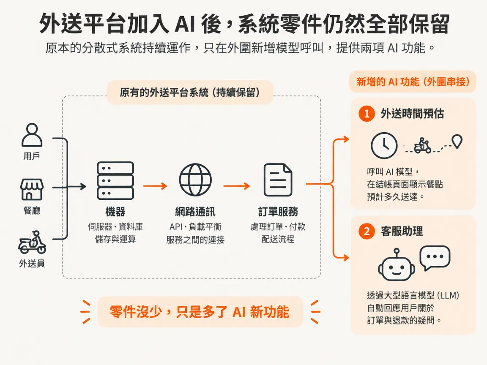
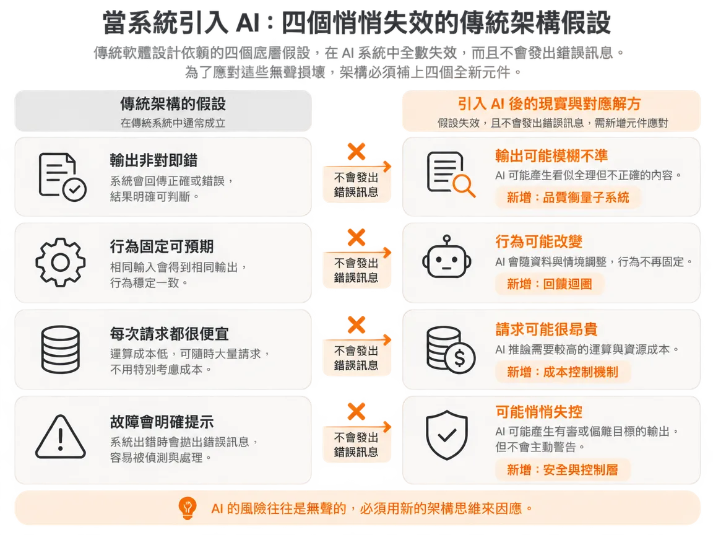

# 當系統引入 AI：四個悄悄失效的傳統架構假設

AI 系統本質上依然是分散式系統，運作依然分散在透過網路互相通訊的機器上。

以一家外送平台為例，以常見的外送平台為例，假設新增兩項 AI 功能：第一項是外送時間預估，在結帳頁面顯示餐點預計多久送達；第二項是客服助理，透過大型語言模型（LLM）自動回應用戶關於訂單與退款的疑問。

導入這兩項功能，沒有移除原本系統裡的任何既有零件。分散式系統的核心架構與知識，絕大部分依然適用。

真正改變的，是傳統軟體工程長期依賴的四個底層假設然而，傳統軟體設計其實暗中依賴了四個假設。在 AI 系統中，這四個假設全都會失效，而且完全不會跳出錯誤訊息。為了應對這些無聲損壞，架構必須補上四個全新元件：

1. **輸出不再非對即錯**：傳統系統的輸出只有對或錯，查詢訂單編號 1234，要嘛查到，要嘛找不到。但在 AI 系統裡，品質是一個連續的光譜，有好有壞。架構必須加入**品質衡量子系統（quality measurement subsystem）**。
2. **行為不再一成不變**：傳統程式在下一次部署前，邏輯與行為固定不變；模型表現卻會隨著現實世界的變化逐漸劣化。架構需要補上**回饋迴圈（feedback loop）**來持續追蹤與更新。
3. **請求不再廉價**：呼叫內部服務或查詢資料庫的成本極低，但大型模型的每一次推論，都會消耗運算成本。架構必須加入**成本控制機制（cost controls）**。
4. **故障不再有聲有色**：傳統系統出錯時通常會回傳錯誤代碼或中斷連線；AI 系統卻可能帶著成功的狀態碼，平靜地送回完全錯誤的答案。架構外層必須架設**安全與控制層（safety and control layer）**把關。
