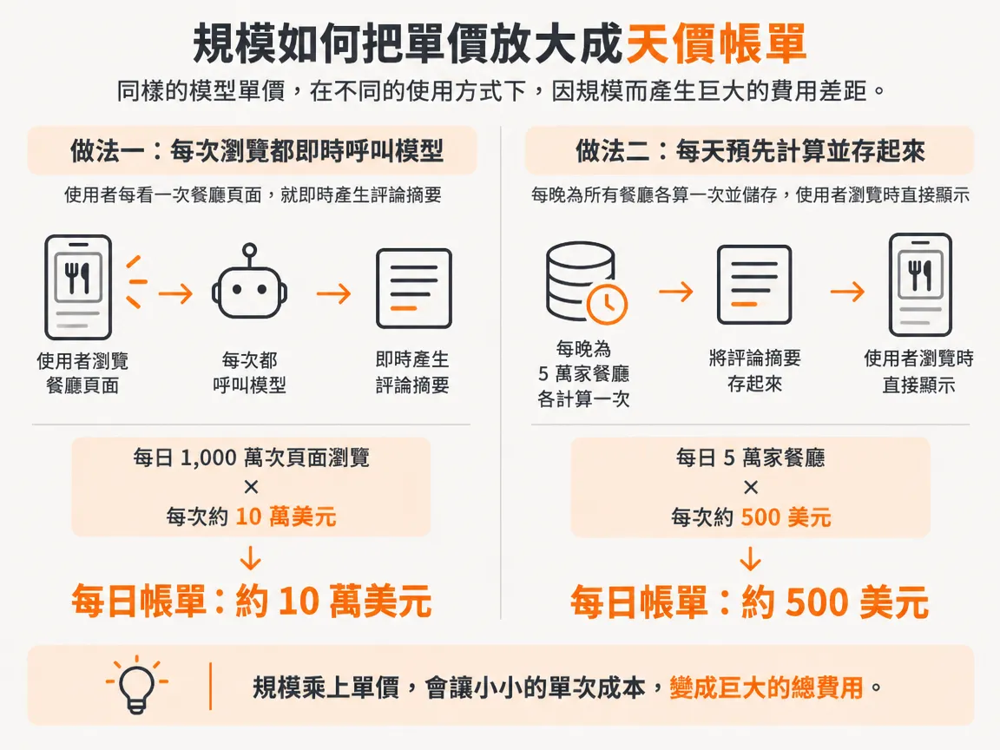
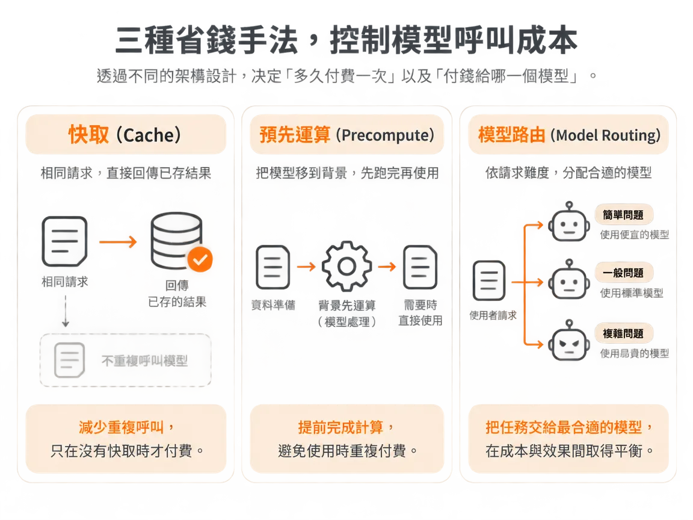
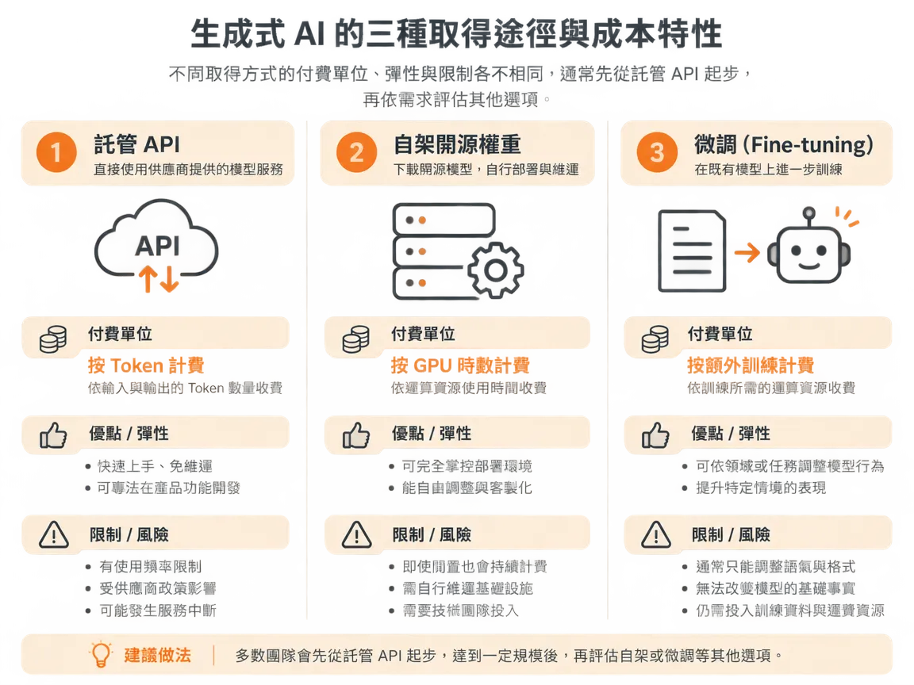

# 壓低模型呼叫成本：算清帳單，在託管、自架與微調之間做取捨

在傳統架構中讀取一次資料庫，花費遠低於千分之一美分；呼叫大型語言模型（LLM）產生一次回答，大約要一美分。兩者相差了三個數量級以上。

當系統規模擴大時，看似微小的單價會迅速膨脹成驚人帳單。成本不能留到事後補救，成本本身就是架構設計的一部分。

## 規模如何把單價放大成天價帳單

假設你的外送或美食 App 中假設每家餐廳頁面都要放一段「顧客評論摘要」，而 App 每天有 1,000 萬次頁面瀏覽。

使用者每打開一次頁面，系統就呼叫一次模型產生摘要，每天模型費用大約 10 萬美元。

實際上平台上的餐廳只有 5 萬家，評論摘要每天只需要更新一次。改用夜間背景排程，每天替每家餐廳跑一次模型並存進資料庫，每天的花費只要約 500 美元。

架構不同，成本差了 200 倍。

控制呼叫成本，關鍵在於決定兩件事：**多久為模型呼叫付費一次**，以及**付錢給哪一個模型**。常見的架構控制手段有三種架構上有三種主要做法：

* **快取（Caching）**：把模型輸出存下來。收到一模一樣的請求時，直接回傳暫存資料，不再呼叫模型。
* **預先運算（Precomputing）**：不在使用者等待時即時呼叫，改用背景排程提前跑完並儲存。
* **模型路由（Routing）**：在架構中加入小型路由器，將請求分派給能做好這件事且成本最便宜的模型。「我的訂單在哪裡？」這類單純詢問交給小型模型，成本只有大型模型的十分之一以下；複雜的「退款爭議」才分派給大型模型。把流量切給小型模型之前，必須先衡量其品質是否達標。

## 生成式 AI 的三種取得途徑與成本特性

在傳統機器學習中，系統多半在公司內部自行建置。預估外送時間的模型必須學習公司自有的歷史訂單資料，外部供應商沒有這些數據。

生成式 AI 不同。為單一產品功能從頭訓練大型語言模型成本過高，團隊通常從供應商提供的託管 API 起步，達到一定規模後再評估其他選項。取得生成式 AI 模型主要有三種途徑三種途徑的成本特性各自不同：

### 1. 呼叫託管 API（Hosted API）
供應商負責維護模型與硬體，費用按 Token 計算。不需要自行維護 GPU，開發上線最快；缺點是必須承受供應商的呼叫頻率限制（rate limits）與服務中斷風險。

### 2. 自架開源權重模型（Self-host Open Weights）
開源模型公開訓練完成的數值權重。可以把模型部署在購買或租用的 GPU 上。計費依據是 GPU 運行時數，設備忙碌或閒置都照常計費。只有流量龐大且穩定時，每次呼叫分攤下來的平均成本才會顯著降低；流量忽高忽低且常有閒置時，自架反而更昂貴。

### 3. 微調模型（Fine-tune）
微調是在既有模型基礎上，使用示範資料進行額外訓練。微調能改變模型的語氣或輸出格式，但無法教會模型公司內部的私有事實。

## 如何選擇合適的降本路徑

導入 AI 的第一步不是微調，而是先寫出高品質的提示詞（Prompt），並測試衡量輸出成果。如果設計良好的提示詞就能達到品質標準，額外微調只是增加成本。

只有在以下情境，才需要考慮自架或微調：

* **高用量且任務明確單純**：例如將客服訊息精準標記為 12 種問題類型之一。這種窄範圍任務適合微調後的小型模型，既能維持高準確度，又能壓低呼叫單價。
* **高度敏感資料**：受限於法規或資安要求不能傳給外部供應商時，必須在自有 GPU 上自架與微調模型。

把成本視為架構的一部分，先用快取、預先運算與模型路由過濾即時呼叫；模型端以託管 API 與提示詞驗證品質，等規模與情境明確後，再評估微調或自架。壓低成本之後，還必須面對最後一個失效的假設：模型發生的故障不會報錯，甚至帶著成功的狀態碼回傳。
