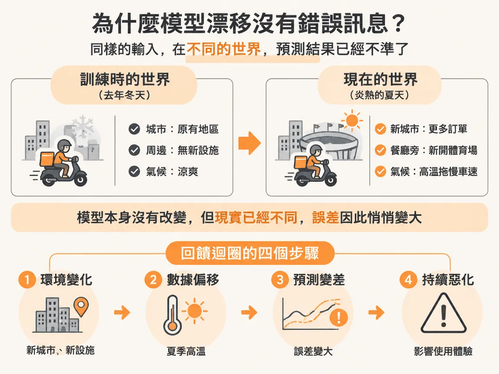
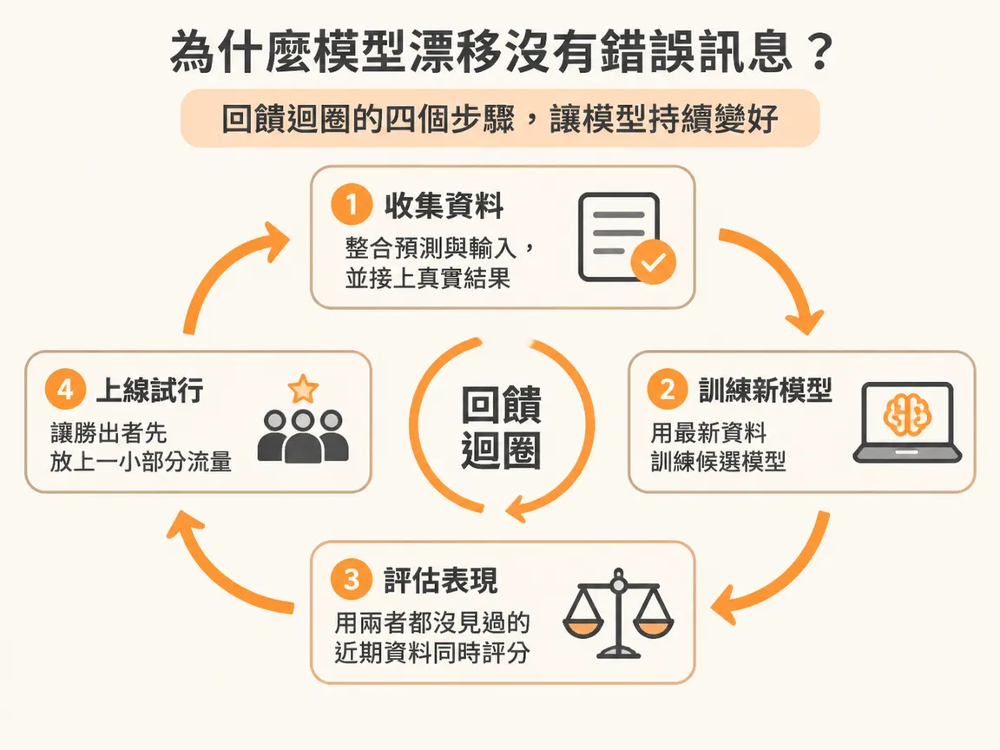
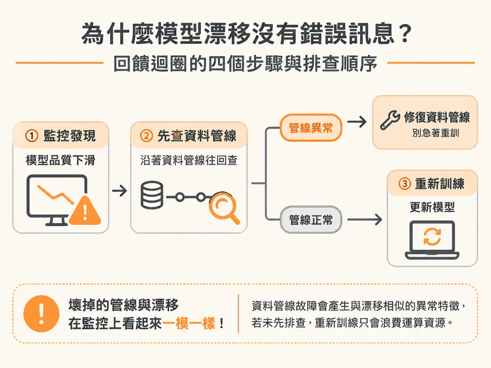

# 為什麼模型漂移沒有錯誤訊息：回饋迴圈的四個步驟與排查順序

在傳統系統中，只要沒有部署新版本，程式的運作行為就不會改變。機器學習模型完全不同。

模型從過去的資料學習規則，學成之後結構就固定了；外面的世界卻持續在變。模型預測品質隨著時間逐漸下滑的現象，稱為「漂移」（drift）。漂移發生時不會跳出任何錯誤訊息——伺服器照常運作、API 照常回傳，輸出的結果卻越來越不可靠。

以預測外送送達時間的模型為例在外送時間預估的例子裡，模型可能是依據去年冬天的訂單資料訓練出來的。隨後公司進軍新城市，許多餐廳旁新開了體育場引發人潮，夏天的炎熱氣溫也拖慢外送員車速。面對這些變化，同一套模型現在產生的預測誤差只會越來越大。

只要世界持續轉動，漂移就不會停止。模型剛上線時測出的分數，對下個月的表現幾乎沒有參考價值。

要讓模型跟上現實世界的變化，系統必須設計一套「回饋迴圈」（feedback loop）持續學習。這個迴圈包含四個步驟這個迴圈包含四個步驟：

1. **收集資料**：把系統做出的每一筆預測及其輸入特徵記錄下來，後續與真實發生的結果整合，作為訓練標籤。
2. **訓練候選模型**：啟動訓練工作，利用新資料打造出一個新模型，稱為「候選模型」（candidate）。
3. **評估分數**：拿一組兩者都沒用來訓練過的近期資料，同時對線上模型與候選模型評分比較。
4. **發布勝出者**：將表現較好的模型推上線，一開始只切換一小部分流量，確認穩定。

當監控發現模型品質下滑時，可以提前啟動這個回饋迴圈。但有一個關鍵排查順序：**必須先檢查資料管線**先沿著資料管線往回查，確認管線正常，才能重新訓練。資料管線故障所導致的異常特徵，外表看起來就跟漂移一模一樣；如果管線壞了，重新訓練只會浪費運算資源。

架構如果沒有主動建立回饋迴圈，就沒有任何有計畫的方式能從漂移中復原。收集資料不會帶來沉重負擔，因為讀取一次資料庫的成本遠遠低於千分之一美分；真正昂貴的，是每一次模型呼叫本身的帳單。
