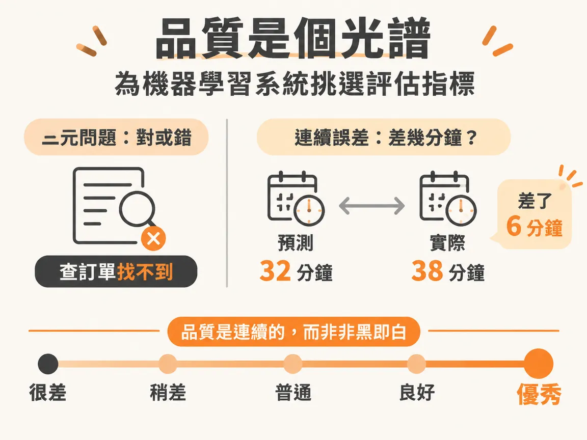
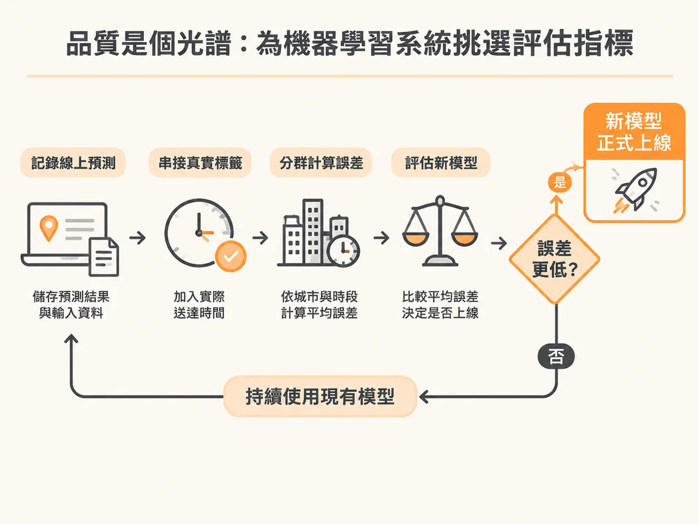
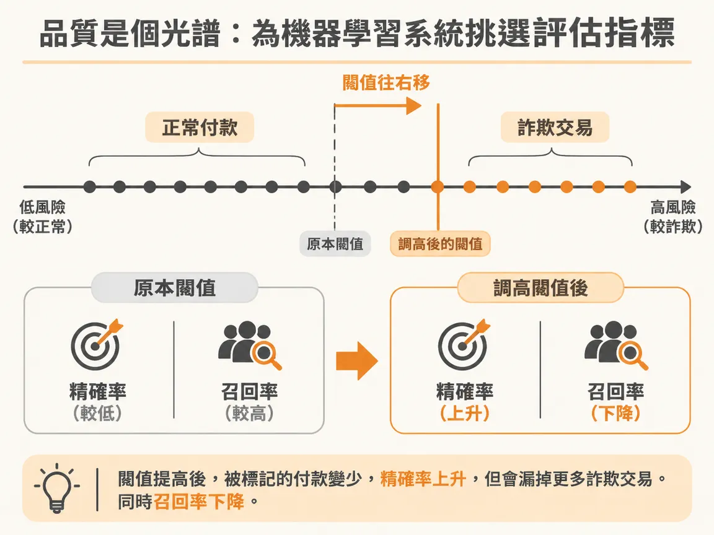

# 品質是個光譜：為機器學習系統挑選評估指標

在傳統軟體中，系統輸出通常只有對或錯。查詢「訂單 1234」，系統要嘛找到這筆訂單，要嘛找不到。傳統監控最關注速度，例如觀察 P99 延遲——也就是 100 個請求中，有 99 個能在這個時間上限內處理完畢。

但處理速度再快，無法說明答案的內容到底好不好。假設外送時間模型預測送達需要 32 分鐘如果外送時間模型預估是 32 分鐘，而實際配送花了 38 分鐘，這並不像系統找不到訂單那樣徹底壞掉，而是差了 6 分鐘。機器學習系統的品質不是非黑即白，而是一個連續的光譜。

在生產環境中掌握連續品質，必須依賴品質衡量子系統為輸出評分。它會把每次記錄下來的預測結果系統要把每次線上預測連同輸入記錄下來，與事後收集到的實際送達時間串接在一起，並依據城市與不同時段，回報以分鐘為單位的平均誤差。每一次新訓練出的模型，平均誤差都必須優於現有模型，才具備上線資格。品質衡量子系統必須在一開始就設計進架構裡，而不是上線後才補做。

每種系統面對的業務情境不同，需要的品質指標也完全不同：

- **動態牆（feed）**：通常使用點閱率，也就是被展示的內容項目中，實際獲得使用者點擊的比例。
- **客服助理（support assistant）**：評估核心是解決率，也就是在不轉接真人客服的情況下，問題成功被排解的對話比例。
- **防詐欺模型**：會為每筆付款算出一組風險分數。系統設定一個「閾值」，只要分數超過這個界線，系統就將該筆交易標記為可疑。

在防詐欺這類分類任務中，品質衡量牽涉到精確率與召回率的拉鋸。精確率看的是系統標記為詐欺的交易中究竟有多準確；召回率看的則是實際發生的詐欺案件裡，系統成功抓出了多少。調高判定閾值通常會讓精確率上升、召回率下降當閾值往右提高，被標記為詐欺的交易變少，精確率上升、召回率下降——被誤擋的正常付款變少了，但同時會有更多詐欺交易漏網過關。

評估系統品質時，不能只看抽象概念或單純報出延遲數字，必須清楚指出正在設計的系統該用哪一個具體指標衡量品質。有了衡量品質的尺度，下一個問題是：當世界隨時間改變，這項品質指標為何會無聲地下滑。
