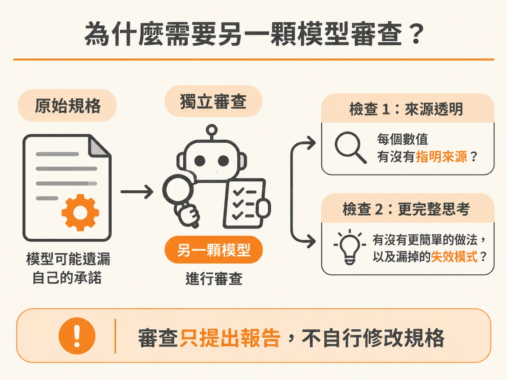
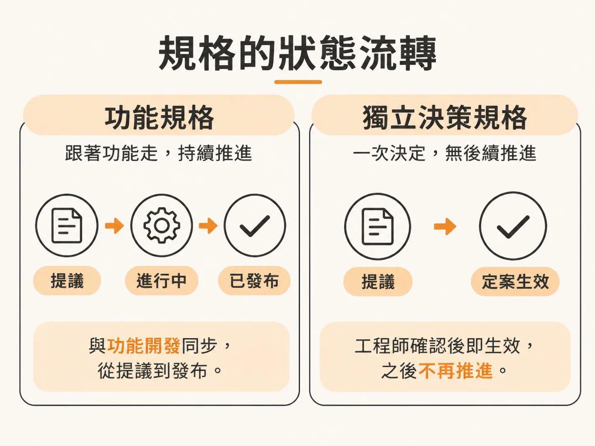
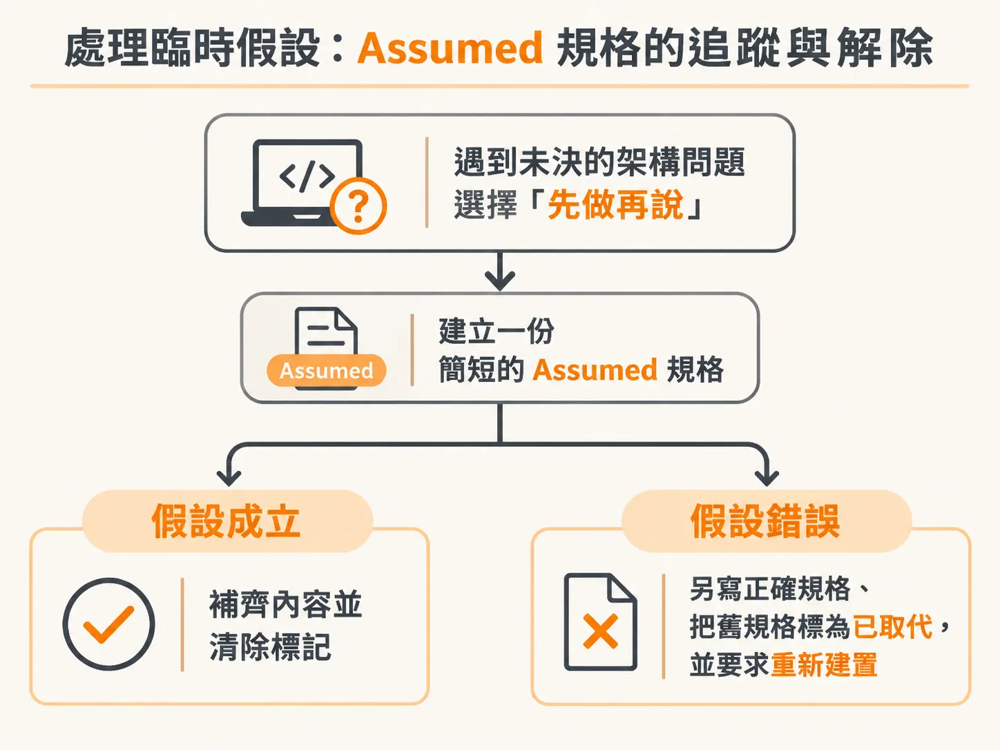
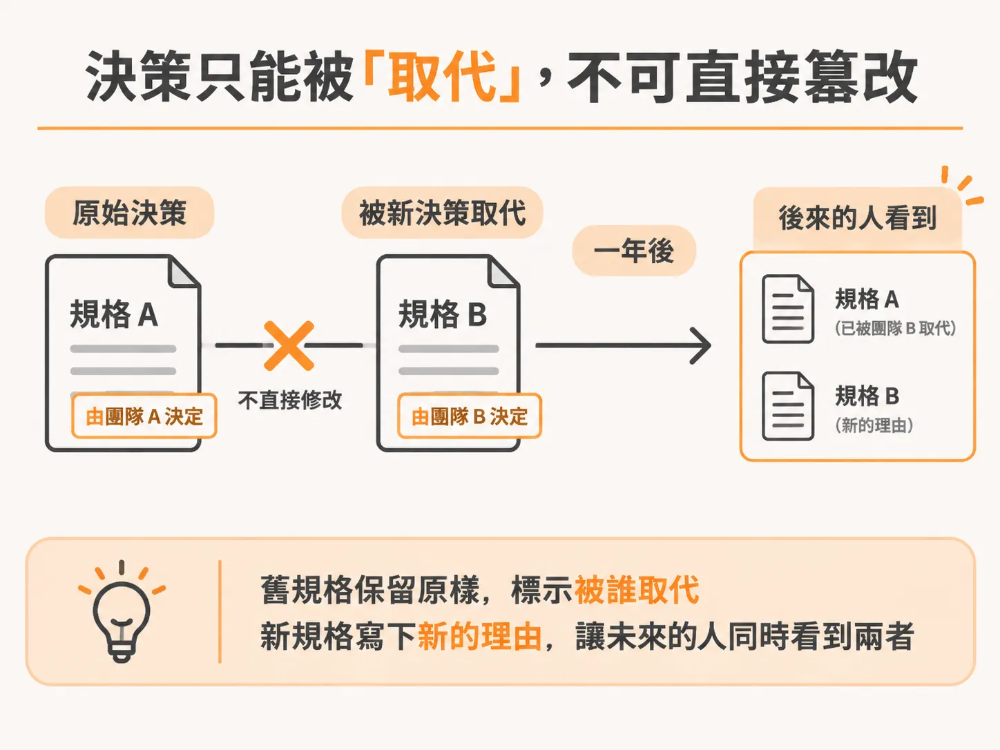

# 用第二顆模型審查架構規格：缺口修補、生命週期與定案流程

上一節結尾提到，規格寫完後要找另一個模型交叉審查。這一節把那次審查之後的事走完：缺口怎麼修、狀態怎麼流轉、假設怎麼轉正。

在架構設計流程中，負責起草規格（spec）的模型往往存在盲點。自己寫出的設計，自己很難看出哪裡漏了關鍵數值，甚至可能在安全機制上出現過度承諾的陳述。

為了避免工程師在進入實作階段才發現規格彼此矛盾，這套工作流程引入了「獨立模型交叉檢查（cross-check）」機制，並且在規格文件的狀態流轉、臨時假設（Assumed）與版本更替（supersede）上建立了一套明確的定案標準。

---

## 為什麼需要另一顆模型審查？

撰寫規格的模型通常具備高度自我邏輯一致性，但也因此難以發現自身遺漏的承諾。透過分派一個唯讀的子代理人（sub-agent），指定使用另一顆能力足夠的模型進行審查，可以專注在兩大工作：

1. **決策完整性（Decision completeness）：** 找出動作、端點或讀取路徑必須產出、計算或呈現，但規格從未指明資料來源的數值；以及找出若現在不決定，實作者就必須自行捏造的決策。
2. **架構健全度（Soundness）：** 檢驗設計是否站得住腳、有無更簡單的替代方案，以及是否忽略了潛在的失效模式。

在實際範例中，審查模型抓出了具體數值未設定的問題——若不處理，後續兩份規格將會產生無聲的衝突。同時，它也糾正了安全性文字上的錯誤：原稿寫著「行級安全機制（Row-Level Security, RLS）保護上傳流程」，但實際上簽署的上傳網址在產生時由 service role 授權，擷取時由 token 授權，從未經過資料庫的資料表政策。

審查模型有時也會提出不屬於該份規格範圍的意見。例如針對釘選座標參考座標系、釘選編號、讀取狀態、軟刪除與硬刪除、外鍵行為等五項缺口，這些實際上屬於資料模型規格的職責，此時應標註為欠缺給其他功能，而非硬塞在當前的技術堆疊規格內。

其餘涉及系統承載力、客戶端身分驗證（HS 金鑰簽署、90 天過期）、分享連結格式（路徑片段而非查詢字串）、依受眾劃分路由路徑等實質決定，則交由工程師定奪。

---

## 審查缺口的修復原則

審查子代理人只負責提出審查報告，絕不能在背後擅自修改規格：

* **自動修復的界線：** 只有無害的修辭問題與機械式的文字不一致，工具才能自動處理。
* **保留審批權：** 任何改變系統行為、權責歸屬、風險層級或架構方向的缺口，都屬於高承載決策（load-bearing decisions），必須向工程師提出建議解法並徵詢確認。
* **修復標的：** 此階段完全不碰程式碼（程式碼甚至尚未存在），所有修補都精準套用在 `index.md` 與 `rationale.md` 之中。

這也體現了上下文管理的原則：在前期的問答階段，模型專注於理解限制條件、替代方案與後果；只有到了撰寫與修訂規格的收尾階段，才載入規格與決策紀錄的架構。

---

## 規格文件的雙檔結構與角色分工

在專案中，架構決策通常拆分成兩個檔案：

* **`index.md`（規格本體）：** 記錄建置過程「必須遵循」的實體內容，例如 Next.js、Supabase、Drizzle 與 Vercel 的技術堆疊選擇與連線機制。此檔案保持精簡，專門提供給後續建置工具（如 `/develop`）讀取。
* **`rationale.md`（決策理由）：** 保存「為什麼做此選擇」的歷史脈絡。包含當時考慮過的替代方案、各方案的優缺點，以及最終勝出的理由。

這份理由不會被壓縮或丟棄，它直接放在規格旁邊，供團隊或一年後的維護者查驗，但不會在每次建置執行時隨附載入，確保工作流程的輕量化。

---

## 規格的狀態流轉：功能規格與獨立決策規格

規格檔案開頭的 `Status` 欄位容易引起混淆，它依照規格種類分為兩種截然不同的生命週期：

### 1. 關聯到範圍清單的功能規格（Feature-linked spec）

這類規格追蹤具體功能的生命週期：

* `/architect` 完成撰寫並確認時，狀態為 `Proposed`。
* 當 `/develop` 開始建置時，狀態變更為 `In Progress`。
* 只有在功能建置完成且通過驗證時，狀態才由 `/develop` 改為 `Accepted`。

因此在功能規格上，**`Accepted` 代表的是「已發布（shipped）」，而不只是「已核准」**。

### 2. 獨立決策規格（Standalone decision spec）

針對技術堆疊或跨領域標準，這類規格沒有對應的功能實作列：

* 撰寫時標註為 `Proposed`。
* 一旦工程師確認定案，狀態**立即變更為 `Accepted`**，決策自此生效，後續的 `/develop` 不會再推進其狀態。
* （若規格是為了補記已經上線發布的現狀，則建立時直接標記為 `Accepted`。）

---

## 處理臨時假設：Assumed 規格的追蹤與解除

當工程師在 `/develop` 建置中途遇到尚未決定的架構問題，但選擇「先做再說」的逃生門時，系統會建立一份簡短的 `Assumed` 規格。

這份規格記錄四個核心區塊：
1. `Owed decision`（欠缺的決策）
2. `Assumption built on`（建置所依據的假設）
3. `Code area`（影響的程式碼區域）
4. `Requirements`（相關需求）

同時，系統會記錄 Git 作者，留下「誰決定在沒有正式決策下推進」的紀錄。

要將這項假設轉正，必須回到 `/architect` 針對該決策執行審查（例如執行 ratify）：

* **假設成立：** 補齊完整的脈絡、替代方案、決策與推論內容，抹除 `Assumed` 標記，將狀態同步至功能的生命週期（`In Progress` 或 `Accepted`）。
* **假設錯誤：** 另外撰寫一份正確的新規格，將舊的假設規格標記為已取代（supersede），並要求該功能依據修正後的規格重新建置。

---

## 決策只能被「取代」，不可直接篡改

當架構方向真正被翻盤時，舊規格不能直接覆寫修改。

舊檔案的狀態必須改為 `Superseded by [NNNN]`，並附上指向新規格的連結。這樣一來，未來接手的工程師既能看見過去為何這樣做，也能看見後來由什麼方案取代，維持明確的決策演進紀錄。

---

## 交叉檢查後的定案步驟

當所有提問與檢查完成，進入規格最後定案時，標準流程如下：

1. **呈現規格與摘要：** 顯示檔案路徑、決策重點、關鍵權衡，以及交叉檢查的結論。
2. **確認面板選擇：**
   * 若選擇「接受，看起來沒問題（Accept, looks solid）」：根據規格種類確立狀態（獨立決策變更為 `Accepted`；功能規格維持 `Proposed`）。
   * 若選擇「修改（Change something）」：針對工程師指定的章節套用局部編輯，不整篇重寫。
3. **連結至範圍清單（Scope）：** 勾選該功能唯一的決策方塊（結尾為 `(spec)` 的項目），關聯規格相對路徑，並依據規格的建置計畫展開 2 到 5 個階段性里程碑，將功能狀態推進為 `in-progress`。
4. **清理工作工作階段：** 定案完成後，執行 `/clear` 清空當前對話的工作階段。規格與推論已經完整落盤，後續呼叫 `/develop` 時會直接從磁碟讀取規格，既不遺失資訊，也不會耗費先前龐大問答所佔用的 token。
