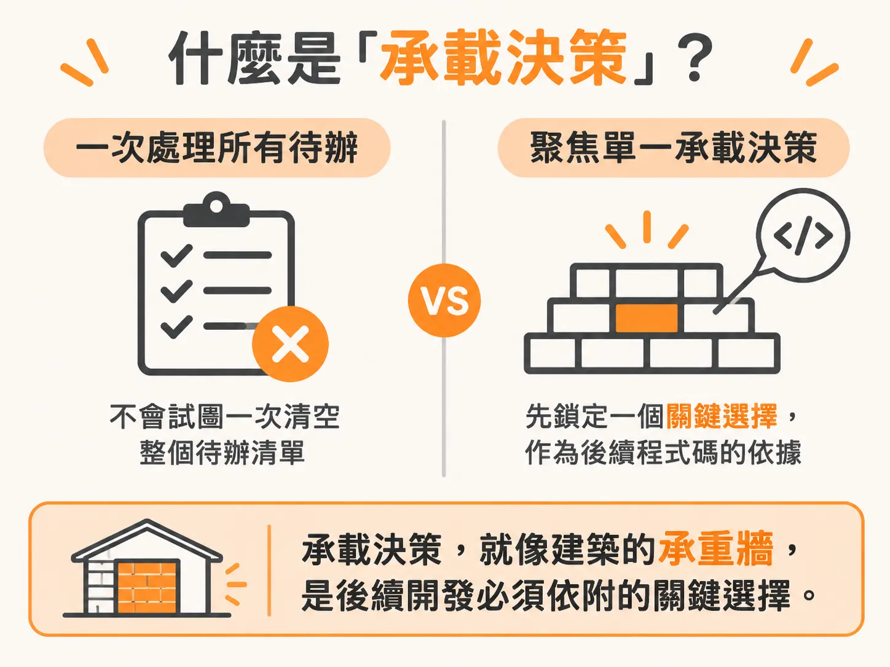

# 為什麼 /architect 一次只解一個承載決策？

`scope.md` 把產品切成有序的切片之後，第一個要動的通常是那個所有功能都得依賴的技術堆疊。

在規劃專案時，最上方往往躺著一個影響最深遠、卻尚未定案的抉擇：整套產品到底要運行在什麼樣的技術堆疊與架構上？

後續的每一個功能都會依賴這個基底；在它確定之前，你幾乎無法動工寫出任何真正的程式碼。面對這種左右全局的技術選擇，我們可以用 `/architect` 技能來做決定。

## 什麼是「承載決策」？

`/architect` 的運作背後有一條核心準則，主導了它所有的行為：**每一次執行，只處理一個決策**。

它不會試圖一次替你清空整個待辦清單（backlog），也不會把專案未來可能需要的所有技術選擇一口氣全抓進來討論。相反地，它一次只鎖定一個「承載決策」（load-bearing decision）——也就是像建築物的承重牆一樣、後續程式碼必須依附在上的關鍵架構選擇。

這樣的核心決策必須先經過嚴謹的評估並白紙黑字記錄下來，後續的程式碼才能安心地依賴它建立。而在這個階段，我們唯一要交付給它決策的，就是整個產品的技術堆疊。

## 為什麼每次執行都要開啟新對話？

在實際呼叫 `/architect` 之前，操作上有一個重要習慣：開啟一個全新的 Claude Code 對話視窗。

每當要執行一項新的技能（skill）時，重新開一個對話是常態，而不是繼續沿用舊的交談記錄。專案本身有記憶機制在追蹤目前的所有進展，因此你不需要依賴對話歷史來傳遞狀態；如果繼續使用舊視窗，反而容易被之前留在上下文（context）裡的雜訊干擾。

## 聚焦在單一選擇

在乾淨的新對話中，你只需要直接執行 `/architect`，並將目標明確對準單一選擇——也就是應用程式的架構與技術堆疊。

當你將技能指向這個選擇後，它在向你推薦任何具體工具或函式庫之前，第一件事就是讀取 `/architect` 本身的技能定義與指引，確保接下來的探索與評估都遵循嚴謹的架構決策流程。

讀完指引後，它並不會立刻開口問你，而是先把你已經寫在磁碟上的專案脈絡讀過一遍。
