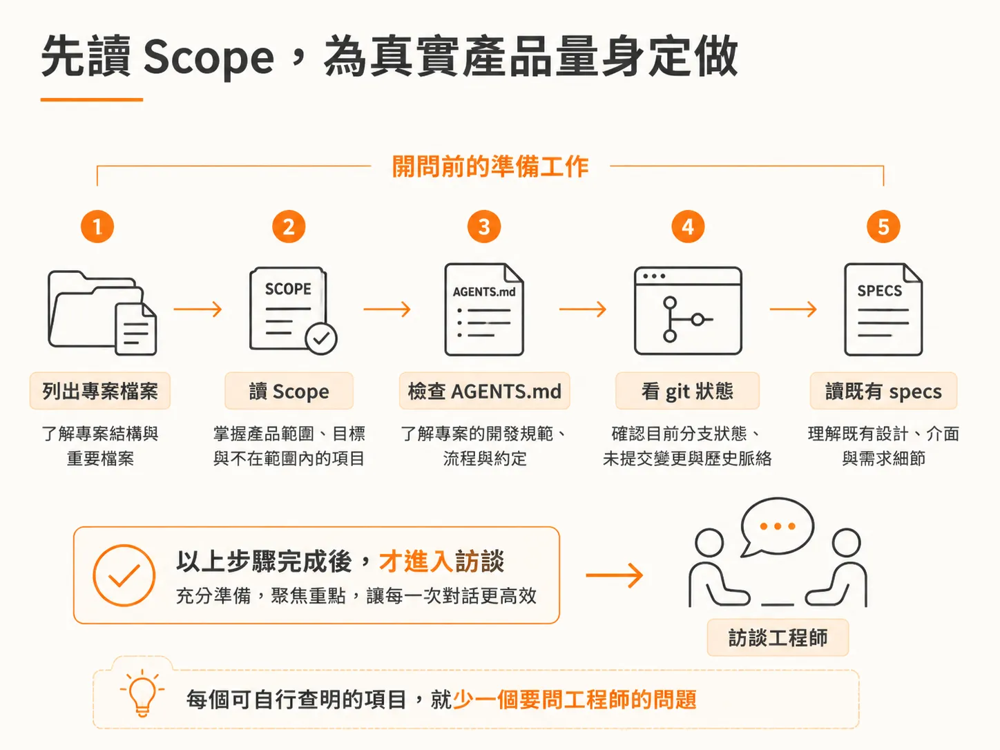
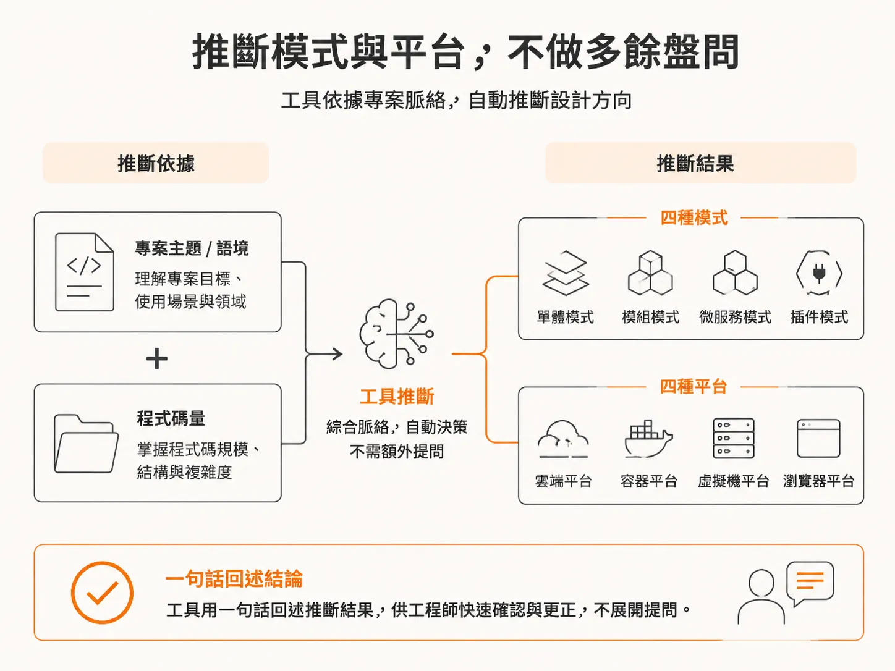
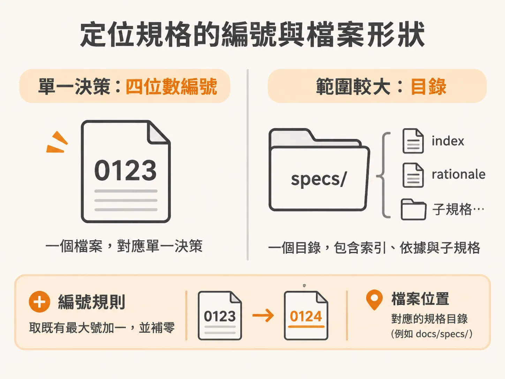

# 在設計訪談前讀完專案脈絡，精準定位規格

上一節提到，`/architect` 讀完技能定義後會先讀專案；這一節看它到底讀了什麼。

當你在專案中啟動架構設計流程時，最怕遇到工具一開口就丟出一連串制式問卷，甚至推薦一套毫無關聯的通用技術堆疊。理想的設計流程不應該把時間浪費在這些能自動查明的細節上，而是在真正發問之前，先默默把整個專案的現狀讀懂。

### 先讀 Scope，為真實產品量身定做

流程啟動的第一步，是列出目前專案的所有檔案，接著閱讀產品範圍（scope）。

這麼做能確保後續所有架構決策，都是針對你實際描述的產品，而不是硬套一套泛用的網頁架構。舉例來說，當它讀完範圍定義後，就能直接掌握這款應用程式需要即時預覽（live previews）、置頂留言（pinned comments）、共用客戶端存取權限（shared client access）、討論串（discussions thread），以及用來管理回饋的儀表板。它已經知道產品的核心功能是什麼，就不需要回頭問你「這套系統要做給誰用、有哪些主要畫面」。

### 檢查 Git 狀態與專案慣例

在深入規格之前，工具還會檢查 Git 的狀態。任何架構工作都必須建立在專案最新且已知的版本上，而不是一個過期或落後的分支。在團隊協作情境中，工具會靜默執行 `git fetch`，確認當前分支是否落後於遠端主幹；如果落後，就先提醒你拉取最新程式碼，避免重複或衝突的決策。

同時，它會檢查專案中是否有記錄指令、慣例、設計模式與目錄結構的 `AGENTS.md`（若沒有則尋找 `CLAUDE.md`）。在剛建立的全新專案裡可能還看不到這份檔案，但在既有的專案程式庫中，這份檔案能直接回答語言、框架、資料庫甚至目錄劃分等疑問。在訪談正式開始前，這些基礎資訊就已經確立，不需要再問你一遍。如果是在 Monorepo 架構下，它還會往下尋找特定子區域的巢狀 `AGENTS.md`，避免誤套根目錄的設定。

### 推斷模式與平台，不做多餘盤問

掌握了專案上下文與程式碼量之後，工具會直接推斷這次設計的框架，而不是對著你做身家調查：

- **運作模式（Mode）**：從主題與現有程式碼判斷這是全新功能（`FEATURE`）、基礎架構（`ARCHITECTURE`）、既有功能調整（`ENHANCEMENT`）還是全域規範（`CROSS-CUTTING`）。
- **目標平台（Platform）**：由 `AGENTS.md` 的技術堆疊推斷是網頁、行動裝置、純後端 API 還是混合平台，絕對不預設為網頁，因為行動裝置的推播、離線儲存與驗證架構完全不同。

推斷完成後，工具只需要簡短說出一句確認，例如「我將這次設計視為既有技術堆疊上的新功能，目標平台為網頁，若有出入請隨時更正」，就能立刻把注意力轉向真正的核心需求。

### 定位規格的編號與檔案形狀

接著，工具會閱讀現有的規格文件（specifications）。這個動作能確認眼前要解決的問題是否曾經定案，並決定下一份規格應當落在哪裡、使用什麼編號。

規格檔案會鏡像存放於對應的規格目錄（例如 `docs/specs/` 或 Monorepo 中的特定 workspace 子目錄）：

- **編號判斷**：清點目錄中既有的 `NNNN-*.md` 檔案，找出目前最大的流水號加一，並補零至四位數（如 `0001`）。在即將寫入檔案前，還會再次清點以避免團隊協作時發生碰撞，絕不覆蓋既有規格。
- **檔案形狀**：如果是單純的獨立決策，會採用不超過五個單詞、全小寫的短網址命名（例如 `0002-live-preview.md`）；如果是牽涉範圍廣大、需要拆解成兩個以上子決策的大型主題（umbrella），則會開出專屬目錄，裡面包含總覽決策 `index.md`、架構理由與盤點檔案 `rationale.md`，以及各個子規格。如果當前主題是現有大型主題的一部分，它也會精準放入該目錄下成為子項目，並更新父層清單。

只要能預先從儲存庫中查出的事實，就可以少花你一個問題的時間。整個流程的目的從來不是把訪談拖得又臭又長，而是替你省下精力，專注在那些只有你才能解答的關鍵資訊上。
