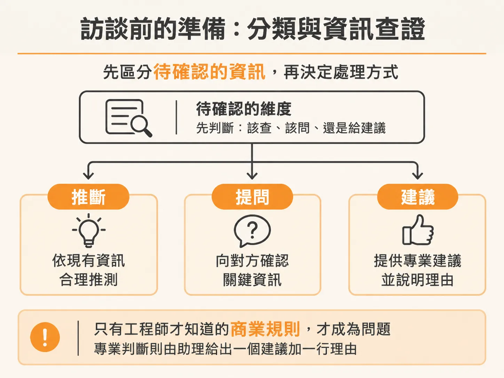
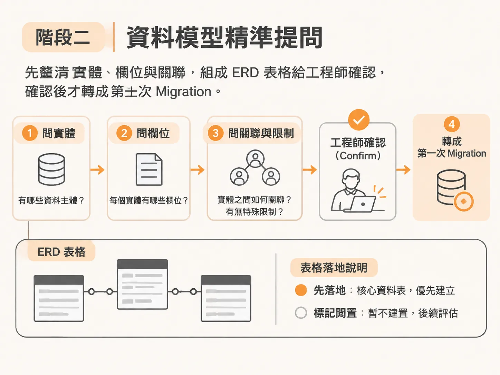
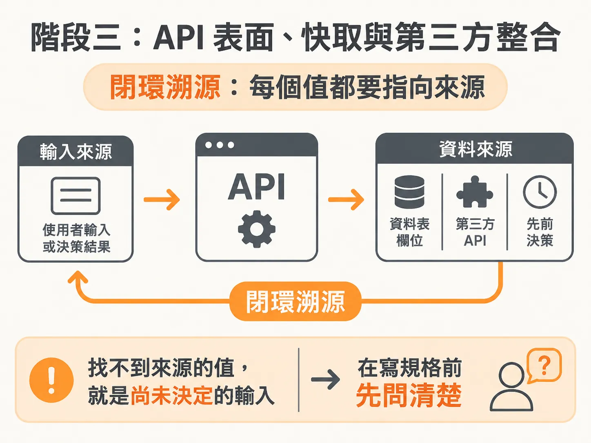
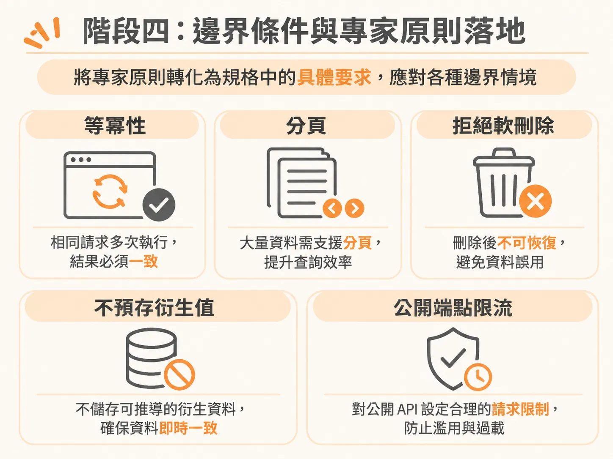

# 逐維度架構訪談：把資料模型、API 與邊界情況問到能寫成 Spec

規格該放哪裡、該長什麼形狀都定位好之後，接下來才是真正的訪談。

寫規格文件（Spec）最常踩到的坑，是工程師直接把一大包預設好的架構丟給 AI，或是讓 AI 自己通靈生出整份綱要。最後產出的檔案不是脫離真實業務場景，就是遺漏關鍵的邊界狀態。

一套真正能落地的設計流程，是把複雜系統拆解成**逐個維度、循序漸進的問答**。每一道題目背後，架構助理都要給出具體的建議選項與「一行推薦理由」，而不是丟出毫無立場的選單，更不能私自跳過重要決策。工程師握有最終決定權，既能一鍵接受推薦，也能直接覆寫。

---

## 訪談前的準備：分類與資訊查證

在拋出第一道設計問題前，必須先區分哪些資訊該查、哪些該問：



- **推斷（INFER）**：能從專案程式碼、現有技術棧或現存 PR 查到的資訊，直接推導，絕不重複詢問。
- **提問（ASK）**：只有工程師或業務端才知道的商業規則、系統邊界、合規需求。
- **建議（RECOMMEND）**：屬於工程專業判斷的選型（例如 ORM、快取策略、資料表正規化）。給出推薦選項、一行理由，以及替代方案供覆寫。

在全新（Greenfield）專案中，架構助理本身的記憶可能已經過期。例如一年前合理的套件，今天可能已不再是最佳解。因此，訪談的第一個動作是確認「參考資料授權（References Consent）」，徵求同意後派生輕量級的唯讀子 Agent（如 Haiku）上網檢索最新技術生態：

- 查證最新版本（如 Next.js 16 App Router、Drizzle 接近 1.0、BetterAuth 1.6 等）。
- 檢索受限在設定好的預算內（例如最多搜尋 5 次、瀏覽 8 個官方文件頁面），不會無限制消耗 Token。
- 檢索摘要會收斂回主對話，網址則留存在規格文件的參考清單中，方便日後查驗。

---

## 階段一：底層技術棧走訪（Stack & Tool Walk）

技術棧的選擇不能一次丟出整套方案讓工程師按確認，而是由下而上、依依賴關係分輪詢問。每一輪最多將 4 個獨立維度的問題打包在同一個回合中，減少來回次數，但絕不跳過任何一個支撐架構的關鍵點。

以一個全端 Web 應用為例，走訪會依序推進：

### 1. 核心形狀與資料底層
- **應用形狀**：單一全端應用（Full stack）、前端搭配平台後端，還是獨立前後端？
- **框架選型**：Next.js 16 App Router、TanStack Start、Remix / React Router，或 SvelteKit？
- **資料與認證平台**：選用 Supabase 這類 BaaS（後續驗證與 Storage 即可順理成章復用其內建生態，避免引入新工具與額外帳單），或是 Neon 搭配代管 Auth？
- **預覽呈現方式（如針對無法嵌入 iframe 的網站）**：直接 iframe 搭配阻擋提示、伺服器代理（Proxy），還是先截圖釘選？MVP 可先選直接 iframe，架構預留日後加裝代理的彈性。

### 2. API 形狀與身分認證
- **前後端通訊**：資料變更優先走 Server Actions，只有需要對外公開或特殊端點時才開 Route Handlers。
- **無帳號訪客的識別方式**：使用包含隨機 ID 與名稱的簽署 Cookie（Signed Cookie）、Supabase 匿名登入，還是瀏覽器 LocalStorage？
- **公開分享連結的安全性**：網址中的 Token 應如何保存？是在資料庫以雜湊值（Hash）儲存，還是存明文？使用隨機長 Token 加雜湊，能兼顧分享便利與金鑰防護。

### 3. 建置工具、專案結構與營運準備
- **樣式與驗證**：Tailwind CSS + shadcn/ui 搭配 Zod Schema 驗證輸入。
- **測試策略**：單元測試選 Vitest；端對端測試（E2E）若接上 Playwright，雖然能讓 Agent 自行點擊測試並自動修復，但執行耗時長。若目前追求推進速度，可先專注在 Vitest。
- **程式碼組織**：區分公開訪客與已登入使用者的路由群組（Route Groups），讓行銷頁面、後台儀表板與公開分享頁的 Layout 與介面徹底分離。
- **外部服務升級路徑**：帳號重設密碼需要寄信，但 BaaS 內建的寄件機制受限於頻率，不可用於生產環境。決策是：MVP 開發期先用內建寄件器，正式上線前再無縫切換到 Resend 等專用郵件服務。
- **監控與日誌**：初期先依賴平台日誌與簡易 Error Boundary，避免在一開始過度設計（Overkill）引入 Sentry 等重型工具。

---

## 階段二：資料模型（Data Model）精準提問

資料模型一旦定錯，後續重構代價極高。因此資料模型必須先詢問完整實體、欄位與關聯，組裝出 ERD 式的總覽表格讓工程師做輕量確認（Confirm），再轉化為 Migration。



在設計上，建議採用「曳光彈（Tracer Bullet）」思維：先定義出所有功能未來需要的完整實體模型，確保架構連貫，但在第一次 Migration 中只落地核心貫通流程所需的表格，其餘暫時標記為閒置。

訪談中必須針對以下細節逐一深挖：

### 實體邊界與儲存細節
- **品味向量（Taste Vector）與輪廓**：使用獨立的 `taste_vectors` 表（每個使用者多列，以 Facet 標籤搭配向量），還是直接在 Profile 表開一個向量欄位？前者保留了未來演進到叢集分面（Clustered Facets）的彈性，完全不需要修改 Schema。
- **異質資料歸納**：滑動卡片（提供 like、dislike、skip）與外部匯入（如評分 0.5 到 5 顆星）如何共用資料表？解法是統一正規化：滑動記錄存為狀態，分數欄位留空（null）；匯入記錄則填寫實際分數。既不捏造數據，未來計分演算法調整時也不必改動 Migration。
- **跳過（Skip）的處置**：使用者在卡片上點選「跳過」，需不需要存成一列？答案是必須寫入一列 `skipped` 狀態的評分資料，確保推薦引擎不會再次推薦相同的項目。
- **非同步暫存資料**：從第三方服務（如 TMDB）拉取的電影資料，在尚未產生向量嵌入（Embedding）前就必須入庫。設計上應將 Embedding 欄位設為 Nullable，並在待處理資料上加上部分索引（Partial Index）。

### 權限隔離與審計追蹤
- **使用者資料庫掛載**：當驗證身分歸由 Auth 服務管理時，業務資料掛在由 `auth.users.id` 作為外鍵的 Profile 表上。
- **範圍查詢安全輔助工具（Scoped Query Helper）**：落實「不信任呼叫端」原則。查詢輔助工具必須在內部自動帶入目前的 `user_id`，而不是交由呼叫方傳入，從根本防止越權存取。
- **審計與安全底線**：帳號刪除或匯入操作必須記錄在通用的 `audit_events` 表中；資料庫層級應在 Migration 階段預先寫入預設拒絕全部（Deny All）的列級安全策略（Row-Level Security, RLS）。

---

## 階段三：API 表面、快取與第三方整合

定義 API 與整合外部 API 時，要緊扣「閉環溯源（Value Sourcing）」——驗收條件（AC）中需要的每一個欄位，API 與資料庫都必須明確指出由誰提供，不能讓後續實作者憑空發明。



以電影目錄與 TMDB 快取為例，架構助理應以「對練夥伴」的身分引導權衡：

<!-- derived -->
```
問題：TMDB 的資料抓取要在哪裡執行？
選項 1：背景工作（Job）負責寫入，即時請求（Request）負責讀取已快取資料。
選項 2：快取未命中時直接在 Request 中發起同步 Fetch。
```

工程師若猶豫不決，助理應指出決定性因素在於**「未命中發生的頻率」**：如果核心片庫在啟動時就透過預載腳本寫入，且推薦項目由背景 Job 產出，那麼使用者請求打到未快取電影的機率極低。既然未命中屬於罕見邊界情況，選擇將抓取放進背景工作（搭配 Ingest 機制），就能嚴格遵守架構原則：**外部 API 的延遲或 Rate Limit 永遠不會拖慢前端使用者的頁面載入**。

針對整合細節，也需同步拍板：
- **Rate Limit 與失敗重試**：第三方 API（如 TMDB 每秒 50 次限制）應透過 Ingest 的併發控制與遇到 HTTP 429 時自動重試來因應。
- **字串正規化與比對信賴度**：將輸入字串去除大小寫、重音、標點符號與開頭冠詞（A/The），在比對時結合標題相似度與年份差距計算權重閾值，避免完全不同的兩部電影被折疊成同一個金鑰。
- **資源分工**：圖片資源不要下載轉存，而是在資料庫儲存 `poster_path`，在前端配置好 CDN 基礎網址，並將來源網域加進 Next.js Image 的白名單中。

---

## 階段四：邊界條件與專家原則落地

在所有功能設計中，下列原則應直接作為邊界設計的預設標準：



1. **第一天就做等冪性（Idempotency）**：任何會產生副作用的 Mutation（發送信件、扣款、外部抓取）都要能安全重試。
2. **分頁不是選配**：只要是清單型端點，無論 MVP 規模再小，都必須實作分頁，否則資料增長後必定成為線上事故。
3. **拒絕軟刪除（Soft Deletes）的爛攤子**：軟刪除往往會污染日常查詢並破壞唯一性約束。除非必要，否則使用明確的封存時間戳記（`archived_at`）或獨立的封存表。
4. **不預先儲存衍生值**：不要在資料庫存計算好的中間數值（除非遇到實測出的效能瓶頸），讀取時動態計算才能避免衍生資料與真相來源脫鉤。
5. **公開端點必加 Rate Limiting**：即使是給匿名訪客點擊的分享連結，也必須加上基礎的頻率限制防護。

---

## 成果驗收：組裝出可執行的 Spec

透過上述多輪、有推薦選項的訪談，系統收集到的不再是一片凌亂的對話紀錄，而是邏輯嚴密的決策鏈：

1. 匯總產出驗收條件（AC-1, AC-2, ...）。
2. 產出定義清楚的 9 張實體表格與 Migration 順序（哪些先上、哪些標記為 idle）。
3. 明確指定交付物：種子資料腳本（Checked-in TMDB JSON）、全域 RLS 策略、各資料表的 Zod Schema。

當整份規格書組裝完成後，工程師只需在最後一步檢查整體產物並簽核。至此，資料模型、API 介面、安全性與錯誤處理皆已定錨，後續的實作 Agent 就能完全依照規格開發，不再有自行揣測的空間。
