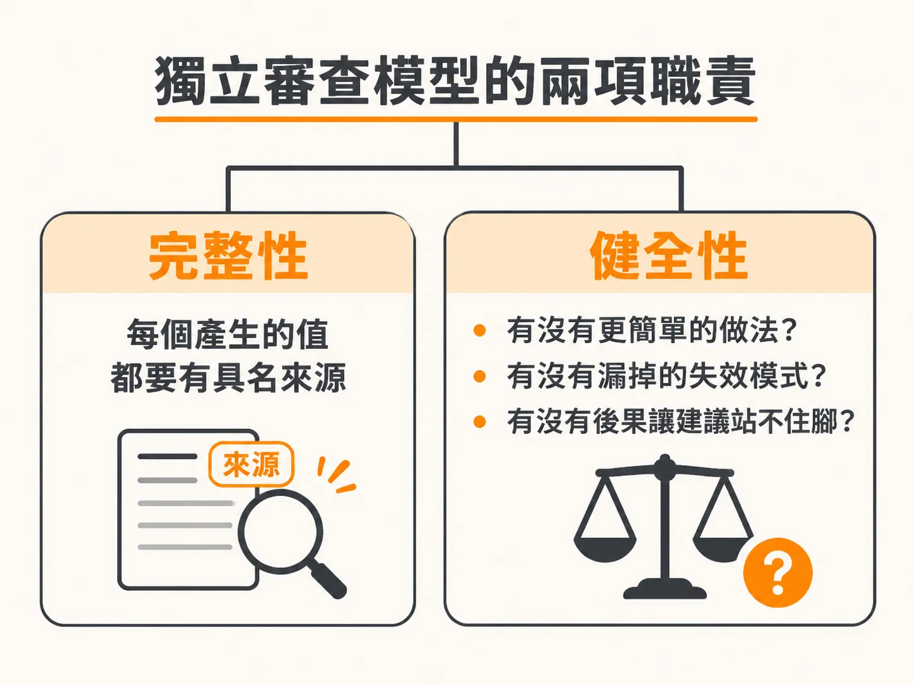

# 拆分 index.md 與 rationale.md：讓 Build 讀契約、人讀決策理由

訪談把一個又一個承載決策問完之後，就要把它們寫成檔案，而寫法本身也是決策。

當架構代理人（agent）準備產出架構草稿時，它不會從一開始就把所有規則塞進上下文，而是到了真正要動筆的時刻，才讀取寫作規則：包含 agent prompt、spec template 與 architecture.md 等規範文件。這樣能確保代理人清楚知道規格文件的撰寫標準。

技術棧（stack）決策是整套專案的基石，內容厚重且後續所有的功能切片都會繼承它。面對這種基礎型決策，規格不能擠在單一檔案裡，而要採用目錄結構：將實作建置所需的契約寫進 `index.md`，將思考推論過程獨立收在 `rationale.md`。

目錄會以序號命名（例如 `specs/0001-stack-architecture/` 或 `docs/specs/0001-stack/`），最頂層的檔案一律叫 `index.md`，不要命名成 `0001-stack/0001-stack.md`。

## 讀者拆分：Build 需要決定，人需要論證

規格文件服務兩個截然不同的讀者：自動化建置工具（如 `/develop`）需要具體的決定與約束，而人類工程師與未來的架構決策者則需要背後的脈絡與辯論。

這兩份檔案的分工非常分明：

- **`index.md`（Build 讀取的實作規格）**：
  包含概要（`## Summary`）、決策（`## Decision`）、完整填寫的技術棧（`## Proposed stack`）、安全模型（security model）、環境設定（configuration）、後續影響（`## Consequences`）、待辦事項（`## Follow-up`），以及一行指向 `rationale.md` 的簡短參照連結。
- **`rationale.md`（Build 跳過、人類閱讀的決策紀錄）**：
  包含背景脈絡（`## Context`）、評估過的所有選項（`## Options considered`）、選擇該選項的推論理由（`## Rationale`）、龐大佐證資料（evidence，例如盤點清單與審計結果，不需另建 `research/` 資料夾，直接放在專屬子標題下），以及參考資料（`## References`）。

在剛寫完的技術棧 `index.md` 中，你看不到實作建置計畫（build plan），也不會看到憑空捏造的驗收標準（acceptance criteria）。這是正確的做法。架構技術棧規格只負責記錄決策本體，後續 `/develop` 技能會根據這份決定直接推導出骨架建立（scaffold）的步驟，不需要在架構階段重複預寫一次建置清單。

理由沒有被丟棄或壓縮，它就並排在規格旁邊。一年後有人重看架構時，所有推論都在；只是建置代理人每次新增路由或修補程式時，不需要每次都把整段論證重讀一遍。

## 交給另一個模型進行交叉審查

規格檔案建立完成且檢查通過後，代理人會在我們親自檢閱（review）前，提議進行規格交叉檢查（cross-check），並強烈建議使用「另一個模型」來執行。

底層架構是整個專案的支柱，後續每一個功能切片都會建立在它之上。如果基礎架構出現負重缺口（load-bearing gap），會是整個專案中最昂貴的錯誤。撰寫規格的模型通常對自己的思考盲點毫無所覺，讓另一個獨立模型從不同方向切入，才能及早抓出問題。

獨立審查模型主要承擔兩項職責：

1. **完整性（Completeness）**：
   檢查設計中要求的每一個數值或行為，確認是否有任何未交代來源的數值。設計必須清楚標註數值是來自使用者輸入、資料庫欄位，還是從其他設定推導而來，不能把未決定的輸入留給後續實作階段去瞎猜。
2. **健全性（Soundness）**：
   審查模型會提出三個關鍵問題：
   - 是否存在實質上更簡單的替代選項？
   - 是否遺漏了重要的失效模式（failure mode）？
   - 是否有任何潛在後果，會讓這項建議其實不如原先模型認定的那麼合適？

透過這種檔案切分與雙模型審查，建置工具能獲得乾淨俐落的契約，團隊也能留下一份經得起檢驗的決策紀錄。
