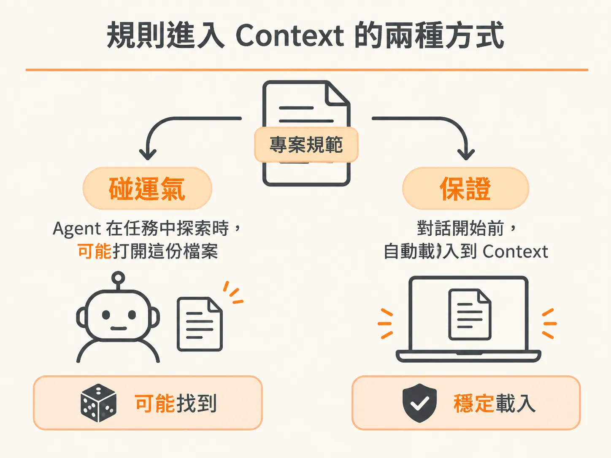
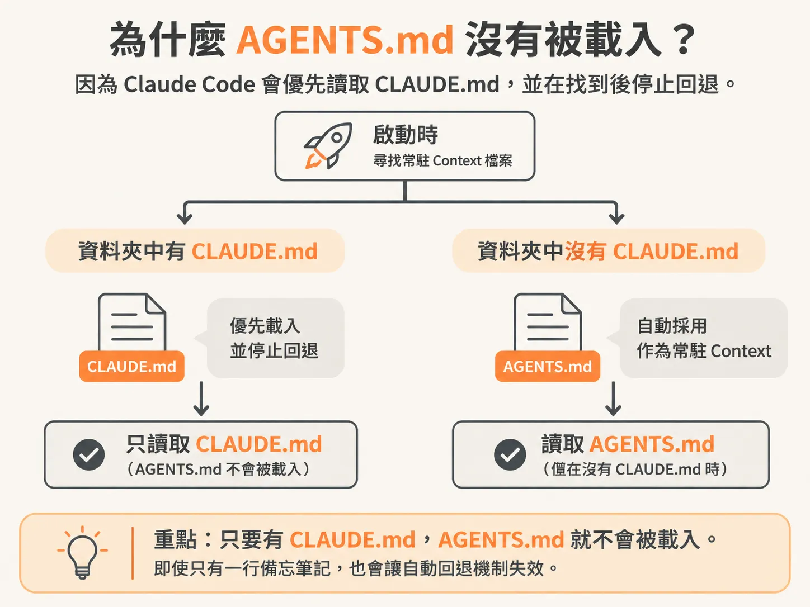
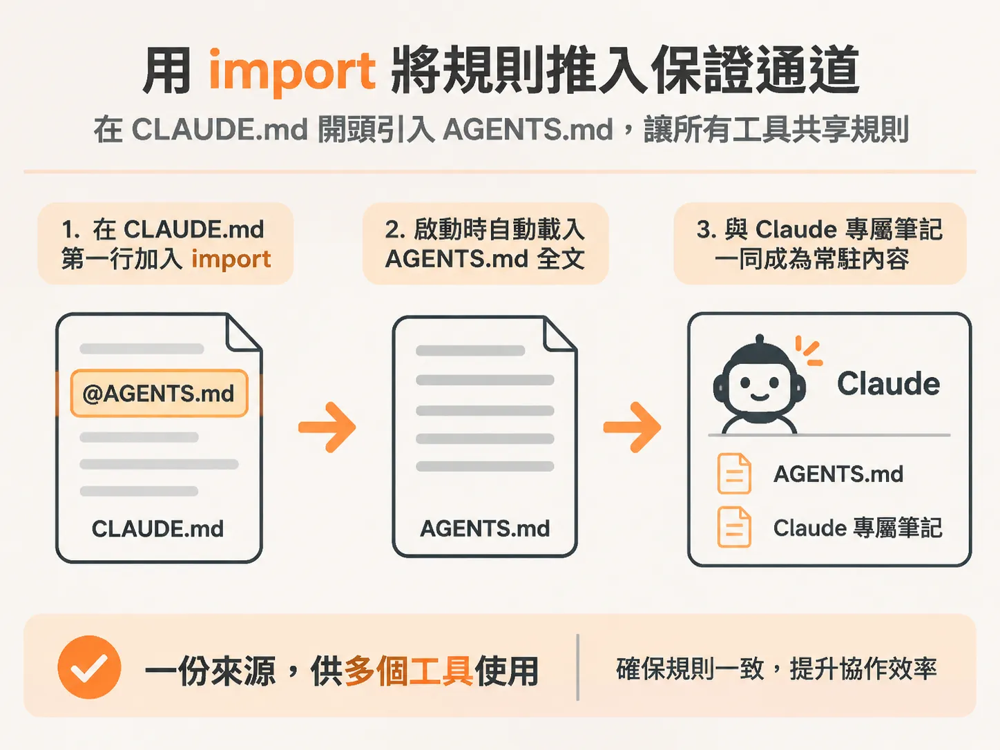
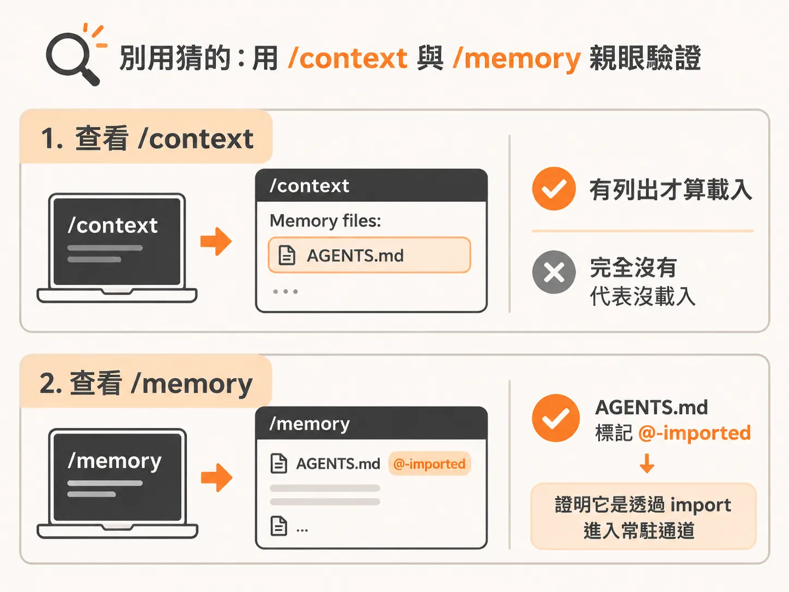

# 掌握 AGENTS.md：用 import 與驗證指令打造小而準的常駐規則

很多開發者在專案裡寫好了規範檔案，卻發現 AI 助理有時乖乖照做，有時又像完全沒看過一樣，直接違反團隊規定。舉例來說，專案明明統一用整數「分」（integer cents）來儲存金額，AI 卻三番兩次把金額格式化成帶有小數點的美元，就算在對話裡糾正了好幾次，換個話題它又故態復萌。

要解決這個問題，必須先釐清規則傳遞給 Agent 的兩種完全不同的管道。

## 探索與常駐：規則進入 Context 的兩種方式

專案中的規則要進到 Agent 的視野，主要透過兩種機制：



1. **探索（Exploration，純屬「碰運氣」）**：當你交給 Agent 一個任務時，它會在專案中翻找相關檔案。在翻找的過程中，它「可能」剛好打開寫有規則的檔案並遵照執行。但這完全取決於當前任務是什麼、檔名看起來相不相關，以及它當下有沒有發起搜尋。它可能正好看到，也可能直接走過去。你不能指望它每次都能靠探索找到規則。
2. **常駐 Context（Always-on Context，絕對的保證）**：這是在每次對話一開始、你甚至還沒輸入任何文字之前，就直接載入 Agent 的規則。它完全不依賴 Agent 的好奇心或搜尋行為，每次都會在那裡。

這就是「寄望 Agent 找到規則」與「保證 Agent 擁有規則」之間的差別。

## 為什麼 AGENTS.md 沒有被載入？

為了讓多種工具（如 Codex、Cursor 等）共用同一份專案規範，大家通常習慣把通用規則寫在專案根目錄的 `AGENTS.md` 裡。以一個新建立的 Next.js 專案為例，你可能在 `AGENTS.md` 寫好了一套 Next.js 的開發規範，滿心以為 Claude Code 也會自動套用。

然而，許多開發者打開 Claude Code 後，卻發現它根本沒讀取這些規則。

這是因為 Claude Code 在啟動時，預設尋找的常駐 Context 檔案是 `CLAUDE.md`，而不是 `AGENTS.md`。雖然在較新版本（v2.1.277 起）中，如果資料夾內**完全沒有** `CLAUDE.md`，Claude Code 會退而求其次自動抓取 `AGENTS.md` 作為常駐 Context；但只要目錄下一旦出現 `CLAUDE.md`（哪怕只是一行 Claude 專屬的備忘筆記），這項自動回退機制就會立刻失效。此時 `AGENTS.md` 又會掉回「碰運氣的探索管道」。



## 用 import 將規則推入保證通道

要讓不同工具共用 `AGENTS.md`，同時確保 Claude Code 也能在啟動時常駐載入，最穩妥的做法是在 `CLAUDE.md` 的最頂部使用 import 語法：



<!-- derived -->
```markdown
@AGENTS.md

## Claude Code
這裡放置只有 Claude 需要遵循的專屬筆記。
```

這行 `@AGENTS.md` 會告訴 Claude Code：在載入常駐 Context 時，一併把 `AGENTS.md` 的完整內容拉進來，並接續下方的 Claude 專屬筆記。這樣一來，`AGENTS.md` 依然是跨工具的單一事實來源（Single Source of Truth），同時也能進入 Claude Code 的常駐保證通道。（在非 Windows 環境下，若是完全沒有 Claude 專屬筆記，也可以使用符號連結 `ln -s AGENTS.md CLAUDE.md`，但 Windows 建立符號連結常需要管理員權限，因此統一使用 `@AGENTS.md` 的 import 語法更為乾淨省事。）

## 別用猜的：用 `/context` 與 `/memory` 親眼驗證

要確認檔案到底有沒有進入常駐通道，不要只看檔案總管裡有沒有這份檔案。Claude Code 提供了兩個指令來檢驗：



1. **`/context` 指令**：直接查看當前 Session 載入了哪些內容。執行後先略過 Token 數量，尋找 `Memory files` 這一行。如果當前有載入常駐檔案，即使 Token 比例顯示為 0%，底下也會列出具體載入了幾個 Memory files。如果完全看不到 `Memory files`，就代表沒有任何常駐檔案載入。
2. **`/memory` 指令**：用來確認目前載入的究竟是哪些檔案。執行後它會列出清單，例如專案記憶的 `CLAUDE.md`、使用者記憶，以及被標註為 `@-imported` 的 `AGENTS.md`。看到這個標記，就證明它是經由 import 成功拉進常駐通道的。

驗證時有一點要特別注意：如果你在編輯器中拿掉了 `@AGENTS.md` 這行 import，回到終端機立刻執行 `/context`，你可能依然會看到兩個 Memory files。這是因為 Claude Code 當前的視窗還沒有重整。必須重啟 Claude Code Session 後再次執行 `/context`，才會看到 Memory files 完全歸零。這證實了拿掉引用後，`AGENTS.md` 就徹底從「保證載入」跌回了「碰運氣載入」。

## 保持精簡：常駐 Context 的代價

雖然把規則放進常駐通道能保證 Agent 一定遵守，但這是有代價的。

常駐檔案中的每一行文字，在每一個 Session 啟動時都會完整轉為 Token 載入。把規則拆分到 `AGENTS.md` 雖然能讓檔案結構更整齊，但並不會減少 Token 帳單的開銷——只要它被載入，你每一次與 AI 對話都在為它付費。

因此，請務必保持 `AGENTS.md` 小而精準：
- **只放絕不能出錯的核心鐵律**：例如前面提到的「金額一律存為整數 cents，禁止帶小數點的 dollars」這種專案通用的硬性規定。
- **局部規則就近放置**：如果某條規則只跟專案的特定子模組有關，不要把它塞進全域常駐檔，應該放在該功能模組所在的目錄，或是讓 Agent 在處理相關任務時再透過探索動態載入。

隨時使用 `/context` 與 `/memory` 檢查載入狀態，不要用猜的；只把真正關鍵的規則送進保證通道，才能兼顧 Agent 的穩定性與 Token 成本。
