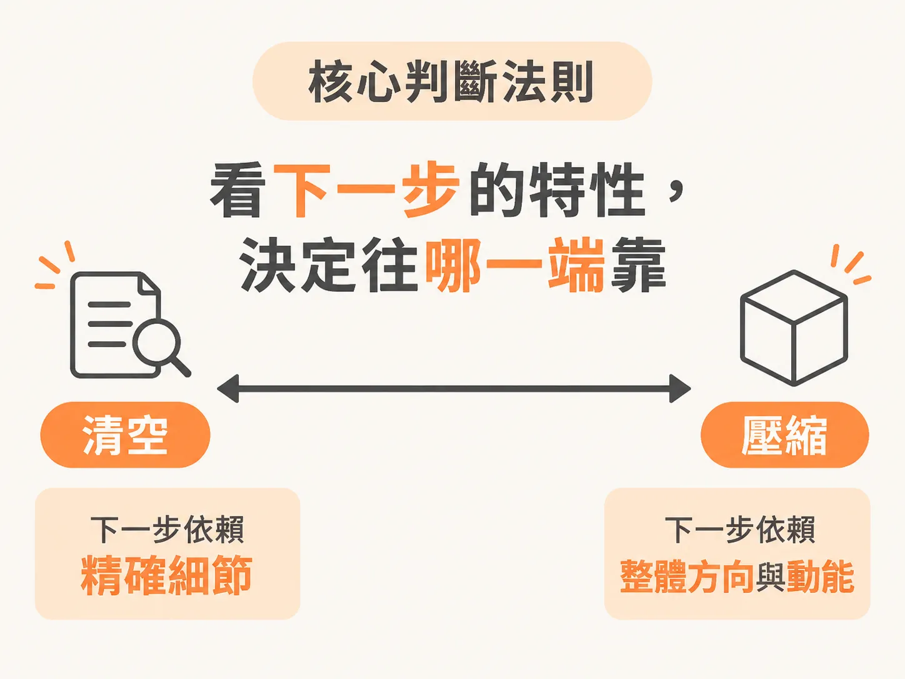

# 重設對話上下文：該選 Clear 還是 Compact？

當對話進行了一陣子，模型開始出現遺忘、重複說過的話，甚至前後矛盾時，這代表上下文視窗已經過載，出現了上一節說的上下文腐化（context rot）。要解決這個問題，最直接的方法就是重設。

但重設並不是只有一種做法，而是分成兩種截然不同的操作：清空（Clear）與壓縮（Compact）。選錯了方式，往往會付出意料之外的代價。

## 兩種重設方式的運作差異

清空與壓縮解決的是同一個根本問題——上下文視窗塞了太多東西。但它們處理的方式完全不同：

- **清空（Clearing）**：徹底抹除整個對話視窗。對話變成全空狀態，沒有保留任何先前的內容，下一道提詞完全從零開始。
- **壓縮（Compacting）**：由模型把目前的對話濃縮成一份摘要，並在後續的對話視窗中保留這份摘要。視窗不是空的，而是體積變小、結構被重新整理過。

表面上看，壓縮似乎是更好的選擇：既然能把內容縮小保留，為什麼要全部丟掉？

然而，壓縮有一個致命的隱憂：這份摘要是由模型自動產生的，而且你在它正式變成新的上下文之前，通常沒有機會逐字審查。如果某個關鍵細節在壓縮過程中被漏掉，或者文字被微妙地改寫而改變了原意，你很難即時察覺——因為被漏掉的資訊，顧名思義已經不在眼前了。

清空則完全沒有這種風險。清空之後的視窗就是一片空白，沒有任何會讓你失去追蹤的隱藏變數。你非常清楚視窗裡有什麼——就是什麼都沒有，直到你自己重新把需要的資訊放進去。

因此，評估兩者的一個基本原則是：**清空很可預測，因為它消除了不確定性；壓縮很有效率，但它是用「失去可預測性」來換取便利。**

## 兩者各自要付出的代價

這兩種做法都沒有免費的午餐，各自有必須承擔的成本：

- **清空的代價**：丟失連續性。如果你剛走過十幾輪對話，累積了繁瑣的推導或脈絡，清空意味著所有對話軌跡一筆勾銷。要推進任務，你必須花時間自己把關鍵條件重新交代一次。
- **壓縮的代價**：承受有損壓縮（lossy summary）的風險。你必須把前幾十輪的細節正確性，交由模型的摘要能力來賭一把，承擔細節遭遺漏或被扭曲的風險。

做決定的關鍵，不在於哪一個方法絕對正確，而在於你目前更願意承擔哪一種代價。

## 什麼時候該用 Clear？什麼時候該用 Compact？

你可以根據當前的工作狀態與下一步的需求來挑選：

### 適合使用 Clear 的時機

1. **準備開始全新的任務**：這項新任務與剛才進行的內容完全無關。
2. **對話方向已經嚴重偏離**：模型開始出現重複、遺忘或前後矛盾的行為。
3. **下一步高度依賴精確細節**：與其冒險相信摘要會完整保留事實，你寧可自己動手重述那兩三個真正關鍵的事實。

### 適合使用 Compact 的時機

1. **深入一項漫長且連續的任務**：如果停下來把所有背景重新解釋一遍，花費的時間遠超過承受一份有損摘要的風險。
2. **對話歷程本身具有延續價值**：例如針對架構或設計決策進行了長時間的反覆討論，失去這段討論的脈絡軌跡，比摘要出現微小瑕疵更令人難以承受。
3. **下一步依賴的是整體方向與動能**：比起單一數值或規則的絕對精準，維持目前的開發節奏更重要。

## 實戰判斷：電商結帳系統的抉擇

想像一個實際開發情境：你在第 4 輪對話中特別要求模型「本專案所有金額一律以整數的美分（cents）儲存，絕不能用浮點數的美元，資料規格請依照這個原則建立」，模型也確實配合建立了欄位。

接著從第 5 輪到第 19 輪，你們連續進行了 15 輪對話，陸續實作了購物車邏輯、折扣功能、稅金計算、訂單摘要頁面以及各項介面調整。

到了第 20 輪，你要新增退款功能，並且要求「必須支援部分退款，且金額需精確到美分」。

這時視窗過載了，你該清空還是壓縮？

如果你選擇壓縮，最令人提心吊膽的，正是第 4 輪那個「金額一律存為整數美分」的嚴格限制。退款功能涉及金額拆分與計算，一旦這個關鍵規則在 15 輪後的摘要中被稀釋或漏掉，模型很可能會擅自改用浮點數來處理退款金額，導致整套系統的金額邏輯出現破綻。

在這種情況下，下一步能否正確運作，完全取決於這個精確細節。最穩妥的做法往往是**選擇清空，接著在下一道提詞中，親手把這條計價規則連同退款需求一起重新交代**。雖然放棄了中間 15 輪的對話痕跡，但你換來了對關鍵邏輯的百分之百掌控。

## 核心判斷法則

歸納兩者底層的判斷邏輯，關鍵只有這句話：

- **下一步越需要精確細節：偏向 Clear。**
- **下一步越依賴整體方向與前進動能：偏向 Compact。**

不過，清空與壓縮終究是出事之後的補救。真正能讓 agent 少出錯的做法，是在對話開始之前就把該常駐的規則準備好——那就是下一節要處理的 AGENTS.md。
