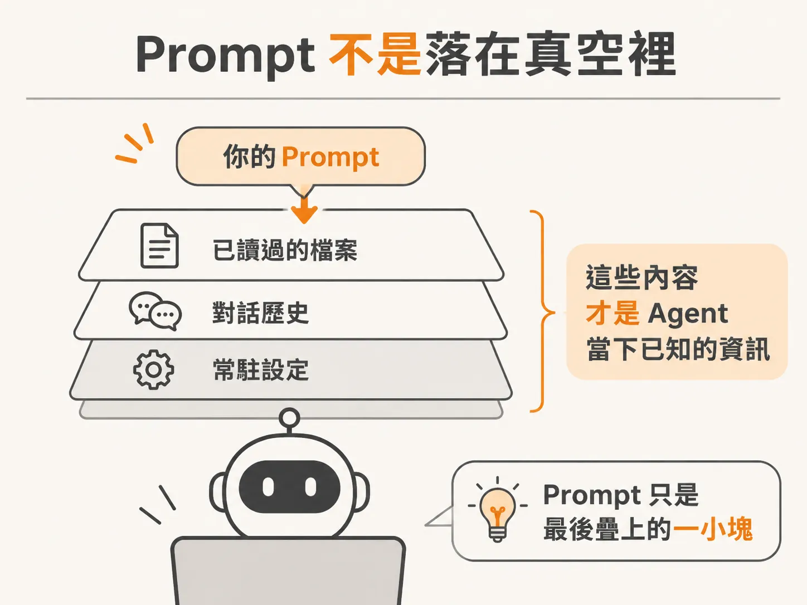
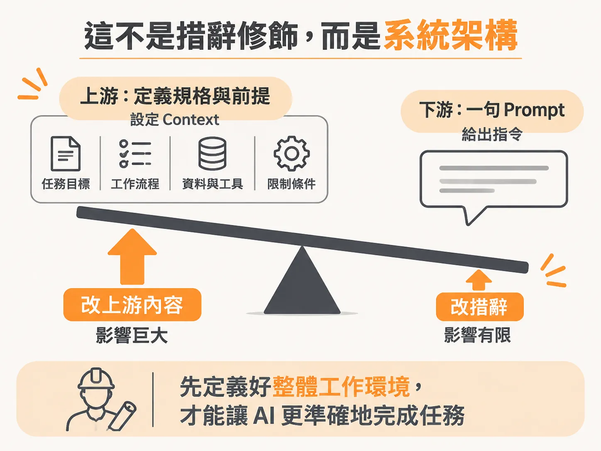
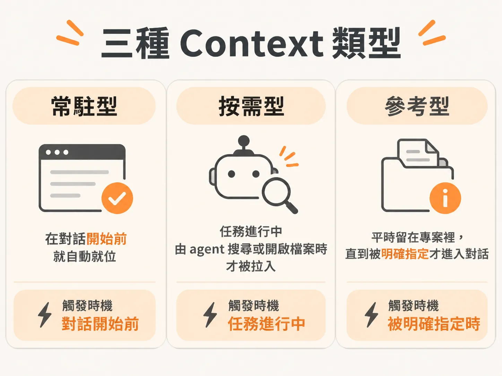
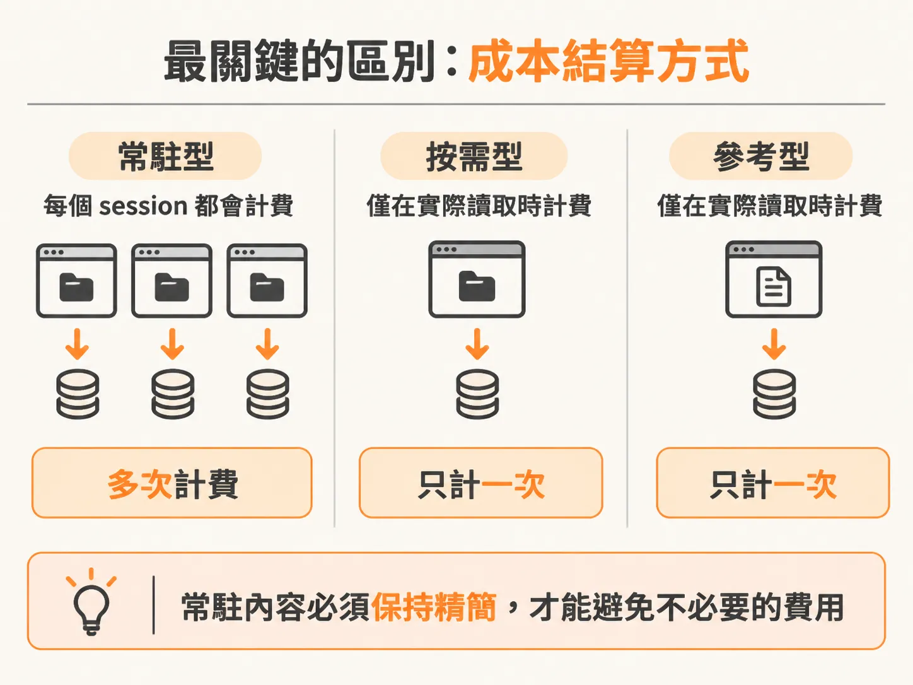

# Context Engineering：在寫 Prompt 之前，先設計 Agent 該知道什麼

當 AI agent 寫出來的程式碼不如預期時，大多數開發者最先採取的手段幾乎如出一轍：修改 prompt。調整措辭、補充細節、換個更精確的句型。網路上有大量的教學指南都在告訴你，prompt 就是掌控輸出的關鍵槓桿，彷彿只要講得夠漂亮、夠完整，agent 就能把事情做對。

但這個直覺找錯了施力點。

## Prompt 不是落在真空裡

當你按下 Enter 送出一段指令時，那段 prompt 並不是進入完全空白的世界。它落在 agent 當下已經知道的所有資訊之上——包括它剛才讀過的所有檔案、這場對話累積的歷史紀錄，以及一開始就載入它的常駐設定。

這整個圍繞著對話的環境，就是上下文（context）。你剛剛輸入的那行 prompt，只是進入這個龐大環境裡的一小部分。最終輸出的品質好壞，取決於這個環境遠多於你字斟句酌的那行字。

Agent 永遠只能根據當下已經載入的內容做判斷。如果 context 裡空無一物，即使寫出全世界最優美、最詳盡的 prompt，agent 依然只能用猜的，因為你給了它完美的句子，卻沒給它任何可以工作的材料。

反過來看，如果你只送出一段粗糙、簡單的 prompt，但 context 裡早已備妥正確的檔案、專案慣例與限制條件，agent 往往第一次就能寫對。

同樣的 agent，甚至是同一個模型，表現卻天差地遠。關鍵差別從來不是 prompt，而是它周遭存在著什麼資訊。

## 這不是措辭修飾，而是系統架構

真正的技術核心從來不是寫出更好的 prompt，而是在 agent 讀到任何 prompt 之前，先設計好它到底該知道什麼。這就是 **Context Engineering（上下文工程）**。

「工程（engineering）」這個詞才是這裡的重點。這不是在推敲字句，而是在做系統設計。你必須提前、有意識地決定：

* 哪些資訊必須載入，哪些不該載入？
* 哪些資訊是 agent 永遠都該掌握的？
* 哪些資訊應該等它需要時才去抓取？
* 又有哪些內容根本不該讓它帶著到處跑？

這就像建築師在工地現場的角色。建築師不會只丟給施工團隊一份模糊的簡報，然後在旁邊祈禱工人自己搞清楚；他們會在工人砌下第一塊磚之前，把所有規格與前提全部定義清楚。Context engineering 就是為 AI agent 搭建這套工作環境的方法。

Prompting 當然還是有它的作用，但它是整條工作鏈條中最後、也最小的一環。真正的槓桿存在於更上游的 context 當中。過去許多 AI 編程失控的狀況，追根究底都不是因為沒有許願成功，而是源於某個沒有被刻意規劃的 context 決策。

在著手規劃時，專案中的資訊可以清楚拆解為三種不同的 context 類型。

## 三種 Context 類型

要做好 context engineering，第一步是分清 agent 接觸資訊的三種不同方式：

### 1. 常駐型上下文（Always-on context）

這是 agent 在每一次對話啟動時、在你輸入任何一個字之前，就自動擁有的資訊。你不需要主動要求，它就在那裡。

在大多數工具裡，這通常存放在單一檔案中（例如專案裡的 `AGENTS.md`），作為專案的常設簡報。它涵蓋了技術堆疊、核心規範，以及無論當天要做什麼任務都永遠成立的規則。舉例來說，如果專案內部處理金額一律使用整數的「分（cents）」，絕對不允許使用浮點數的「元（dollars）」，這就是一條必須常駐的事實。Agent 每次執行任務都必須知道這件事，否則就會在不知不覺中寫出錯誤的金錢邏輯。

常駐型上下文的本質特徵，在於**無論它與你當下正在處理的工作有沒有關係，它都會被載入**。這正是它的用途，但同時也是必須謹慎對待的代價——它的每一行內容，在每一次對話中都在消耗成本與記憶容量，因此規模必須嚴格保持在最精簡的範圍。

### 2. 按需型上下文（On-demand context）

這是 agent 在執行任務的過程中，因為工作需要而自己拉進來的資訊。

例如 agent 執行搜尋後開啟的檔案、某個技能觸發條件符合後載入的指令本體，或是它逐行檢視的 grep 搜尋結果。Agent 透過搜尋與閱讀逐步找到答案，每一次的讀取動作，都是按需型上下文：在需要的時刻才載入，需要之前絕不提前引入。

它的關鍵特質在於**只有在真正用到時才產生成本**。Agent 主動去拿、拿來使用，之後這段資訊在當次對話中就持續可用；但那些不需要這份資料的任務，就完全不必負擔它的載入代價。

### 3. 參考型上下文（Reference context）

這是專案中客觀存在、但除非被明確指定否則不會進入 context 的所有內容。包含產品規格書、設計文件，或是躺在磁碟裡的其他程式庫原始碼。

它隨時可用，但預設不會載入，agent 也不會自己在工作過程中意外踩到它。它只有在受到你、或是某個檔案的明確指示時，才會被帶進對話中。

這也是它與按需型上下文的界線所在：按需型是 agent 在工作時自己伸手去抓；參考型則是有人主動指給它看才被載入，例如你在指派任務時附上的特定規格書，或是文件裡明確連結的說明。

## 最關鍵的一項區別

區分這三種 context 時，最重要的衡量標準只有一個：

* **Always-on**：每一個 session 都在支付代價。
* **On-demand 與 Reference**：只有在使用時才支付代價。

明白這個成本結構後，看待專案檔案的角度就會完全改變。程式碼本體也是 context 的一部分，決定哪些規則放進常駐檔案、哪些留待搜尋、哪些作為參考文件備查，正是讓 agent 能穩定產出高品質成果的核心基本功。

這三種 context 的成本結構，也帶出接下來兩個實務問題：視窗為什麼這麼快就滿，以及滿了之後該怎麼重設。
