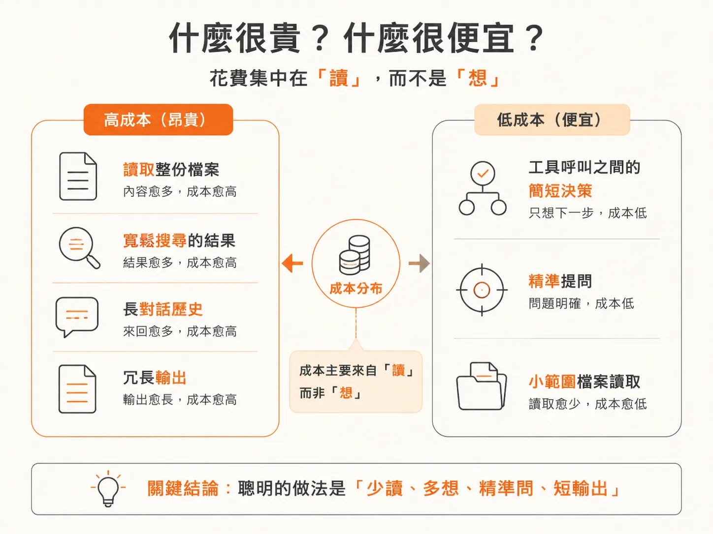
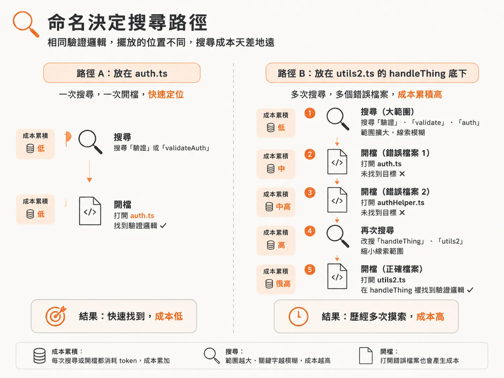
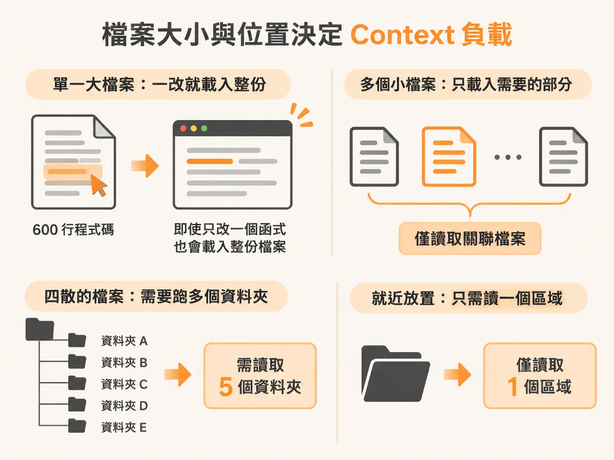
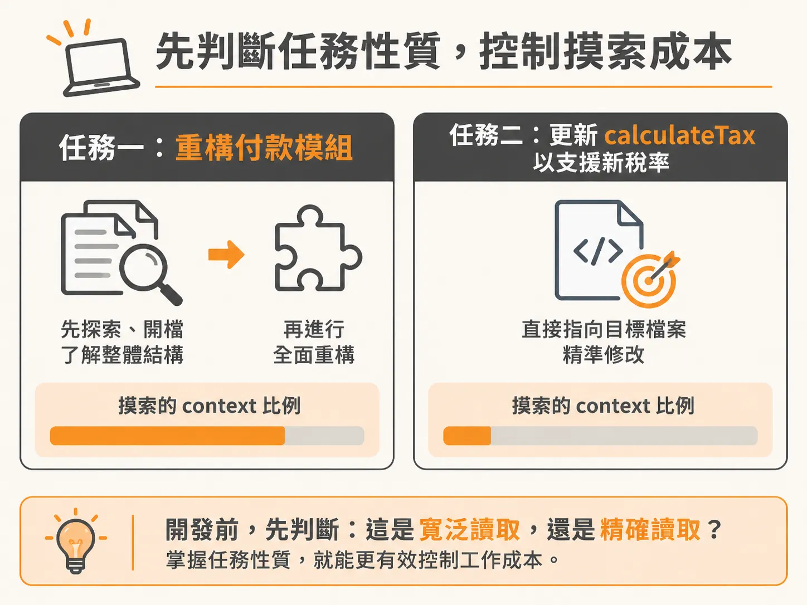

# 讀很貴、想很便宜：如何用命名與結構管好 Agent 的 Token 成本

上一節看的是上下文視窗怎麼被探索塞滿。但同樣是佔用視窗，塞進去的東西成本其實大不相同——這正是你被逼著隨時清空或壓縮對話時，最該先搞懂的一件事。

我們不必精確計算每個 token 的數目——token 只是大約幾個字元長度的文字區塊。你真正需要建立的直覺，是知道哪些動作會劇烈燃燒 context 預算，哪些動作幾乎不佔成本。

最關鍵的規律只有一句話：**讀很貴，想很便宜（Reading is expensive, and reasoning is cheap）。**

## 什麼很貴？什麼很便宜？

這句話解釋了 context 預算的大多數去向。具體區分開來，昂貴與便宜的操作如下：

### 昂貴的操作

1. **讀取檔案**：這是最大的開銷。Agent 每打開一個檔案，就會完整載入所有內容。裡面的每一次 import、每一行註解，以及目標程式碼上下方毫不相關的函式，全部都會塞進視窗。一份 300 行的檔案，無論 agent 只需要其中的 10 行還是全部，都會花費大約 300 行的 token 成本。
2. **搜尋結果**：每一次 grep 匹配、glob 結果，包含檔案路徑、周圍上下文、行號，都會進入視窗。在大型專案中進行寬鬆搜尋可能會傳回幾十筆結果，即使最後證實無關，你也得全額支付這些 token。
3. **長對話歷史**：在對話清除或壓縮之前，每一輪互動都會留在視窗內。累積 60 次來回的 session，必須背負整整 60 次互動的 token 成本，而不是只有最近幾筆。
4. **冗長輸出**：當 agent 詳細解釋推理過程，或產出大段程式碼時，這些回應本身都在燃燒 token，而不僅僅是它為了得出結論所閱讀的內容。

### 便宜的操作

1. **簡短且具針對性的推理**：在工具呼叫（tool calls）之間進行的快速即時決策——例如「下一步該打開哪個檔案？」或「這符合我要找的條件嗎？」——相較於為了做決策所讀入的資料，本身的思考成本非常低。**做決定很便宜，搜集資訊來做決定卻很貴。**
   
   這裡需要特別劃分範圍：這指的是流程中的日常例行判斷，而不是說所有思考都免費。當模型開啟深度思考（extended thinking）去處理複雜 bug 或大型架構權衡時，確實會消耗可觀的 token；但那種深度推理解決的是高價值問題，與日常決策不同。
2. **精準的問題**：提出具體、範圍明確的要求（例如「`validateSession` 函式的作用是什麼？」），成本遠低於模糊的問題（例如「解釋這個專案的驗證機制怎麼運作」）。模糊的問題會迫使 agent 發動更大範圍的搜尋、打開更多檔案。
3. **小範圍的檔案讀取**：打開一個 20 行的工具函式，成本只有打開包含該函式的 400 行大檔案的一小部分。

## 命名與檔案結構如何左右讀取量

這項成本原則直接關係到專案的工程品質。程式碼本身就是 context；你組織程式碼的方式，決定了 agent 是一次讀取到位，還是反覆搜尋盲猜。

### 命名決定搜尋路徑

Agent 手上沒有專案的全局索引，它必須依靠搜尋和開檔來定位程式碼。如果驗證邏輯放在名為 `auth.ts` 的檔案裡，agent 搜尋一次、打開一個檔案就找到了；但若同樣的邏輯被塞在 `utils2.ts` 裡、函式命名為 `handleThing`，agent 就必須發動更大範圍的搜尋、打開多個錯誤檔案，並為每一次摸索支付 token 代價。

不良的命名意味著更多的搜尋、更多的猜測，以及在找到正確位置前打開更多無關檔案。這也是為什麼清楚的命名與工程基礎規範在 AI 時代反而更重要。

### 檔案大小與位置決定 context 負載

當功能拆分成單一職責的小檔案時，agent 讀取的幾乎就是它需要的片段；但若把程式碼全塞在單一大檔案中，即便只改動一個函式，也會把整份檔案的 import 與周圍雜訊一併拖入視窗，造成人為的 context 腐化。

同樣地，將經常一起變動的檔案就近放置（colocation）能把橫跨數個目錄的尋寶過程，縮減為單一區域的讀取。

## 實務上的工作習慣與檢查方式

要在日常開發中維持成本意識，你不需要時時刻刻精打細算，只要建立一個核心習慣：**在發出任務前，先檢視這會迫使 agent 進行「寬泛讀取」還是「精確讀取」。**

- **寬泛讀取**：「重構付款模組。」這句話會迫使 agent 在動手前讀取大量背景資料。
- **精確讀取**：「更新 payments 檔案裡的 `calculateTax` 函式以支援新稅率。」agent 能直接鎖定目標位置，省下昂貴的摸索過程。

這也為清理與壓縮對話提供了判斷標準：如果目前的 session 已經花費大量 token 在廣泛探索上，而這些資訊對下一步沒有幫助，直接清空 context 重述精準任務，幾乎零成本，卻能省下後續整路背負無用歷史的負擔。

在 Claude Code 中，你可以隨時輸入 `/context` 指令，查看目前 session 的即時 token 分配：包括系統提示詞、工具、記憶檔、技能、對話歷史與剩餘空間。在實際開發中跑一次這個指令，就能親眼看到「讀很貴、想很便宜」不再只是抽象原則，而是清清楚楚的具體數據。

有了成本直覺，下一個實務問題就是：當視窗真的過載時，該清空還是壓縮？
