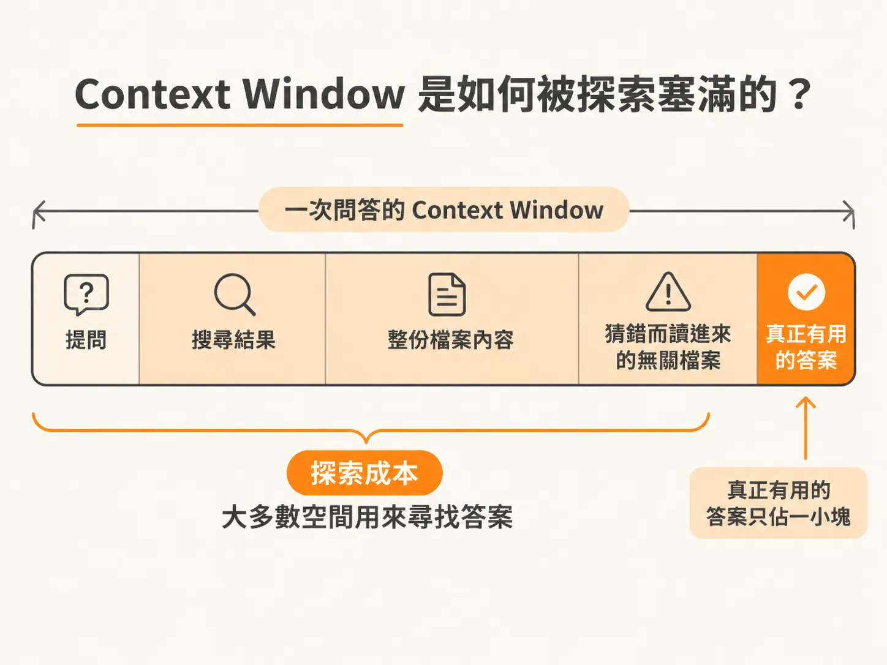
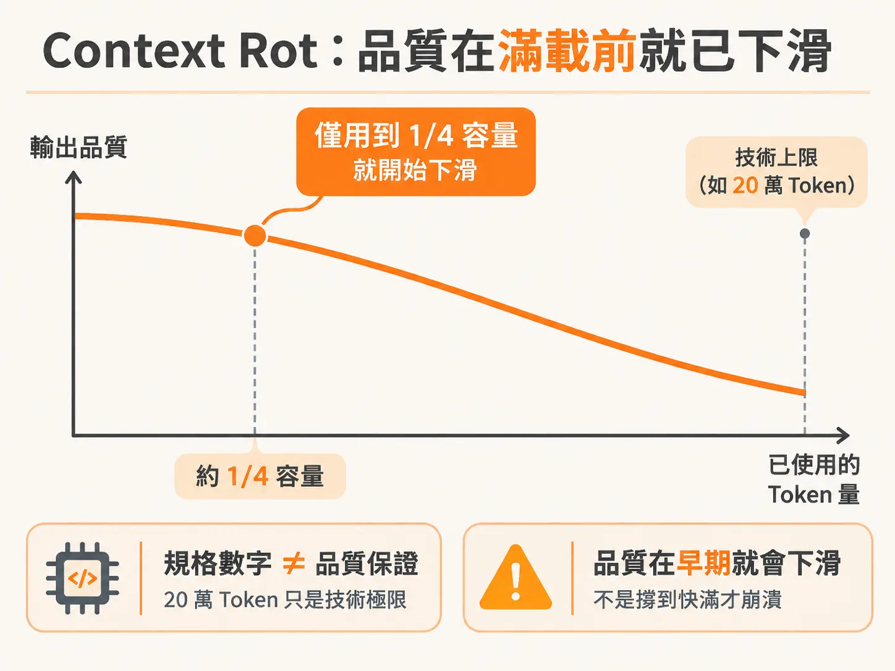
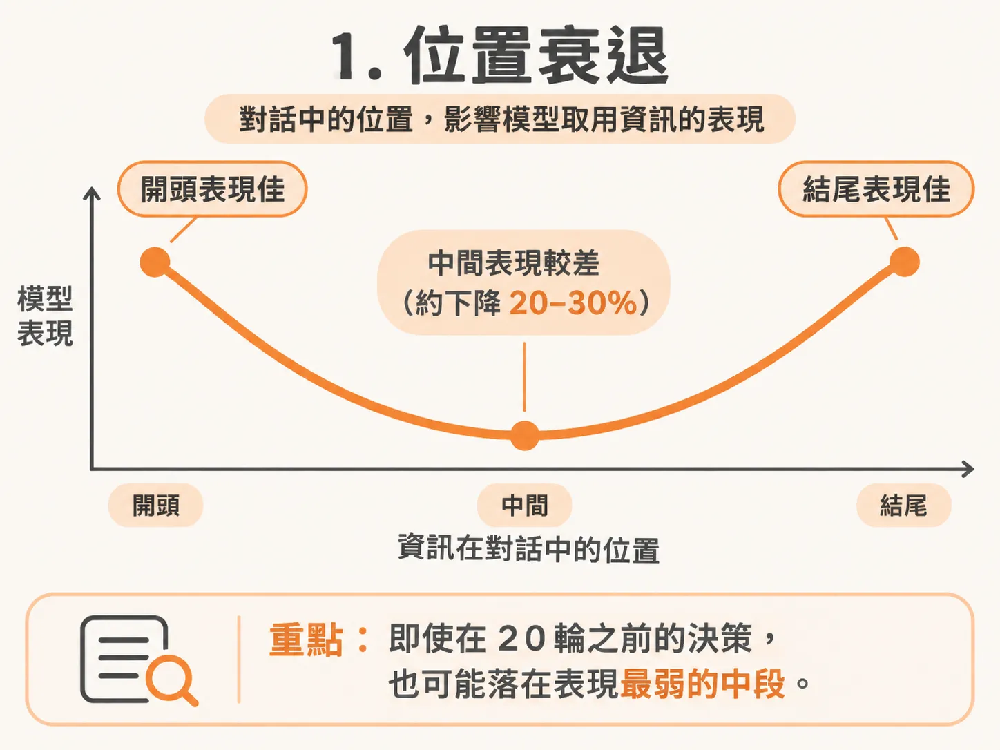
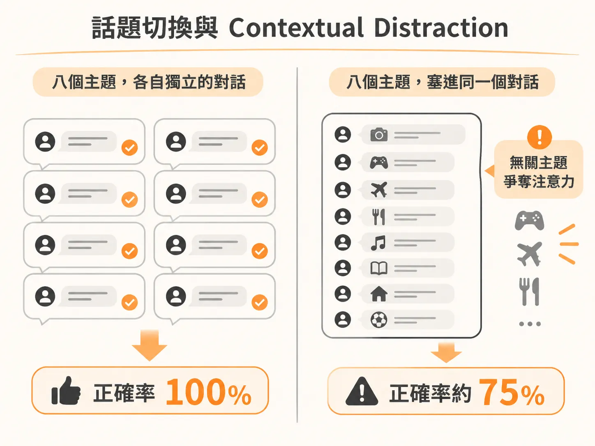

# 為什麼 Context Window 總是被探索塞滿？談 Context Rot 與品質提前下滑

在使用 AI agent 開發功能時，你可能遇過這種情況：對話明明才進行十幾輪，模型卻突然開始「失憶」，提出剛剛被否決的解法，或是推翻稍早討論好的架構。

許多人以為只有當 context window（上下文視窗）完全被塞滿時，模型才會出問題。但事實上，視窗裡的空間往往不是被「有用的答案」佔據，而是被「尋找答案的過程」快速耗盡；而且早在視窗見底之前，模型的回答品質就已經開始大幅下滑。

## Context Window 是如何被探索塞滿的？

AI agent 在為你解答問題時，會經歷搜尋、篩選和閱讀檔案的過程。所有這些步驟看過的、寫過的內容，都必須放進同一個地方：context window。

你可以把 context window 想成一個有嚴格容量上限的容器。在整個 session（對話階段）中，agent 讀過的所有內容、你輸入的所有文字、agent 做出的每一次回覆，全都擠在這個容器裡。

現在有些工具宣稱支援多達 100 萬個 token 的超大視窗。這個數字聽起來大到永遠用不完，但它的消耗速度遠比大家想像的快得多。

以一個簡單的驗證（auth）問題為例，容器是這樣被填滿的：

1. **你的提問**：這部分佔用的 token 其實非常少。
2. **搜尋結果**：agent 執行搜尋後，每一筆符合的項目、檔案路徑，以及用來評估上下文的周邊程式碼，全部都進了視窗。這不是免費的，全都是實打實的 token。
3. **開啟並閱讀檔案**：agent 接著打開檔案。它不是只讀相關的函式，而是載入整份檔案，包含所有的 import、註解，以及目標函式上下無關的所有程式碼。
4. **猜錯並開啟無關的檔案**：agent 可能猜測某個檔案有關，點開後才發現毫無關聯。這次猜測雖然失敗了，但這些讀進來的內容依然留在 context window 裡，token 不會退還給你。
5. **最終的答案**：你真正想要的核心解答，其實只是最末端那一小段文字。

仔細看這個比例：你真正在乎的答案只有一小塊，視窗裡剩下的絕大多數空間，全是探索、搜尋、盲猜、開啟無關檔案，以及閱讀非必要程式碼所產生的代價。

一題問答就已如此，如果放大到實際開發——例如用 30 到 40 次來回互動去打造一個完整功能——每一輪都在重複「搜尋、開啟檔案、猜錯、擷取答案」的循環。視窗會被塞爆，不是因為你的專案特別龐大，而是因為「探索」本來就需要極高成本，而 agent 在行動之前又非得先探索不可。

這也是為什麼良好的專案結構與清楚的命名如此關鍵：結構清楚，agent 就能減少猜錯的次數與無謂的探索，把寶貴的視窗空間留給真正重要的工作。

## Context Rot：品質在滿載前就已下滑

當視窗逐漸被探索過程塞滿時，agent 不會突然「當機」，而是行為開始變質。這個現象稱為 **Context Rot**（上下文腐化）。

2025 年的一項研究測試了 18 種前沿模型在不同上下文長度下的表現，結果無一例外：只要輸入的 token 增加，輸出品質就會下降。

更值得注意的是，品質下滑不是在視窗快滿時才像懸崖一樣突然跌落。以宣稱支援 20 萬 token 的模型來說，往往在用到 5 萬 token（僅容量的四分之一）時，就出現了肉眼可見且可測量的衰退。規格表上的數字只是技術極限，不是維持高品質表現的保證。

研究指出了導致品質下滑的兩個獨立機制：

### 1. 位置衰退（Positional degradation）
資訊在視窗中的擺放位置影響巨大。測試顯示出明顯的「U 型效應」：擺在對話最開頭與最末端的資訊，模型掌握得最好；而被埋在中間的資訊，表現明顯較差，在對照測試中甚至會下滑 20 到 30 個百分點。

這就是為什麼你在二十次對話前做出的決策，後來會感覺被模型「遺忘」了。它並沒有消失，依然躺在視窗裡，只是正好落在模型注意力最脆弱的中間區段。

### 2. 長度衰退（Length degradation）
即使關鍵資訊被放在開頭等有利位置，只要周圍的上下文總量增加，準確率依然會下降。研究發現，在任務完全不變的情況下，僅僅將輸入長度從幾百個 token 增加到幾千個 token，推理解題準確率就從 92% 掉到 68%。如果某個事實不是一字不差重複而是被換句話說，多數模型在累積到 3.2 萬個 token 時，準確率就會跌破短上下文時期的一半。

這代表容量本身就有代價，單純「空間變大」並不等於「表現可靠」。

## 話題切換與 Contextual Distraction

在同一個對話中頻繁切換無關主題，會讓 Context Rot 更嚴重。

有研究直接測試了話題切換的影響：如果每個主題都在乾淨獨立的對話中進行，模型能達到 100% 的正確率；但若把八個無關主題連續塞進同一個對話裡，正確率直接掉到約 75%。模型本身沒有改變，唯一的變數是多了一堆無關的內容在競爭注意力。

這種現象在研究中被稱為 **Contextual Distraction**（上下文分心）：對話前半段無關的材料，會顯著把模型的注意力從當前的問題上拉走，即便前面的討論也是技術話題而非隨機雜訊，情況依然一樣。

在日常開發中，這會表現為三種常見毛病：

* **重複建議**：稍早明明已經試過且被你否決的解法，agent 又再次提出。這不是粗心，而是當初拒絕該解法的紀錄，已經在大量累積的上下文中被淹沒。
* **遺忘決策**：一開始就已經定案的決策，agent 後來又重新提問，彷彿從未討論過。該資訊還在視窗中，只是競爭不過其他內容。
* **前後矛盾**：在長對話的不同時間點詢問同一個問題，agent 給出了前後矛盾的答案，因為它對自己稍早推理過程的掌握力已經變弱。

當你發現 agent 開始出現這些狀況時，並不是模型的能力在第 80 則訊息時突然縮水，而是視窗裡充滿了先前探索留下的雜訊與無關主題，導致關鍵資訊的比例被嚴重稀釋。

在實務上，比起在一個 session 裡從修 bug 聊到架構設計、再做新功能、最後又跳回修 bug，為每個獨立任務開啟新的對話，更能讓模型維持在最佳狀態。

不過，視窗被塞滿只是一半的故事。下一個問題是：塞進去的每一樣東西，價格都一樣嗎？
