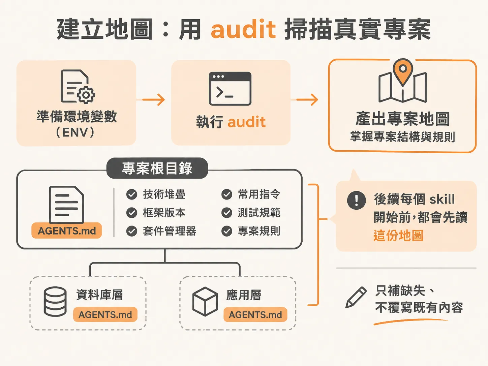
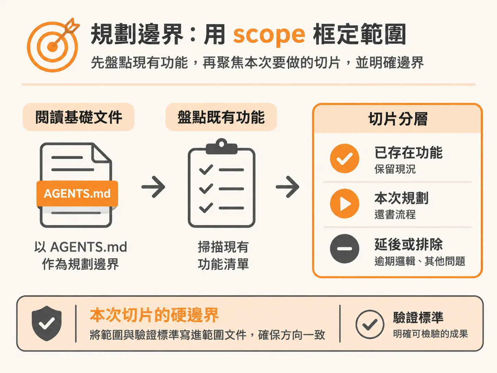
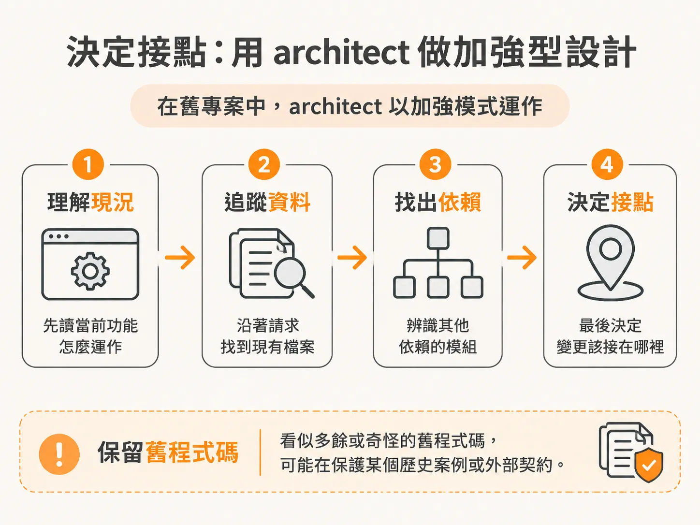
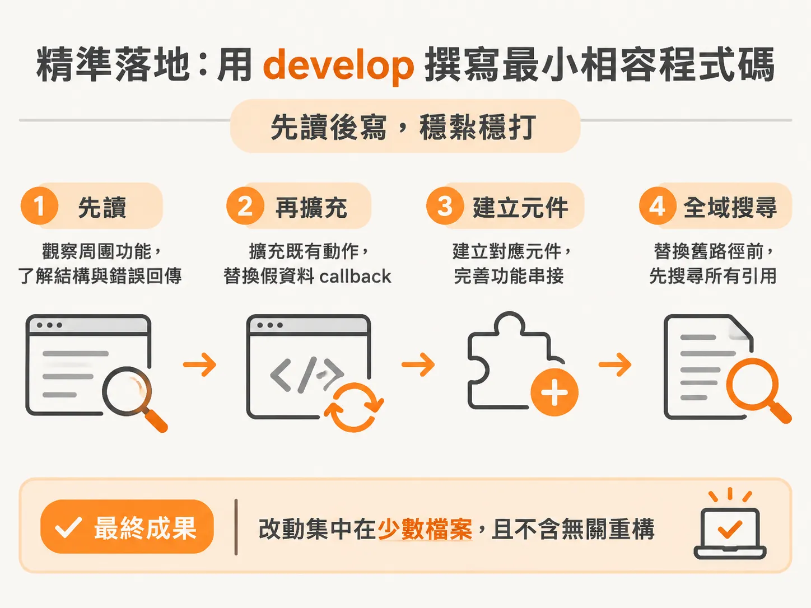

# 在既有專案裡先建立地圖，再用最小安全修改交付功能

前面幾種壞掉，至少都發生在你熟悉、自己一路建起來的專案裡，你知道東西原本該怎麼運作。換成別人寫的程式碼，這層熟悉感就沒了。

剛接手一個別人寫的專案時，最危險的直覺就是直接打開 AI 工具，下 prompt 請它幫你改程式碼。

在空資料夾裡開新專案，AI 可以憑空產生漂亮的骨架；但在已經運作數年的既有專案（brownfield codebase）裡，系統充滿了沒有寫在文件上的慣例、歷史包袱與外部整合。如果沒有先給 AI 一張精準的「地圖」，它就會發揮想像力自行猜測，甚至引入衝突的套件或破壞已上線的行為。

面對別人的程式碼，正確的順序永遠是：**先透過 audit 建立地圖，再沿著 scope → architect → develop 的流程，做出最小且安全的修改。**

---

## 建立地圖：用 audit 掃描真實專案

以一個真實的大學校園圖書館開源專案「BookWise」為例，這個專案歷經 140 次檔案變更，寫於兩年前，擁有 62 個以上的原始碼檔案、既有的資料庫遷移腳本（migrations）與身分驗證邏輯。使用者可以註冊、填寫學號與密碼、上傳學生證圖片，登入後能瀏覽書本與簡介；但若要借書，系統會提示帳號必須先經過管理員審核。

面對這樣一個專案，首先要收集好所需的環境變數（ENV），接著開啟終端機視窗執行 `audit`。

在空白專案中，audit 通常會詢問你偏好的編碼風格；但在已經成型的專案裡，它的行為完全不同，會自動進入全儲存庫掃描（Phase 2: Whole Repo Scan）：

1. **掃描歷史與結構**：檢查既有的套件設定、檔案關聯與提交紀錄。
2. **背景探索周邊工具（Agent Skills 與 MCP）**：
   audit 發現專案大量依賴特定的技術堆疊，會主動詢問是否要配置對應的技能與 MCP 伺服器。確認後，它會在背景啟動子代理（sub-agent）進行探索，維持主對話視窗的簡潔。在 BookWise 中，它辨識出專案使用了 Neon、Drizzle、Auth.js（NextAuth v5）與 Upstash，並建議掛載 Neon、Upstash 與 ImageKit 的 MCP 連線。
3. **安全審查與判斷權保留**：
   在掃描套件時，安全工具 GenScanner 可能會將某些內容（例如 Auth.js skills）標記為風險。audit 不會擅自決定，而是把決策權留給工程師，由你判斷是否剔除不需要的套件。
4. **輸出全域與巢狀脈絡檔案（AGENTS.md）**：
   audit 會將所有資深工程師在第一天會告訴你的關鍵資訊寫入 `AGENTS.md`（並建立一行的 `CLAUDE.md` 指向它作為指標），包含語言執行階段、框架精確版本、套件管理器、常用指令、測試規範與潛在陷阱。

### 什麼時候需要巢狀 AGENTS.md？

audit 並不會為每一個資料夾都產生說明檔。它的原則是克制：**只有當專案的特定目錄擁有專屬規則、獨立指令、外部整合或特殊的區域風險時，才會放置局部的 `AGENTS.md`。**

在 BookWise 中，audit 建立了兩份巢狀設定：

- **資料庫層（`database/AGENTS.md`）**：
  記錄 Drizzle ORM schema、Neon Postgres 連線、Redis 用戶端，以及獨立的開發用 seed 腳本。說明 `schema.ts` 是資料模型的單一真實來源（Single Source of Truth），包含使用者、書籍、借閱紀錄，以及角色與借閱狀態的 Postgres 列舉值（enums）。
- **應用層（`app/AGENTS.md`）**：
  梳理各個版面配置（layouts）的權責，例如登入註冊專用的 auth layout、根目錄 root layout 以及 admin layout 的慣例。

如果是 Monorepo 結構，audit 則會在根目錄保留簡短的通用規則，並為各個 workspace 建立獨立的 agent 檔案。它絕不會隨意覆寫既有內容，而是只補足缺失的脈絡。

### 人的職責：驗證地圖

產出地圖後，不能直接進入開發。身為工程師，你的第一項任務是拿產出的地圖對照真實專案：

- 記錄的技術架構與版本正確嗎？
- 上面列出的日常指令真的可以跑嗎？實際挑一兩個指令在終端機執行看看。
- 它是否遺漏了明顯的專案慣例？或者給出了程式碼根本不支援的推論？

---

## 規劃邊界：用 scope 框定範圍

地圖驗證無誤後，如果只是改一行錯字，可以直接跳到 develop；但只要是新增或調整功能，就該先執行 `scope`。

執行 `scope` 時，它會先閱讀剛剛 audit 產出的 `AGENTS.md`，以此為邊界，掃描既有功能清單，並詢問你想著手的目標切片（slice）。

以新增「還書與續借流程（Return and Renewal Flow）」為例：

1. **功能盤點（Feature Inventory）**：
   scope 掃描後，將既有程式碼歸類出 14 個已存在功能、2 個延後（deferred）項目，並將這次要規劃的「還書」標記為第 1 號計畫功能。
2. **捕捉既有線索**：
   scope 發現系統中其實早就存在還書流程需要的零碎片段，例如 schema 裡的 return status、後台的借閱紀錄，以及提醒工作流程中的歸還檢查。
3. **記錄周邊異常但不越界**：
   掃描過程中，它順便發現了其他區域的既有問題（如使用者與書本缺乏刪除動作、管理員審核通過時尚未真正發送郵件、存在 `sign in` 與 `sign-in` 的路徑不一致等），但它會把這些問題記下並排除在本次切片之外，避免工作範圍無限發散。
4. **輸出 `docs/scope.md`**：明確記錄本次範圍為「僅限還書，逾期邏輯延後」，確定構建方式與驗證標準。

---

## 決定接點：用 architect 做加強型設計

在新專案中，architect 是從零設計架構；但在舊專案中，它是以**加強模式（enhancement mode）**運作。

它絕不會一上來就說「整段重寫比較乾淨」，而是：

1. **順藤摸瓜**：先閱讀當前功能如何運作，沿著請求路徑追蹤現有檔案與使用的資料，找出所有依賴它的外部模組。
2. **分階段確認需求**：
   - 誰有權限觸發還書？（設定為：僅限 Admin）
   - 狀態更新是否需要即時且具備原子性（atomic）？
   - 當發現資料庫操作無法在單一步驟保證原子性時，architect 會主動提問，確認是否拆成兩階段處理。
3. **保留未知的歷史程式碼**：
   舊專案裡看似奇怪的判斷式，可能是幾年前某個邊界案例的防禦措施；多餘的查詢可能是為了解決特定環境的部署問題。architect 絕不會因為看不出用途就隨意刪除舊邏輯。
4. **產出規格書（`specs/1-return-a-book.md`）**：
   明確記錄變更屬於哪個模組、哪些現有行為必須維持不變、哪些檔案需要調整，以及如何驗證修改成果。

---

## 精準落地：用 develop 撰寫最小相容程式碼

規格確認並更新進 scope 後，清理階段 session，執行 `develop` 進行實作。

develop 遵循「先讀後寫」的原則：

- **借用既有邏輯**：它確認規格書提到的 `lib/actions/book.ts` 伺服器動作（Server Action）已具備基礎，便直接在此擴充管理員還書邏輯，並掛上伺服器端的權限檢查。
- **沿用現有元件風格**：修改後台管理選單，將原本只印出 `console.log` 的假資料 callback 替換為真實的 `onItemSelect` 事件，並建立對應的 Client 端資料列元件。
- **清除舊路徑**：在替換舊有的暫代邏輯前，全域搜尋是否有其他檔案依賴該程式碼，避免新舊邏輯並存導致狀態不一致。
- **隔離不相關的排版與 Lint 雜訊**：在檢查型別與程式碼風格時，若發現既有檔案原本就殘留 lint 警告，除了隨手修復外，develop 也能區分「哪些是本次新增的改動、哪些是既有問題」，確保 git diff 乾淨聚焦。

這次的修改最終只動到了 4 個檔案，完全沒有動到額外的資料庫 migration，就順利在從未接觸過的專案裡把功能接上。

---

## 交付前的自我檢驗

當修改完成，後續可以透過 `check verify` 驗證功能運作，並用 `check review` 進行跨模型審查。但在準備提交 PR 之前，請先用這四個問題檢驗自己：

1. 你能清楚解釋改動了哪些檔案嗎？
2. 你能說明為什麼修改這個接點，而不是重寫另一套嗎？
3. 你有證據證明新功能確實如預期運作嗎？
4. 你能保證改動周圍原本就存在的功能沒有被破壞嗎？

在別人的專案裡寫程式，有價值的不是寫出看起來漂亮的全新架構，而是抱持對既有系統的敬畏：**理解現狀、找到最小安全接點、貼合周圍慣例，並確實證明改動的前後一致性。** 這正是讓 AI 成為可靠幫手而非系統未爆彈的核心工作流。
