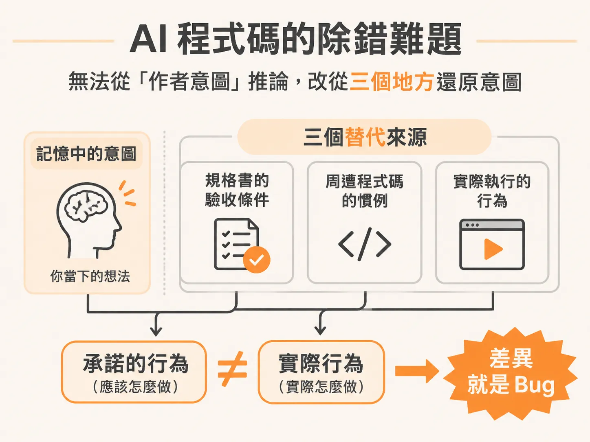
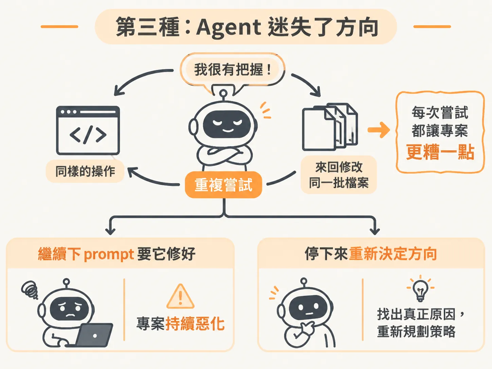
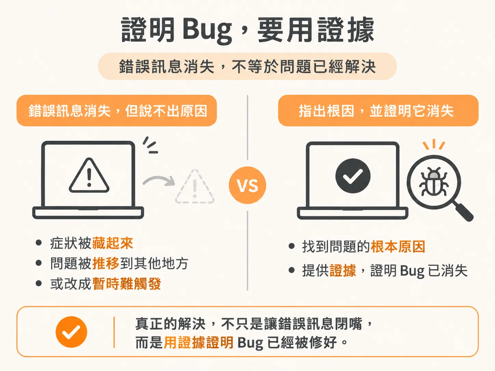

# 程式壞掉時先別急著修：面對三種不同的「壞掉」

在剛起步的乾淨專案裡，多數事情通常都能照著計畫進行。但真實的專案不可能永遠維持這個狀態，東西遲早會壞掉。

當程式出問題時，你最有用的第一步並不是立刻套用某個除錯技巧，而是先問自己一個問題：「這到底是哪一種壞掉？」

壞掉大致可以分成三種。它們看起來像是同一種問題的不同外貌，但每一種需要的應對方式完全不同。

## 第一種：普通的程式碼錯誤

第一種是標準的程式碼 bug。例如計算回傳了錯誤的結果、請求直接崩潰（crash），或是總數差了一點（off-by-one）。

這是一個真正存在的缺陷，會產生你可以觀察到、也可以穩定重現的行為。無論這段程式碼是你寫的、同事寫的，還是由 agent 生成的，它的表現方式都一模一樣。

要找出這種問題，方法就跟軟體工程界在 AI 出現前幾十年來做的事情一樣：透過重現步驟與系統性的除錯方法逐步排查。

## 第二種：AI 程式碼特有的失敗方式

第二種問題專門出現在 AI 寫的程式碼裡：

* 它呼叫了根本不存在的套件函式。
* 它寫出看起來頭頭是道、合情合理，實際上卻暗中出錯的邏輯。
* 它在檔案寫到一半時，擅自替系統做了一個關鍵決定，卻完全沒有告訴你。
* 它漏掉了存取權限規則、邊緣案例，或是真實資料進來時才會暴露的失敗情境。

這種程式碼在走「順暢路徑」（happy path）時看起來毫無破綻，但只要遇到第一個不尋常的輸入，就會把你沒料到、agent 也從未考慮過的所有漏洞一次暴露出來。

這類問題最棘手的地方在於排查過程。除錯自己的程式碼時，你的大腦會記得當初寫這行程式碼的意圖；但在 AI 寫的程式碼裡，你無法從「作者意圖」去推論，因為你根本不是作者。就算你剛才親眼看著它一行行被生成出來，你也不可能真正知道為什麼每一行會出現在那裡。

這時不能憑空猜測它「原本想做什麼」，而必須從規格書的驗收條件、周遭程式碼的慣例，以及實際執行的行為去還原真正的規格差距。

## 第三種：Agent 迷失了方向

第三種情況根本不是程式碼本身的問題，而是 agent 已經迷失了方向（lost the path）。

這時候的特徵非常明顯：它開始重複做一樣的操作、在相同的幾個檔案之間改來改去，而且每一次嘗試都讓專案變得更糟一點點。更麻煩的是，它在偏離真正原因越來越遠的同時，語氣依然顯得自信滿滿。

在這種狀態下，繼續對它下 prompt 叫它「修好這個問題」完全沒有任何幫助——因為你拜託去解決問題的對象，本身已經變成了問題的一部分。

面對走偏的 agent，你不能再補一句 prompt，而是必須果斷停下來，評估是要手動引導、重置 session，還是重新整理思緒。

## 判斷錯誤要付出的代價

為什麼必須在動手前先花時間判斷它是哪一種？因為判斷錯誤的代價完全不同，而且每一種代價都很昂貴：

* **把普通 bug 當成 AI 隨手能修好的事**：你會不斷下 prompt 叫 agent 去修一個它根本看不見的 bug，浪費了十幾次對話，最後還是得自己停下來手動重現。
* **把只是空間不足的有效 session 當成中毒**：你太早清空了 session，順手把 agent 之前辛苦收集到的大量有用證據全都倒掉。
* **把 agent 走偏當成程式碼有問題**：你在那裡花了一個小時拼命改程式碼，但那段程式碼本來根本沒有寫錯，真正的問題是 agent 早在十個回合前就已經偏離了原本的任務。

## 一條貫穿所有的核心原則

無論你面對的是哪一種壞掉，底下都有一條共同的核心原則：

**一個你無法解釋的修復，就是一個你還沒抓到的 bug。**

如果報錯消失了，但你說不出它為什麼會消失，你其實並沒有證明問題的根源已經被消除。你很可能只是把症狀藏了起來、把問題推移到了其他地方，或是把程式碼改成了暫時比較難觸發錯誤的樣子。

除錯要依靠證據，而不是憑直覺猜測。Bug 是一個需要你去證明的案件，而不是一條想辦法讓它閉嘴的錯誤訊息。

因此，當系統壞掉時，第一步永遠不是急著動手改程式碼，而是先停下來，看清楚眼前發生的究竟是哪一種壞掉。
