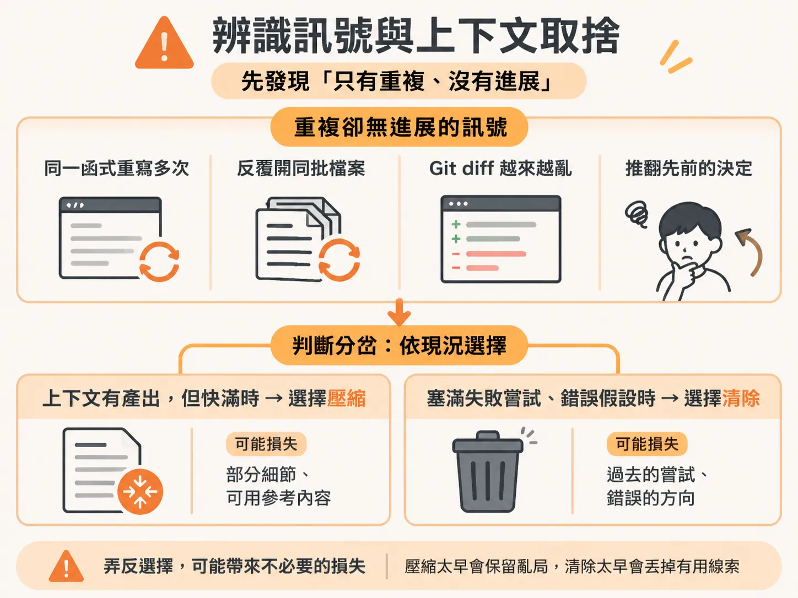
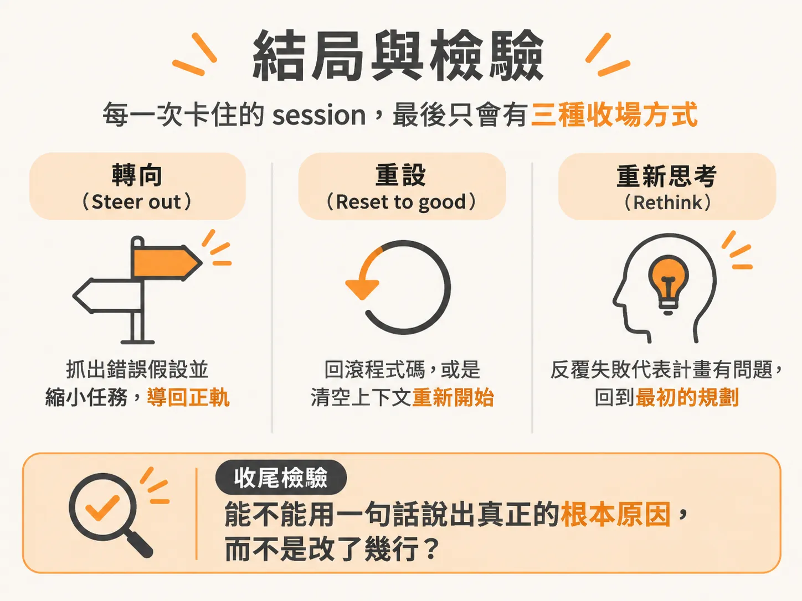

# 救回原地打轉的 AI Session

上一課的六步迴圈處理的是能穩定重現、可以靠證據一步步追到根因的問題。但還有一種情況，問題根本不在程式碼：這時 agent 已經完全偏離軌道、迷失方向。它開始重複相同的動作，來回修改同幾個檔案，而每一次嘗試都讓專案變得更糟一點。最危險的是，它在離真正病因越來越遠的同時，依然表現得自信滿滿。這時叫它「把問題修好」毫無用處，因為你拜託去解決問題的對象，現在本身就是問題的一部分。

## 辨識訊號與上下文取捨

這種狀態的訊號非常清楚：**只有重複，沒有進展**。同一個函式重寫了五遍，每次改動微乎其微；反覆重開相同的檔案；Git diff 越來越混亂；甚至推翻自己幾分鐘前剛做出的決定。幻覺給你的是錯誤的內容，而迴圈給你的則是一個徹底故障的流程。這時候直接追加指令只會雪上加霜。

在採取行動前，你只需要做一個關鍵判斷：這個 session 累積的上下文（context），到底值得留下來，還是該丟掉？

- **有產出但空間快用盡**：這時上下文是資產，請使用壓縮（compact）。
- **塞滿失敗嘗試與錯誤假設**：這時上下文已經是負債，請果斷清除（clear）。

弄反的代價非常高昂。清掉一個高效且搜集了大量線索的 session，等於白白扔掉已經找到的證據；但若是壓縮一個已經中毒的 session，你只會把失敗的推論打包壓縮帶到後面，反而變得更難察覺。

## 五步驟依序救援

當 agent 開始卡住打轉，請依照順序採取這五個步驟，不要隨意跳步：

### 1. 停手
按 `Esc` 立即中斷輸出。不要按 `Ctrl+C`，那會直接退出整個工作階段。中斷輸出不需要任何成本，察覺不對勁就立刻按下去。

### 2. 追問
在動手改任何東西之前，先問它：
> 「你認為現在的問題是什麼？你做了哪些可能出錯的假設？」

卡住的 agent 通常都繞著某個錯誤假設打轉。逼它把假設講出來，往往能直接打破迴圈。就算沒有立刻解開，你也能明確知道下一次嘗試需要修正什麼。

### 3. 縮小
大多數的無窮迴圈，起因都是任務下得太寬泛。例如「重構驗證模組」這種指令幾乎注定失敗。把目標縮小到可以具體完成的程度：「只從這個檔案抽出 token refresh 函式，其他檔案一律不准動。」明確給定一個不可跨越的邊界。

### 4. 回滾
如果剛才幾次失敗的嘗試已經改亂了程式碼，千萬不要叫已經混亂的 agent 自己收拾殘局。許多工具的內部檢查點（checkpoint）無法還原透過終端機指令改動的檔案，Git 才是最穩固的底線：工作區的變更用 `git restore` 復原，需要退回整個提交時使用 `git reset`。

### 5. 清掉並帶入關鍵證據
開啟乾淨的新 session，但千萬不要直接複製貼上當初失敗的 prompt，那只會重演剛剛的悲劇。

帶著確切的錯誤訊息、失敗的測試，以及舊 session 一直忽視的那一項關鍵事實重新開始。一個帶有扎實證據的乾淨對話，往往兩次對話就能解決舊 session 糾纏十輪都解不開的難題。清空 session 損失的只是對話紀錄，檔案規格與專案核心設定依然留在磁碟上。

## 結局與檢驗

在進行大幅度修改前，養成讓 agent「先規劃、不動手」的習慣（例如使用各工具的 Plan mode）。在草案還是幾行文字時駁回錯誤策略，遠比它改壞十個檔案之後再來收拾輕鬆得多。

每一次卡住的 session，最後只會有三種收場方式：
1. **轉向（Steer out）**：你抓出了錯誤假設並縮小任務，順利導回正軌。
2. **重設（Reset to good）**：回滾程式碼，或是清空上下文重新開始。
3. **重新思考（Rethink）**：反覆失敗說明架構計畫本身就有問題，必須回到最初的規格或設計階段重新規劃。

無論最後用哪種方式解開，脫困後都要問自己一個問題：「我能用一句話說清楚到底哪裡壞掉了嗎？」你必須說出問題的根本原因，而不是你改了哪幾行程式碼。

如果你說不出原因，就只是暫時掩蓋了症狀，它遲早會再次發生。你無法解釋的修復，就是你還沒抓到的 bug。
