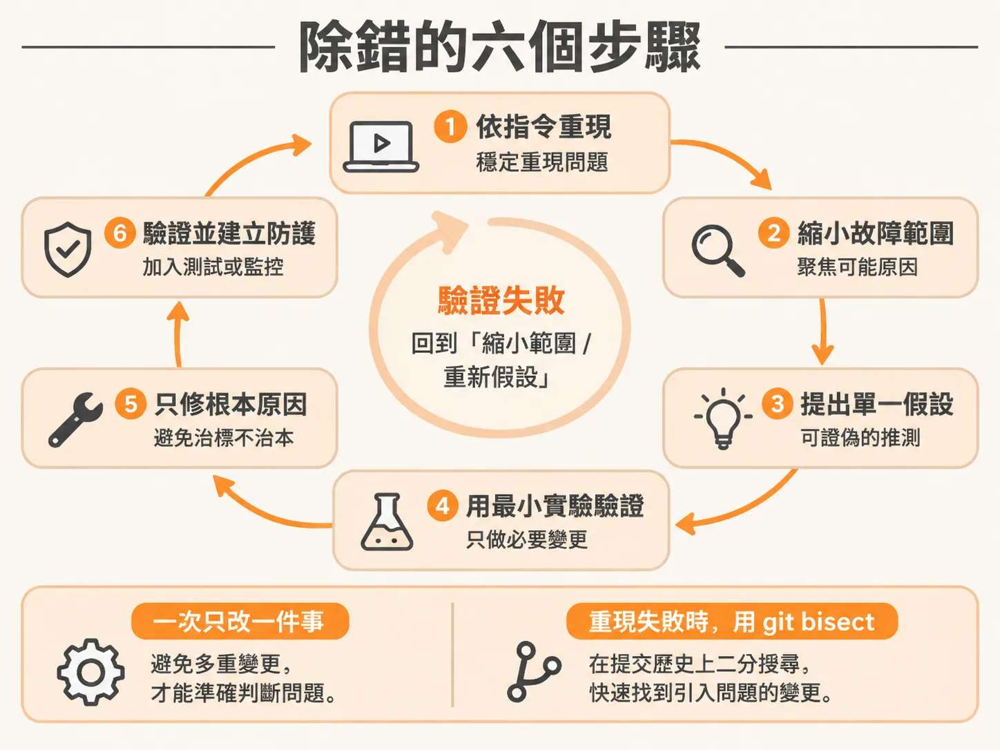
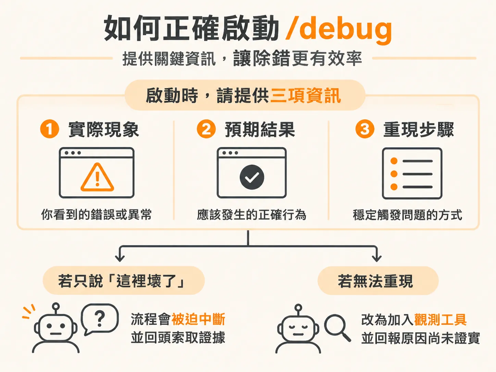
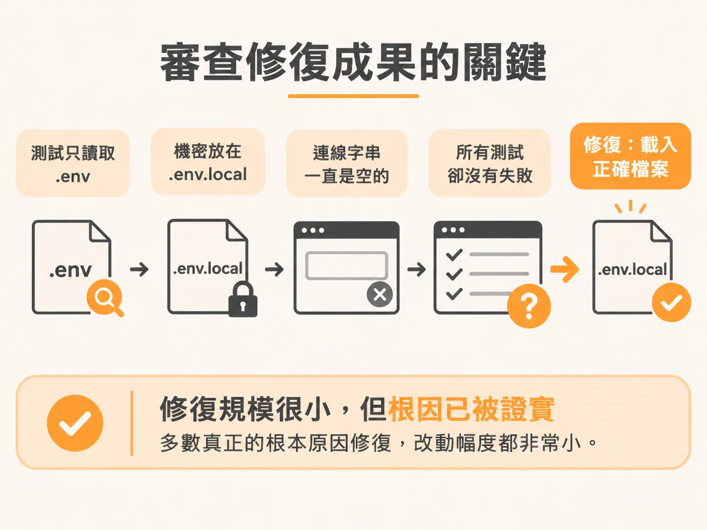
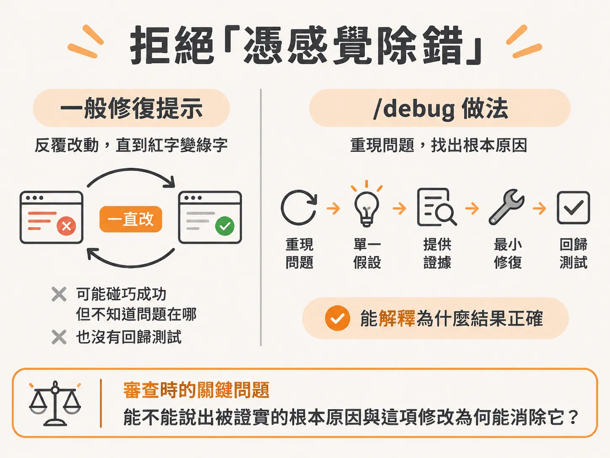

# 用單一假設的六步迴圈追查根因

上一課先把壞掉分成三種：普通的程式碼錯誤、AI 程式碼特有的失敗，以及 agent 走偏。前兩種再怎麼難纏，終究要回到程式碼本身才找得到根因，而這正是接下來這套方法的用武之地。

多數人除錯時的第一反應，往往是隨意修改幾處程式碼，看著紅字有沒有消失。如果紅字不見了，就以為問題已經解決。

但這種做法只是在掩蓋症狀，也是臭蟲過陣子又悄悄跑回來的主因。真正的除錯不是胡亂修改直到錯誤消失，而是把科學方法套用在出問題的程式上：觀察失敗現象、提出一個具體解釋、設計實驗驗證，並根據證據決定下一步。

無論程式語言是什麼、專案架構長什麼樣，甚至不管程式碼是你寫的、同事寫的，還是 AI 代理人生成的，這套方法都完全通用。最核心的習慣只有一個：**一次只改一件事**，這樣每一次實驗的結果才能帶給你明確的資訊。

## 除錯的六個步驟

這套方法由兩個核心習慣支撐：重視證據勝過直覺，以及懷疑自己的心智模型。這六個步驟值得反覆查閱，而不是硬背：

1. **依指令穩定重現（Reproduce on command）**  
   你無法修復無法觸發的問題，也無法證明一個無法再次發生的錯誤已經被修好。必須拿到一個會以相同方式失敗的測試、指令或請求。若是間歇性發生的問題，首要任務就是找出觸發它的精確資料、時間差、執行順序或並行條件，讓它變得可預測。在 Claude Code 中，`/loop` 技能可以排程重複執行某個指令直到錯誤出現（請注意它與持續執行到特定條件成立的 `/goal` 不同）。
2. **縮小故障範圍（Localise the failure）**  
   在提出解釋之前，先將問題逼到角落。找出「正確輸入變成錯誤輸出」的轉折點：檢查路徑的中間點，確認問題在前半段還是後半段，然後重複這個過程。這是在程式碼中做二分搜尋法，一百行程式碼只要幾次檢查就能收斂，不必逐行看完。同時，檢查每個邊界上的真實數值，而不是你自以為它該有的數值。很多臭蟲就藏在「你預期的數值」與「程式實際收到的數值」之間的落差。  
   如果這個問題是原本正常、後來才壞掉的退化（regression），步驟二也可以透過 `git bisect` 套用在 commit 歷史上：Git 會在好與壞的提交之間挑選中間點讓你測試，一路將範圍減半，直到找出引入錯誤的第一個提交，最後再執行 `git bisect reset` 復原。
3. **提出單一且可證偽的假設（Form one falsifiable hypothesis）**  
   不要說「日期好像怪怪的」，而是明確提出「日期是用本地時間解析的，導致截止點位移了時區偏差值」。描述原因，而不是症狀。某個數值變成 `null` 只是症狀，它為什麼變成 `null` 才是原因。堅持一次只提一個假設、做一次實驗、學到一件事。一次改動五個地方，就算錯誤消失了你也學不到任何東西，因為你根本不知道是哪一項改動奏效。
4. **用最小實驗進行驗證（Test it with the smallest possible experiment）**  
   加上一行鎖定目標的日誌、一個斷言（assertion），或改動一行程式碼，接著重新跑重現步驟。如果假設被推翻，立刻移除實驗性的改動，帶著剛學到的資訊提出更好的假設；千萬不要把失敗的實驗程式碼留在專案裡，它們只會干擾下一次嘗試。如果假設被證實，你就找到了根本原因，這時才開始動手寫真正的修復方案。
5. **只修復根本原因，不做多餘改動（Fix the root cause and nothing else）**  
   用能解決已證實問題的最小改動來修正。修正數值為什麼會變成 `null` 的原因，而不是加上一個 fallback 把它藏起來；修正錯誤的假設，而不是壓抑它產生的錯誤訊息。修正時切勿順手重構。把清理程式碼與修復臭蟲混在一起，會讓審查變得困難，還可能在修復第一個問題時引入第二個問題。
6. **驗證並建立防護（Verify and protect it）**  
   重新執行一開始的重現步驟，確認它現在能通過；跑過周圍的測試套件，確保沒有引發其他問題。接著加入一個回歸測試（regression test）：在沒有你的修復時必定失敗、加上修復後必定通過。這個測試是該臭蟲無法悄悄復發的永久證明。最後，檢查是否有「兄弟臭蟲」（siblings）：相同的錯誤假設往往會出現在好幾個檔案裡，在程式碼庫中搜尋該模式並逐一檢查。

## 為什麼有了 /debug 還需要懂這套方法

Claude Code 提供的 `/debug` 技能可以非常嚴謹且迅速地跑完上述步驟。它重現、定位、測試、修復與建立防護的速度都比人工更快。

但有一件事技能做不到：它無法替你判斷「這項修改究竟是證明了根本原因，還是單純讓症狀消失」。這項裁決權在於你，而如果你自己不懂這套方法，就完全無法做出判斷。方法屬於你，`/debug` 只是讓你更快套用它的工具。

## 如何正確啟動 /debug

如果直接單獨執行 `/debug`，它會停下來要求你提供臭蟲細節。啟動時最關鍵的就是一開始給它的三項資訊：

1. **你觀察到的現象（What you observed）**：實際發生的行為、確切錯誤訊息或輸出，而不是你猜測的理論。
2. **你預期的結果（What you expected）**：讓它知道正確的狀態應該長什麼樣子。
3. **重現步驟（The exact steps）**：讓它在著手調查前能夠百分之百重現問題。

給齊這三樣，它就會立刻展開調查。如果你只丟一句「這裡壞了」，它就必須中斷流程，回頭向你索取證據。這往往就是排查速度快與慢的關鍵分野。

如果 `/debug` 無法重現問題，它不會盲目修改，而是會停下來，嘗試加入額外的觀測工具（instrumentation）讓自己具備重現能力，並向你說明目前找到的狀況。

在某些工作流程中，例如先前執行過 `/check verify` 暴露了資料模型的真實問題，驗證流程本身就已經記錄了觀察、預期與重現步驟。這時直接執行 `/debug` 搭配對應模組，它就能直接接手現有資訊。但若是自己獨立執行、沒有前置驗證產生的資訊時，請務必精確描述，不要只說「資料庫有問題」，要具體到足以讓下一個實驗能被證實或證偽。

## 審查修復成果的關鍵

當代理人回傳結果時，你必須確實審查它。最需要緊盯的就是**單一假設（one hypothesis）**原則。

如果你看到代理人同時改動好幾個不相關的地方，寄望著錯誤自己消失，請立刻叫停。必須是一次實驗對應一項資訊，只有在證據確認了原因之後，才能進行修復。

要判斷修復是否正確，看改動的規模往往就能見真章：多數真正的根本原因修復，改動幅度都非常小。

舉個實際例子：在測試中發現環境變數從未被載入。冒煙測試（smoke test）雖然匯入了 `.envconfig`，但該設定只會去讀取字面檔名剛好叫 `.env` 的檔案；然而機密資訊都存放在 `.env.local` 裡，導致資料庫連線字串在 `.env` 中一直都是空的。這造成所有測試跑完卻沒有給出任何明確的失敗訊號。最終的根本原因修復，僅僅是在測試中明確指定載入正確的環境變數檔案——整個改動只有短短一行，測試套件便能完整且正常地執行。

## 拒絕「憑感覺除錯」

這就是 `/debug` 技能與盲目要求 AI「幫我修好這個錯誤」的最大差別。

一般請代理人修復的提示詞，是在鼓勵它不斷改東改西，直到紅字變成綠字。有時候這確實會碰巧奏效，但結束時你根本不知道問題到底出在哪裡。這種「憑感覺除錯」（vibe debugging）往往留下後患。

`/debug` 則嚴格要求重現步驟、單一假設、證據佐證、最小修復，最後加上回歸測試。它的優勢不在於步驟最少——面對顯而易見的打錯字，直接改當然更快——而是在於完成後你能清楚解釋為什麼這個結果是正確的。

審查它提出的結果時，只要問自己一個問題：**你能否清楚說出被證實的根本原因是什麼，以及為什麼這項修改能徹底消除它？** 如果說不出來，就算測試全綠，也不要接受這個未經驗證的修復。

這套方法能處理你自己、同事或 AI 寫出的程式碼。不過當程式碼是代理人寫出的時候，還會面臨一項額外挑戰：你無法從作者的意圖去推敲邏輯，因為那個意圖從來就不屬於你，你必須先設法找回當時的意圖。
