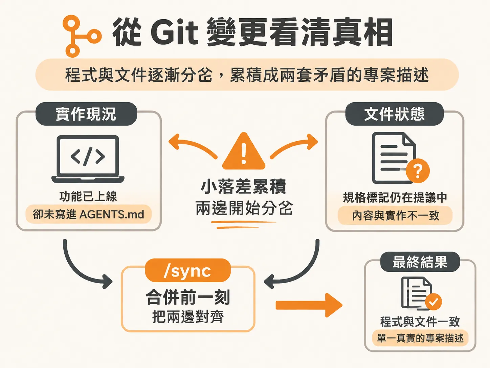
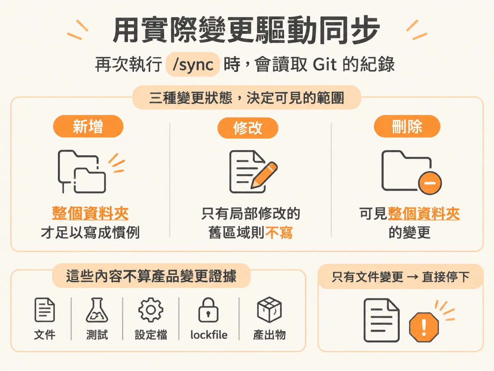
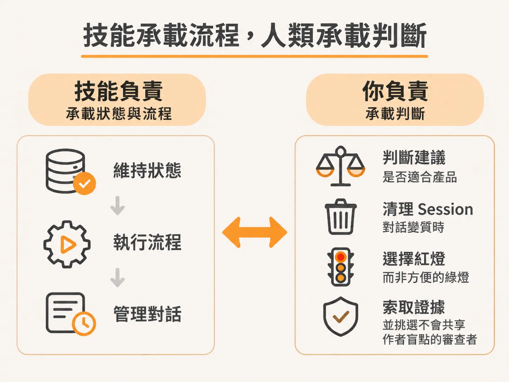
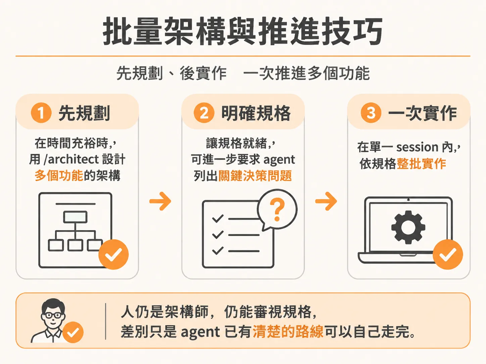

# 用 /sync 對齊專案狀態，以人的判斷為開發迴圈收尾

就算修改做得再小、再安全，只要把成果交出去，還有一層容易漏掉的落差：文件通常沒跟上程式碼。

每次程式碼變更時，引導 AI 代理人（agent）的文件都很容易脫節。實作程式碼裡出現了某個特定的命名或架構慣例，卻始終沒有寫進專案的 `AGENTS.md`；或者規格文件標記某項功能還在提議中（proposed），後續的功能卻早就已經實作上線。

這些落差單獨看都不嚴重，但累積起來，程式碼描述的會是一套系統，文件記錄的卻是另一套完全不同的專案。

`/sync` 技能就是用來消除這層斷層的工具。它在整個工作階段的尾聲執行，也就是在你準備合併（merge）程式碼的正前方。

完整的開發推進流程通常是：先透過 `/architect` 規劃架構，接著進入 `/develop` 實作，實作完成後清理對話階段（clear session），最後再執行 `/sync`。

## 從 Git 變更看清真相

當你重新回到專案並檢查進度範圍（scope）時，如果暫時略過初始功能的驗證與測試，直接跳到編碼標準與工具鏈的整理，會發現這項工作的驗收標準是：根目錄的 `AGENTS.md` 必須如實反映真實的技術堆疊，且在全新 clone 的專案上能順利通過 lint、format 與型別檢查。

這通常需要先執行 `/audit` 檢視現狀。當你開啟新視窗並嘗試執行 `/sync` 時，如果專案還沒有初始化 Git，它會立刻指出這裡不是一個 Git 儲存庫。

因為 `/sync` 高度依賴 `git diff` 與 `git log` 來比對變更；沒有 Git 歷史，它就沒有任何差異可以參考。初始化 Git、加入檔案並建立第一筆 baseline commit 後，由於沒有更早的狀態可以對比，`/sync` 看到的變更集（change set）會是空的，並直接回報沒有東西需要對齊。

要給 `/sync` 足夠的事實依據，我們可以執行 audit 來捕捉慣例與工具選擇。它會檢視程式碼庫，確認 `CLAUDE.md` 指標正確指向規範檔案，並檢查 ESLint 設定。比方說，專案目前缺乏特定套件管理器或 lint 指令時，audit 會將這些資訊補進 `AGENTS.md`。

完成後，你可以手動將進度範圍內的對應項目標記為完成。雖然系統通常會自動標記，但由你手動核對並確認狀態也是完全合適的——掌控權始終在你手上。

## 用實際變更驅動同步

在進行下一步（例如透過 `/architect` 規劃資料模型）之前，若要觀察 `/sync` 的實際運作，需要先讓專案產生真實的 Git 變更。

舉例來說，首頁上的即時評論卡片在桌機瀏覽時縱向高度被拉得過高，版面不協調。此時只要截一張圖，在新對話中傳給 agent，請它修正版面使其貼合既有設計。即便第一次修改後高度縮短、lint 也沒有報錯，但畫面可能依然不夠協調（例如中欄卡片的高度小於左右兩欄，而該列只有它一張卡片，高度理應與左右兩欄切齊）。透過後續反饋請 agent 修正並在行動裝置尺寸上檢查確認，問題就能徹底排解。

修正完畢後，專案中就有了具體的 Git 變更——例如 `AGENTS.md` 與 `scope.md` 都發生了變動。

這時再次執行 `/sync`，它就會讀取 Git 的紀錄。

`/sync` 不只看哪些檔案變了，更會細分哪些檔案是新增（added）、修改（changed）或刪除（deleted）。每一種狀態，都代表它能看見這個領域多完整的全貌：
* 如果某個資料夾裡的所有檔案都是全新加入的，代表它掌握了完整上下文，可以建立規則。
* 如果某些檔案只是局部修改，代表那是早於本次變更就存在的舊程式碼，`/sync` 就不會擅自把單次實作細節當成全域規範寫入政策。

同時，`/sync` 懂得過濾雜訊。文件、測試、設定檔、lockfile 與自動產生的建置輸出，都會被排除在「產品核心變更」的證據之外。它會維護部分這類檔案，但絕不會根據純文件的修改，去推斷產品功能發生了改變。如果某次提交只有文件改動，`/sync` 會直接停下，不進行多餘的變更。

藉由這次小修復，`/sync` 成功將技術堆疊與架構的狀態對齊為完成，並同步更新了 scope 檔案。在大型專案或有大量新功能提交時，這項技能能發揮更顯著的作用。與負責寫程式的 `/develop` 相比，`/sync` 極為輕量，而且具備冪等性（idempotent）——在未變動的專案上重複執行不會造成任何破壞，每次 merge 前跑一次都非常安全。

至此，整個開發迴圈正式閉合：你經歷了規劃、決策、撰寫程式、沉澱記憶，最後透過 `/sync`，將記憶與實際發布的成果完美對齊。

## 技能承載流程，人類承載判斷

這套工作流程的分工非常明確：技能負責承載狀態與流程，而你負責承載判斷。

agent 的優勢在於速度極快、不知疲倦，但它對你打造出來的產品是否成功、系統是否安全、架構未來是否值得長期維護，沒有任何得失心或責任。

因此，關鍵決定永遠在你身上：
* 由你判斷 agent 給出的架構建議是否真的適合你的產品。
* 當對話變質、內容陷入泥淖時，由你主動清除 session 重置上下文。
* 寧可要一個誠實通報問題的紅燈，也不要一個粉飾太平、看似通過的虛假綠燈。
* 由你主動索取變更依據，並挑選那些不會落入作者自身盲點的審查工具與角度。

## 批量架構與推進技巧

這套流程不僅能維持嚴謹的工程細節，也能同時維持極高的推進速度。

如果你希望加快節奏，可以採用批次開發（batch develop）：
在時間充裕時，先針對多個功能進行前期的 `/architect` 架構設計，甚至可以直接要求 agent 自行列出關鍵決策問題並挑選推薦解答。

一旦這些功能的架構規格通通就緒，你就可以在單一 session 裡將它們整批實作出來。你依然維持著工程師的嚴謹與架構師的角色，依然能夠隨時審視規格細節；但因為 agent 眼前已經有了清晰的航線（flight path），它就能沿著多個規格文件獨立推導出專業的實作，讓你在高速推進的同時，依然保有極高的精確度。
