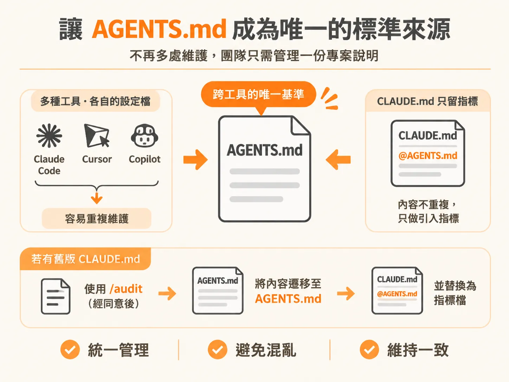
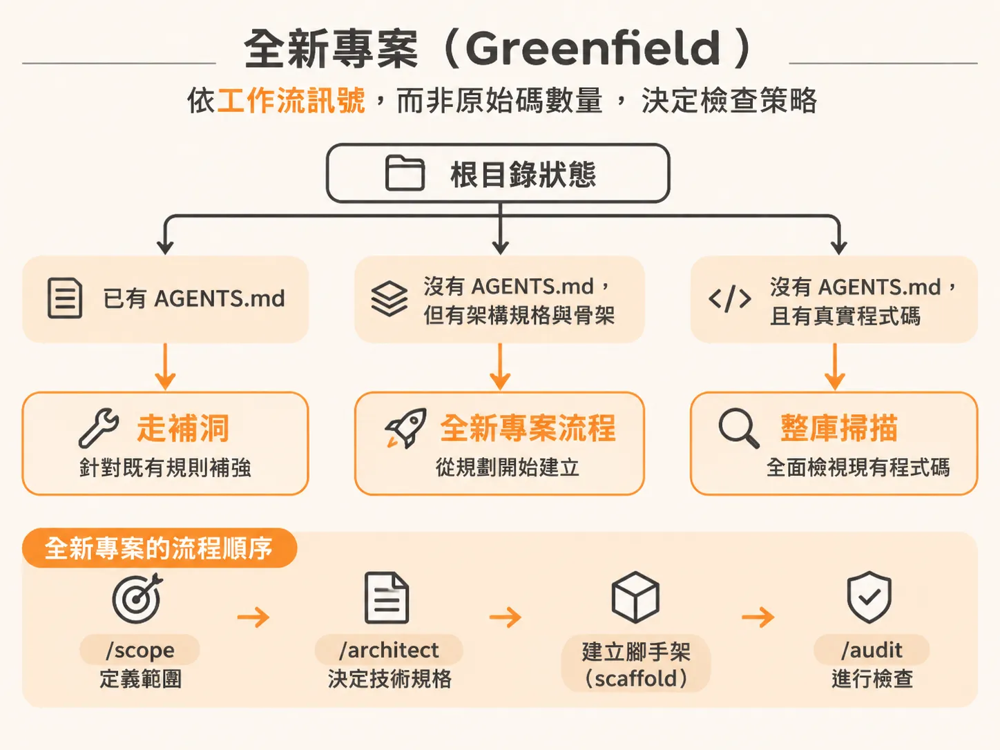
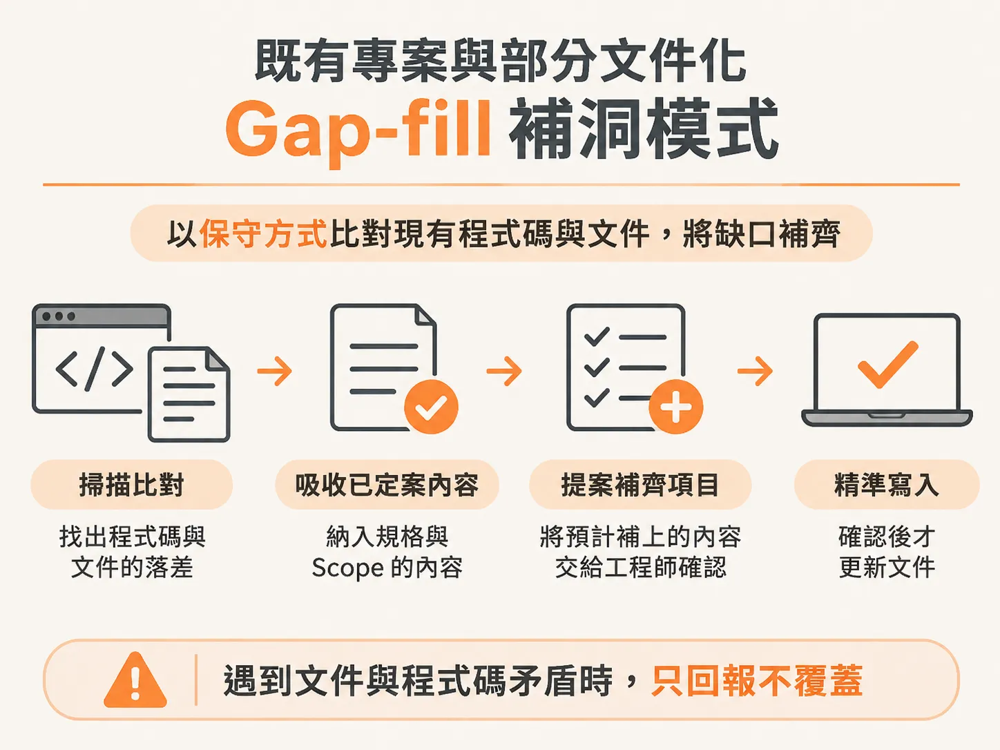
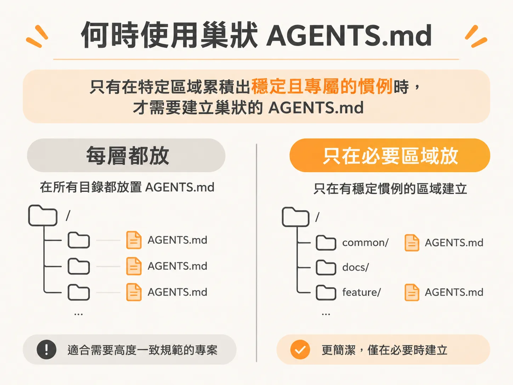

# 透過 /audit 建立專案脈絡：AGENTS.md 的設定、Gap-fill 與巢狀架構

介面與設計系統就位後，專案的形狀已經穩定，該把這些事實寫成 agent 每次都會讀到的 `AGENTS.md`。

當你在硬碟上完成專案的初始化，裝好了框架、設定檔、依賴套件與腳本，程式碼結構看似齊全，但此時往往缺了一樣關鍵要素：沒有任何文件告訴 AI 工具這個專案到底該如何運作、日常該用什麼指令，以及未來的每一次變更該遵守哪些慣例。

少了這層全域脈絡（global context），之後執行的每一個 AI 指令或技能（skill），都必須重新通讀整份專案。這不僅非常耗費 Token 成本，而且每次對話猜出來的專案規則都可能不一樣；或者它必須把整個 scope 和所有規格重新讀一遍才能推斷進度。

解決方法很直接：在 Agent 讀取任何程式碼之前，先讓它讀取唯一的專案指示檔——`AGENTS.md`。

---

## 讓 AGENTS.md 成為唯一的標準來源

許多開發者在專案剛建立時，根目錄只有 Next.js 預設建立的簡短附註（例如 breaking change note），其餘內容一片空白。你不可能在每次小修改後都手動回去補寫說明文件。Agentic engineering 工作流中的 `/audit` 技能，就是專門用來產生並維護這份共享指示檔的工具。

`/audit` 的輸出原則很單純：
1. **用詞精簡白話**：保留真正有實質意義的技術術語，並用淺顯文字解釋。
2. **聚焦關鍵決策**：只記錄技術堆疊（stack）、執行指令、團隊慣例、從 scope 繼承而來的建構策略（build approach），以及深入其他脈絡的指標檔案。它不會試圖解釋每個資料夾或所有設計細節。
3. **影響 Agent 行為**：檔案裡的每一行內容，都必須能實質改變 Agent 在該儲存庫寫程式時的行為。

市面上各種 AI 工具常有自己的專屬檔名（例如 Claude Code 的 `CLAUDE.md`，或是 Cursor、Copilot 的設定檔），這很容易造成團隊在多個地方重複維護同一份專案說明。在標準工作流中，`AGENTS.md` 是跨工具的唯一基準（canonical source）。至於 `CLAUDE.md`，內容只會保留單行引入指標（透過 `@AGENTS.md` 語法直接載入），團隊永遠只需要維護 `AGENTS.md` 本身。若原本專案已有舊的 `CLAUDE.md`，`/audit` 會在取得同意後將內容遷移至 `AGENTS.md`，再把原檔替換為指標，絕不默默丟棄既有筆記。

---

## 全新專案（Greenfield）：標準擷取而非掃描程式碼

在全新專案中，執行的流程順序通常是 `/scope` 定義範圍、`/architect` 決定技術規格，接著完成腳手架（scaffold）建立，最後執行 `/audit`。

雖然剛建立好腳手架的目錄裡已經有套件清單（manifest）和初始原始碼，但 `/audit` 的判斷機制中，「工作流設定訊號」優先於「原始碼數量」。它不會把剛 scaffold 完成的專案誤判為既有舊專案，而是進入 Greenfield 模式。

在這個模式下，`/audit` 不會去掃描空白或預設的程式碼，而是向你提問以擷取團隊的編碼標準：

* **架構風格**：詢問專案要採用函數式（Functional，搭配不可變資料）、整潔架構（Clean Architecture，分離實體與配接器）、領域驅動設計（DDD），還是物件導向（OOP）。
* **目錄分層結構**：決定資料夾要依業務功能（by feature）還是技術層次（by layer）拆分。
* **程式碼慣例**：例如是否強制僅使用具名導出（named exports only）、統一錯誤處理機制、無障礙性（accessibility）標準，以及公開函式是否強制附帶說明文件。
* **工具鏈與檢查**：決定 Lint 與 Format 工具（例如採用將兩者整合為單一設定的 Biome，或是 ESLint 搭配 Prettier）；確認 Pre-commit 階段是否自動執行 lint、format 與 type check。
* **測試策略**：選擇採用單元與整合測試、僅仰賴型別檢查與手動驗證，或是測試驅動開發（TDD）。
* **Git 自動化與技能補齊**：確認是否由工作流程自動管理分支與提交。接著檢查環境中已安裝的 Agent Skills，針對缺少的官方工具技能（例如 Resend 電子郵件技能）進行搜尋與安裝，非官方或暫不需要的工具則跳過。

確認完畢後，`/audit` 會建立含有上述所有規範的 `AGENTS.md`，並協助建立專案的第一個 Git Commit，為後續的所有功能開發提供乾淨的比對基準。

---

## 既有專案與部分文件化：Gap-fill 補洞模式

當專案已經存在程式碼，且根目錄也已有初步的 `AGENTS.md` 時，在終端機輸入 `/audit` 就會進入 Gap-fill 模式（Phase 4）。

Gap-fill 的目標不是推翻現有檔案重寫，而是「以保守方式比對現有程式碼與文件，將缺口補齊」：

1. **掃描專案落差**：它會檢視目前程式碼與文件的差距。如果現有檔案只有框架預設的附註，它會偵測出技術堆疊、建構策略、常用指令、規則清單與 Agent Skills 均處於缺失狀態。
2. **吸收既有決定**：檔案中的技術堆疊（如 TypeScript strict mode、Next.js 16 app-router、依賴套件）來自已被接受的架構規格；建構策略（如 Tracer-bullet 貫穿式開發）則來自進行中的 scope。`/audit` 只負責吸收已定案的結論，不會私自重新推翻。
3. **提案確認再寫入**：在寫入任何改動前，它會向你列出預計補上的內容，提供「立即套用（Add them now）」、「檢視差異（Show me the diff）」或「暫時略過（Skip for now）」的選項，獲得許可後才進行精確編輯。
4. **回報衝突（Contradictions）絕不覆蓋**：如果既有文件寫的規則與現行程式碼或規格不符，`/audit` 絕不會自行決定誰勝出並覆蓋它。它會明確向你回報「文件標註為 X，但程式碼／規格顯示為 Y」，交由工程師手動決定要修改文件還是調整程式碼。

若初期沒有設定到特定面向（例如開發風格 pattern），你可以隨時再次執行 `/audit` 並明確指定補充規則（例如補上 functional immutable 規範、Git 帳號設定、型別嚴格度或路徑別名規範）。

---

## 判斷何時使用巢狀（Nested）AGENTS.md

專案並非只能在根目錄放一份 `AGENTS.md`，但也不該在每個子資料夾都隨便塞入一份。

### 根目錄檔案保持精簡與全域
根目錄的 `AGENTS.md` 僅能放置全專案通用的規則（例如路由分組依客群劃分、一律使用 Server Actions 並遵循統一回傳格式、使用 Zod 驗證、資料庫透過 Supabase Connection Pooler 使用 Drizzle 等）。如果把每個頁面或模組的細節都塞進根目錄，檔案會變得過度肥大，導致 Agent 每次收到指令都得載入大量無關資訊，不僅花費昂貴，還會把真正重要的全域規則淹沒在無關的雜訊中。

### 何時建立 Nested 檔
只有當專案的特定區域（area）發展出**穩定且專屬的長久慣例**時，才需要在該目錄下建立巢狀的 `AGENTS.md`：

* **典型情境**：以付款模組（`payments/`）為例，該區域通常需要重試機制、第三方服務中斷處理、交易安全性防護與防重複請求（idempotency）等嚴格規則。這些規則若放在根目錄，對正在修改行銷頁面（`marketing/`）或公開儀表板的 Agent 而言完全是雜訊與負擔。
* **運作機制**：`/audit` 會在 `payments/` 資料夾內建立專屬的 `AGENTS.md`，並在根目錄的 `AGENTS.md` 末尾加入指標附註：「與付款相關的修改，請參考 `payments/AGENTS.md`」。未來當 Agent 在付款模組內工作時，便會同時讀取全域與區域指示，其他區域則不受影響。

如果專案規模尚小（例如只有單純的 marketing 頁面，其餘功能尚未動工），`/audit` 會判斷暫不需要巢狀檔案，維持單一全域檔即可。

---

## 後續維護時機

在後續的開發過程中，你不必在每次改動程式時都執行 `/audit`。一般建議在以下時間點再次呼叫：

1. 專案加入了跨模組的重大功能或核心架構變更，值得被記錄為長期規則時。
2. 進行中的架構規格（spec）或範圍定義（scope）發生修正，需要同步全域脈絡時。
3. 針對大型專案或 monorepo 中的特定單一 app，需要單獨補齊該區塊的特定慣例時。

在專案規劃完成、架構確立且完成 `/audit` 後，後續的各項工作流技能（例如編寫功能的 `/develop`、檢查用的 `/check`、執行驗證的 `/test` 與維護結構的 `/sync`）都會在動工前優先讀取 `AGENTS.md`。整個團隊與 AI 工具就能在完全一致的規範基礎上協同開發。
