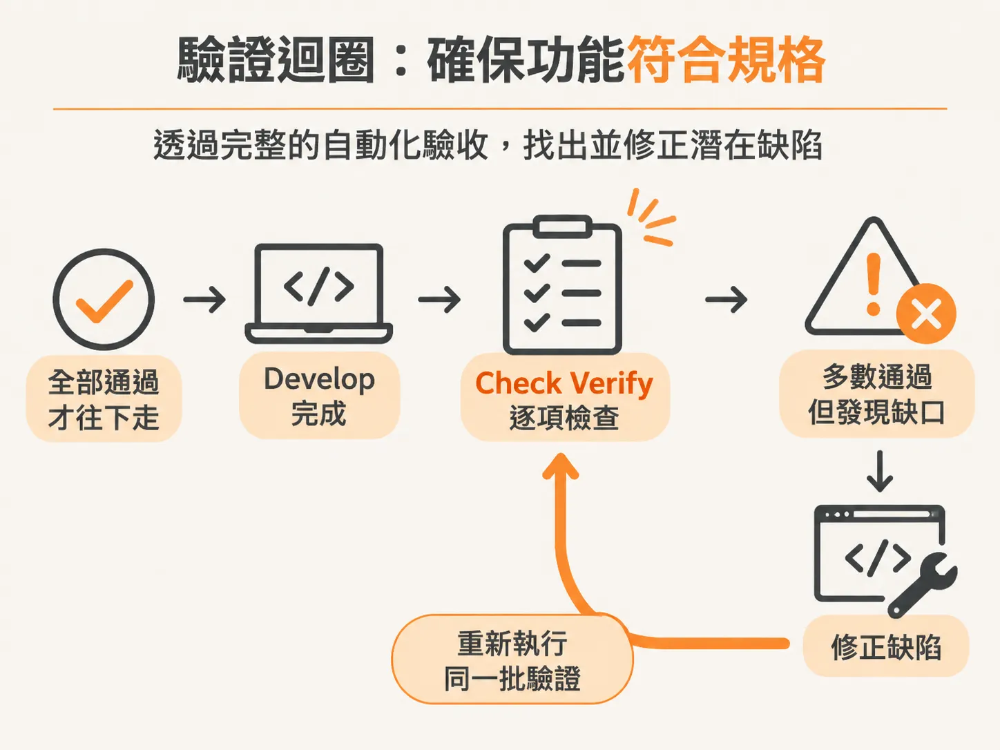
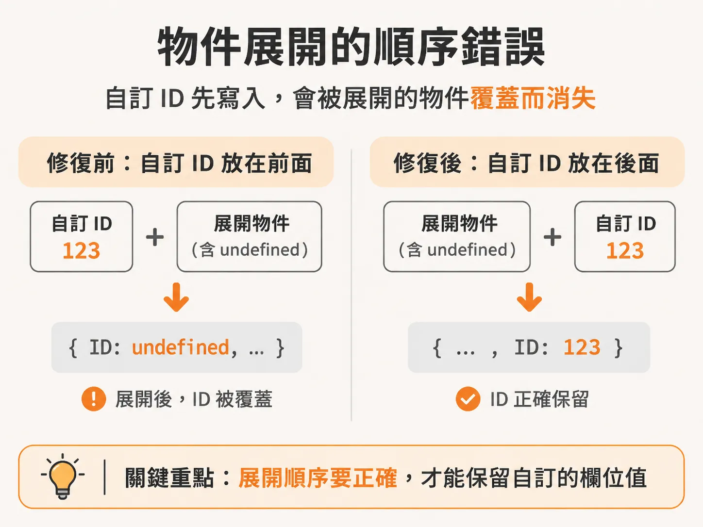
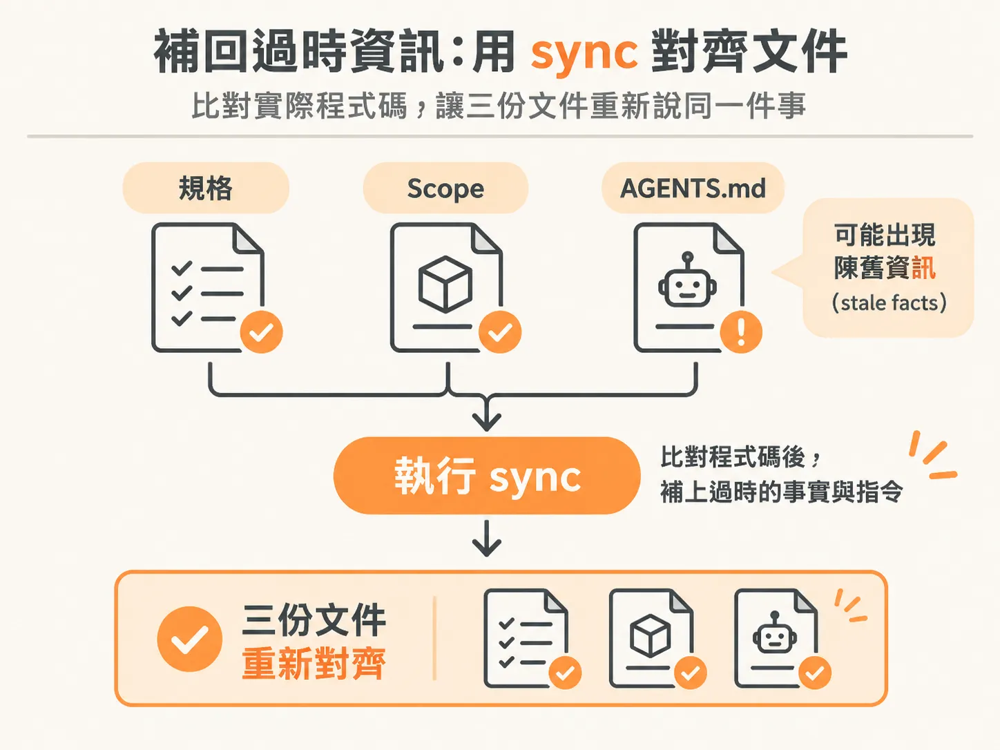
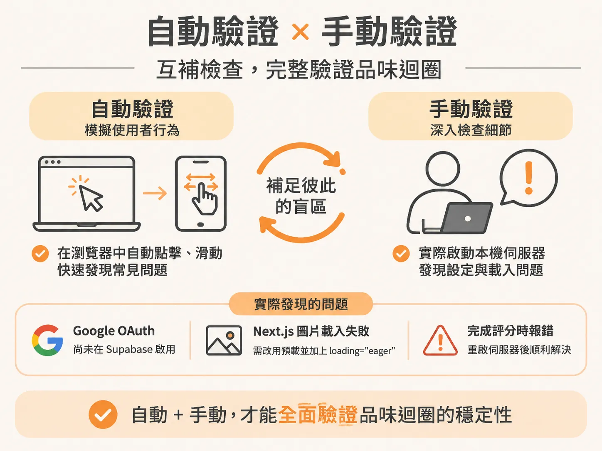

# 走過真實功能的 develop、audit 與 check verify

`AGENTS.md` 讓 agent 知道怎麼動工；但知道怎麼動工，不等於做對了。這一節看驗證。

在代理人驅動（agentic）的工程流程裡，最容易讓人心虛的環節往往不是「生成程式碼」，而是驗證。當模型把十幾個工作項目一口氣寫完，你該如何確定它真的符合規格、真實跑得通，而不是只靠型別檢查在粉飾太平？

透過電影目錄與快取（movie catalog and cache）以及核心品味迴圈（core taste loop）的真實開發過程，我們可以清楚看到整個工作流如何處理環境變數、跑自動化驗證、抓出隱蔽的缺陷，並在最後靠指令把漂移的文件同步回來。

---

## 建立功能與收集金鑰：develop 的起步

當你啟動功能開發時，系統會先載入規格（spec）、專案約定（conventions）以及相關技能。以電影目錄與快取功能為例，它需要存取外部服務，這時會面臨一個選擇：是要先停下來填妥環境變數再開始建置，還是讓它一邊建置、你一邊收集金鑰？

實務上完全可以選擇後者。在建置進行的同時，你可以去抓 TMDB 的 API 金鑰、Ingest 登入金鑰（sign-in key）與事件金鑰（event key）。

幾分鐘後建置完成，以 spec 0003 為基準的十項建置計畫任務全數落地，分支與提交紀錄都已就位。這時你可以審視所有檔案——TMDB 設定、電影目錄資料層、正規化模組、Ingest 用戶端。這些實作都必須直接對接真實環境驗證，而非單純通過型別檢查。不過在當時，需要本機開發伺服器在 dev 模式下跑 Ingest 的驗收條件（AC12）仍待進一步驗證。

---

## check verify 抓出物件展開的覆蓋缺陷

補齊金鑰後，下一步就是執行 `check verify`，確認功能是否真的依照規格落實。這一步不是單純跑幾個單元測試，而是深入且耗時的自動化驗收。

在電影目錄的驗證過程中，檢查流程跑了約十分鐘，執行了 62 個檢查清單步驟中的 53 項，全部通過（其餘 9 項未執行）。然而，驗證過程抓出了一個留在系統裡的真正缺陷：**事件層級的重複資料刪除（deduplication）失效**。

問題出在物件合併的語法細節：
- 資料過期（staleness）檢查與查詢邏輯都會發送目錄重新整理的 TMDB ID。
- `create` 回傳的物件本身就帶有一個 `ID`。
- 在使用物件展開運算子（spread operator）時，順序放錯了，導致展開動作直接把自訂的 ID 覆蓋成 `undefined`。

修復方式非常明確：**將自訂 ID 移到物件展開運算子之後**。

發現問題後，直接告訴代理人「修復它（fix it）」，並選擇跳過繁瑣的手動審查，將該項目標記為完成。這正是代理人工作流靈活的地方：前期的架構規劃需要花很多心力定義結構，但一旦基礎穩固，你就能把指令串連起來（例如修復後略過審查，接著立即同步），甚至在規格定義好後，同時指示代理人並行建置多個功能。

修復完成後的重複驗證極為嚴格，涵蓋了大量邊界情境：
1. 針對電影概覽（overview）為空以及回傳 404 的真實電影 ID 進行檢查。
2. 重新測試驗收條件 13 的線路測試產物（harness artifact）。
3. 測試靜默結束（silent exit），驗證在呼叫端預算限制下耗時 2 秒、在用戶端自身上限下耗時 8 秒的反應。
4. 檢查驗收條件 7 所收到的事件及其產生的結果。

---

## 補回過時資訊：用 sync 對齊 AGENTS.md 與 Scope

當功能通過檢驗，就必須回頭維持全域狀態的真實性。在這個階段執行 `sync` 指令時，三份規格狀態可能都已相符，但根目錄的 `AGENTS.md` 往往會出現陳舊資訊（stale facts）。

例如在電影目錄完成後，`sync` 偵測到兩處脫節：
1. 至今到底安裝了哪些套件。
2. 阻擋流程中缺少的 DB 腳本指令。

`sync` 會自動修正這些檔案，確保代理人的系統提示與專案現況完全一致。

這種情況在設定開發工具鏈時更為常見。當時我們在中途推翻了原先要寫測試套件的決定，改為不需要 Playwright CLI 與測試套件，並改用作用域查詢輔助函式（scoped query helpers）來防範跨使用者存取的資安風險。當你在實作中途改變心意時，規格檔案、`Scope.md` 與 `AGENTS.md` 就會產生矛盾。

開發工具鏈建立完成後（例如以 Lefthook 搭配 Biome 取代 Husky 來自動阻擋不合規定的程式碼），`AGENTS.md` 裡面卻依然只列著舊有的 `install`、`dev`、`build` 與 `type check` 指令，新的驗證腳本沒有被加進去。

開發者無法也不應該手動去改那些由流程管理的文件。正確的作法是：
1. 執行 `/scope` 調和層級間的決策衝突。
2. 執行 `/sync` 讓系統自動將新指令與決策寫回 `AGENTS.md`。
3. 標記完成該功能的最後檢查，接著清除 context 進入下一個功能的架構規劃。

---

## 從端對端切片看全貌：核心品味迴圈的驗證與除錯

完成前置基礎建設後，最能展現這套驗證價值的是「核心品味迴圈（core taste loop）」。這是整個產品最薄但貫穿全貌的真實切片（walking skeleton）：使用者登入、滑動 20 部電影的初始卡牌（至少評分 5 部）、從 500 部候選池中挑出 12 部推薦電影，並透過模型替每一部生成專屬的一句話推薦理由。

在開發完成並補上 Anthropic 與 OpenAI 金鑰後，代理人執行 `check verify`，直接啟動 Playwright 開啟無頭 Chrome，建立全新測試帳號，在瀏覽器裡模擬點擊與滑動。

這種自動化測試極為強大，但手動驗證依然不可或缺。當我們手動啟動本機伺服器實際測試時，抓出了自動測試容易漏掉的外部設定問題：
1. **Google OAuth 尚未在 Supabase 啟用**：畫面顯示不支援的提供商（unsupported provider），必須手動到 Google Cloud Console 建立 Web 用戶端 ID 與密鑰，填回 Supabase 才能登入。
2. **Next.js 圖片重複載入失敗**：在引導畫面（onboarding）重新整理時，初始電影的海報每隔一次就會遺失。代理人透過 Playwright 重現這個問題，發現原因是 Next.js 16 廢棄了原本的 `priority` 屬性行為；修復方式是將海報改為預載，並明確加上 `loading="eager"`。
3. **完成評分時的控制台報錯**：在滑完最後一張卡牌時出現了 `fetch failed` 與組件更新錯誤，重啟伺服器後再次發送，後端順利計算出品味向量並成功產生 12 筆帶有推薦理由的電影片單。

確認手動驗證全部通過後，直接要求代理人手動將該功能在 `scope` 中關閉，並同步所有文件。

---

## 讓工程師穩坐在駕駛座

從 `develop`、`check verify` 到 `sync`，這套工作流程的核心不在於全自動放手不管，而在於嚴謹的邊界防護：

- 讓代理人去跑枯燥、耗時的 60 多道驗證檢查，抓出物件展開覆蓋這種細微的語法臭蟲。
- 讓 `sync` 自動比對規格與 `AGENTS.md`，把中途變更的決策和遺漏的指令無痛補回。
- 工程師則坐在駕駛座上，負責外部金鑰配置、重要架構取捨，以及在關鍵節點進行手動把關。
