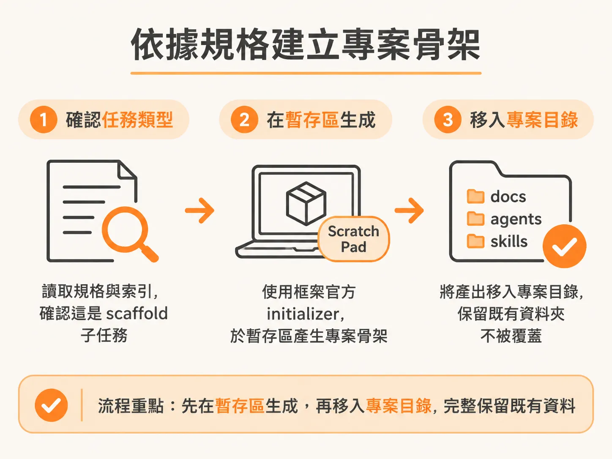
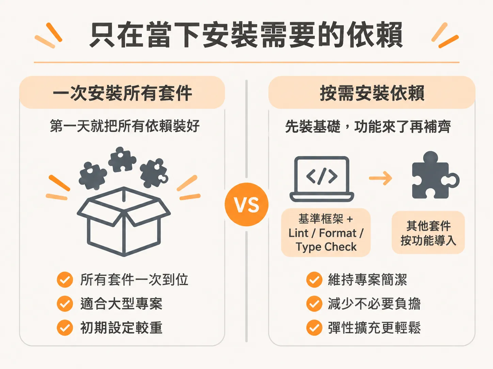
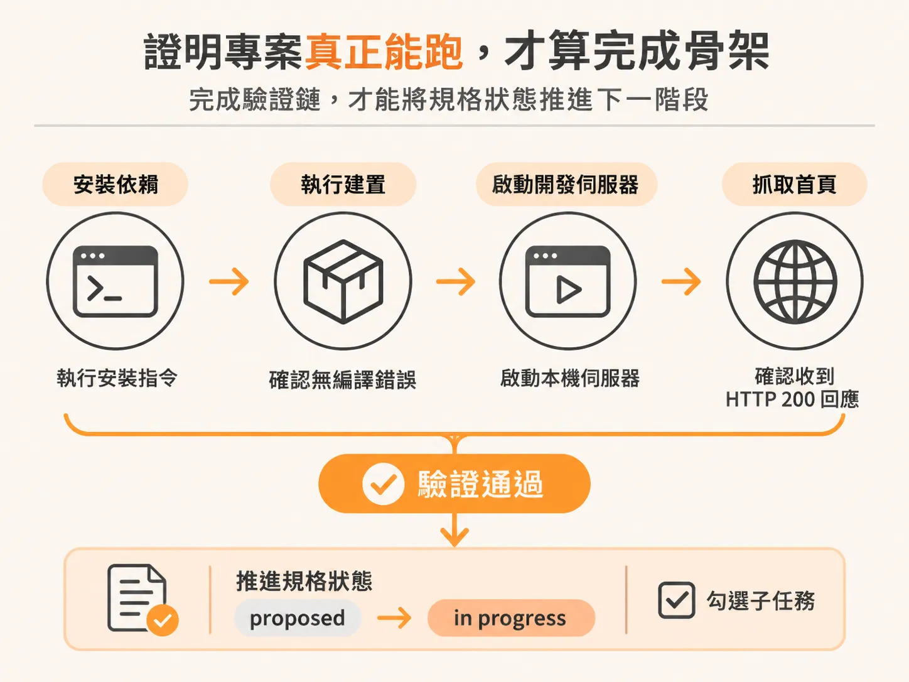

# 用官方 Initializer 建立專案骨架與即時依賴

門禁通過、該接的 MCP 也接上之後，`/develop` 的第一個實際動作就是建骨架。

啟動一個全新專案時，最容易犯的錯誤就是憑著過往印象自己手動建立資料夾，或者在第一天就把架構圖上列出的所有套件一次裝齊。這種做法不僅容易偏離官方社群的最佳實踐，還會讓專案背負一堆數週甚至數月都不會用到的依賴。

標準的工程做法恰好相反：由規格文件驅動，調用框架維護的官方初始化工具（initializer）產出骨架，只安裝當下切片所需的依賴，並在收工前親自證明專案真的能啟動運作。

## 依據規格建立真正的專案骨架

在與 AI 代理人經過充分討論、思考與推理後，系統便會根據你擔任主架構工程師所定案的規格文件，著手推進技術棧與架構的開發。

開發流程啟動時，第一步是讀取 `scope.md` 以及歸屬於該規格的索引檔案。當系統檢查規格存在且內容詳盡，確認技術棧決策（如 `spec 0001`）已完整記錄，就會辨識出這屬於第一個功能（feature one）的專案鷹架建立子任務（scaffold subtask）。

如果此時專案目錄尚未建立 Git 儲存庫，就不需要進行新鮮度檢查（freshness check），而是直接檢視鷹架工具的真實參數標記（flags）。以現代全端專案為例，系統會依規格要求建立一個啟用 TurboPack、搭配 pnpm 與 TypeScript 嚴格模式（strict mode）的 Next.js 16 專案，規劃 route group 目錄，並確認建置流程。

在實際寫入磁碟時，工具往往會展現一個細節：如果專案目錄中已經存在預先建立的 `docs`、`agents`、`claude` 或 `skills` 等工作資料夾，官方初始化工具通常會拒絕直接寫入非空目錄。這時流程會先在暫存區（scratch pad）跑完骨架生成，再將產出移入專案目錄，同時完整保留既有的文件與代理人設定。

更重要的是，它絕不憑記憶捏造目錄結構，也不模仿任何人自以為「現代專案該有的模樣」，而是直接執行該生態系官方維護的 setup 工具。這樣一來，專案的地基就能與開源社群實際發布的標準完全一致。

## 只在當下安裝需要的依賴

專案骨架生成之後，打開 `package.json` 會發現一個刻意的設計：除了技術棧的基準框架，以及程式碼檢查（linting）、排版（formatting）和型別檢查（type checking）必備的工具之外，幾乎沒有額外安裝其他依賴。

架構規格書裡即使規劃了完整的生態系，也不該在第一天就把所有套件全數安裝。郵件發送、系統監控、數據分析等特化套件，應該等到真正著手開發對應功能的那一個切片時，才順勢引入。

這不是偷懶或半吊子的設定，而是深思熟慮的「即時安裝」（just-in-time installation）。專業團隊藉此避免專案在一開局就背著十幾個整整一個月都沒碰過的依賴；每個套件都應該在它的真實慣例與設定檔能被妥善建立的那一刻，才正式進入程式庫。

與此同時，系統會立即建立好 `.env.example` 環境變數範本。這樣工程師就能一眼看出後續需要準備的憑證與連線字串，例如 Supabase 的資料庫連線網址（包含 pooler 與 direct URL）、Anthropic 與 OpenAI 的 API 金鑰、TMDB 電影資料庫金鑰、背景排程（background jobs）的 ingest key，以及發送郵件用的 Resend API 金鑰。在功能開發的同時先備齊這些金鑰，後續整合就能順暢接軌。

## 證明專案真正能跑，才算完成骨架

產生完整的目錄結構只是前半段。當 `app`、`components`、`db`、`jobs`、Supabase 專用的 `lib` 以及 `server` 等詳細目錄就位後，在把這個地基標記為完成之前，必須證明產生的專案能真正啟動。

依據選擇的技術棧不同，驗證可能包含：
1. 執行乾淨的建置（build）確認沒有編譯錯誤。
2. 啟動本機開發伺服器（development server）。
3. 發送請求抓取首頁，確認收到 HTTP 200 回應。

在實務流程中，開發流程會先執行 `pnpm install` 與 `pnpm build`，接著啟動本機伺服器並抓取首頁。當看到電影推薦應用程式（movie recommendation app）回傳 200，就證明專案骨架已經在執行。

規格文件的狀態會在此時俐落地從「提議中」（proposed）推進為「進行中」（in progress），並在規格內將這項開發子任務勾選為已完成。雖然流程可能詢問是否要執行進一步的驗證檢查或測試指令，但在綠地專案（greenfield project）剛起步的階段，只要在 `localhost:3000` 看到網頁順利跑起來，就足以證明專案可行，不需要在沒有測試案例時硬跑檢查。

這時專案中已經有了明確的腳本、依賴與組態設定，後續無論是由稽核工具盤點程式庫的真實樣貌，或是繼續填寫代理人設定檔，都有了扎實且可驗證的起點。
