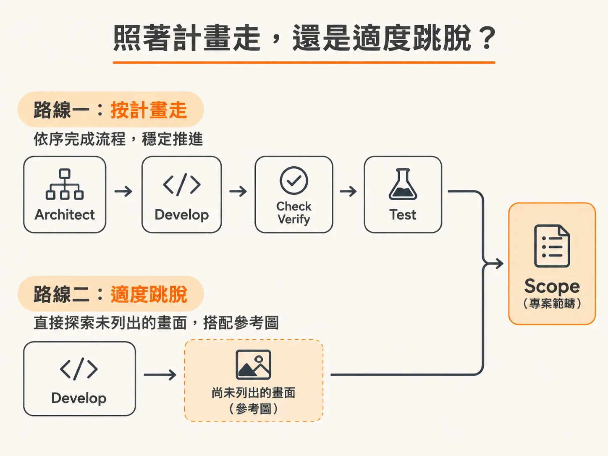
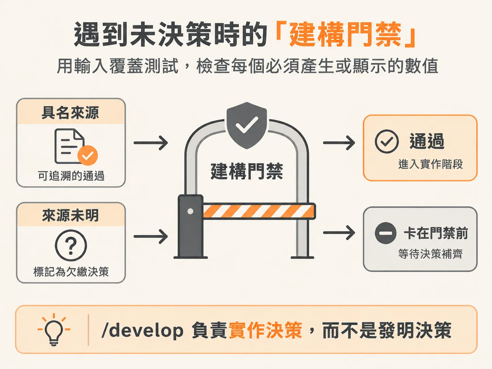
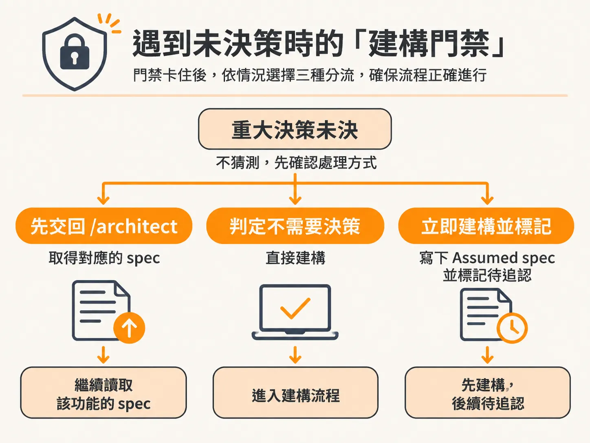
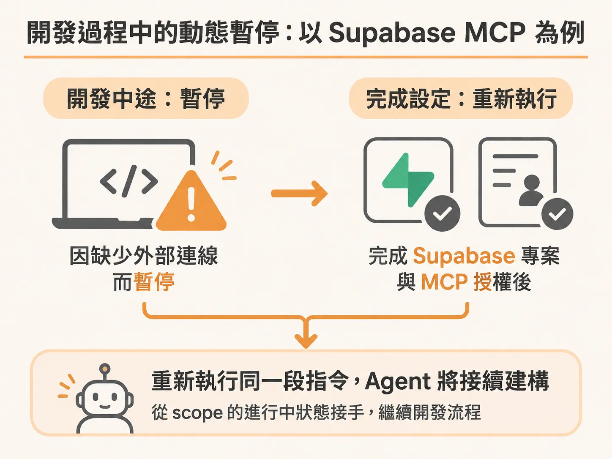

# `/develop` 開工前的檢查機制：讀取 Scope、Spec 與處理未決策

`/architect` 把規格定案、清掉對話之後，下一個接手的是 `/develop`。

在使用代理人（Agent）協助開發時，很多人會誤以為輸入 `/develop` 後，模型就會自動發揮創意把所有功能寫出來。但在嚴謹的架構工作流程中，`/develop` 的本質不是「發想」，而是「閱讀與執行」。

在決定好技術堆疊之後，下一步就是叫出 `/develop` 技能。開啟一個新的 Cloud Code 視窗，輸入 `develop`，並告訴它你想開發什麼。如果是在一個全新的綠地專案（Greenfield project）上，第一件要打造的事情並不是具體功能，而是建立整個架構的基礎建設（architectural foundation）。這部分你當然可以手動完成，但讓代理人來處理整個設定會輕鬆許多。在執行的過程中，你可以觀察它的指令到底從何而來——因為 `/develop` 本身不負責決策思考，它只是嚴格閱讀既有的規劃與規範。

---

## 照著計畫走，還是適度跳脫？

當架構基礎建立完成後，專案範疇（scope）裡會列滿待開發的功能。引導 `/develop` 推進這些功能通常有兩種方式：



第一種是完全照著計畫走。也就是依序執行 `/architect`、`/develop`、`check verify`、測試、執行審查（audit），接著再回到 `/architect` 規劃資料模型（data model），一步步推進。

但第二種方式能讓你有喘息空間，不必百分之百死板地照著計畫執行，同時又不會完全脫離工作流程。這也是整個開發流程最核心的設計精神：**工作流程是拿來引導你的，而掌控權始終在架構師（你）身上**。

舉例來說，當代理人在對話視窗中提示下一步應該依照 scope 執行 `check verify` 並進行測試時，你其實不需要照做。你可以把 `/develop` 直接指向一個在 scope 中甚至還沒列出獨立項目（feature row）的功能，例如首頁（homepage）。

你可以清除當前對話，直接呼叫 `/develop`，並提供一張代表最終成品的視覺設計參考圖（mockup），告訴它：「develop the homepage」。

雖然這看起來違背了原本的工作流程順序，但系統並不會崩潰或脫軌。它會辨識出這是一項介面（UI）工作，並依據你提供的設計圖來理解需求。

---

## 遇到未決策時的「建構門禁」（Build Gate）

當 `/develop` 讀取 scope 時，如果發現某個功能（例如 Feature 10：行銷頁面與 SEO）被標記為 `needs a decision`（需要決策），而且當前專案中既沒有 spec 也沒有 `design.md`，它就會觸發**建構門禁（build gate，又稱 Step 0: The spec gate）**。

這道門禁的核心原則是：**`/develop` 負責實作決策，而不是發明決策**。



為了避免代理人將重大的架構抉擇誤判為「只是單純的串接」，系統採用了**輸入覆蓋測試（Input coverage test）**：
列出這趟建構必須產生、計算或顯示的所有數值與行為。每一項數值都必須在 spec 中明確指出來源（例如：某個輸入值、資料庫欄位、或前一個決策的衍生結果）。只要有任何數值來源未明，或者需要憑空發明第三方套件、資料模型、整張頁面的區塊結構與資產策略，這就是一筆「尚未記錄的欠繳決策（owed decision）」。

在讀取規範時，`/develop` 只會精準讀取該功能所屬的 scope 檔案與對應的 spec，絕對不會漫無目的地掃描整個 `docs/` 目錄。如果門禁檢查發現有重大決策懸而未決，它不會擅自猜測，而是會停下來向你確認該如何處理：



1. **先交回架構規劃（Architect it first）**：
   如果這項功能涉及深層的架構或資料流，建議先停止建構，將決策交回給 `/architect`：
   <!-- derived -->
   ```
   /architect <feature>: <具體要解決的決策>
   ```
   產出明確的 spec 後，再重新執行 `/develop`。

2. **認定無需決策（No, not needed）**：
   若人工判斷這只是純粹的前端排版或現有規範已涵蓋的實作細節，可直接略過門禁進行建構。

3. **立即建構並記錄為假設（Build now, record it as an assumed spec）**：
   以剛才的首頁為例，既然已經提供了完整的視覺設計稿，視覺方向非常明確，其實不需要大費周章重新走一次架構討論。這時可以選擇直接建構，並由 `/develop` 自動寫入一份最精簡的「假設規範」（Assumed spec）。

這份狀態為 `Assumed` 的 spec 會明確記錄是誰在什麼時候略過了架構決策直接開工。在設定好 Git 後，它還會帶入 Git Email，清楚標示出決策責任人。這項紀錄讓假設具備持久性，不會因為對話清除（`/clear`）而遺失，同時也不會阻礙功能最終被標記為完成。

---

## 開發過程中的動態暫停：以 Supabase MCP 為例

除了開工前的 spec 門禁，`/develop` 在執行過程中一旦遇到缺少環境設定或連線工具，也會主動停下並等待使用者補齊。

在開發資料模型（data model）時，`/develop` 判斷出接下來的工作需要與資料庫互動，此時它可能會詢問：你是想現在手動填入指向 Supabase 的環境變數（ENVs），還是要直接連接 MCP（Model Context Protocol）伺服器？



如果你選擇立即連接 MCP，`/develop` 就會先主動暫停開發流程，並提示：「等你連線完成後，再重新執行一次 `develop data model`，我就會接續建構。」

這時你可以依照提示完成外部設定：
1. 到 GitHub 建立公開儲存庫（如 `client feedback app agentic`），並將目前的程式碼推送上去。
2. 前往 Supabase 建立新專案，並綁定該 GitHub 儲存庫，記下生成的資料庫密碼。
3. 參考 Supabase 官方文件中的 MCP Server 說明，取得平台託管專案（platform hosted project）的設定指令。
4. 在終端機貼上指令加入 HTTP MCP server。
5. 執行驗證指令（例如在終端機執行 `cloud` 或 `/mcp`），完成 Supabase 的授權認證（Authorize cloud code）。

當 MCP 伺服器狀態顯示為已連線（connected）後，你只需要重新輸入：

<!-- derived -->
```text
develop data model
```

此時代理人會重新讀取目前的 scope 進度，發現先前的 data model 正處於進行中（in progress），同時它現在已經具備了 MCP 工具的權限，就能自動接手後續的資料庫遷移（migrations）與建構工作。

藉由在開工前嚴格讀取 scope 與 spec、在遇到未決策時退回 `/architect` 或留下 Assumed 紀錄，以及在缺少依賴時動態暫停，開發流程既能維持嚴謹的架構邊界，又保留了實務操作上的靈活性。
