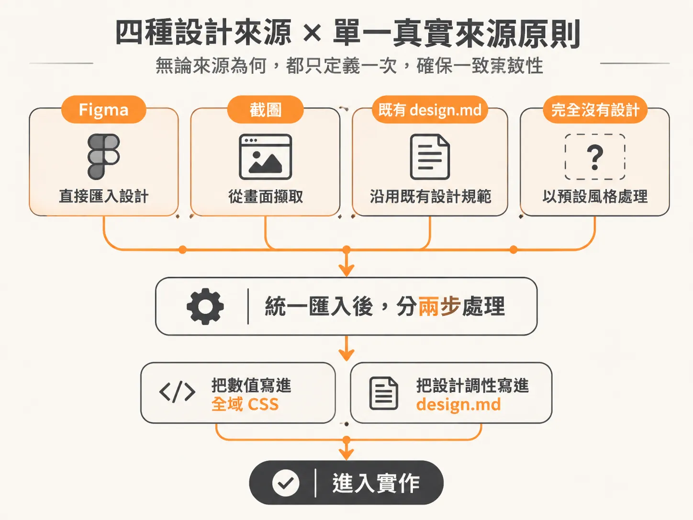
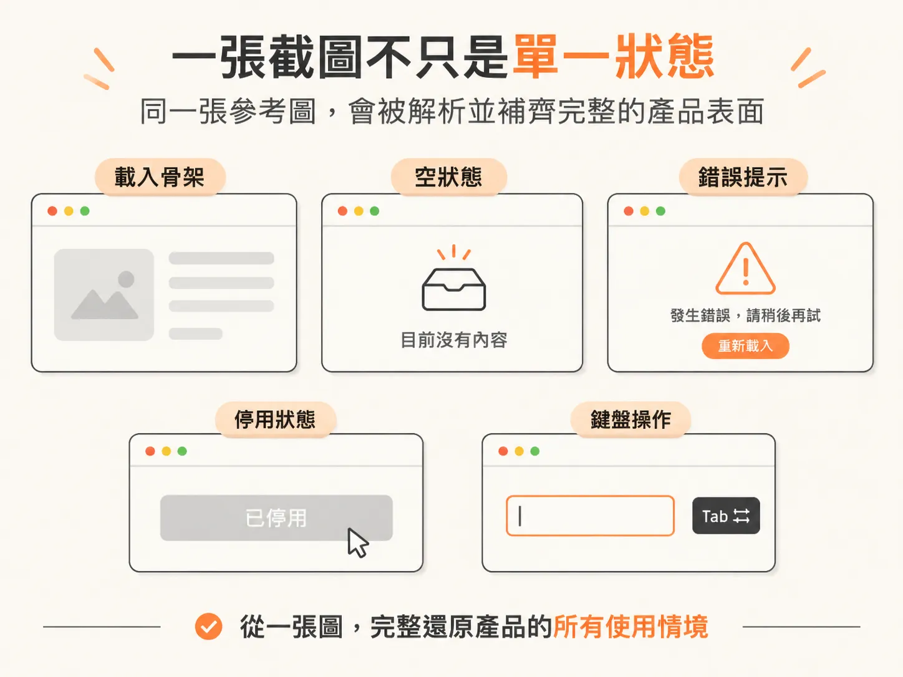
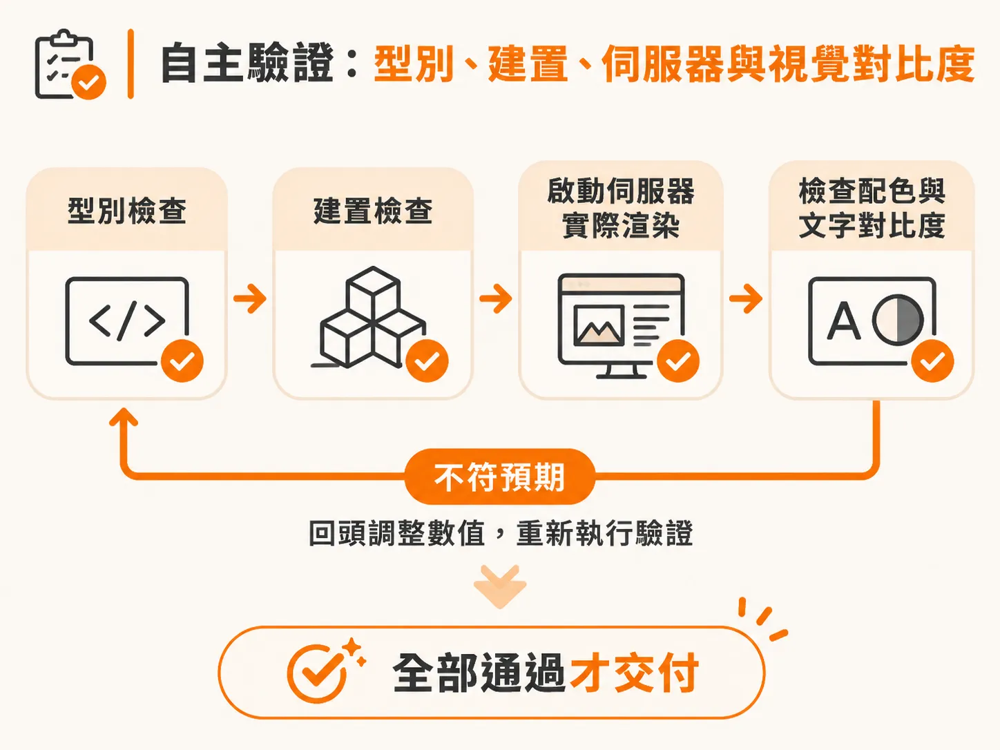
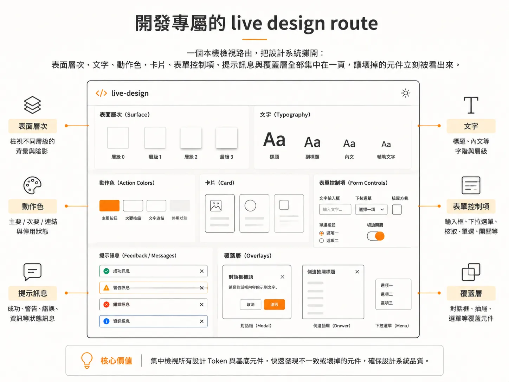

# 用 /develop 從截圖與 design.md 建出設計系統與完整畫面

骨架能在本機跑起來之後，接下來才是把畫面做成真的。

用 AI 生成前端介面時，最常遇到的問題是模型只交出一個「看起來像截圖」的靜態外殼：沒有載入中狀態、沒有錯誤處理，按鈕沒有 focus 樣式，換到不同螢幕尺寸時排版直接崩壞。

在 Agentic Engineering 工作流程中，`/develop` 不是單純在瀏覽器裡硬貼一張假畫面，而是以設計系統為核心，把參考圖或規劃檔案落實成具備完整狀態、能自我驗證的真實產品介面。

---

## 來源的四種走向與單一真實來源原則

當你把任務交給 `/develop` 時，第一步是決定視覺來源從何而來。依據輸入內容，工作流程會分成四種處理路徑：

1. **已連接 Figma**：直接拉取真實設計稿的 frames，以 Figma 為準進行像素級還原。
2. **提供截圖或參考圖**：AI 忠實還原畫面與排版，不擅自增減裝飾。它會把肉眼可見的數值萃取為 CSS Token，並把設計調性記錄到 `design.md`，同時推導出單張截圖無法呈現的響應式與無障礙互動。
3. **已有設計系統（`design.md` 與 CSS Token）**：在新頁面中沿用既有規範，確保元件尺寸、圓角與顏色與已上線功能一致。
4. **完全沒有提供設計**：先由系統提議完整的視覺方向（包含字階、調色盤、間距、圓角與卡片造型），寫入 `design.md`，將 Token 寫進全域 CSS（如 `globals.css`），再以高標準建立完整介面。

無論走哪條路徑，整個流程都遵循同一個規則：**每個真實來源（Source of Truth）只定義一次**。設計規則與視覺走向記錄在 `design.md`，實體數值（顏色、間距、字型等）收攏在全域樣式檔中，避免散落多處導致設定衝突。

---

## 一張截圖不只是單一狀態

一張參考圖往往只展示了使用者旅程中的某一個瞬間。但真正能上線的產品，必須在各種狀態下都維持可用性。

當 `/develop` 讀取參考圖（例如一組帶有溫潤、沉靜手作質感、米白色畫布而非刺眼死白、搭配柔和粉彩面板的畫面）時，它會解析出畫面裡的元件，並在程式碼中補齊截圖看不見的細節：

- **邊界狀態覆蓋**：自動實作骨架畫面（Skeleton）作為載入狀態、帶有插圖的空狀態（Empty states）、行內錯誤提示，以及按鈕的 disabled 狀態。
- **無障礙與鍵盤操作**：以滑動卡片（Swipe card）為例，不能只支援滑鼠或觸控拖曳，必須同時支援鍵盤操作與 focus 焦點管理。
- **行動優先與手勢對映**：對於以手機為核心情境的應用，將右滑（喜歡）、左滑（不喜歡）、上滑（略過）三種結果統一接到同一個事件處理器，並納入安全區域（Safe area insets）與動態視區單位。

這意味著畫面不再只是一張「截圖臨摹」，而是一套可以被後續功能反覆引用的元件基底。

---

## 自主驗證：型別、建置、伺服器與視覺對比度

完成程式碼撰寫後，`/develop` 不會直接停下，而是主動執行驗證流程：

1. **靜態檢查**：先跑型別檢查（Type check），再跑專案建置（Build check）。
2. **實際渲染**：在背景啟動開發伺服器，將頁面實際渲染出來。
3. **視覺與對比度審查**：檢查色彩搭配是否合理、文字與背景對比度是否達標。如果發現數值不符無障礙或視覺標準，AI 會回頭修改數值，直到通過為止。

在交付成果前，AI 還會依據一套檢驗標準進行自我審查：頁面不能只留下孤立在畫面正中央的輸入框、不能有大片未利用的死區、不能出現未套用樣式的瀏覽器預設控制項，更不能只有空泛的小工具而缺乏品牌、文案與頁尾結構。確認無誤後，它會詢問是否將推導出來的驗證步驟寫入 `verify.md`，或是先保留在執行摘要中。

---

## 開發專屬的 live design route

設計系統建立完成後，除了文件檔案（如 `docs/design.md`），工作流程還能在本機環境產出一個專屬的檢視路由（例如 `localhost:3000/design`）。

這個頁面會把目前應用程式中所有的設計 Token 與基底元件集中渲染出來，包含：

- 各層表面（Surfaces）、線條與文字層次。
- 動作狀態（確認、危險、品牌色）。
- 卡片邊界樣式、海報比例、缺少圖片時的 fallback 呈現。
- 表單控制項、Toast 提示訊息、響應式覆蓋層（Overlay）。

透過這個路由，開發團隊能在單一頁面快速抓出壞掉的元件，並確保後續所有新功能都會遵循同一套圓角、間距、動態與無障礙規則，避免視覺風格隨著迭代逐漸發散。

---

## 依需求調整：規劃路徑與靈活介入

在工作流程中，使用 `/develop` 有兩種主要方式：

- **循規模式**：嚴格按照規劃清單（Scope）逐步推進，針對已排定的功能執行開發。
- **彈性模式**：直接將 `/develop` 指向一張截圖、一句話或臨時增加的小功能。開發完成後，只需在終端機執行不帶參數的 `scope`，它就會讀取 `replan.md`，將現狀與清單比對並自動收錄，不需要手動重排計畫。

需要注意的是，`/develop` 是整個工程工具鏈中負擔最重（heaviest）的指令。建立完整介面需要大量的上下文去規範設計、無障礙、狀態處理與自我驗證。如果是修改單一文案或微調一組間距，應該直接進行局部修改；只有在處理真正要交付上線、具備足夠表面積的完整畫面時，才需要動用 `/develop` 跑完整套建置與驗證流程。
