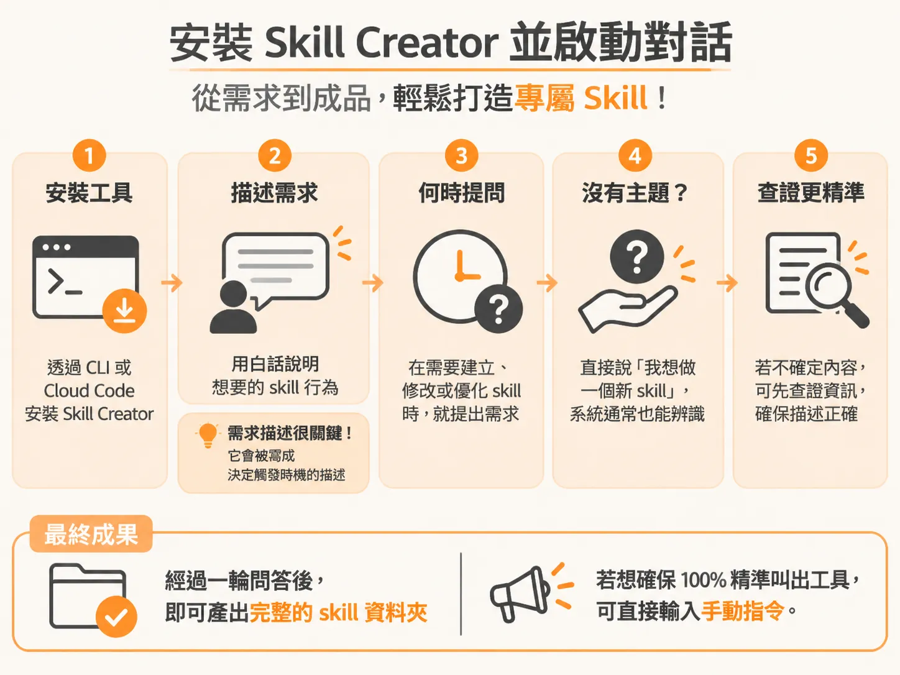
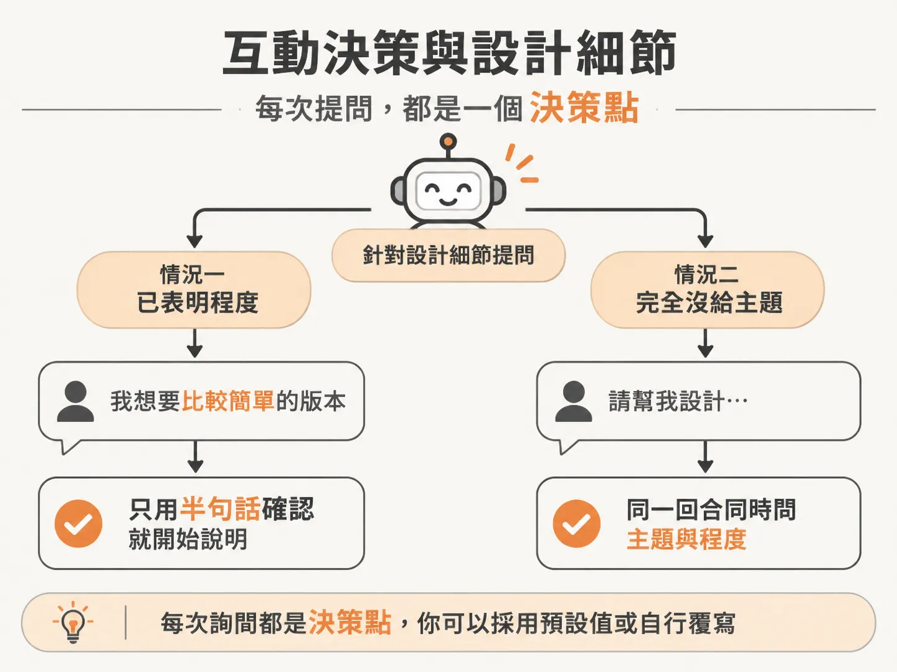
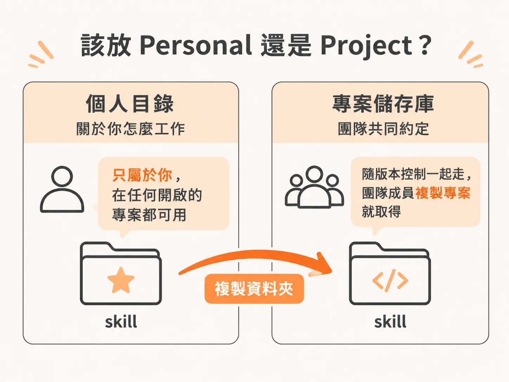
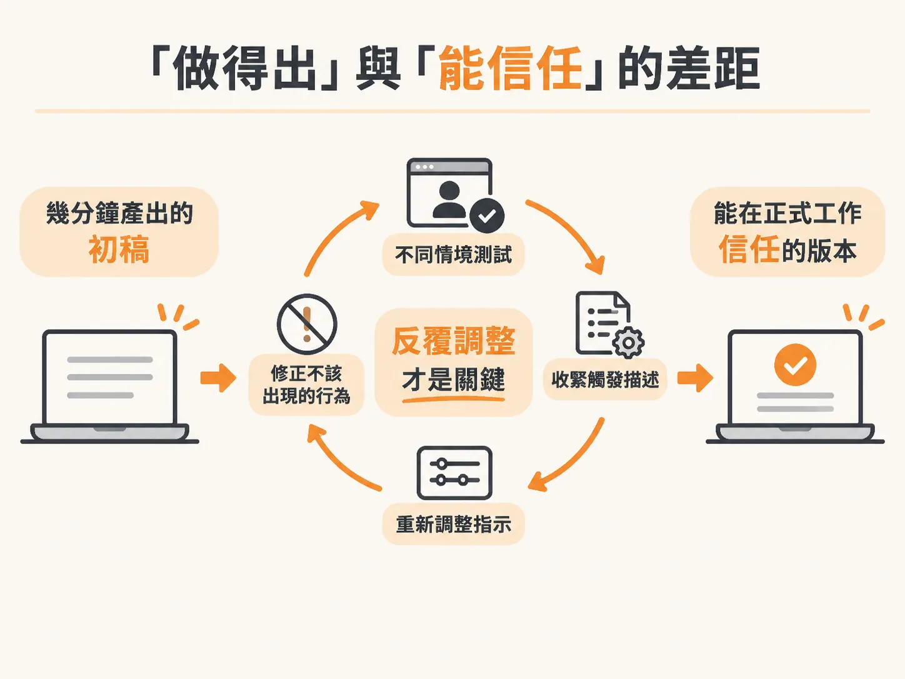
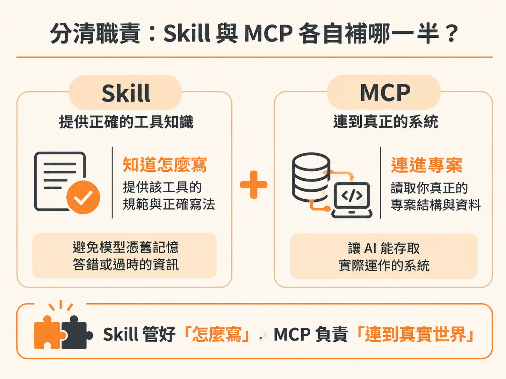

# 用 Skill Creator 打造自訂 Skill：個人設定、專案共用與 MCP 分工

看過別人寫好的 skill 之後，下一步就是自己動手做一個。實際走過一次流程，你就會發現建立專屬 skill 並沒有那麼高不可攀，它不是只有資深開發者才能完成的黑魔法。

我們這次要打造一個真正用得上的「teach-me」教學 skill。它的運作邏輯很單純：當我們要求它解說某個主題時，它必須先詢問我們的程度是「beginner（初學者）」、「medium（中階）」還是「pro（專家）」，再根據程度給出相應深度的說明；如果遇到不確定或可能過時的內容，它要先上網查證，避免教錯東西。

這件事跟平常寫程式的 workflow 技能完全不同。一般的 workflow 是幫我們產出軟體，而這個 skill 是在配合「個人的學習方式」。填補這種個人或團隊日常的流程空隙，正是自訂 skill 最適合派上用場的地方。

---

## 安裝 Skill Creator 並啟動對話

為了製作這個 skill，我們使用 Anthropic 官方推出的 Skill Creator 工具。在 Claude Code 終端機中，一行指令就能安裝官方外掛：

<!-- source: sources/js-mastery-engineer/20261107/supplement/046 - Build Your Own Skill pdf.txt#L10-L11 -->
```bash
/plugin install skill-creator@anthropicagent-skills
```

（如果你使用的是 Claude Desktop 或 Cowork，它通常已經內建完成。）

安裝後，無論透過 CLI 還是 Cloud Code 延伸模組，都可以直接呼叫 Skill Creator。因為 Claude 會依據 skill 的 description（描述）自動判斷意圖，所以即使只輸入「我想做一個新 skill」，系統通常也能辨識出 Skill Creator 的用途：建立新 skill、修改與優化既有 skill。但如果想確保百分之百精準叫出工具，直接輸入手動指令最保險。



Skill 的 description 是決定它何時被觸發的核心依據，而在使用 Skill Creator 時，**由它來幫你產出 description**。因此，你在提示詞（prompt）中傳達的需求，就成了最關鍵的輸入：

<!-- source: sources/js-mastery-engineer/20261107/supplement/046 - Build Your Own Skill pdf.txt#L3-L6 -->
```text
/skill-creator create a skill to teach me something. Before it explains, it should ask my level: beginner, medium, or pro, and explain based on that. If I use it with no topic, it should ask me what I want to learn. And if it's unsure or might be out of date on a topic, it should verify on the internet first instead of teaching me something wrong.
```

不要只對它說「幫我做一個教學 skill」，而是要把細節交代清楚：
1. 什麼時機要問程度？（說明之前先詢問 beginner、medium 或 pro）。
2. 使用者什麼主題都沒給時怎麼處理？（主動詢問想學什麼）。
3. 遇到冷門或時效性資訊時該做什麼？（上網查證而不是胡亂猜測）。

把行為交代得越清楚，Skill Creator 就有越充分的資訊寫出準確的 description。

---

## 互動決策與設計細節

送出提示詞後，Skill Creator 不會盲目產生檔案，而是會透過問答逐一確認設計細節。每次詢問都是一個決策點，你可以直接採用建議的預設值，也可以自行覆寫。



在生成過程中，Skill Creator 也會參考你現有的 skills 風格。例如它可能會檢視你習慣以純文字、不加連字號的風格命名，進而配合團隊或個人的書寫慣例。

產出名為 `Teach` 的 skill 後，有兩個它自動補足、非常貼心的互動設計：
1. **已交代程度時自動跳過問題**：如果你輸入「用五歲小孩能懂的方式（ELI5）解釋 closure」或「我是資深開發者，請解釋 X」，它只會用半句話確認已掌握程度，接著直接說明。使用者剛說完自己的背景，如果系統下一句又問「你是什麼程度？」，體驗上就像完全沒在聽。
2. **沒有主題時合流提問**：如果你單獨執行 skill 而沒帶主題，它會在同一個回合中同時詢問「想學的主題」與「你的程度」，而不是拆成兩輪問答讓你回兩次。

---

## 該放 Personal 還是 Project？

Skill 產生後，必須重啟對話視窗才能載入新設定。這時請特別注意它被安裝在哪個資料夾路徑。

如果檢查全域的 Claude skills 資料夾（即 `~/.claude/skills/`），你會看到 `teach` 資料夾躺在那裡。這代表它屬於**個人 skill（personal skill）**：



* **Personal（`~/.claude/skills/`）**：屬於你個人，任何開啟的專案都能讀取。像 teach-me 這種符合個人學習或工作習慣的輔助工具，不需要綁在特定的程式碼儲存庫（repo）內，放個人層級最合適。
* **Project（專案 repo 內的 `.claude/skills/`）**：跟隨程式碼一起版本控制。只要團隊成員 clone 專案，就能自動取得。團隊約定、程式碼規範、共用工作流程的 skill 都應該放在這裡。如果要把個人 skill 轉成專案 skill，直接把資料夾複製到 repo 的 `.claude/skills/` 即可。

---

## 實測 teach-me skill

載入後，我們可以用一個經典概念進行測試：「請教我 database indexes（資料庫索引）」。

因為沒有預先告知程度，它精準觸發了詢問：「你目前接觸 database indexes 的經驗大概到哪裡？（beginner、medium、pro）」並附帶了各程度的定義說明。

回答 `medium` 後，它先連網確認索引概念近期是否有巨大架構變化，查證完畢後輸出符合中階水準的教學架構：
* **核心本質**：索引是特定欄位獨立出來、經過排序的複本，與原資料表同步更新，讓資料庫不用全表掃描就能跳到目標資料。索引的核心概念全部圍繞在「sorted（已排序）」這個特質上。
* **常見迷思與破除**：一般常以為索引就像雜湊表（Hash Map）一樣加速查詢，但預設的 B-tree 索引並非雜湊結構，而是類似書籍目錄或按姓氏排序的電話簿。
* **深層機制與驗證**：進一步解釋為什麼要這樣設計、常見的踩坑點，以及如何在終端機親手驗證效能差異與後續延伸主題。

這套結構不僅適合用來學習技術概念，拿來讓它解說不熟悉的專案程式碼，或是理解代理工作流程（agentic workflow）的環節，都非常管用。

---

## 「做得出」與「能信任」的差距

用工具建立一個 skill 只要幾分鐘，聊個天就產出初稿。但要記住：**跑得通（it works），不等於可以在正式工作裡完全信任它（I trust this in real work）。**

剛生成的版本只是一個體質不錯的初稿。它每次教學都能保持穩定品質嗎？它每次都能在恰到好處的時間點提問程度嗎？這些都需要在不同情境反覆驗證、收緊 description 的觸發條件、修改引導詞，直到把不該出現的行為修正完畢。



這也是為什麼在建構完整工作流時，預先經過成百上千次測試打磨的成熟 skills 那麼有價值。只有在「一個步驟需要重複執行，且每次都必須以相同標準落實」時，它才值得被固化為一個 skill。

---

## 分清職責：Skill 與 MCP 各自補哪一半？

理解了如何打造 skill 後，要避免把它和 MCP（Model Context Protocol）搞混。兩者經常搭配特定工具（例如 Supabase、Next.js、Stripe、Prisma）一起出現，但各司其職：



* **Skill 傳遞「工具的真實規範（Conventions）」**：
  現代工具更迭快速，模型訓練資料裡記住的語法經常過時。Supabase skill 教導代理模型 Supabase「目前真正的運作方式」——認證怎麼做、Row-Level Security（RLS）如何撰寫、推薦的最新 API 呼叫模式等，避免模型半記半猜寫出舊版程式碼。
* **MCP 提供「該工具實例的即時連線（Live Access）」**：
  Supabase MCP 不負責教導語法慣例，而是真正連線到你的 Supabase 專案。它能查詢真實的資料表結構、讀取 live 資料、執行真實 query，讓模型不用憑空猜測環境現況。

一句話區分兩者的分工：**Skill 讓模型知道「程式該怎麼寫」，MCP 讓模型連進「真實運作的系統」。**

在成熟的流程中，系統會自動分析你的技術堆疊，找出對應的 skills 與 MCPs，但安裝與連線授權一律由你把關。工具代勞繁瑣搜尋，人類做出決策，這正是高效率人機協作的核心。
