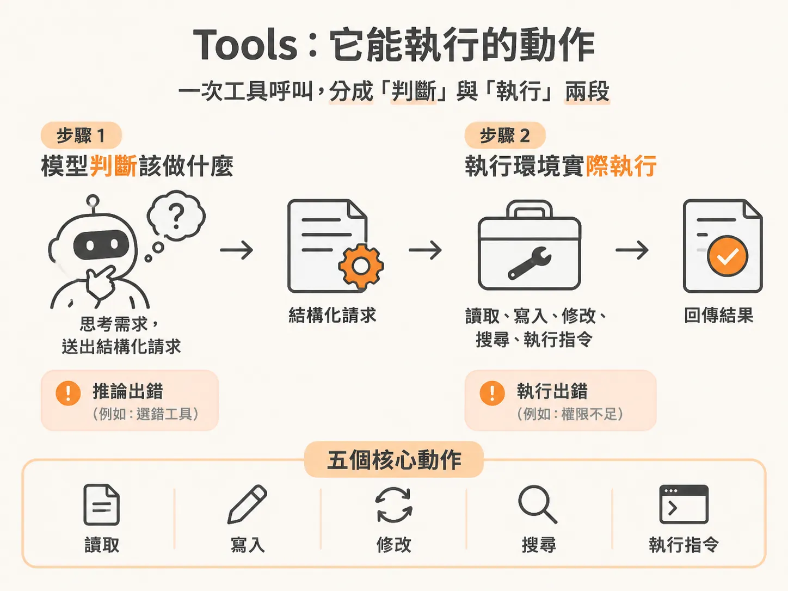
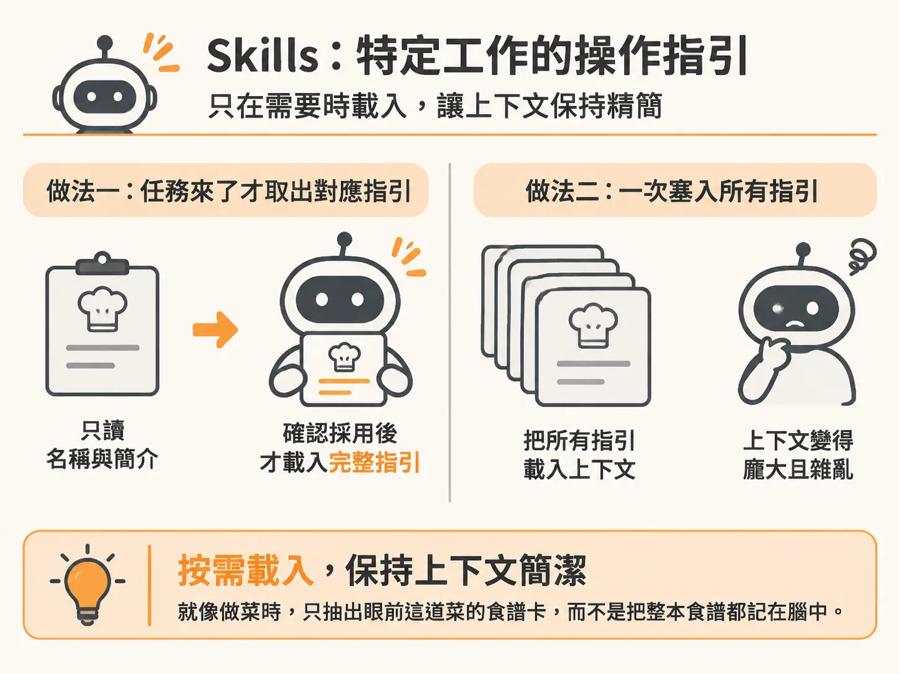
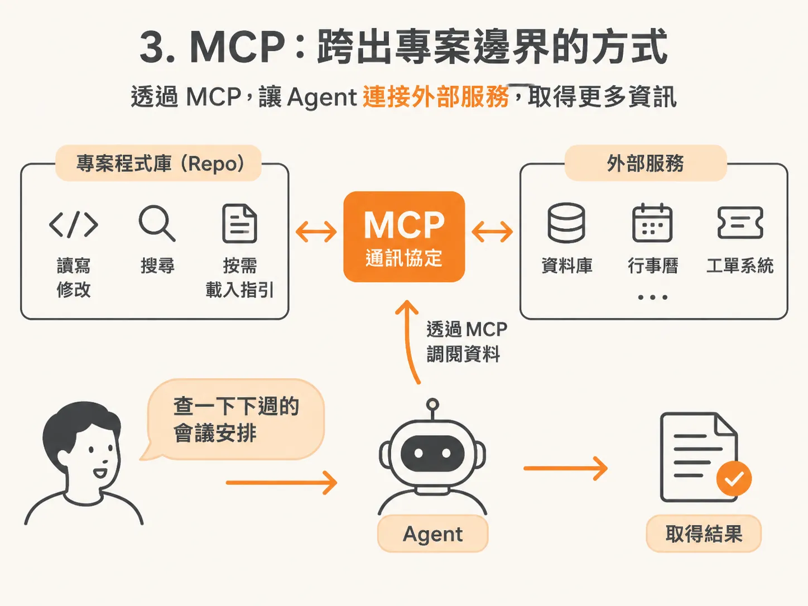
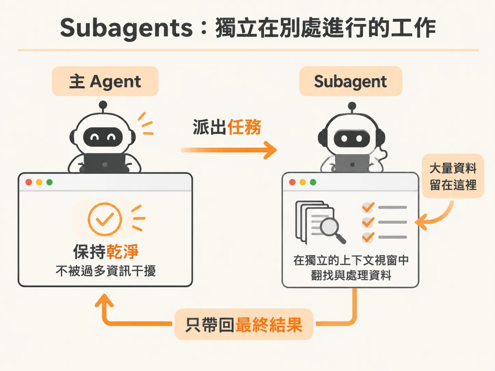
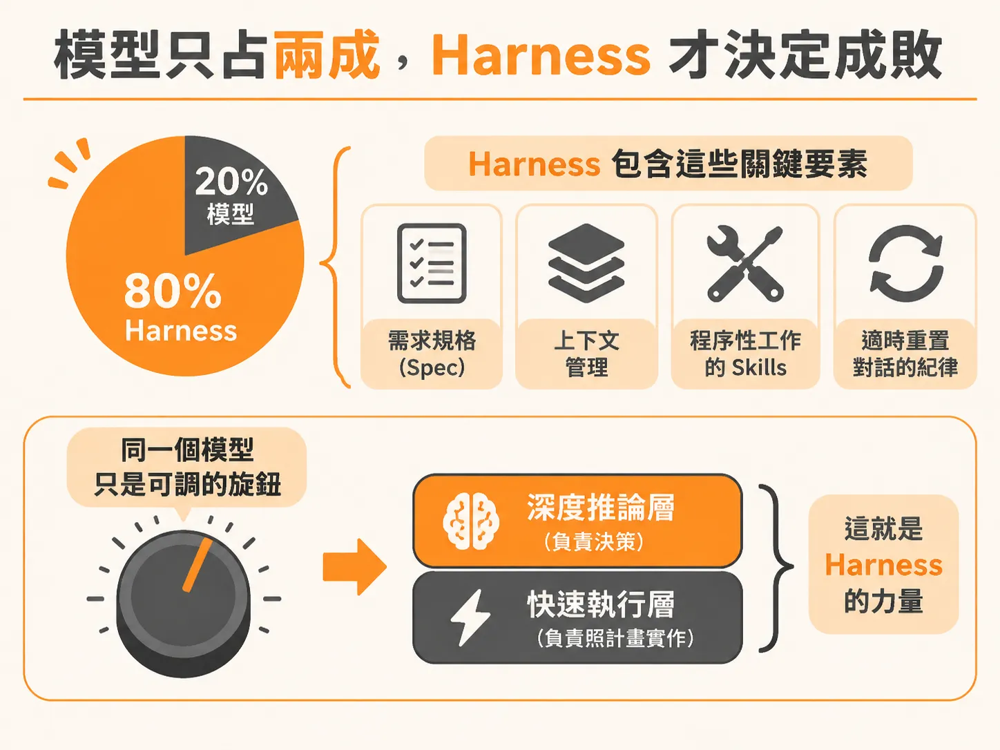

# 掌握四個基礎元素，看懂所有 AI 開發工具

每次市場上推出新的 AI 開發工具，官方文件總會堆出令人眼花撩亂的新名詞。如果你每次換工具都要從零開始摸索，很快就會疲於奔命。

上一章討論了 Agent 如何思考、閱讀、決策、行動與觀察。這一章要談的是：它實際上能拿到什麼東西？

答案只有四樣。

這就是全部的名單。下個月會有新工具發布，再下個月又會有另一個，而且每一個都會為這同樣的四件事發明自己的稱呼。只要好好學會這一次，以後無論市場推出什麼新產品，你都不用再從零開始——你只是在聽某個人說不同腔調的同一種語言罷了。

這四個基礎元素（Primitives）就是：Tools、Skills、MCP、Subagents。

## 1. Tools：它能執行的動作

Tools 是 Agent 真正可以執行的動作，例如讀取檔案、執行指令、搜尋程式碼庫。

你可以把 Tool 想成平常寫的函式呼叫（function call）：一件定義清楚、負責單一工作的事，需要時被呼叫，然後回傳結果。例如 Agent 呼叫 `read("auth.ts")`，接著拿回檔案內容。

這裡有一個關鍵細節必須記住：Agent 本身並不執行這個函式。它是「判斷應該執行某個函式」，發出請求，然後等待結果。

這個「推論」與「執行」的分離，解釋了實務上常遇到的一個現象：模型可能完全正確推斷出該做什麼，最後卻得到糟糕的結果。原因可能是工具呼叫格式錯誤、檔案根本不存在，或是指令在你的環境中無法執行。推論與執行是兩個獨立步驟，兩者都有可能失敗。

每一款 Coding Agent 無論出自哪家公司，基本上都會提供以下核心工具組合：

- **Read**：打開檔案並檢視內容。
- **Write**：建立新檔案或完全覆蓋現有檔案。
- **Edit**：修改現有檔案的特定部分。
- **Search (grep / glob)**：尋找特定文字，或搜尋符合特定規則的檔案路徑。
- **Run a command**：在終端機中執行指令，例如測試套件或建置指令。

這五個動作涵蓋了 Agent 大部分的工作流程。這也是 Coding Agent 與一般聊天機器人的根本區別：聊天機器人只能說話，而 Agent 能夠行動，因為它擁有被允許取用的 Tools。

## 2. Skills：特定工作的操作指引

Tool 代表它能做什麼，Skill 代表它「知道」什麼。

Skill 是針對某種特定工作的一整套指引。Agent 只在遇到該任務時才會拿起來參考，工作完成後就放下。這就像做菜時，你只會抽出眼前這道菜的食譜卡，而不是試著把整本食譜的所有內容一次硬塞在腦袋裡。

「只在需要時才載入」是 Skill 的核心價值。它能避免 context window（上下文視窗）被無關的細節塞爆。以 Claude Code 與 OpenAI 的 Codex 為例，兩者對 Skill 的支援甚至完全共用同一套格式：同樣是在資料夾裡放一份 `SKILL.md`，同樣包含 frontmatter，Agent 都會先讀取名稱與簡介，等到真正決定採用時才載入完整的指引步驟。

## 3. MCP：跨出專案邊界的方式

Tools 和 Skills 的運作範圍都落在專案目錄之內。但如果需要的資料根本不在專案程式庫裡呢？

應用程式依賴的許多服務都不在 repo 內，例如資料庫、行事曆或工單系統。MCP（Model Context Protocol）就是 Agent 連接這些外部服務的通訊協定。許多服務（如 Slack、Google Calendar 或各類資料庫）都提供 MCP 介面。設定連線一次之後，你只要用白話提出需求，Agent 就能直接透過 MCP 向外調閱資料並帶回結果。

簡單來說：Tool 處理專案內部的事情，MCP 則是 Agent 觸及專案外部服務的管道。

## 4. Subagents：獨立在別處進行的工作

前面三種元素都發生在同一個地方——單一 Agent、單一 context window。Subagent 則打破了這個限制。

Subagent 是主 Agent 派出去的分身小幫手。它會在獨立分開的 context window 裡處理一部分工作，在自己的空間摸索完畢後，只帶著最終成果回傳，而不會把沿途看過的所有雜訊倒回主 Agent 的工作區。

把繁重的任務交接出去，能確保主 Agent 的上下文視窗保持乾淨俐落。

---

走到這裡，對照各家產品就會發現：不管是 Claude Code 還是 Codex，底層都是同樣的動作（讀寫改搜執行）、同樣的 `SKILL.md` 檔案、同樣的 MCP 協定，以及同樣將任務切分給獨立 context 的 Subagent 機制。看懂這四個概念，你就不需要每看到新工具就重新焦慮，只是認出換了包裝的同一批骨架。

## 模型只占兩成，Harness 才決定成敗

許多人在使用 AI 開發時，往往把精力花在追逐最新、最大的模型上。然而，模型大約只決定了最終產出品質的 20%。

剩下的 80%，全看模型周圍的整套配置——這套架構稱為 Harness（挽具／外圍工作骨架）。Harness 包含了你撰寫的需求規格（spec）、上下文管理、負責程序性工作的 Skills，以及在 context 開始劣化前主動重置對話的紀律。

頂級模型若缺乏良好 Harness，依舊只是在憑感覺亂寫程式（vibe-coding）；相對地，中階模型放在設計嚴謹的 Harness 裡，卻能產出扎實且便於審查的程式碼。因為真正關鍵的邏輯與架構由 Harness 撐起，模型只是在框架內執行對應的任務。

因此，模型不是品質的引擎，它只是一個依需求調整的旋鈕：

- **深度推論層（Deep tier）**：適合架構規劃與重大決策。
- **快速執行層（Fast tier）**：適合按部就班的實作與日常呼叫。

在 Claude 的生態裡，你可以讓 Opus 處理決策，讓 Sonnet 負責實作；換到 Codex、Copilot 或 Gemini 時，規則完全一樣——找到它們各自的深度層與快速層，依難度指派任務。

版本型號會不斷推陳出新，但學會寫好 spec、控管 context，以及在對的時機調度合適的模型，這些屬於 Harness 的能力永遠不會過期。當底層模型持續變強時，你的 Harness 不僅不會被淘汰，反而會釋放更大的槓桿效應。

接下來，我們就從四個元素裡最需要跨出專案邊界的那一個開始看：MCP。
