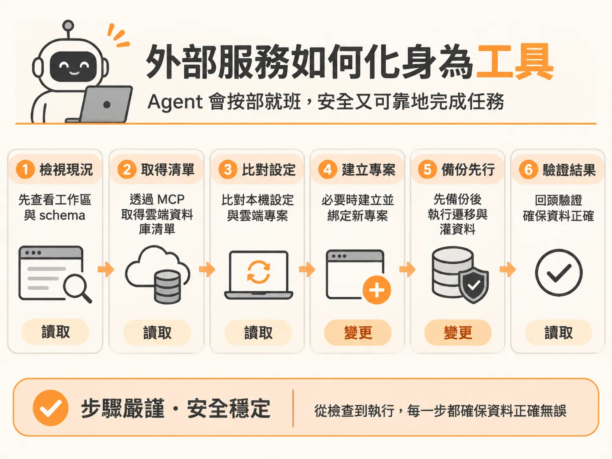
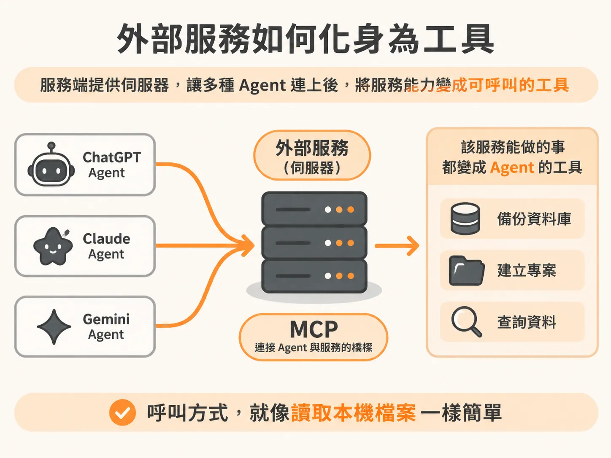
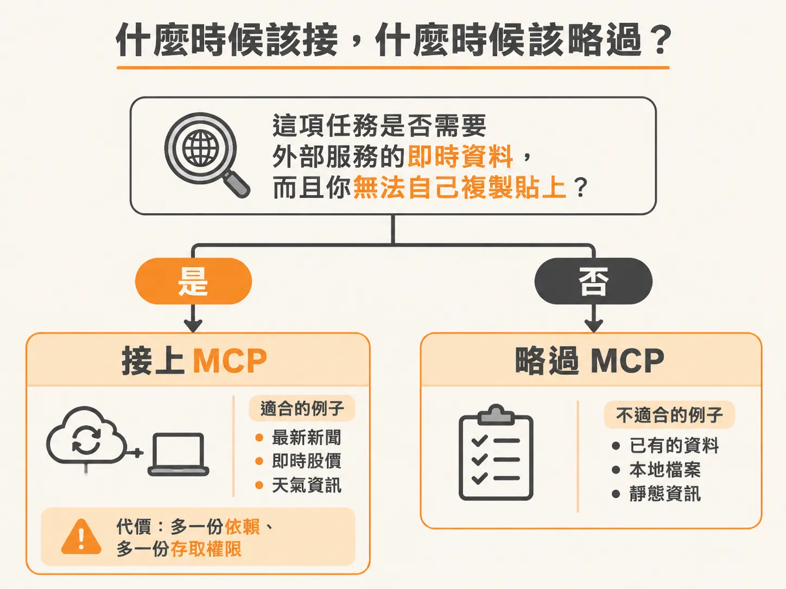
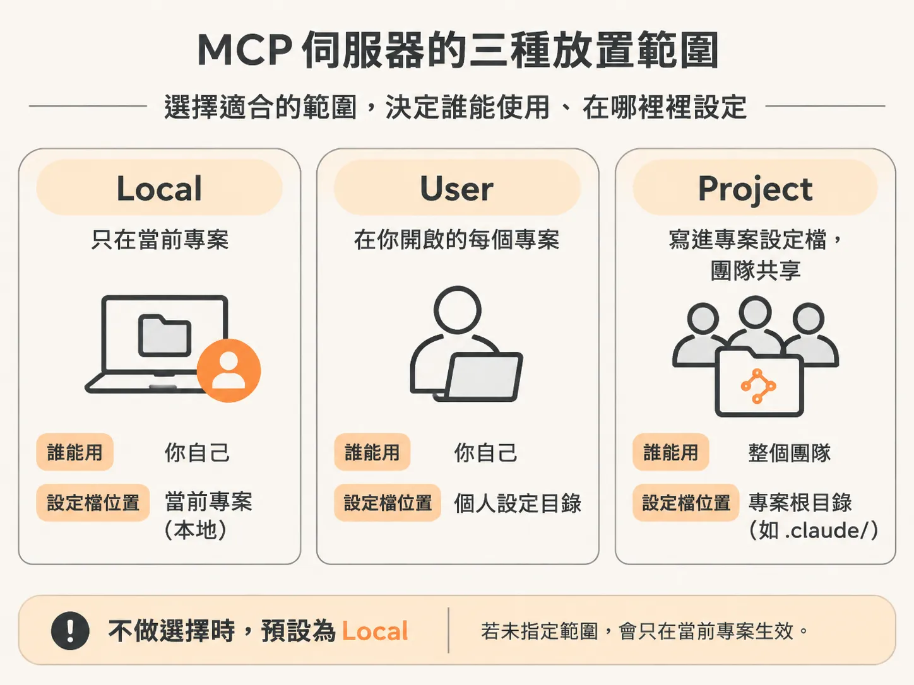
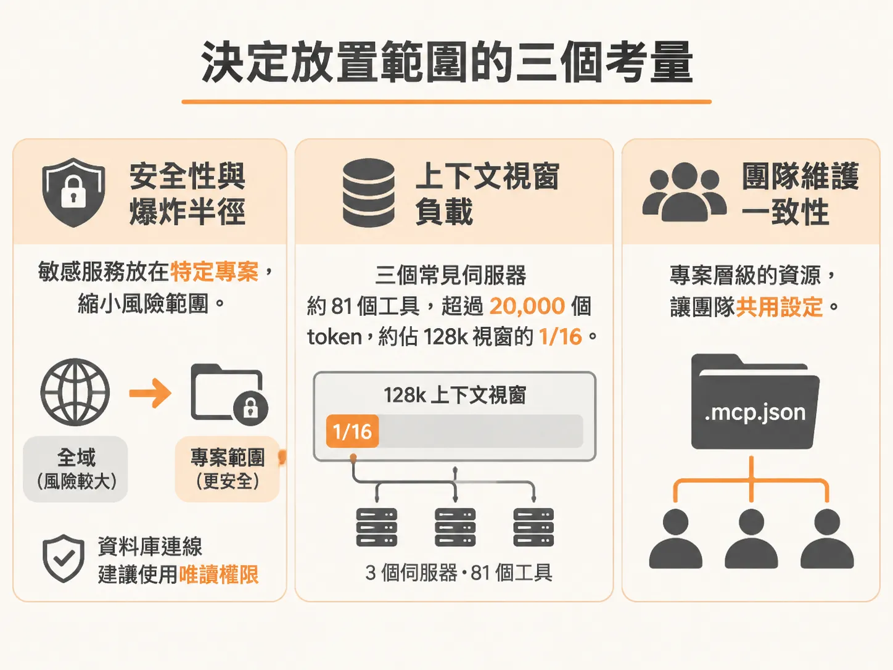

# MCP 如何把外部服務變成 Agent 工具：接合時機與設定範圍

你的應用程式所依賴的絕大多數資源，其實都不在你的程式碼倉庫（repo）裡。最明顯的例子就是資料庫。當你的專案剛建立、裡面空空如也時，終端機裡的 AI Agent 到底要怎麼伸手碰到外部的資料庫？

這就是 Model Context Protocol（MCP）要解決的核心問題。

## 外部服務如何化身為工具

Prisma、Drizzle、Supabase 等資料庫服務，通常都直接提供專門的 MCP 伺服器。以連接 Prisma Postgres 為例，整個串接過程只要幾步：

在終端機執行連接指令：

<!-- derived -->
```bash
claude mcp add <Prisma 的 MCP 連結>
```

這樣就新增了一個 HTTP MCP 伺服器。接著開啟新的 Claude Code 視窗，可以在圖形介面查看 MCP 伺服器的連線狀態，也可以直接在終端機輸入 `/mcp`。

此時 Prisma 伺服器需要認證。按下 Enter，系統會在瀏覽器開啟認證頁面；如果沒有自動跳轉，也可以按 `c` 複製網址手動貼上。在瀏覽器登入資料庫服務並確認授權（若在特定瀏覽器遇到跳轉問題，換到 Chrome 通常能正常完成）。認證成功後，關閉目前的終端機工作階段並重新開啟，設定就會生效。

現在，你只要對 Agent 輸入一句自然語言：

> 「幫我用逼真的範例資料灌入資料庫（seed），但請先建立備份。使用 Prisma MCP。」

Agent 就會開始行動，而且它的步驟非常嚴謹：



1. **先看全貌**：在動手前，它先檢視工作區、既有的資料庫與 schema 定義。
2. **透過 MCP 調閱遠端狀態**：呼叫 Prisma MCP 取得工作區詳細資訊，確認雲端現有幾個資料庫。
3. **比對本機設定**：檢查專案內的 Prisma 設定檔與 schema，確認本機環境變數與雲端現有的資料庫是否吻合。
4. **自動建立並綁定專案**：如果發現環境變數指向的專案根本不存在，它會主動提示，甚至不需要你開網頁儀表板，就能直接在終端機替你建立新的 Prisma 專案、拿到 ID，並自動寫入本機的 `.env`。
5. **執行變更並驗證**：建立資料庫備份、執行 migration，接著撰寫並執行 seed 腳本。完成後，它還會主動反查資料庫，確認使用者與文章資料確實寫入成功。

回到專案啟動本地伺服器，頁面上顯示的使用者與文章，全都是真實寫入 Prisma 雲端資料庫的資料，而不是前端寫死的假資料。

這就是 MCP 的本質：**外部服務架設伺服器，Agent 連上它，這項服務能做的一切操作，就全部變成 Agent 可以呼叫的工具。** 



備份資料庫、建立專案、查詢資料，在 Agent 眼中就跟「讀取本機檔案」具有完全相同的調用形式。更重要的是，MCP 是開放標準，不是特定工具的專屬功能。Cursor、Codex、Claude Code 都能連到同一套 MCP 伺服器。服務商只要寫一次，所有 Agent 都能通用。

這項機制還附帶一個好處：Prisma 的 MCP 伺服器同時暴露了文件搜尋工具。當 Agent 遇到 Prisma 的設定問題時，它不是憑著訓練模型的模糊記憶瞎猜，而是直接調用官方最新文件，給出帶有引用來源的精準回答。

## 什麼時候該接，什麼時候該略過？

學會 MCP 的操作並不難，真正的關鍵在於**判斷何時值得接**。

連接一個 MCP 伺服器並非毫無代價。每多接一個伺服器，就多了一條外部依賴，也就是多了一個可能壞掉的環節；更重要的是，你正在把真實世界的存取權限交給 Agent。

這份權限既強大又危險。為了安全，Prisma 的伺服器預設會攔截像是清空資料庫這類破壞性指令，除非你明確授權，否則不允許執行。

因此，判斷要不要接 MCP，標準只有一個：**這項任務是否需要來自外部服務的即時資料，而且這份資料是你無法自己隨手複製貼到對話框裡的？**



- **值得接**：即時運作的資料庫、真實的行事曆排程、即時的客服工單系統，或是任何會自己持續變動的外部狀態。
- **應該略過**：一份你可以直接當作附件上傳的靜態文件、一組固定不變的值，或是你本來就知道、貼一次就能講清楚的背景資訊。

如果不需要動態拉取資料，就不要多架這座橋樑。隨意增加存取面，只會給自己找麻煩。

## 設定範圍：Local、User 還是 Project？

當你確定某個服務確實需要接成 MCP 後，緊接著必須決定它該放在哪一個範圍（Scope）。在 Claude Code 中，新增指令時可以帶入 `--scope` 參數：



1. **Local（預設）**：不加任何參數時的預設值。僅限你個人在目前的專案當中使用。
2. **User / Global（`--scope user`）**：全域可用。你在這台電腦上打開的任何專案，Agent 都能調用此伺服器。
3. **Project（`--scope project`）**：設定會被寫入專案根目錄的 `.mcp.json`，並納入 Git 版本控制。團隊成員 clone 專案後，第一次使用只需確認同意，就能直接共用相同的設定。

這個層級劃分在各家 AI 開發工具中完全相通：
- **Cursor**：全域設定在 `~/.cursor/mcp.json`；專案設定在根目錄的 `.cursor/mcp.json`（若衝突以專案設定優先）。
- **Codex**：全域在 `~/.codex/config.toml`；專案在 `.codex/config.toml`。
- **Copilot**：CLI 讀取全域的 `~/.copilot/mcp-config.json`；儲存庫層級則在 GitHub 專案設定中配置。

### 決定放置範圍的三個考量

很多人習慣全部加上 `--scope user` 貪圖方便，但這樣做往往會帶來隱患：

- **安全性與爆炸半徑**：如果你把帶有真實權限的資料庫伺服器設為全域，代表你隨便開一個拋棄式的測試目錄，Agent 都有權限去碰那顆正式資料庫。將敏感服務限縮在特定專案（Project 範圍），才能縮小出事時的影響範圍。此外，無論放在哪裡，只要不需要寫入，資料庫連線最好都使用唯讀權限。
- **上下文視窗（Context）負載**：這是最常被忽視的效能稅。每個連上的 MCP 伺服器，在對話開始之前，都必須把旗下的工具定義（Tool Definitions）塞進模型的上下文視窗裡。曾經有基準測試顯示，光是串接三個常見伺服器（共 81 個工具），在對話開始前就吃掉了超過 20,000 個 token，直接佔掉 128k 上下文的 16%。掛了一堆用不到的全域伺服器，等於在每一場對話前平白繳納效能稅。
- **團隊維護一致性**：屬於某個專案的外部資源，放在專案層級可以讓整組團隊共用同一份 `.mcp.json`，不必每個人手動配對一遍。



**最佳實踐原則**：只要該服務綁定特定專案的資料或持有重要存取權（例如專案資料庫），預設一律放在 **Project** 範圍；只有像文件搜尋、通用 Web 工具這類不牽涉專案隱私且隨時通用的工具，才放入 **User（全域）**。如果拿不定主意，先放在專案層級永遠是比較安全的選擇。

把外部服務接進來之後，下一個問題就換成：工作變重時，怎麼不讓這些拉取與讀取塞爆主視窗？這正是 subagent 要處理的事。
