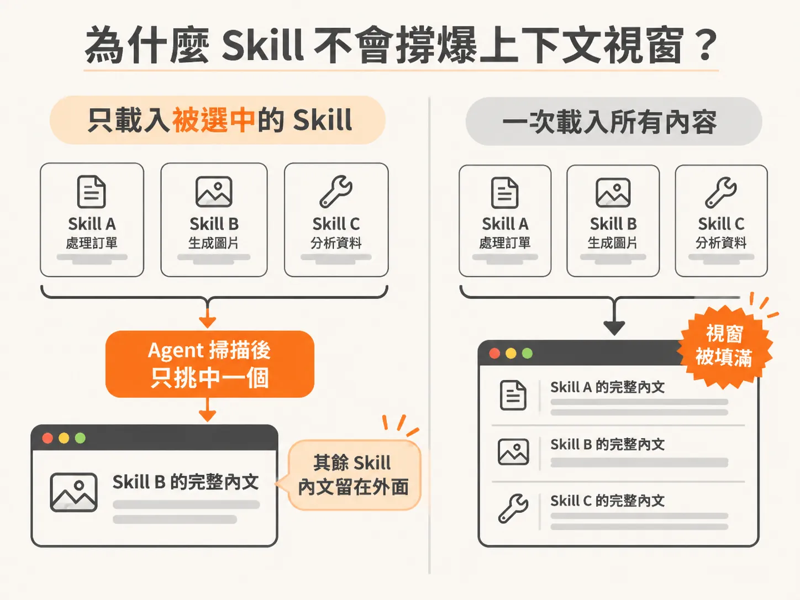
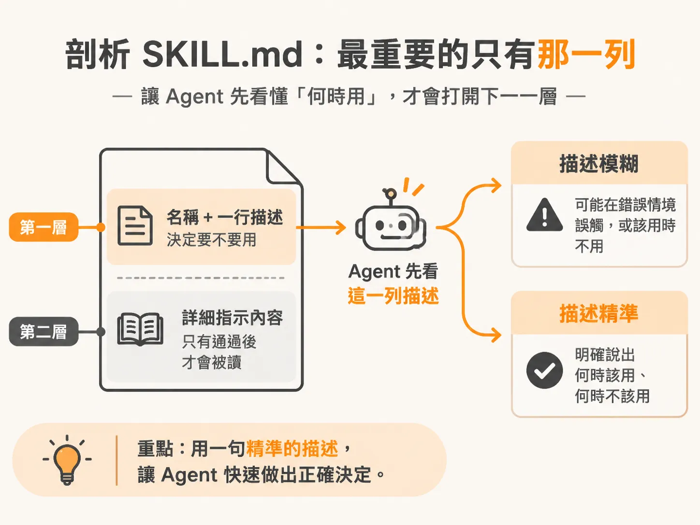
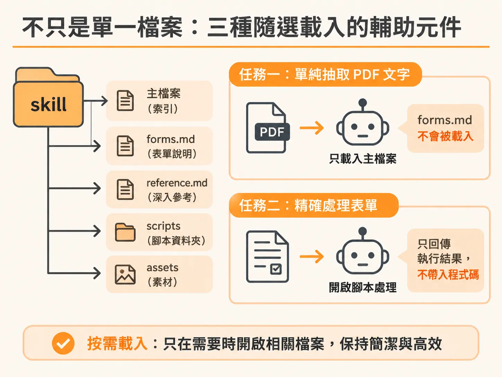

# 把手動紀律化為 Skill：SKILL.md 的觸發機制與按需載入架構

在與 AI Agent 協作時，你可能已經學會了一套嚴謹的工作紀律：在動手寫程式碼之前先工程化上下文、主動做關鍵決策而不讓模型瞎猜、維持精簡的常駐資訊（always-on context），以及在信任輸出前逐一驗證。

你知道這些紀律為什麼重要，也見識過略過它們時會出什麼差錯。然而，「知道一套紀律」與「在疲憊、深夜、只想趕快交差時，每一次、每個功能都切實執行」，完全是兩回事。

因為這套紀律從來不是單一動作，而是一連串繁瑣的微小流程：動筆前先釐清決策、記在不會遺失的地方、拆解工作範圍以確保改動小到便於審查、最後對照最初的需求逐項驗證。每一步都必須依序執行。

絕大多數人都很難持之以恆，這並非粗心，而是認知負荷太重。當你做在乎的核心功能時，會把全套流程跑完；但換到煩躁厭倦的瑣碎功能時，就會悄悄偷工減料。紀律往往在工作最忙碌、也最需要它的那一刻破功。

解決之道很單純：如果你不需要硬記這套流程呢？如果把它寫下來一次，讓 Agent 在你精神充沛或疲憊不堪時都以相同方式執行呢？

這就是「Skill」（技能）的本質。它不是深奧的黑魔法，純粹是把過去必須手動執行的流程寫進檔案，確保每次運作都維持一致。

---

## 為什麼 Skill 不會撐爆上下文視窗？

每個 Skill 都包含兩個部分：
1. 頂部的簡短名稱與描述（description）。
2. 下方較長的具體指示內文（body）。

Agent 平時只讀取頂部資訊。它會掃描所有具備的 Skill 名稱與描述，判斷哪一個符合使用者當前交辦的任務，接著「只載入被選中的那一個」完整內文。其餘不相關的 Skill，內文完全不會進入對話。

這解決了常駐上下文（always-on context）帶來的租金問題。如果在專案中放置 10 套作業流程，且全部設為常駐，每一次對話無論是否相關，你都得為這 10 份檔案支付上下文租金。

Skill 架構剛好相反：10 套流程安靜備用，未被選中的檔案每次只耗費兩行描述的租金，你僅需為當下觸發的那個流程支付完整成本。這種結構性設計，讓整個系統能容納豐富的流程規範，卻不會壓垮上下文視窗。

### Skill 不會替你思考

這也是許多開發者容易誤解的地方：**Skill 不會替你思考。**

它不會讓 Agent 變得更聰明，也不是某種讓模型工程能力突飛猛進的魔法咒語。模型的能力完全沒有改變。

Skill 改變的是你的注意力分配。它接手了繁瑣的流程管理——記住步驟順序、確認檢查清單是否完成——將你的注意力解放出來，留給真正屬於你的工作：下決斷、做判斷，以及只有人類能敲定的決策。

整套概念的核心只有一句話：**Skill 負責執行流程，你負責做出決策。**

你的專業判斷力之所以被浪費，不是因為能力不足，而是被無止境的流程細節淹沒了。移除這層負擔，剩下的就是你真正擅長的工作。

---

## 剖析 SKILL.md：最重要的只有那一列

以 Anthropic 公開的 skills 儲存庫為例，打開其 PDF skill 的 `SKILL.md`，會發現它只是一個標準的 Markdown 檔案，跟一般的 README 沒有兩樣，沒有任何艱澀的專屬語法。

在檔案最頂端，由三個減號（`---`）包夾的 Frontmatter 區域內，有兩個關鍵欄位：`name` 與 `description`。

**`description` 是整個檔案中最重要的一列，它是 Skill 的觸發器（trigger）。**

Agent 正是依據名稱與這行描述，決定是否要調用此 Skill。當使用者提及處理 PDF 時，該行描述會觸發 PDF skill；未提及時，它就保持靜默。底下的所有指引，在 Agent 被這行描述說服之前，連看都不會看一眼。

如果寫了一行模糊的描述，例如「helps with documents」（協助處理文件），Agent 就無法判斷何時該取用它，導致在錯誤的情境誤發、或在正確的任務中錯過。精準的描述必須清楚交代**何時該用**以及**何時不該用**。

Frontmatter 之下是內文（body）。內文不需要從頭到尾死背，Agent 也不會逐字生吞。它的結構就像在向新同事交代任務：說明此技能的用途、什麼情境該採取哪種做法、具體步驟為何，以及常見的踩坑陷阱。

---

## 不只是單一檔案：三種隨選載入的輔助元件

Skill 不一定只是單一的 `SKILL.md`，它可以擴展成一個完整資料夾。以 PDF skill 資料夾為例，除了根目錄的 `SKILL.md`，同級目錄下還可能有 `forms.md`、`reference.md` 以及包含程式碼的 `scripts/` 目錄。

`SKILL.md` 是唯一必須存在的根目錄檔案，它不需要包山包海，而是扮演索引的角色。例如在快速參考段落中註明：「如果任務涉及表單填寫，請參閱 forms.md。」

當任務只是單純抽取 PDF 文字時，`forms.md` 永遠不會被載入；只有在真正需要填寫表單時，Agent 才會開啟它。記錄深入細節的 `reference.md` 也是同樣邏輯。

額外的輔助元件通常分為三種，且全部都是按需載入（loaded on demand）：

1. **`scripts/`（腳本）**：當任務需要精確無誤的操作（例如解析表單中的每個欄位）時，不需要用自然語言描述並祈禱模型做對，而是直接由 Agent 執行腳本。此時**只有執行結果會回傳至對話中，腳本本身的原始碼不會進入上下文**。
2. **`references/`（參考文件）**：提供深層技術細節或特定情境的補充指南，僅在任務具體需要時才打開。
3. **`assets/`（素材資產）**：包含模板、圖片或輸出時需要嵌入的現成檔案。

---

## 總結：Skill 的完整解剖架構

拆解後的 Skill 架構非常清晰：
- 根目錄必備的 `SKILL.md`。
- 頂部的 `description` 決定觸發時機。
- 內文的指示引導 Agent 如何執行。
- 重量級的內容（深入文件、腳本、素材）則切分至旁側，按需調用，不耗費多餘上下文。

理解了這些組成構件，將手動紀律轉換為可重複執行的 Skill 便不再是黑盒子。

看懂結構之後，最快學會的方式就是親手做一個。下一節我們就從零建起一個 teach-me skill，順便決定它該放個人還是專案層級。
