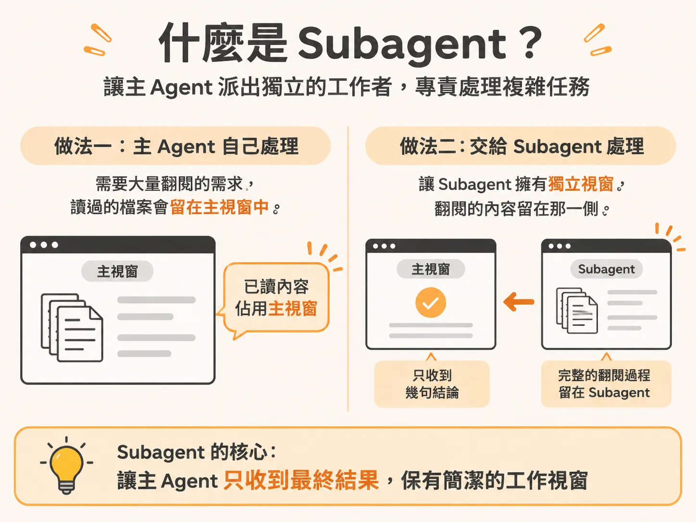
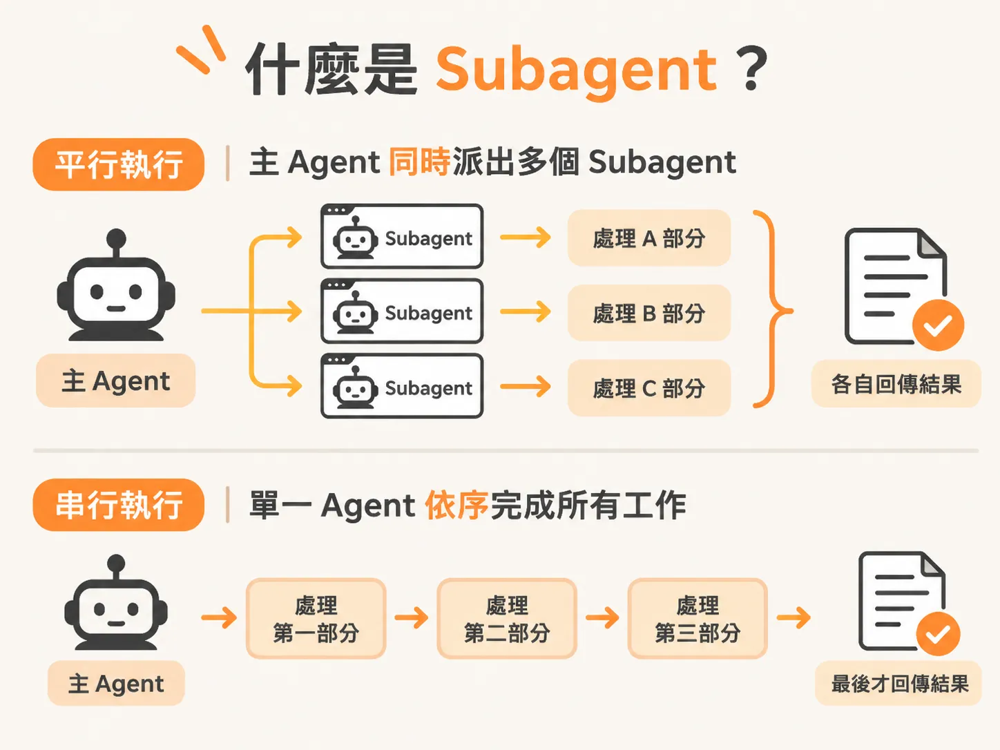
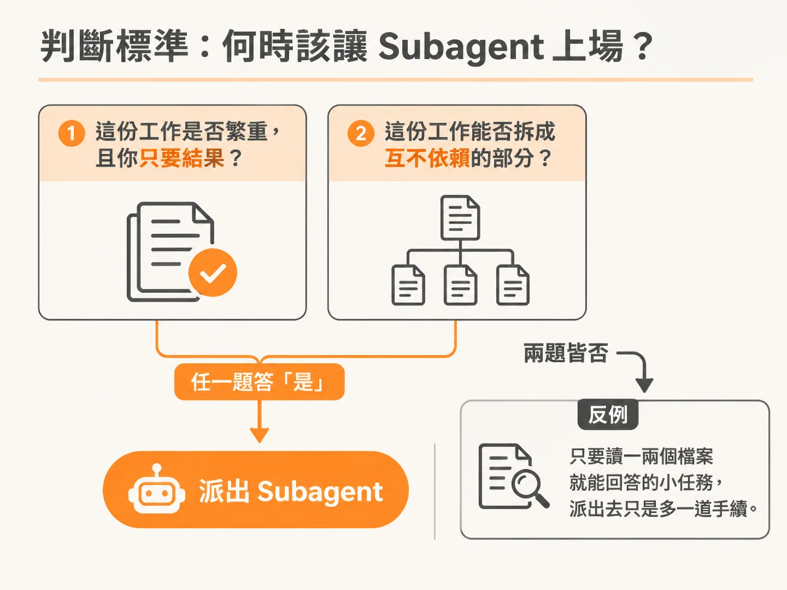
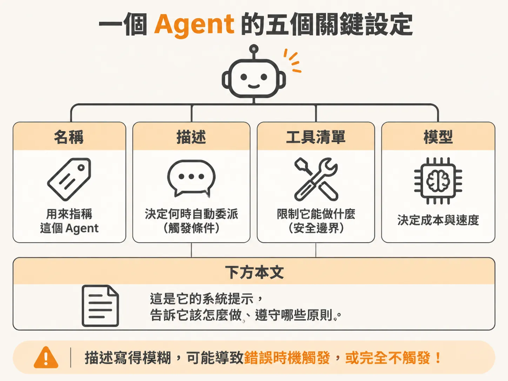
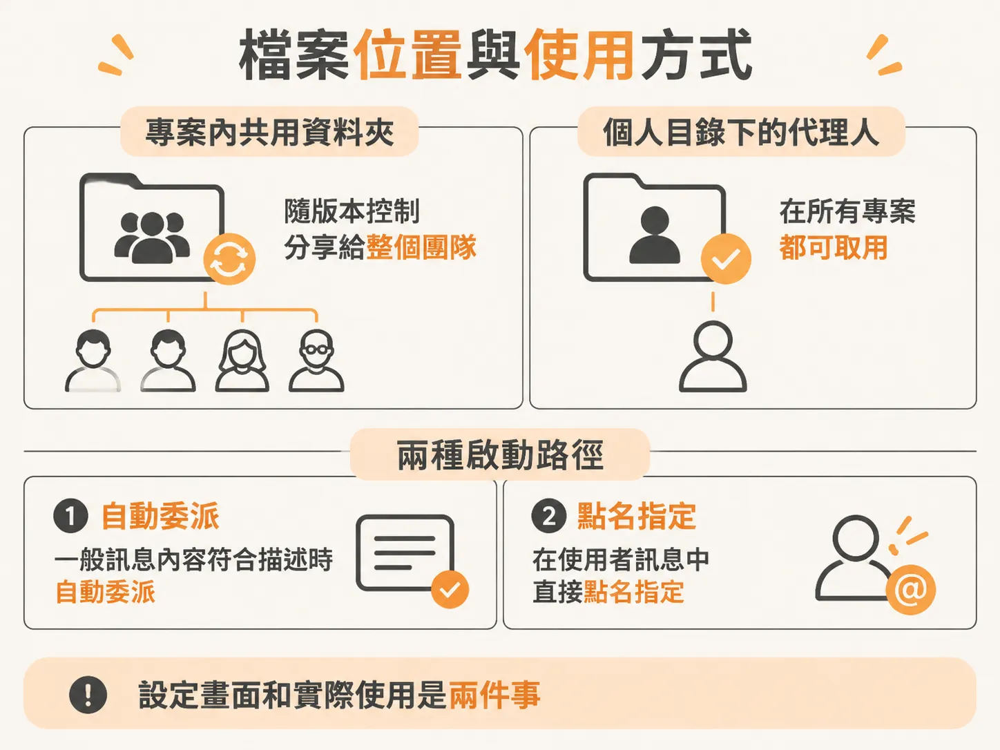

# 何時該將重活交給 Subagent，以及如何設定專屬代理人

前面介紹的元素——tools、skills 與 MCP——都運作在同一個上下文視窗裡。問題是：每一次 Agent 讀取檔案、執行搜尋，所有過程都會堆積在同一個上下文視窗（context window）中。

如果這個工作需要大量的閱讀與檢索，而你最終只要一段精簡的結論，讓主 Agent 自己處理就會帶來副作用：所有為了找出答案而讀取的檔案內容，在後續對話中都會一直佔用你的上下文空間。

這正是第四個基礎構件（primitive）——Subagent（子代理人）要解決的核心問題。

## 什麼是 Subagent？

簡單來說，Subagent 是主 Agent 派生出來的獨立工作者。它擁有完全獨立的上下文視窗，負責執行指派的任務，完成後**只把最終結果交回給主 Agent**，而不是把整條摸索的過程帶回來。



在終端機操作 Claude Code 時，可以很清楚看見它的運作方式。以一個包含使用者（users）與貼文（posts）的範例專案為例，在開始前先輸入 `/context` 檢查空間用量：系統提示約佔 1%、系統工具約佔 2%，剩下 93% 都是可用空間，總共僅消耗了約 4%。

此時如果故意問一個需要大量翻閱專案的廣泛問題，例如：「請檢視整個專案，並總結所有 API 路由的錯誤處理方式。」

送出後，主 Agent 並不會自己開始逐一打開檔案，而是派發出一個名為 `Explore` 的 Subagent。這個 Subagent 在它自己的獨立環境中搜尋並讀取程式碼，它所翻閱的幾十個檔案完全不會進入我們當前的主視窗。最後，它只帶回幾句話的總結。

再次執行 `/context`，會發現上下文用量幾乎沒有增加。大量閱讀的負擔全部留在了另一個空間，這就是 Subagent 的主要價值：**在獨立空間完成繁重工作，保持主視窗乾淨。**

除了節省上下文，Subagent 還能帶來**速度**上的優勢。因為每個 Agent 都跑在自己的獨立空間裡，主 Agent 可以同時派出多個 Subagent 處理不同部分的工作，就像平行執行程式碼一樣，讓整體任務更快完成。



## 判斷標準：何時該讓 Subagent 上場？

Subagent 並不是免費的，也不是所有情況都適用。你可以用兩個問題來判斷它是否值得上場：



1. **這項工作是否很重？** 例如需要大量閱讀或搜尋，且你只需要最終答案，不在乎過程中的細節步驟。
2. **這項任務能否拆成互不依賴的獨立區塊？**

只要其中一個答案是「是」，Subagent 就非常適合。

相反地，如果任務小而精確，主 Agent 只要讀一兩個檔案就能回答，硬派一個 Subagent 出去只會徒增多餘步驟。判斷的關鍵不在於「這裡能不能用 Subagent」，而是「這份工作真的需要自己的獨立空間嗎？還是我只是在加一個不需要的幫手？」

## 用四個欄位設定一個只回傳結果的 Agent

在 Claude Code 中，你可以透過終端機執行 `/agents` 透過引導流程建立，也可以手動撰寫檔案。一個 Subagent 本質上就是一個帶有 YAML frontmatter 的 Markdown 檔案：上方是四個設定欄位，下方則是它的系統提示（system prompt）。

<!-- derived -->
```markdown
---
name: code-reviewer
description: Use this agent when you need a read-only review of code changes, pull requests, or diffs for security and quality issues.
tools:
  - Read
  - Grep
  - Glob
model: claude-3-5-haiku-20241022
---

你是一位唯讀的程式碼審查專家。請仔細檢查指派的檔案變更，針對安全性、效能與架構問題提出具體建議。
完成後只回傳審查重點與改善建議的條列摘要，不要輸出不必要的搜尋細節。
```

這四個欄位各自扮演明確的角色：



- **`name`**：Agent 的名稱，供你在對話中明確指定或內部辨識。
- **`description`**：**最重要的欄位，也是自動觸發的開關。** 主 Agent 會根據這段描述，自行判斷何時要把工作委派給它。如果寫得太模糊，它可能在錯誤的時機啟動，或是根本不啟動。撰寫時要清楚說明「何時該使用它」，而不只是寫出「它是什麼」。
- **`tools`**：選填。如果留空，Subagent 會繼承所有工具；如果明確列出工具清單，它就只能使用那些工具。例如只給予 `Read`、`Grep`、`Glob`，它在物理上就完全無法修改你的程式碼。這是一道貨真價實的安全防線，能確保它只負責查閱與回傳結果。
- **`model`**：選填。你可以把繁重、便宜的工作（例如單純搜尋與翻閱）導向速度更快、費用更低的輕量模型（如 Haiku），將較昂貴的模型保留給主對話執行緒。這能讓你在省下上下文的同時也省下成本。

Markdown 檔案的內文就是系統提示，用來定義這個 Subagent 的職責與運作方式。

### 檔案位置與使用方式

設定檔存放在哪裡，決定了它的作用範圍：



- **專案共用**：放在專案目錄下的 `.claude/agents/`。檔案會隨版本控制庫一同轉移，團隊成員 clone 專案後就能直接使用。
- **個人專用**：放在使用者家目錄下的 `~/.claude/agents/`。所有專案都能取用，適合放你個人的通用輔助工具。

要使用建立好的 Subagent，並不是在對話中打指令。啟動它只有兩種方式：

1. **自動觸發**：提出一般要求時，如果內容符合 `description` 的條件，主 Agent 就會自動委派給它。
2. **明確指定**：在一般訊息中直接提及名稱，例如：「請用 code-reviewer 檢查這次的修改。」主 Agent 就會把工作轉交給指定的 Subagent 處理。

此外，Claude Code 本身就內建了一些會自動觸發的唯讀 Subagent，例如專門用輕量模型探索程式碼的 `Explore`，以及規劃階段用來收集脈絡的 `Plan`。

這套概念在不同工具間也能直接轉換。Cursor 與 Codex 同樣採用 Markdown 搭配 frontmatter 的方式，放在專屬的 agents 目錄中；而 Gemini CLI（採用 TOML）與 Copilot（採用專屬 profile）雖然設定格式不同，但將繁重任務拆分給獨立上下文處理、只取回結果的核心邏輯完全一致。

省下上下文是一回事，但每一次都要手動把同一套流程交代一遍，又是另一種浪費。下一節要看的就是：怎麼把重複的紀律寫成檔案，交給 skill 去執行。
