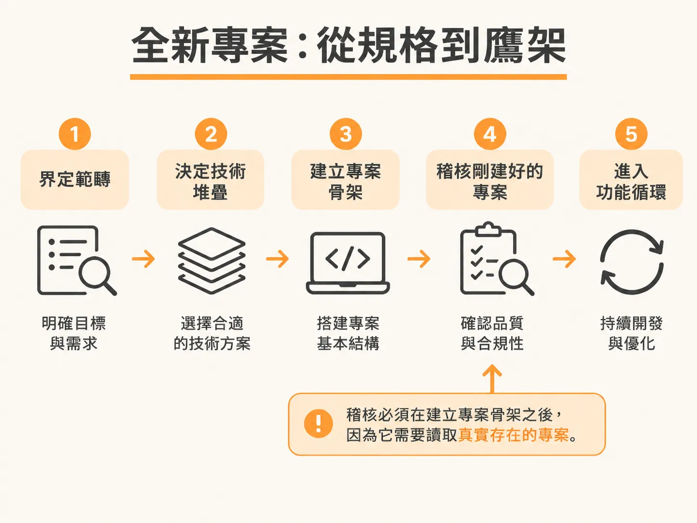
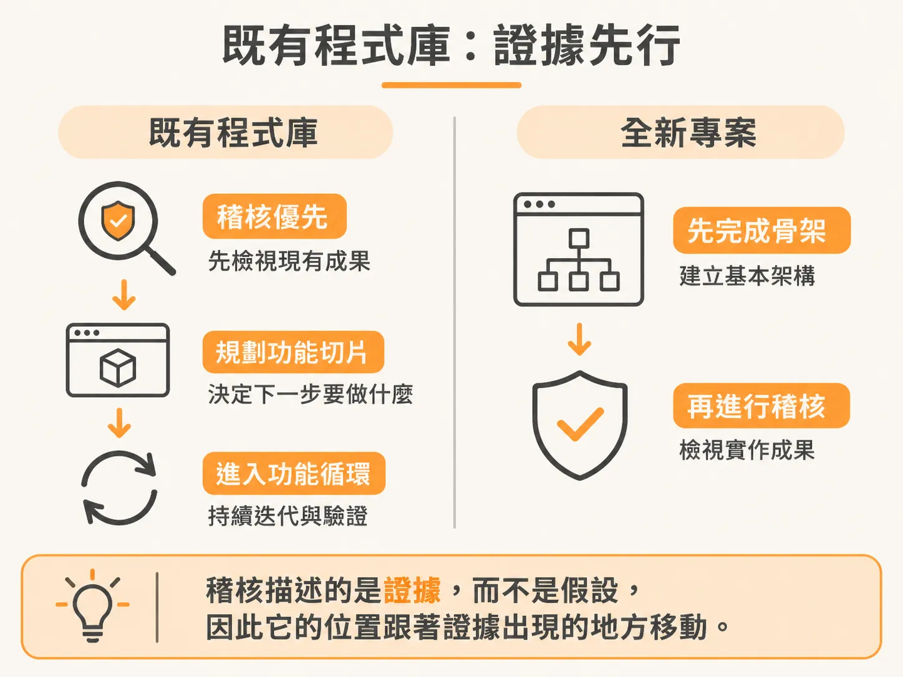
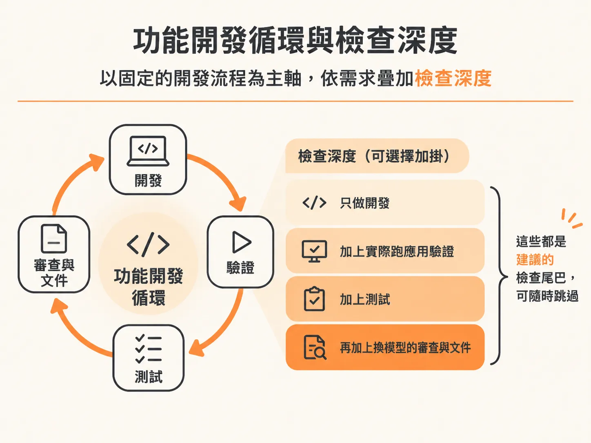

# 選擇第一個 Skill 與工作流程順序

承接上一個問題：九個 skill 都裝好了，也各自有負責的階段，但面對眼前的專案時，到底該先執行哪一個？最容易卡住的地方通常不是指令怎麼打，而是這個順序判斷。

工作流程的順序完全取決於專案當下的起點。常見的情況可以分成三種：全新專案（greenfield）、既有程式庫（brownfield），以及只需要微調或修復的單一修改。

## 全新專案：從規格到鷹架

如果是從零開始的全新專案，順序與業界標準的工程作法一致：



1. `/scope`：界定產品構想與邊界。
2. `/architect`：規劃技術堆疊（stack）。
3. 建立專案骨架（scaffold）：產生實際的專案結構與設定檔。
4. `/audit`：檢視並稽核剛建立好的專案。
5. 進入功能開發循環（develop loop）。

這段流程的關鍵在於 `/audit` 的擺放位置。你必須先決定技術堆疊並建立好專案鷹架，才能執行 `/audit`。因為 `/audit` 的工作是讀取真實存在的專案來產生 `AGENTS.md`；如果對著一個空資料夾執行，它沒有任何程式碼可以分析，就只能憑空捏造符合專案型態的慣例與假設，這正好違背了這套工程流程要避免的問題。

## 既有程式庫：證據先行

面對已經在運作的既有程式庫，順序則完全顛倒過來：



1. `/audit`：第一步先執行稽核，讓所有 skill 都能正確理解目前的專案脈絡與規則。
2. `/scope`：在現有的程式架構之上，規劃下一個要實作的功能切片（slice）。
3. 進入功能開發循環。

為什麼 `/audit` 在全新專案排在第四步，在既有專案卻排在第一步？背後的原則完全相同：`/audit` 永遠只記錄事實與證據，絕不記錄猜測。既然既有專案裡已經有現成的程式碼與設定，證據已經在那裡，它就必須先執行，好讓後續的所有動作都建立在真實證據上。

如果是 monorepo（多專案儲存庫），所有的 skill 操作範圍都應該限制在目標 workspace 內，每個 workspace 都會有屬於自己的 `AGENTS.md`、範圍定義、技術堆疊與專屬指令。

## 單一修改：只跑需要的步驟

如果只是要修改一個小地方，不需要把整套流程從頭跑一次：

- 遇到 bug 時，直接呼叫 `/debug` 即可。
- 單純的小修改，可以直接執行 `/develop`，接著跑 `/check verify` 驗證結果。

## 功能開發循環與檢查深度

當專案完成前置準備、進入功能開發時，標準的功能循環如下：

<!-- source: sources/js-mastery-engineer/20261107/supplement/skills/README.md#L59-L61 -->

```text
/architect → /develop → /check verify → /test → /check review → /document → /sync
```

在 `/scope` 階段的尾聲，你可以為專案挑選一個建議的「工作流程深度」（workflow depth），日後也可以針對單一功能隨時覆寫：



- **Prototype**：只執行 `/develop` 並自行確認，適合隨手驗證或拋棄式的原型。
- **Alpha**：在開發後加入 `/check verify`。
- **Beta**：在驗證後加入 `/test`。
- **GA**：加入由全新模型視角執行的 `/check review` 以及 `/document`。

這套深度只是 `/develop` 之後建議執行的檢查環節，而不是把你綁死的硬性規定。身為工程師，你隨時可以執行或跳過任何步驟，並自己決定何時將功能標記為完成。這套流程在任何深度下唯一堅持的事，是重要的承重架構決策必須寫下來（`/architect`），而不是強迫跑完每一道檢查。
