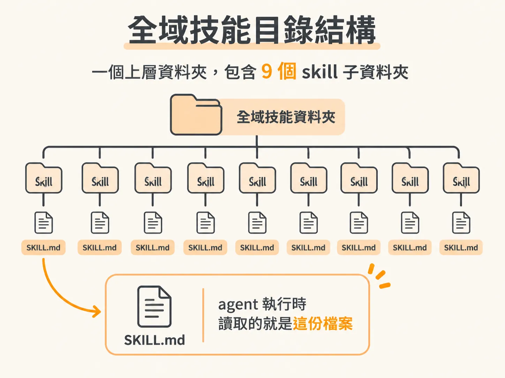
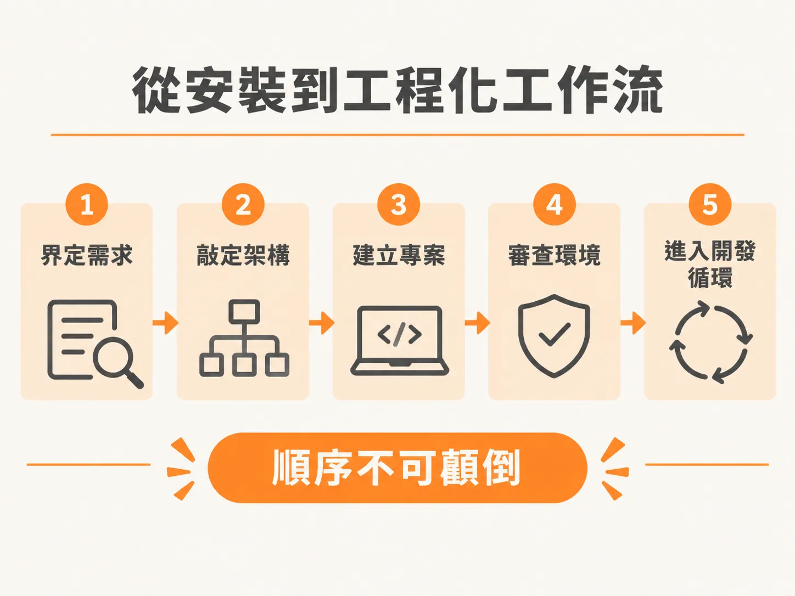

# 一行指令安裝 JSM Skills 系統：在全域設定 AI Agent 的工作流

想要讓 AI 助理真正融入工程開發，關鍵不在於每次手動貼上長篇 prompt，而是讓 agent 擁有整套標準化、隨調隨用的技能（skills）。這套 JSM Skills 系統完全開源，安裝不需要繁複的設定，只要終端機裡的一行指令，幾秒鐘就能完成。

如果你已經到 GitHub 專案庫看過，不妨先順手在右上角按個 Star 給予支持。接下來，只要打開終端機就能直接安裝。

## 執行安裝指令

這套系統採用了 Vercel 的 `skills` 工具，安裝過程不需要註冊任何帳號，也不需要填入 API key，因為所有 skill 本質上都是純 Markdown 檔案，裡面寫滿了給 agent 閱讀與執行的結構化指令。

你可以直接透過 `npx` 指令安裝；如果指定要給 Claude Code 使用，可以加上對應的參數：

<!-- source: sources/js-mastery-engineer/20261107/supplement/skills/README.md#L35-L41 -->

```bash
# Claude Code (installs into .claude/skills, then restart Claude Code)
npx skills@latest add jsmastery-pro/skills -a claude-code

# Generic .agents/skills, read by Codex and other agents
npx skills@latest add jsmastery-pro/skills
```

如果你執行指令時沒有加上 `-a claude-code` 這類 agent 參數，安裝程式會先詢問是否要安裝 skills installer，輸入 `y` 繼續後，互動選單會讓你挑選目標 agent。除了 Claude Code，像 Cursor、Codex 等常見工具也都原生支援。


接著，安裝程式會列出清單，詢問你想包含哪些 skills。這套系統提供的核心 skill 涵蓋整個專案生命週期：

- `scope`：梳理產品與功能需求
- `architect`：規劃技術架構與技術堆疊
- `audit`：稽核程式碼與專案配置
- `check`：快速檢查與驗證
- `debug`：排查問題與除錯
- `develop`：進入主力的功能開發循環
- `sync`：同步專案脈絡與進度
- `test`：撰寫與執行測試

全選這九個 skill 後按下 Enter，並選擇以全域（globally）方式安裝。這樣一來，不論你切換到哪一個工作專案，所有 agent 都能共用這套技能。

## 確認全域資料夾與 SKILL.md

安裝完成後，這些檔案會被放在系統的全域技能目錄（例如全域的 Claude Skills 目錄）中。

打開該資料夾，你會發現結構非常乾淨單純，裡面正好就是九個 skill 對應的九個子資料夾。點進任何一個資料夾，核心主體就是一份 `SKILL.md`：



- **`SKILL.md`**：這是純 Markdown 格式的指令檔。每當你呼叫該技能時，agent 讀取的就是這份檔案裡精心定義的工作規則與提示詞。
- **介面設定檔**：部分資料夾內若有 `agents/openai.yaml`，那只是提供給 Codex 介面顯示名稱、簡介與預設提示的 metadata，本身並不包含任何執行邏輯。

這九份 `SKILL.md` 經過了長時間的打磨與反覆迭代，甚至針對不同情境設計了額外的運作模式（modes）與模式架構（patterns），後續也會根據社群回饋持續更新。有空的話，很建議親自打開幾份檔案瀏覽，感受如何用清晰的工程結構引導 agent 思考。

## 從安裝到工程化工作流

安裝技能只是最輕鬆的第一步，真正考驗工程功力的，是知道在專案的什麼階段呼叫哪一個 skill。

在正規的工程實務中，啟動一個新專案的順序每一次都遵循嚴謹的節奏：



1. 先執行 `scope` 明確界定需求邊界與構想。
2. 接著以 `architect` 敲定系統架構與技術選型。
3. 建立專案骨幹後，使用 `audit` 審查剛剛建立的基礎環境與設定。
4. 一切就緒後，才正式進入 `develop` 的開發循環。

掌握這個脈絡之後，下一個問題自然會冒出來：這些固定步驟為什麼值得遵守，而不是每次憑感覺開發就好？這正是下一步要處理的事。
