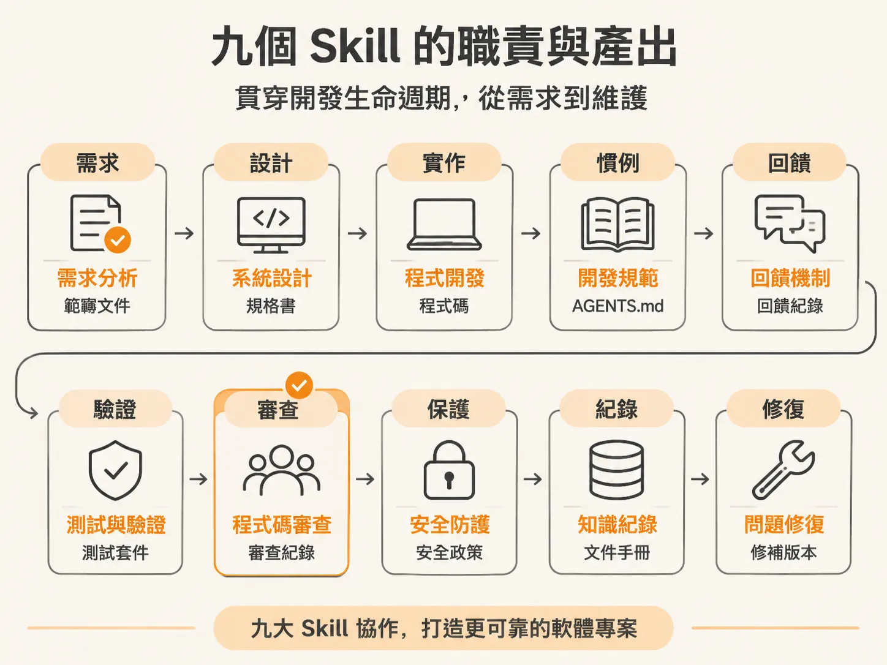
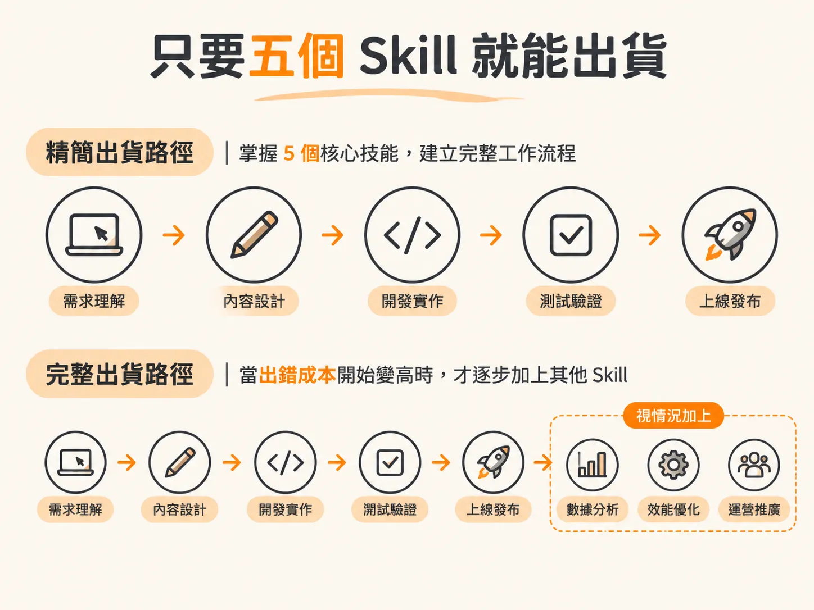

# 認識 JSM 的九個 Skill 與出貨核心流程

既然流程的每個階段都有存在的理由，接著就能把每個 skill 放回它負責的位置。在使用 AI 輔助開發時，很多人會遇到指令發散、缺乏脈絡的問題。JSM 的技能系統（Skills System）解決了這件事：在 Cursor 或 Codex 中，這些技能預設就能運作，不需要另外建立帳號或貼上 API 金鑰，因為每個 skill 本質上就是包含特定指令的 Markdown 檔案，用來引導 AI Agent 執行專門任務。

你可以選擇將這些技能安裝在全域環境，這樣不論是建立全新專案（greenfield）還是維護現有的既有專案（brownfield），所有專案都能隨時取用。目前系統包含九個技能，各自負責專案生命週期的不同階段。

## 九個 Skill 的職責與產出

在完整的開發生命週期中，這九個技能各司其職：

- **scope**：負責將產品構想轉化為具體的粗略開發計畫，並在功能交付時持續更新範圍。在全新專案中通常最先執行；在既有專案中，它會先盤點現有功能，再規劃後續工作。
- **audit**：負責分析專案的技術堆疊、指令與慣例，產生 `AGENTS.md` 上下文檔案，供其他所有技能讀取。在既有專案中它應該最先執行；全新專案則在確定技術堆疊並搭建好專案骨架後執行。
- **architect**：負責承擔關鍵決策（如技術選型、資料模型、外部服務商或頁面設計），並在 `docs/specs/` 中產出建造規格書（build spec）。
- **develop**：根據 `architect` 產出的規格書動手開發功能（包含前端介面與後端），執行資料庫遷移（migration），並推動開發進度。如果遇到尚未決定的關鍵架構，它會主動暫停並要求先回到 `/architect` 做出決策。
- **check**：在合併前確認變更。它有兩種模式：`/check verify` 會實際啟動應用程式，驗證功能是否符合規格；`/check review` 則會在提交 PR 前，換用第二個不同的模型扮演資深工程師來審查程式碼。
- **test**：在功能開發完成或臭蟲修復後，針對未提交的程式碼變更撰寫測試套件，並記錄專案選用的測試框架。
- **document**：根據實際的程式碼差異（git diff），撰寫面向團隊與使用者的說明文件，包含 PR 說明內文、變更日誌（changelog）、版本發布說明（release note）或事後檢討報告（postmortem）。
- **sync**：在變更準備合併的最後階段執行，負責同步比對現有程式碼庫，將 `AGENTS.md`、專案範疇（scope）與各規格書的狀態更新為最新狀態。
- **debug**：當系統出錯、拋出例外或行為異常時執行。它會進行有系統的根本原因分析（root cause loop），找出並修復臭蟲，隨後將回歸測試案例交接給 `/test`。

## 只要五個 Skill 就能出貨

雖然九個技能涵蓋了完整的軟體生命週期，但想要交付一個真正能運作的產品，其實不需要一開始就把所有技能全用上。

在打造原型（Prototype）的階段，只要掌握五個核心技能，就足以構成一條完整獨立的工作流程：

1. **scope**：先定義好要做的範圍與功能清單。
2. **architect**：決定技術堆疊與資料結構，寫下實作規格。
3. **develop**：根據規格確實把程式碼與功能刻出來。
4. **check**：跑起來驗證功能，並請模型審查程式碼。
5. **test**：補齊驗證邏輯與測試案例。

（或者在接手既有專案時，先用 **audit** 建立專案上下文檔案，取代最初的架構定義。）

這套精簡流程足以讓你快速將產品推向市場。至於其他的技能——像是用來整理文件的 `document`、同步整體專案狀態的 `sync`，或是深入排查異常的 `debug`——則是當專案規模擴大、容錯成本開始變高時，再依需求逐步補進工作流程中。不過先別急著把九個技能都排進行事曆，真正的問題是：眼前這個專案該從哪一個開始。
