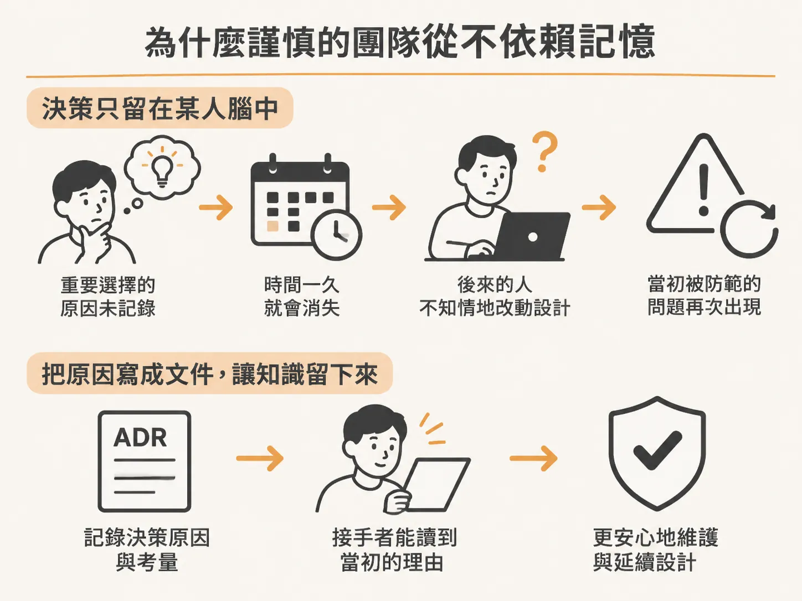
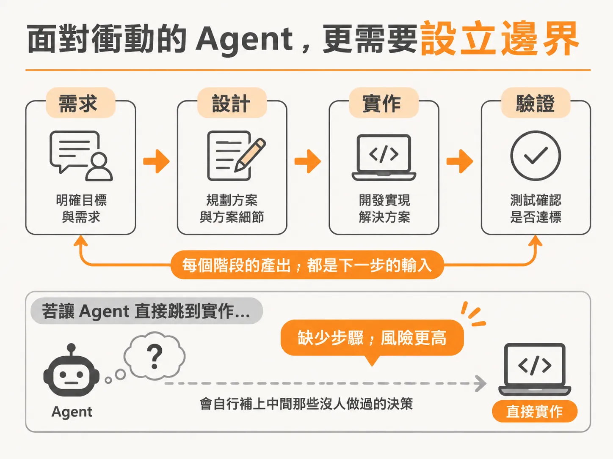
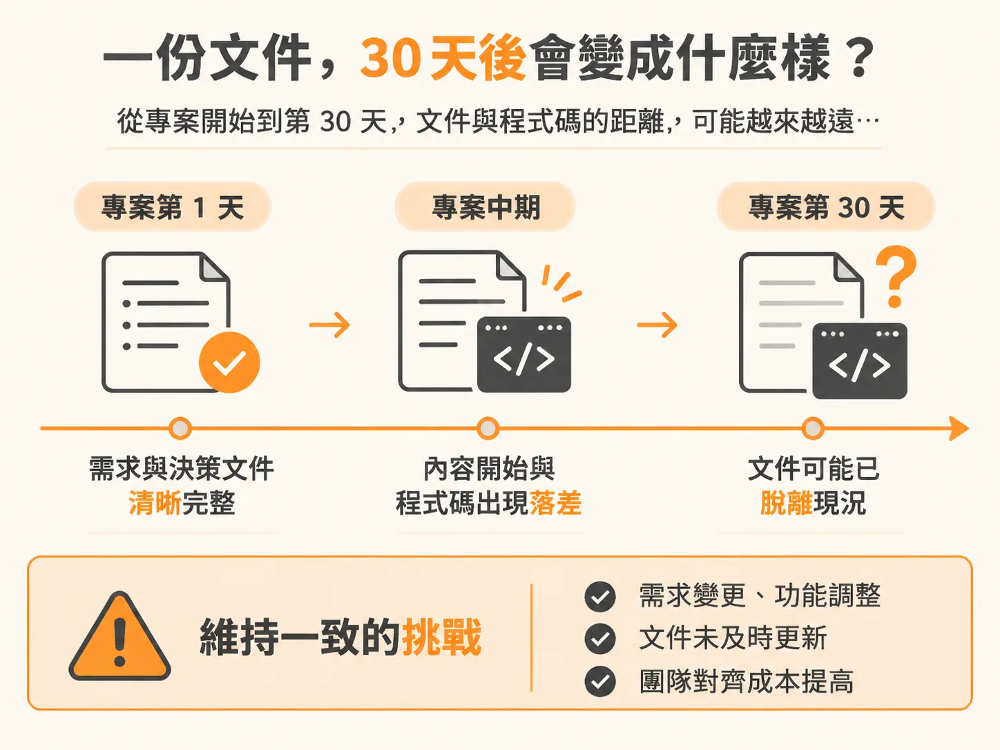

# 從需求到驗證：為什麼這套流程不是個人偏好

九個 skill 裝好之後，真正的疑問才剛開始。面對一套規定了固定步驟與必要文件的開發流程，許多人心中最直接的疑問往往是：這真的有必要嗎？這會不會只是某個人的工作偏好，被刻意包裝成了看似專業的軟體工程術語？

事實上，這套工作流程並非憑空發明。早在 AI Agent 能夠替人類寫程式碼之前，嚴肅的軟體專案就已經依循這套脈絡運作：先釐清要打造什麼、做出重大技術決策並將其記錄下來、訂立團隊成員都該遵循的慣例、一次只做一個功能，並在宣稱完工之前拿出證據證明功能正常。

這正是經典的軟體開發生命週期（Software Development Life Cycle，簡稱 SDLC）：需求轉化為設計，設計轉化為實作，實作再進入驗證。

每個階段產出的成果，都是下一個階段所不可或缺的輸入。這套原則的歷史，遠比 Claude、Cursor 或任何 AI 程式設計工具都還要悠久。

## 為什麼謹慎的團隊從不依賴記憶

把決策寫成文件同樣不是新觀念。工程師長久以來都會維護「架構決策紀錄」（Architecture Decision Records，簡稱 ADR），背後的原因極為實際：如果一個重要選擇的決策原因只留在某個人的腦袋裡，它遲早會被淡忘或隨人員流動而消失。

幾個月之後，接手的人可能在不知道背景脈絡的情況下隨意改動設計，結果反而重新引發了當初那個決策極力防範的問題。因此，謹慎的團隊不會仰賴記憶，而是透過文件留下證據。

這項習慣在與 AI Agent 協作時，反而比單純人對人協作還要重要得多。

## 面對衝動的 Agent，更需要設立邊界

Agent 的天性就是直奔程式碼。在先前那次 vibe 建置的過程中就可以看到，它只要一掌握到模糊的概念，就會在幾秒之內，悄悄自行補齊所有缺漏的決策並開始實作。

在這種狀態下，Agent 看起來極具生產力，但它實際上正在把程式碼蓋在那些「你從未親自確認過」的決策之上。

因此，這些規範並不是在發明一套全新的軟體開發方式，只是透過流程約束，強制 Agent 遵守優秀工程團隊本來就該落實的規範：一步一個階段，讓前一個決策成為下一個步驟的基底。

走向這條路的也不只有特定團隊。GitHub 發展了 SpecKit，Amazon 也推出了 Qiro，兩者都基於同一個核心前提：在要求 Agent 動手寫程式碼之前，務必先將需求與架構決策寫下來。

## 重點在於文件在第 30 天的模樣

把事情寫下來確實能帶來幫助，這點在業界已經毫無爭議。但更有意思也更具挑戰性的問題是：到了專案進行的第 30 天，這些當初寫下的文件究竟會變成什麼樣子？

這才是不同做法之間拉開差距的關鍵。

這些規範從來就不是為了寫得更快而設計的捷徑，而是作為一道道清晰的邊界，阻止 Agent 在開發過程中略過軟體工程最關鍵的核心環節。建立好這個認知後，接下來就能清楚掌握每項具體技能的用途，以及它們該以什麼樣的順序依序落實。
