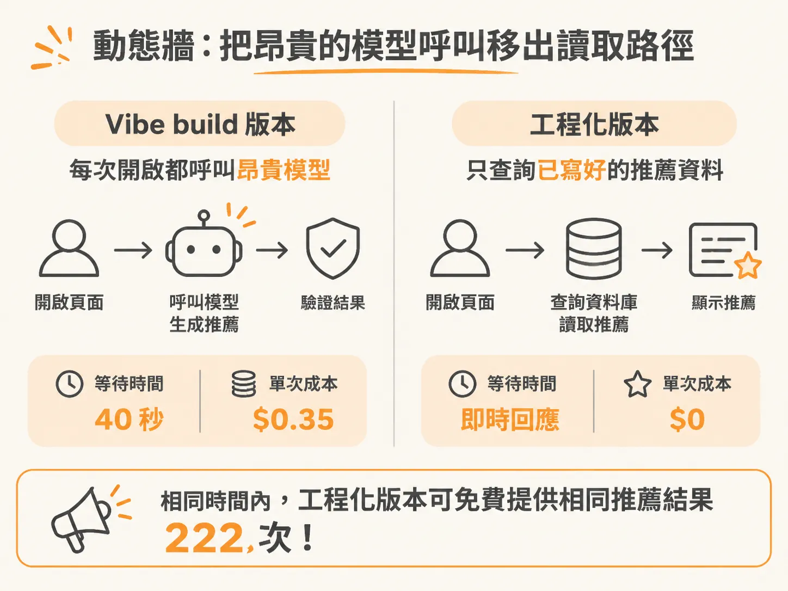
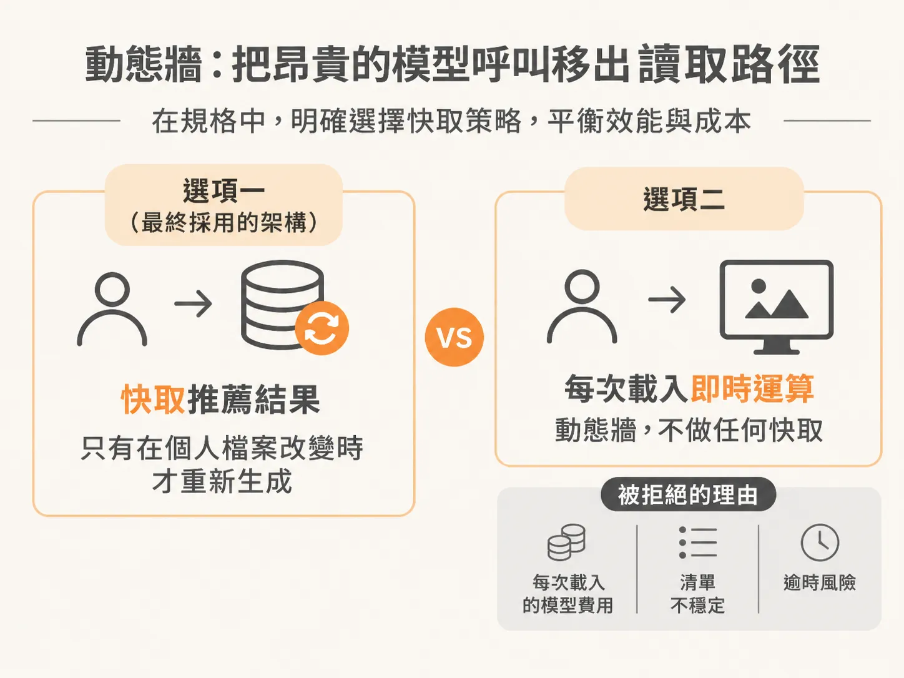
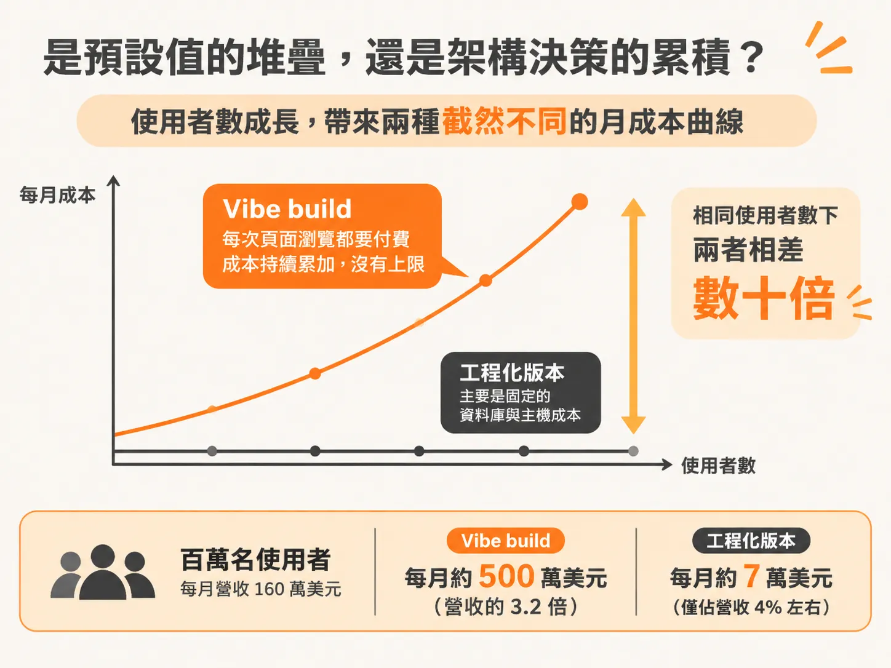

# 從每次 35 美分到近乎零成本：兩個 Codebase 的架構抉擇

如果你看過單純用「感覺」寫出來的 AI 應用程式（也就是所謂的 Vibe build），一定對這種畫面不陌生：使用者每打開一次動態牆，畫面就要轉上 40 秒，後台默默噴掉 35 美分的模型 API 費用。同一個功能，如果改用經過工程思考的架構（Workflow build）來實作，頁面成本可以直接降到接近零，而且反應速度幾乎是瞬間完成。

這兩個 codebase 實作的是完全相同的應用，但一個全由預設值拼湊而成，另一個則處處是明確的架構決策。

### 動態牆：把昂貴的模型呼叫移出讀取路徑

在工程化版本的動態牆（Feed）中，使用者的評分會先被轉換為個人品味向量（taste vector）。在候選名單檔案（`candidates`）的第 46 行附近，就藏著完整的檢索邏輯：只要發出一次資料庫查詢，利用向量索引（vector index），就能從真實的電影型錄中找出最貼近該品味向量的電影，並把結果寫入推薦資料表（`recommendations`）。

當使用者打開動態牆時，翻開 `feed actions` 裡的 `get feed` 函式，會發現它的工作非常單純：直接讀取該資料表。

整個讀取路徑完全沒有呼叫任何大型語言模型。開啟頁面的成本實質上是零，載入速度取決於從 Supabase 拿回資料的時間，基本上是即時回應。相較之下，Vibe build 在每次開啟頁面時都把模型呼叫塞在請求路徑中，每次都要花上 40 秒並燒掉 35 美分；但在相同時間內，經過快取的工程化版本能免費提供相同的推薦結果 222 次。

這不代表 AI 完全不參與。在 `feed reasons` 裡，AI 確實要替每部推薦電影寫下一句簡短的推薦理由（「為什麼這部片適合你」）。但這項工作被嚴格限制：
- 全部的推薦理由一次打包，只對 Claude Sonnet 發送單一一次批次呼叫，而不是使用昂貴的 Opus 或其他模型。
- 關閉模型的思考模式（thinking），因為短短一句理由不需要深思熟慮。
- 只有在使用者品味真正改變、或是使用者主動按下重新整理時才執行，絕不在頁面載入（page load）時觸發。

在產生器檔案（`generate`）靠近 61 行的底部，有一個名為 `isFeedStale` 的函式。快取更新在這裡不是個隨手寫出的邏輯，而是一個被正式賦予名稱的架構決定。

在專案規格文件（`007.md`）的方案比較中，架構師角色在動工前就提出了具體問題：推薦資料表要快取嗎？電影要如何檢索？理由該由誰來寫？
- **選項一（最終採用的架構）**：快取推薦結果，只有在個人檔案改變時才重新生成。
- **選項二**：每次載入都即時運算動態牆，不做任何快取。

在規格文件中，選項二旁邊清楚記錄了被拒絕的缺點：每次頁面載入都得忍受數秒的 Sonnet 呼叫與費用，而且每次刷新都會打亂推薦清單與理由，讓內容永遠處於不穩定狀態，不僅體驗極差，每一次渲染還都會面臨伺服器無伺服器（serverless）執行時間逾時的風險。

這個被拒絕的選項，正是 Vibe build 裡寫出來的程式碼。Vibe build 並不是刻意選了爛方法，而是寫程式的人從頭到尾根本沒有意識到這個選項的存在。

### 資料匯入：以冪等與排重取代危險的刪除重建

第二個呈現架構差異的功能是 CSV 匯入流程（`import flow`）。

在工程化版本中，瀏覽器負責解析 CSV，並以每批 100 筆資料的大小批次送出。如果在中途按下重試，系統會從中斷處繼續匯入，而不是砍掉重來。在 `actions.ts` 裡的匯入邏輯中，每一批資料在遇到失敗時，本身就會先以指數退避（backoff）機制自動重試。

更關鍵的是資料寫入策略：
- 現有資料絕不直接刪除，而是依照電影 ID 進行 upsert（存在即更新，不存在則新增）。這消除了 Vibe build 那種「先全刪再插入」所導致的評分空窗期。
- 程式碼明確處理了排重（deduping）。如果匯出的 CSV 中有兩筆資料對應到同一部電影（例如重新上映版本或別名），在單一 SQL 語句打入資料庫時，Postgres 會直接拋出錯誤並導致整個批次失敗；若重試時依然送入完全相同的輸入，匯入流程就會永遠卡死。

這段排重與批次控制邏輯並非踩到坑後才補上的修補程式，而是來自專案架構中的驗收條件（acceptance criteria）：「匯入流程絕不能遺失資料」。條件在任何程式碼動筆前就已經確立。

### 意圖搜尋：把規則落實為不可能違規的架構保證

在搜尋功能（Vibe search）上，工程化版本在 `search actions` 裡只用了五行就串出整條管線（pipeline）：
1. 取得使用者檔案的品味。
2. 解析使用者的具體意圖。
3. 篩選縮小候選清單。
4. 記錄日誌並回傳結果。

整個流程拆解得非常精確：
- 先用體積小、成本極低的模型，把使用者的自然語言查詢解析成結構化意圖（包含年份、片長，甚至氛圍、主題、調性與感受）。
- 透過向量嵌入搜尋，從資料庫型錄中撈出真實存在的候選名單。這一步將昂貴的檢索交給資料庫查詢處理。
- 最後才交給中型模型從中挑選 3 到 5 部電影，且嚴格限制它只能從剛才撈出的清單中挑選。

在 `select.ts` 裡，程式不僅要求模型「不要捏造電影」，還嚴格定義了電影的結構綱要（schema）。Vibe build 也曾在 prompt 裡提醒模型不要胡謅，但工程化版本是直接在架構上封死所有違規的管道，讓模型在物理上無法產生幻覺。這就是口頭「規則」與架構「保證」的本質差別。

這套管線讓一次搜尋的成本壓到大約 1.5 美分，而 Vibe build 的單次搜尋則高達 30 美分。

### 驗收條件驅動的測試與資料庫遷移

翻開工程化版本的程式碼庫，周邊設施的成熟度也完全不同：
- 專案完整配置了 Vitest。測試涵蓋了最容易出錯的邏輯，例如 CSV 解析與品味計算公式，而 Vibe build 的測試覆蓋率是零。
- 測試檔案的命名直接綁定驗收條件編號，例如 `compute taste profile below the floor, AC7`，讓每一段測試都能一路回溯到當初的規格決策。
- 資料庫內建了六個版本的遷移紀錄（migrations），清楚記錄資料結構如何隨著功能演進而升級。

### 是預設值的堆疊，還是架構決策的累積？

仔細比對這兩個專案的資料庫與程式碼，工程化版本的程式碼行數確實比較多。但裡頭沒有任何一行是裝飾用的廢話，每一行多出來的程式碼都是承重牆（load-bearing），都能對應回動工前架構思考所提出的問題。

以一位每週打開幾次動態牆、做一兩次搜尋的活躍使用者計算：
- Vibe build 每月要為每位使用者支付約 5 美元的 AI 帳單。
- 工程化版本每位使用者的月成本不到 10 美分，兩者相差約 60 倍。

若擴大到一百萬名使用者、每月營收 160 萬美元的規模，Vibe build 每月要燒掉 500 萬美元的 API 費用（營收的 3.2 倍），每多一個使用者，虧損就擴大一步；工程化版本則只要約 7 萬美元（僅佔營收 4% 左右）。

Vibe build 並不是單純的「比較貴」，而是架構上根本無法存活。差別就在於：Vibe codebase 是由各種工具的預設值湊出來的，而真正的工程化 codebase，是由一個個帶著成本意識的明確決策建立起來的。

看到這裡，你可能會想：那 agent 到底是怎麼讀我的程式庫、怎麼決定下一步的？下一課就從「該做哪些決定」走到「它在你的專案裡如何做決定」。
