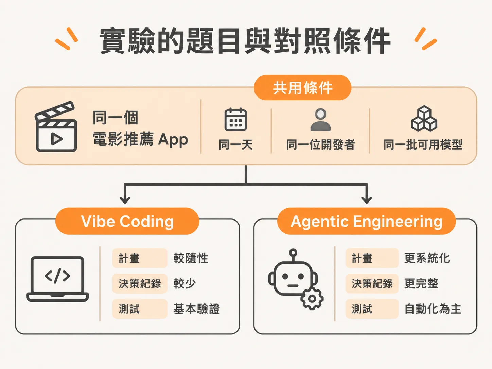
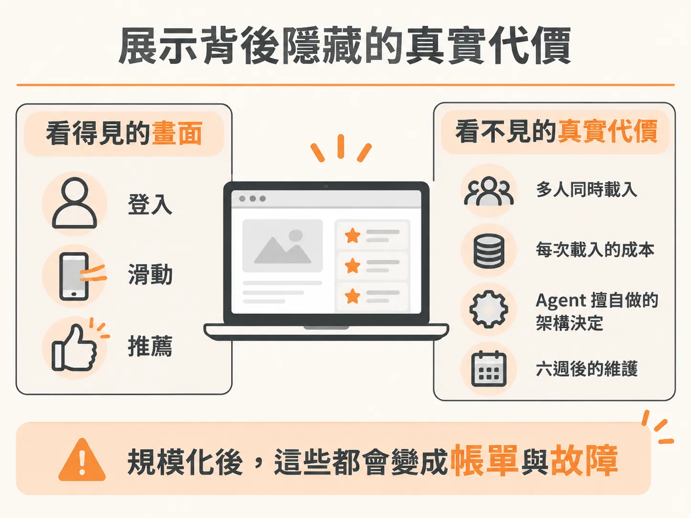

# 打造同一款 App 兩次：對照實驗的條件與 Vibe Coding 的 Demo 迷思

當 AI 已經能替你寫出大部分程式碼時，嚴謹的軟體工程實踐究竟還重不重要？那些架構規劃、測試與決策紀錄，到底是在保護系統，還是只是拖慢速度的陳舊習慣？

在當前熱門的 Vibe Coding 浪潮中，每個人都有一套說法，卻鮮少有人願意用真實數據給出答案，幾乎看不到任何嚴謹的對照實驗。

為了解開這個疑惑，作者進行了一場真實的對照實驗：由同一個人、在同一天內，使用相同的 AI 模型，將同一個應用程式完整打造兩次。

## 實驗的題目與對照條件

這次實驗要打造的產品是一個名為「Reel」的個人化電影推薦平台。使用者可以匯入 Letterboxd 的評分 CSV 檔，或是滑動瀏覽 20 部電影來完成新手引導；系統會為使用者產生帶有推薦理由的個人化動態牆，並提供「氛圍搜尋」（Vibe Search）功能——例如輸入「適合雨天週日的慢節奏科幻片」，系統就能找出符合情境的真實電影片單。

為了讓比較具備說服力，這場實驗控制了關鍵變因：

* **完全相同的環境**：在同一天完成、由同一位開發者單獨操作，並且兩個版本都能存取相同的 AI 模型。
* **版本一（Vibe Coding）**：採用絕大多數人每天使用 AI 工具的方式。開發者只用口語描述想要的功能，AI Agent 負責生成程式碼；看到成果後再說一句「很棒，現在再幫我加這個」，AI 便接著補上。整個過程沒有在硬碟留下任何架構計畫，沒有記錄任何技術決策，也沒有撰寫任何測試。在錄製實驗時，這個版本甚至用上了當時能力最強大的模型 Fable。
* **版本二（Agentic Engineering 工作流）**：先定義範疇，在寫下任何程式碼之前，先捕捉並記錄所有支撐系統的關鍵決策；嚴格限制 AI Agent，防止它自行發明開發者未授權的規格，並且落實測試、資料庫遷移（Migration）與工程紀律。

這場實驗對兩個版本的建造過程與實際應用程式進行了精確的 Token 消耗分析，並公開了兩邊的程式碼儲存庫（Repository），讓所有人都能自行驗證。

## 為什麼 Vibe Build 的 Demo 看起來真的能用？

將 Vibe Build 整個開發過程壓縮成幾分鐘的縮時影片後，呈現出來的開發速度極為驚人。

這整個版本最初的規格說明，其實就只有一條 Prompt：「幫我做一個電影推薦 App。使用者可以登入、匯入 Letterboxd 的 CSV 評分，或是滑動卡片來完成引導，接著獲得附帶推薦理由的個人化推薦動態牆，並具備氛圍搜尋功能。」

就憑這段簡短的描述，AI Agent 迅速搭建好 Next.js 專案架構、串接 Supabase 認證、做出滑動卡片與推薦動態牆頁面，並建立了匯入端點。

碰到推薦演算法時，Agent 選擇了最直觀的做法：直接呼叫能力最強的模型，把使用者的喜好丟給它，要求產生 18 部推薦電影與理由。為了防止模型產生幻覺、胡謅不存在的電影，Agent 還聰明地將每一筆建議拿去比對 TMDB 電影資料庫，確認是真實作品才放行。

僅僅一個工作工作階段（Session），AI 就產出了整整 2,000 行程式碼，而且做出來的成品絕非花拳繡蛋：

* 使用者登入運作正常。
* 滑動引導體驗流暢，點選喜歡的電影後，能順利產出動態牆。
* 推薦品質非常好，甚至包含許多冷門的深度好片（Deep Cuts），因為高品質的大型語言模型掌握的電影知識庫比一般人想像的更廣博。
* 氛圍搜尋能理解複雜的語意關聯，例如輸入「像《銀翼殺手》，但要再幽默一點」，它真能給出合適的片單。
* 系統分析出來的使用者品味側寫，精準得令人有些吃驚。

如果把這段操作錄成影片發到社群平台 X 上，附上一句「我一次 Prompt 就做出了完整的電影推薦 App」，肯定能輕鬆拿到數千個讚。

## 展示背後隱藏的真實代價

這不是那種「Vibe Coding 全是假的」的套路批判。縮時攝影裡的開發速度是真實的，展示畫面裡的功能也是真的，這種短時間內能搓出一套可用系統的誘惑力更是無比真實。作者自己看完成果時，也同樣感到驚艷。

但 Demo 最致命的地方，在於那種「一切都太順暢了」的感覺——這種感覺往往掩蓋了工程的現實。

單人操作的展示畫面，永遠看不出系統真正的體質：

1. **看不見多人併發**：當同時有幾位使用者一起載入頁面時，系統會如何反應？
2. **看不見載入成本**：每次重新整理頁面、產生一次推薦，背後究竟燃燒了多少 Token？換算成伺服器帳單是多少錢？
3. **看不見擅自做主的決策**：在核心引擎檔案的深處，Agent 為了讓展示能動，擅自選用了一套未經評估的運作邏輯；這項沒人真正審核過的決策，一旦放到實際運作環境（Production）中被規模化放大，就會演變成極度昂貴的每月帳單。
4. **看不見未來的維護**：六週之後重新打開這份沒有測試、沒有架構決策紀錄的專案，想要修改其中一個核心邏輯時，程式庫是否還能維護？

展示影片隱藏了經濟成本、載入延遲與效能負載。要看清兩者的真實差距，不能只停留在 Demo，而是必須把這兩套程式碼放進生產環境的條件下，用資深工程師的眼光逐行檢視兩者的架構與代價。
