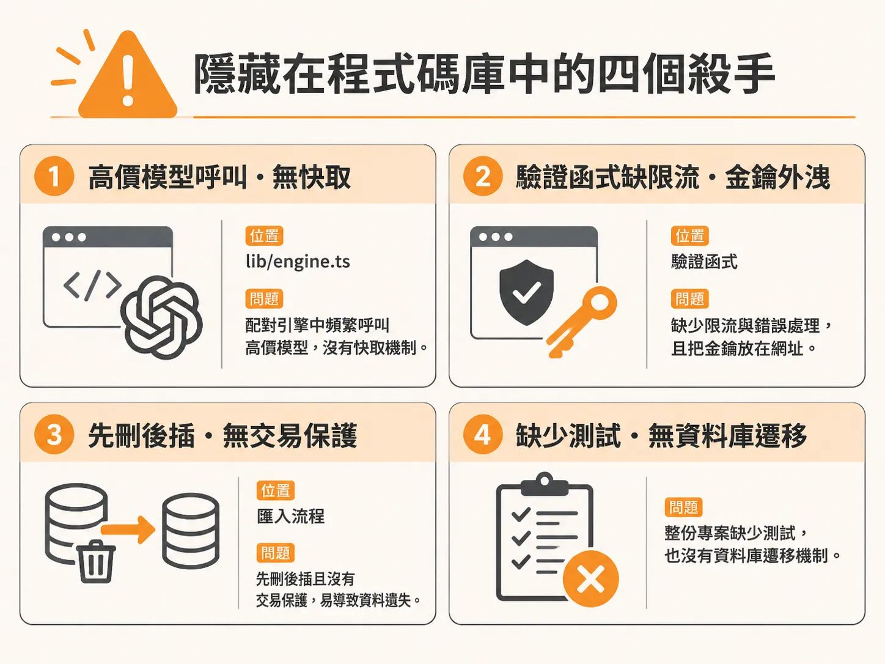
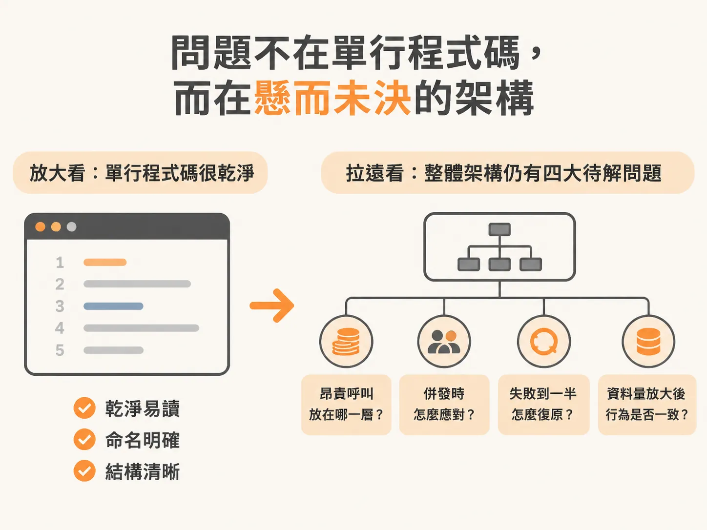
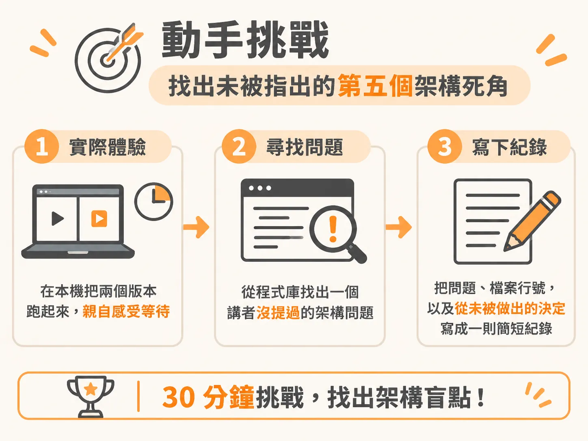

# 剖析 Vibe Codebase：找出四個致命傷與未決定的架構

剛剛那 40 秒與 35 美分只是症狀。要找出病根，得把專案打開，逐檔看清楚。

當你讓 AI 代理人（agent）一路狂奔寫完整個專案，程式碼往往看起來乾淨俐落、命名得體，而且在展示影片裡跑得順暢無比。但只要像審查者一樣逐檔細讀，就會發現那些在 demo 之外隨時會讓系統崩潰的致命隱患。

這些問題不是出在 AI 寫出難看的單行程式碼，而是根本沒有人替它做出關鍵的架構決定。

---

## 隱藏在程式碼庫中的四個殺手

### 第一個殺手：毫無快取的高昂 AI 呼叫

第一個問題藏在 `lib/engine.ts` 的配對引擎中。這段邏輯讓 Claude 根據使用者喜好產出候選片單（包含片名、年份與一句個人化理由），回傳結果被視為未驗證資料，必須再交給 TMDB 驗證。

看似合理，但翻到第 16 行，AI 選用的模型是 Claude Opus 4.8。接著在第 68 行的 `generate feed candidates` 函式中，它呼叫 Opus 模型，設定了 16,000 個最大 token 並啟用適應性思考（adaptive thinking），藉此分析使用者的品味檔案（taste profile）。

這本身就是極其昂貴的操作。然而打開動態牆頁面（feed page），第 34 行的 `useEffect` 卻在每次組件載入（mount）時直接觸發這個函式。

整支檔案完全沒有任何快取機制。只要使用者重新整理頁面，或是重新造訪，它就會原封不動重新跑一次。一人使用可能還撐得住，但如果有幾十、幾百人同時造訪，或有人惡作劇狂按重新整理，每次造訪都會燒掉大約 35 美分（約合台幣 11 元）。最貴的模型被放在每次頁面載入都會觸發的位置，這就是放任 agent 主導而缺乏架構防護的下場。

### 第二個殺手：無聲吞掉的限流失敗與外洩的金鑰

第二個問題位於 `tmdb.ts` 的 `validateCandidates` 函式。這個函式負責向 TMDB 批次驗證候選項目。

程式碼使用 `Promise.all` 遍歷所有候選者（大約 24 個比對請求），卻完全沒有設定速率限制（rate limiter）、指數退避（backoff）或重試機制。更糟的是內部的 `catch` 區塊：發生錯誤時，它只默默回傳 `null`。當 TMDB 因瞬間併發過高而觸發限流反彈時，被拒絕的候選電影就這樣無聲無息地消失了。

再往上看第 44 行，程式碼把 TMDB API 金鑰直接以查詢參數（query string parameter）串在請求 URL 後方。這代表你的金鑰會明文出現在從客戶端到 TMDB 伺服器之間每一層反向代理與存取日誌（log）之中。

### 第三個殺手：沒有交易包裝的毀滅性匯入

第三個問題在資料匯入路由 `import/route.ts` 的第 35 行。那裡甚至留著 agent 自己寫的註解：「整批替換先前的匯入，匯出檔即為單一真實來源（source of truth）。」

緊接著第 36 行，程式直接刪除了該使用者所有的歷史評分紀錄。接著第 45 到 48 行，手動跑迴圈寫入 500 筆新資料。

這段刪除與寫入之間沒有任何資料庫交易（transaction）保護。如果批次寫入在處理到一半時拋出錯誤，舊資料早就已經被刪光，而且完全無法回復（rollback）。agent 誠實地寫下註解描述自己的動作，但從未有人替它把關這個行為是否可以被接受。

### 第四個殺手：不存在的測試與遷移系統

第四個殺手不在任何檔案內，而是在於整個專案「缺少了什麼」。

翻遍整個程式庫，找不到任何一筆自動化測試。打開 Supabase 資料夾，裡面只有一張 85 行的原始 SQL 結構綱要（raw SQL schema），完全沒有任何資料庫遷移（migration）資料夾。

像 Letterboxd 匯入解析、片名模糊比對（fuzzy title match）這些邏輯，都是包含大量邊界情況（edge cases）的純函式，卻沒有任何單元測試保護。

---

## 問題不在單行程式碼，而在懸而未決的架構

隨便抓出這份專案裡的任何 10 行程式碼，它們都乾淨、易讀、命名明確。逐行來看，它甚至算得上是一份漂亮的程式碼。

但所有災難都發生在架構層面：
- 最昂貴的外部呼叫應該放在哪一層？
- 高併發負載（concurrent load）湧入時該怎麼應對？
- 執行到一半崩潰時該如何復原？
- 資料量從 40 筆擴充到 400 筆時行為是否一致？

這些都不是單行程式碼能處理的細節，而是必須由工程師明確決定的架構方針。Vibe coding 產出的不是糟糕的程式碼行，而是「懸而未決的架構」（undecided architecture）。生成器只在乎展示影片能不能跑過，不會替你決定極端狀況下的系統架構。

---

## 動手挑戰：找出未被指出的第五個架構死角

現在輪到你實際走過一次審查流程。花大約 30 分鐘完成以下三個步驟：

1. **本機啟動體驗**：依據 README 的設定說明，使用免費的 Supabase 帳號與 TMDB key 在本地端跑起專案。親自打開動態牆，感受等候 40 秒的焦慮感。看別人等待與自己乾等是完全不同的體會，這段等待就是最好的架構教材。
2. **找出第五個致命傷**：除了上述的未快取 AI 呼叫、無聲限流遺漏、先刪後插匯入，以及 400 筆標題上限之外，這份程式碼庫裡至少還有三個未決定的架構問題。你可以從這些方向下手：
   - 應用程式如何驗證傳入 request body 的資料？
   - 使用者能在 profile endpoint 塞進什麼非預期的內容？
   - 搜尋功能如何直接拿你的原始字串（raw query）去查詢？
3. **具體記錄並提出決策**：在社群發布一則簡潔的審查紀錄，列出：你發現的問題、所在的檔案與行數，以及用一句話總結「哪一個架構決定從未被做出來」。

抓出程式錯誤只是基本功，看出「懸而未決的架構」才是資深工程師的核心價值。親自經歷過手動建構的痛點與程式庫解剖，你就能精準掌握問題的核心，並在 agent 交付程式碼的第一時間替架構嚴格把關。
