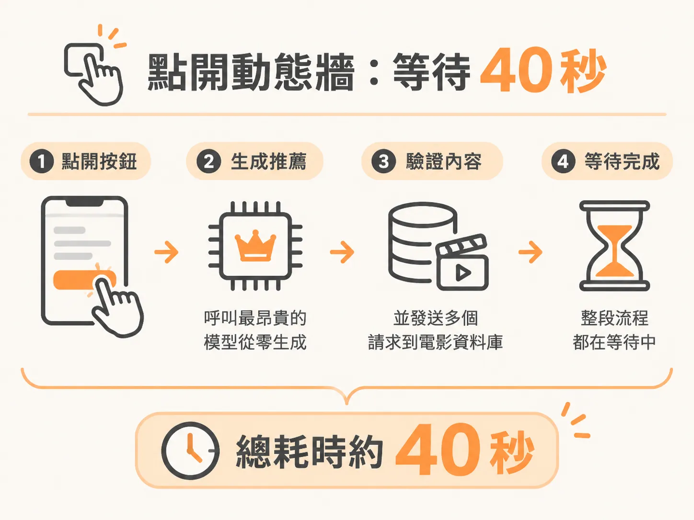
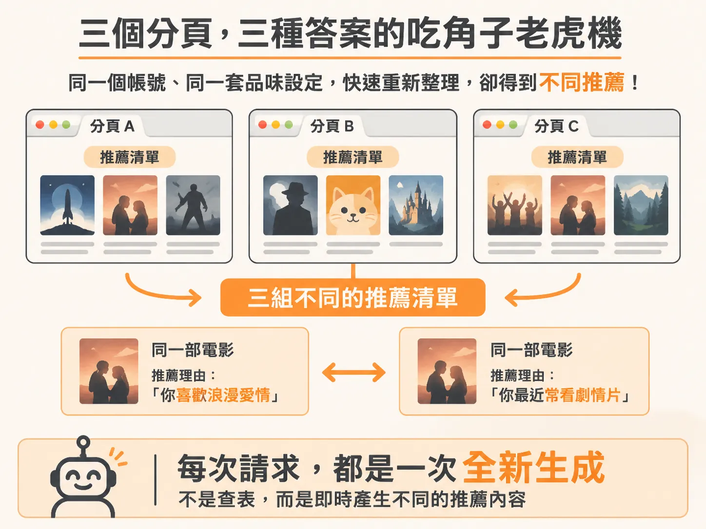
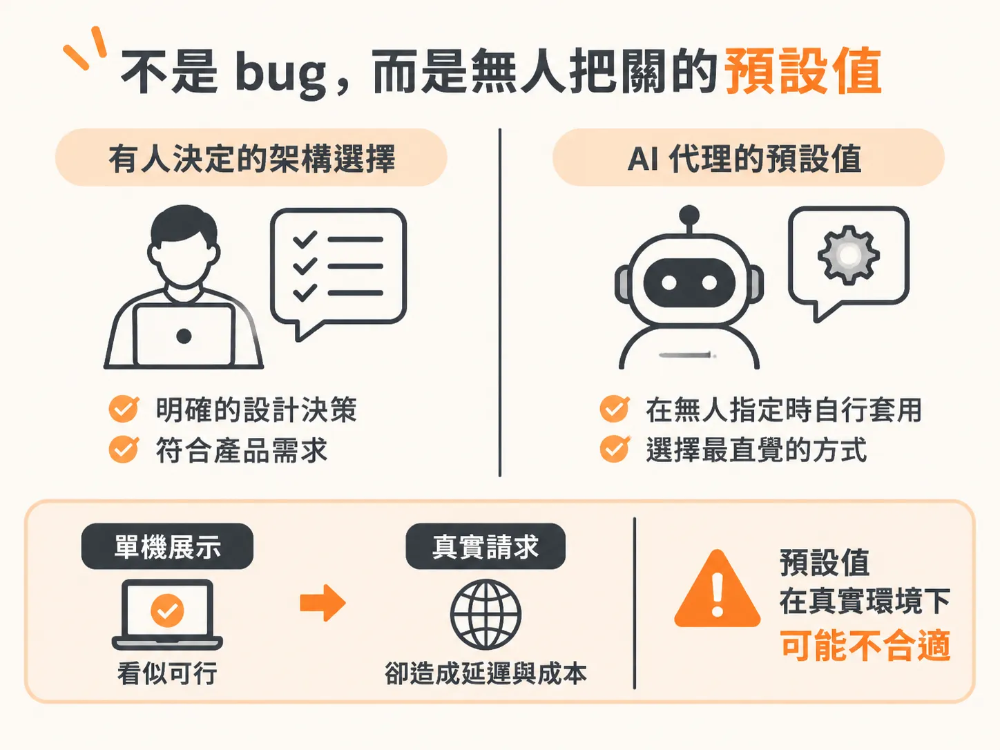

# 40 秒、35 美分與三個分頁：為什麼 Vibe App 一進真實環境就崩潰

許多人在看「vibe coding」——完全交給 AI 代理（agent）對話寫程式——的展示影片時，都會被那種幾分鐘內完成一個完整應用的速度吸引。展示影片裡的東西不是假的：應用程式確實能動，開發速度是真實的，那種能一口氣做出完整產品的吸引力也是真實的。

但展示影片最容易掩蓋的，是真實環境下的經濟成本與系統負載。在展示畫面裡，你看不到幾個使用者同時載入頁面時會發生什麼事，看不到每次載入要花多少錢，更看不到 AI 代理在核心程式碼裡替你做了什麼決定，導致系統一上線就變成每個月天價的帳單。

沒有人刻意做這些決定，事情就這樣發生了。只要真正把應用程式跑起來，問題就會立刻現形。

## 點開動態牆：等待 40 秒

以一個最基本的動作為例：使用者登入後，點開個人化的推薦動態牆（feed）。

在 vibe app 裡點下這個按鈕，畫面就停在「思考中」。這個思考過程非常漫長，足足要等 40 秒。

為什麼載入一個動態牆要 40 秒？因為這支應用程式把最昂貴的操作直接塞進了即時請求路徑（request path）。每一次有人打開動態牆，程式就會現場呼叫目前最昂貴的 Claude 3 Opus 模型，要求它從零開始憑空生成一套推薦清單；接著，它再對外部的 TMDB 電影資料庫 API 發出一整批平行請求，逐一驗證這些電影是否存在。

每一次頁面載入，這套繁瑣的流程就必須重跑一次。

## 按下重新整理：再燒 35 美分

好玩的地方在於重新整理。如果你重新整理頁面，它不會讀取快取，而是再次卡住 40 秒。

這不只是使用者體驗極差的問題，背後更是昂貴的財務代價。在每次頁面瀏覽的當下，調用最昂貴的模型從頭生成資料，單單載入一次動態牆，成本就大約是 35 美分。

如果一個使用者重新整理三次，一塊美金就沒了。這些隱藏的 token 消耗與 API 請求成本，在縮時錄影的展示畫面裡完全看不到，但在真實營運環境中，每一筆請求都會直接反映在雲端與模型供應商的帳單上。

## 三個分頁、三種答案的吃角子老虎機

更荒謬的是推薦內容的品質與一致性。這件事不需要任何複雜的測試工具，只要在瀏覽器打開三個分頁，都停留在動態牆，然後在幾秒鐘內依序重新整理。

這是同一個帳號、同一套使用者品味設定，在同一個時間點發出的請求。但三個分頁回傳的，卻是三種完全不同的推薦結果。

如果仔細看內容，甚至會發現同一部電影出現在兩個不同的分頁裡，底下附帶的推薦理由卻完全不同。兩個理由看起來都很合理、挑不出毛病，但這證明了一件事：系統背後根本沒有進行資料庫查詢（lookup），也沒有固定的答案可以回傳。

每一次開啟分頁，都是一次全新的生成；每一次全新的生成，都是 AI 的一次即時猜測。AI 必須為每一部分頁裡出現的電影重新思考一遍，這不僅消耗大量 token，也代表這款應用程式對使用者根本沒有穩定的看法——每一次你問它，它就現編一個新的想法給你看。

整座動態牆，本質上就是一台昂貴的吃角子老虎機。

## 不是 bug，而是無人把關的預設值

在展示影片裡，這些問題全都被漂亮的 UI 與流暢的展示節奏掩蓋過去了。

最關鍵的核心在於：這套架構裡發生的每一項錯誤，都不是工程師深思熟慮後的決定。沒有人規劃過「每次使用者進來都要花 35 美分呼叫 Opus」，也沒有人刻意設計「同一個使用者在不同分頁要拿到不同答案」。

這些全都是 AI 代理在缺乏人類工程師把關下，替開發者選擇的預設值。當開發者只要求「把推薦動態牆做出來」，AI 就用了最直覺、最容易在單機展示中跑通，卻在真實網路請求下完全不具備可行性的方式把它拼裝起來。

